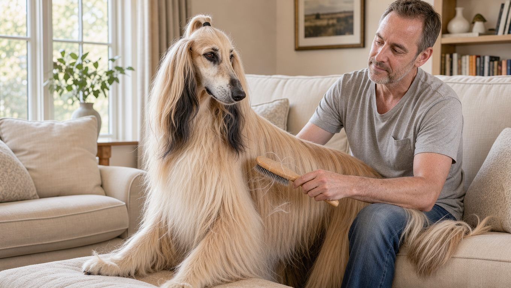

**2026년 10월 15일 기준** — 분양가 참고치는 시점과 분양처에 따라 달라질 수 있습니다.

## 빠른 답

- **성격 한 줄**: 조용하고 독립적인 견종입니다. 가족에게는 충실하지만 낯선 사람에게는 거리를 두고, 사냥 본능이 강합니다.
- **아파트에서 키울 수 있나?**: 법적 제한은 없고 짖음도 적은 편이라 아파트 생활 자체가 불가능하지는 않습니다. 다만 하루 한 시간 이상의 운동과 매주 몇 시간의 빗질을 꾸준히 감당할 수 있어야 합니다.
- **처음 키우는 사람에게 맞나?**: 훈련 반응이 느리고 자기 방식대로 움직이는 견종이라, 첫 반려견으로는 권하기 어렵습니다.

## 품종 개요

아프칸 하운드는 아프가니스탄 지역에서 사냥견으로 길러진 사이트하운드로, 가장 오래된 견종 가운데 하나로 꼽힙니다(AKC). PetMD가 인용한 미국 아프칸하운드클럽(AHCA) 관계자에 따르면, 아프칸 하운드는 독립적으로 사냥하는 견종으로 길러졌으며, 스스로 판단해 사냥감을 쫓았습니다. 유전적으로는 살루키가 가장 가까운 친척으로 분류됩니다(위키백과).

오늘날 아프칸 하운드의 기본적인 품종 형태는 20세기 초에 확립되기 시작했습니다. 1920년 발루치스탄에서 영국으로 들여온 벨머레이(Bell-Murray) 계열과 1925년 카불의 브리더가 영국으로 보낸 가즈니(Ghazni) 계열은 오늘날 아프칸 하운드의 품종 형성에 중요한 기반이 됐으며, 현재의 품종 표준은 1948년에 확정됐습니다(위키백과, AKC). 지금은 사냥보다 반려견과 도그쇼 무대에서 주로 만나는 견종입니다. 같은 하운드 계열의 다른 견종들과 비교하려면 [하운드 종류 가이드](/guides/hound-types/)를 참고하시면 좋습니다.

<dl>
  <dt>체고</dt>
  <dd>61~73cm입니다(위키백과). 영국 펫케어 브랜드 Lintbells의 품종 정보 페이지(YuMOVE)는 63~74cm로 조금 더 크게 제시합니다.</dd>
  <dt>체중</dt>
  <dd>20~27kg입니다(위키백과). 27~32kg으로 보는 자료도 있습니다(YuMOVE).</dd>
  <dt>수명</dt>
  <dd>일반적인 기대수명은 12~14년으로 안내됩니다(YuMOVE, 국내 분양 가이드). 영국 반려견 수명 조사(McMillan et al., 2024, 위키백과 인용)에서는 실제 평균이 11.1년으로 집계되기도 했습니다. 두 수치의 차이는 집계 기준에서 비롯됩니다. 안내서의 수치는 일반적인 기대수명 범위이며, 조사 결과는 실제 반려견을 대상으로 집계한 평균 수명입니다.</dd>
  <dt>운동량</dt>
  <dd>하루 최소 한 시간(PetMD)에 더해, 일주일에 한 번은 전력으로 달릴 수 있는 안전한 공간이 필요합니다(YuMOVE).</dd>
  <dt>털 관리 난이도</dt>
  <dd>높음 — 매주 몇 시간의 빗질과 1~2주 간격의 목욕이 권장됩니다(PetMD).</dd>
  <dt>초보 적합도</dt>
  <dd>낮음 — 훈련 수용도가 낮고 미용 부담이 커서 경험이 있는 보호자에게 어울립니다.</dd>
</dl>

## 외모와 털, 색상

아프칸 하운드의 상징은 발끝까지 흐르는 긴 실크 같은 털입니다. 머리 위에는 톱크놋(정수리의 긴 털)이 있으며, 등 중앙에는 짧은 털로 이루어진 새들(saddle) 부분이 있어 독특한 대비를 이룹니다. 엉덩이뼈가 높고 꼬리 끝이 고리 모양으로 말리는 것도 다른 견종과 구분되는 특징입니다(위키백과).

모색은 다양합니다. 파운, 골드, 브린들, 화이트, 레드, 크림, 블루, 그레이, 삼색 등이 대표적이며(위키백과), 미국애견협회(AKC) 기준에서는 모든 모색을 허용하지만, 머리 부분에 흰색 무늬가 있는 것은 바람직하지 않은 것으로 봅니다. 흰색 바탕에 붉은색이나 검은색 반점이 있는 파티 컬러는 AKC 기준에서는 감점 요소로 취급되지만, FCI 기준에서는 허용됩니다(위키백과).

긴 털은 미용으로 짧게 유지할 수도 있습니다. 전시용 풀코트가 아니라면 관리 부담이 크게 줄어듭니다(PetMD). 다만 털을 아주 짧게 유지하면 추위와 더위에 민감해질 수 있어(YuMOVE), 계절 관리가 함께 필요합니다.

## 성격과 기질

품종 표준은 아프칸 하운드를 "도도하고 위엄 있는(aloof and dignified)" 견종으로 묘사합니다(AKC). PetMD는 아프칸 하운드의 성격을 "내성적(reserved)"이라고 설명합니다. 가족과 깊은 유대감을 형성하고 특정 가족 구성원에게 특히 애착을 보이지만, 낯선 사람에게는 쉽게 마음을 열지 않는 편입니다. 짖음이 적어 조용한 편이지만, 사람을 상대할 때 자기 방식대로 다가가는 견종입니다.

강한 사냥 본능 역시 아프칸 하운드의 대표적인 기질 중 하나입니다. 작은 동물을 보면 쫓아가려는 본능이 강하므로, 목줄을 착용하거나 울타리가 설치된 안전한 공간에서 관리해야 합니다(PetMD). 사냥감을 발견하면 보호자의 부름에 반응하지 않을 수 있어 회수가 어렵다는 지적도 있습니다(YuMOVE). 어린아이나 작은 반려동물이 있는 집에서는 상호작용을 지켜봐야 합니다(PetMD).

훈련에서는 스스로 판단하는 성향이 그대로 드러납니다. 복종 훈련에 적극적으로 반응하지 않거나, 명령을 따르는 일을 중요하게 여기지 않는 듯한 모습을 보이기도 합니다. 소음이 심한 환경에서는 예민해져 짖음이 늘 수 있으므로, 조용하고 규칙적인 환경이 잘 어울립니다. 어린 시기부터 다양한 자극에 차근차근 노출시키는 사회화는 도움이 됩니다(YuMOVE).

## 한국에서 키울 때

국내에서는 아프칸 하운드의 공식 등록 현황이나 평균 분양가를 확인할 수 있는 통계 자료가 충분하지 않습니다. 국내 분양 가이드인 Animalnea에서는 참고 분양가로 200만~400만 원을 제시합니다. 다만 이는 단일 자료에서 제공하는 가격 범위이므로 실제 분양가와 차이가 있을 수 있습니다. 실제 분양가는 혈통과 건강 상태, 분양처에 따라 달라지며, 도그쇼 출전용 혈통은 일반적인 경우보다 가격이 높을 수 있습니다(Animalnea). 미국 기준으로는 새끼 가격이 2,000~3,000달러라는 안내도 있습니다(PetMD). 가격대와 관계없이, 분양 전에는 부모견의 건강 검진 이력을 확인하는 것이 기본입니다.

법적으로는 동물보호법상 맹견 5종(도사견, 아메리칸 핏불테리어, 아메리칸 스태퍼드셔 테리어, 스태퍼드셔 불테리어, 로트와일러와 그 잡종)에 포함되지 않아, 외출 시 입마개 착용 같은 맹견 관리 의무 대상이 아닙니다([입마개 가이드](/guides/dog-muzzle/) 참고). 아파트에서 키우는 것은 법적인 맹견 관리 의무와는 별개의 문제입니다. 견종 자체를 일률적으로 금지하는 법률은 없지만, 아파트 관리규약에 따라 반려견 사육에 제한이 있을 수 있으므로 입주 전에 확인하는 것이 좋습니다. 아파트에서 키우려면 짖음의 정도와 필요한 운동량, 털 관리에 드는 시간 등을 종합적으로 고려해야 합니다.

- **짖음** — 조용한 편이라 층간소음 부담이 상대적으로 적습니다(PetMD). 다만 스트레스가 쌓이거나 주변 자극에 민감하게 반응하면 짖는 횟수가 늘어날 수 있습니다(YuMOVE).
- **운동** — 하루 한 시간 이상의 운동이 필요하므로(PetMD), 아파트 단지 안을 짧게 산책하는 것만으로는 운동량이 부족할 수 있습니다.
- **털** — 털 빠짐 자체는 적은 편이지만(YuMOVE), 길어서 엉키기 쉬워 매주 몇 시간의 빗질이 필요합니다(PetMD).

**딱지허브 평가**: 높은 울타리와 전력 질주를 강조하는 조언(YuMOVE)은 주로 넓은 야외 공간에서의 운동을 전제로 합니다. 한국의 아파트 생활에서는 평일에는 한 시간 이상 산책을 하고, 주말에는 사람이 적은 시간대를 활용해 안전한 장소에서 충분히 달릴 수 있도록 해주는 방법도 있습니다. 매주 빗질에 충분한 시간을 할애하기 어렵다면 털을 짧게 다듬어 관리 부담을 줄이는 방법도 고려할 수 있습니다.

## 건강관리

아프칸 하운드는 병원 진료 시에도 특별히 주의해야 할 사항이 있습니다. 사이트하운드 계열은 마취제나 일부 약물에 민감하게 반응할 수 있습니다(YuMOVE). 따라서 중성화 수술이나 치과 치료 등 마취가 필요한 시술을 받기 전에는 담당 수의사에게 아프칸 하운드라는 견종 특성을 미리 알리는 것이 좋습니다. 깊은 흉곽 구조로 인해 위가 뒤틀리는 응급 질환인 위염전이 발생할 위험도 있습니다(PetMD, YuMOVE). 배가 갑자기 부풀어 오르거나 구토 없이 헛구역질을 반복하는 등의 증상이 나타나면 즉시 동물병원으로 가야 합니다.

다른 일부 견종에 비해 알려진 유전질환은 많지 않은 편입니다. 다만 고관절 이형성과 백내장이 간헐적으로 보고되고, 고관절 검사와 안과 검진이 권장됩니다(PetMD). 갑상선기능저하증과 흉강에 림프액이 고이는 유미흉도 이 견종에서 보고됩니다(YuMOVE). 분양 전 부모견의 검진 이력을 확인하는 것이 가장 현실적인 예방책입니다.

## 관리법

- **빗질** — 털이 엉키지 않도록 매주 몇 시간씩 꾸준히 빗질해 주는 것이 기본입니다(PetMD, YuMOVE). 톱크놋과 귀 뒤, 겨드랑이처럼 털이 쉽게 엉키는 부위부터 꼼꼼하게 빗어 줍니다. 빗 종류와 빗질 순서는 [강아지 빗·브러시 비교](/guides/dog-brush-comparison/)를 참고하시면 좋습니다.
- **목욕** — 1~2주 간격의 목욕과 드라이가 권장됩니다(PetMD). 귀 안쪽의 털과 피부 상태를 주기적으로 확인하고, 귀가 청결하게 유지되도록 관리해야 합니다(Animalnea).
- **운동** — 하루 한 시간 이상의 운동이 필요하며(PetMD), 일주일에 한 번은 안전한 공간에서 전력으로 달릴 기회를 제공하는 것이 좋습니다(YuMOVE). 사냥 본능이 강해 목줄 없이 산책하는 것은 위험할 수 있습니다. 따라서 울타리가 설치된 안전한 공간에서만 목줄을 풀어 주는 것이 좋습니다.
- **식사** — 위염전 예방을 위해 식사를 하루 두 번으로 나누고, 식사 전후 한 시간은 격한 활동을 피합니다(YuMOVE, PetMD).
- **훈련과 자극** — 복종 훈련은 짧고 보상 중심으로 진행하고, 냄새 맡기 놀이와 달리기 놀이로 정신적 자극을 채워 줍니다(YuMOVE).

## 자주 묻는 질문

### 아프칸 하운드와 아프간 하운드는 같은 견종인가요?

두 명칭 모두 동일한 견종을 가리키는 표현입니다. 영문 명칭인 Afghan Hound를 한글로 표기하는 과정에서 "아프간 하운드"와 "아프칸 하운드"가 함께 사용되며, 국내 검색 결과나 분양 관련 글에서도 두 명칭을 모두 찾아볼 수 있습니다. 이 글의 정보는 두 표기에 모두 해당합니다.

### 수명은 얼마나 되나요?

일반적으로 기대할 수 있는 수명은 12~14년입니다. 영국 반려견 수명 조사에서는 실제 평균 수명이 11.1년으로 집계되기도 했습니다(McMillan et al., 2024, 위키백과 인용). 앞의 수치는 일반적인 기대수명 범위이고, 뒤의 수치는 실제 반려견을 대상으로 조사한 평균 수명이므로 차이가 있습니다. 장수 여부는 유전과 관리에 따라 차이가 커서, 부모견의 건강 검진 이력을 확인하는 것이 도움이 됩니다.

### 아이가 있는 집에서도 키울 수 있나요?

키우는 것은 가능하지만, 가정환경과 반려견의 성향을 고려해 신중하게 결정해야 합니다. 어린아이가 있는 집과는 최적의 조합이 아니라는 안내가 있고(YuMOVE). 어린아이나 작은 반려동물과 함께 있을 때는 서로 안전하게 지낼 수 있도록 상호작용을 주의 깊게 살펴야 합니다. 분주하고 소란한 환경은 이 견종과 잘 맞지 않습니다.

### 긴 털을 짧게 밀어도 되나요?

가능합니다. 전시용 풀코트가 아니라면 털을 짧게 잘라 관리 부담을 줄일 수 있습니다. 다만 털을 아주 짧게 유지하면 추위와 더위에 민감해질 수 있어, 계절 변화에 맞춘 관리가 필요합니다.

### 목줄 없이 산책해도 되나요?

목줄 없이 산책하는 것은 권장하지 않습니다. 사냥 본능이 강해 목줄이나 울타리가 없으면 안전을 보장하기 어렵습니다. 목줄은 울타리가 설치된 안전한 공간에서만 풀어 주는 것이 좋습니다.

## 출처

- [Afghan Hound — PetMD](https://www.petmd.com/dog/breeds/afghan-hound) (성격·크기·운동·털 관리·질환·해외 가격)
- [Afghan Hound — AKC](https://www.akc.org/dog-breeds/afghan-hound/) (역사·품종 표준·모색)
- [Afghan Hound — YuMOVE](https://yumove.co.uk/pages/dog-breeds/afghan-hound) (영국 Lintbells 펫케어 브랜드의 품종 정보 페이지 — 수명·유전질환·마취 주의·운동·미용)
- [Afghan Hound — Wikipedia](https://en.wikipedia.org/wiki/Afghan_Hound) (역사·모색·체격·수명 조사)
- [아프간 하운드 분양 가이드 — Animalnea](http://dog.tomonews.kr/entry/%EC%95%84%ED%94%84%EA%B0%84-%ED%95%98%EC%9A%B4%EB%93%9C-%EB%B6%84%EC%96%91-%EA%B0%80%EC%9D%B4%EB%93%9C-%ED%8A%B9%EC%A7%95-%EC%97%AD%EC%82%AC-%EC%88%98%EB%AA%85-%EB%B0%8F-%EA%B0%80%EA%B2%A9-%EC%A0%95%EB%B3%B4) (국내 분양가 참고치·수명)

표지와 본문 이미지는 AI로 생성한 이미지입니다.
