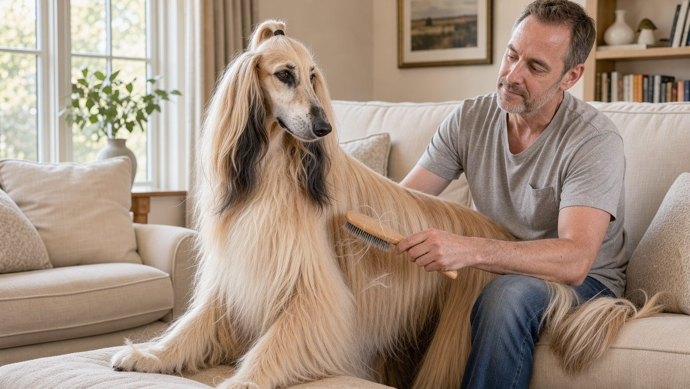

**2026년 10월 15일 기준** — 분양가 참고치는 시점과 분양처에 따라 달라질 수 있습니다.

## 빠른 답

- **성격 한 줄**: 조용하고 독립적인 견종입니다. 가족에게는 충실하지만 낯선 사람에게는 거리를 두고, 사냥 본능이 강합니다.
- **아파트에서 키울 수 있나?**: 법적 제한은 없고 짖음도 적은 편이라 아파트 생활 자체가 불가능하지는 않습니다. 다만 하루 한 시간 이상의 운동과 매주 몇 시간의 빗질을 꾸준히 감당할 수 있어야 합니다.
- **처음 키우는 사람에게 맞나?**: 훈련 반응이 느리고 자기 방식대로 움직이는 견종이라, 첫 반려견으로는 권하기 어렵습니다.

## 품종 개요

아프칸 하운드는 아프가니스탄 지역에서 사냥견으로 길러진 사이트하운드입니다. PetMD가 인용한 미국 아프칸하운드클럽(AHCA) 관계자의 설명에 따르면, 이들은 "독립적인 사냥꾼"으로 자라며 스스로 판단해 사냥에 나섰습니다. 유전적 뿌리가 오래된 기저 견종 가운데 하나로 분류되며, 살루키가 가장 가까운 친척입니다(위키백과).

근대 견종의 골격은 20세기 초에 만들어졌습니다. 1920년 발루치스탄에서 영국으로 들여온 벨머레이(Bell-Murray) 계열과 1925년 카불의 브리더가 영국으로 보낸 가즈니(Ghazni) 계열이 오늘날 아프칸 하운드의 두 기둥이 됐고, 현재의 표준은 1948년에 확정됐습니다(위키백과). 지금은 사냥보다 반려견과 도그쇼 무대에서 주로 만나는 견종입니다. 같은 하운드 계열의 다른 견종들과 비교하려면 [하운드 종류 가이드](/guides/hound-types/)를 참고하시면 좋습니다.

<dl>
  <dt>체고</dt>
  <dd>61~73cm입니다(위키백과). 영국 YuMOVE는 63~74cm로 조금 더 크게 제시합니다.</dd>
  <dt>체중</dt>
  <dd>20~27kg입니다(위키백과). YuMOVE는 27~32kg으로 봅니다.</dd>
  <dt>수명</dt>
  <dd>12~14년이 일반적입니다(YuMOVE, 국내 분양 가이드). 영국 조사에서는 평균 11.1년으로 집계되기도 했습니다(위키백과).</dd>
  <dt>운동량</dt>
  <dd>하루 최소 한 시간(PetMD)에 더해, 일주일에 한 번은 전력으로 달릴 수 있는 안전한 공간이 필요합니다(YuMOVE).</dd>
  <dt>털 관리 난이도</dt>
  <dd>높음 — 매주 몇 시간의 빗질과 1~2주 간격의 목욕이 권장됩니다(PetMD).</dd>
  <dt>초보 적합도</dt>
  <dd>낮음 — 훈련 수용도가 낮고 미용 부담이 커서 경험이 있는 보호자에게 어울립니다.</dd>
</dl>

## 외모와 털, 색상

아프칸 하운드의 상징은 발끝까지 흐르는 긴 실크 같은 털입니다. 머리 위에는 톱크놋(정수리 묶음)이 있고, 등 중앙에는 짧은 새들 부분이 있어 대비를 이룹니다. 엉덩이뼈가 높고 꼬리 끝이 고리 모양으로 말리는 것도 다른 견종과 구분되는 특징입니다(위키백과).

모색은 다양합니다. 파운, 골드, 브린들, 화이트, 레드, 크림, 블루, 그레이, 삼색 등이 대표적이며(위키백과), 미국 기준(AKC)으로는 모든 색이 허용되지만 머리 부분의 흰 무늬는 권장되지 않습니다. 흰 바탕에 붉은색이나 검은색 반점이 있는 파티 컬러는 AKC에서는 감점 요소이지만 FCI에서는 허용합니다(위키백과).

긴 털은 미용으로 짧게 유지할 수도 있습니다. 전시용 풀코트가 아니라면 관리 부담이 크게 줄어듭니다(PetMD). 다만 털을 아주 짧게 유지하면 추위와 더위에 민감해질 수 있어(YuMOVE), 계절 관리가 함께 필요합니다.

## 성격과 기질

품종 표준은 아프칸 하운드를 "도도하고 위엄 있는(aloof and dignified)" 견종으로 묘사합니다(AKC). PetMD는 성격을 "내성적(reserved)"이라는 한 단어로 요약하며, 가족 중 한 사람을 특별히 따르고 가족과 깊이 유대하는 대신 낯선 사람에게는 좀처럼 마음을 열지 않는다고 설명합니다. 짖음이 적어 조용한 편이지만, 사람을 상대할 때 자기 방식대로 다가가는 견종입니다.

사냥 본능은 성격의 큰 축입니다. 작은 동물을 보면 쫓아가려는 본능이 강해 목줄이나 울타리 안에서만 안전하게 관리할 수 있고(PetMD), 영국 안내 사이트 YuMOVE는 사냥감 앞에서 부르기 회수가 사실상 어렵다고 짚습니다. 어린아이나 작은 반려동물이 있는 집에서는 상호작용을 지켜봐야 합니다(PetMD).

훈련에서는 스스로 판단하는 성향이 그대로 드러납니다. YuMOVE는 아프칸 하운드가 복종 훈련을 "의미 없는 일"로 여기는 듯한 태도를 보일 수 있다고 설명합니다. 소음이 심한 환경에서는 예민해져 짖음이 늘 수 있으므로, 조용하고 규칙적인 환경이 잘 어울립니다(YuMOVE). 어린 시기부터 다양한 자극에 차근차근 노출시키는 사회화는 도움이 됩니다(YuMOVE).

## 한국에서 키울 때

국내에는 아프칸 하운드의 공식 등록 통계나 시세 집계가 마련되어 있지 않습니다. 국내 분양 가이드에서는 일반적으로 200만~400만 원 수준으로 안내하며, 혈통과 건강 상태, 분양처에 따라 달라지고 쇼용 혈통은 더 비쌀 수 있다고 설명합니다(Animalnea). 미국 기준으로는 새끼 가격이 2,000~3,000달러라는 안내도 있습니다(PetMD). 가격대와 관계없이, 분양 전에는 부모견의 건강 검진 이력을 확인하는 것이 기본입니다.

법적으로는 맹견 5종(도사, 핏불테리어, 애스타, 스태퍼드셔 불테리어, 로트와일러)에 포함되지 않아 입마개 의무 대상이 아니고, 아파트 양육을 제한하는 규정도 없습니다. 아파트에서 생활할 때는 짖음, 운동량, 털 관리라는 세 가지 요소를 고려해야 합니다.

- **짖음** — 조용한 편이라 층간소음 부담이 상대적으로 적습니다(PetMD). 다만 스트레스가 쌓이면 반응성 짖음이 늘 수 있습니다(YuMOVE).
- **운동** — 하루 한 시간 이상의 운동이 필요하므로(PetMD), 아파트 단지 안을 짧게 산책하는 것만으로는 운동량이 부족할 수 있습니다.
- **털** — 털 빠짐 자체는 적은 편이지만(YuMOVE), 길어서 엉키기 쉬워 매주 몇 시간의 빗질이 필요합니다(PetMD).

**딱지허브 평가**: YuMOVE가 강조하는 높은 울타리와 전력 질주는 주로 넓은 야외 공간에서의 운동을 전제로 합니다. 한국의 아파트 생활에서는 평일에 한 시간 이상 산책하고, 주말에는 사람이 적은 시간대에 안전한 장소에서 충분히 달리게 하는 방법을 고려할 수 있습니다. 빗질에 충분한 시간을 들이기 어렵다면 털을 짧게 다듬는 미용도 고려해 보시는 것이 좋습니다.

병원 진료와 관련해서도 알아 둘 점이 있습니다. 사이트하운드 계열은 마취와 일부 약물에 민감하게 반응할 수 있어(YuMOVE), 중성화 수술이나 치과 치료처럼 마취가 필요한 시술 전에는 담당 수의사에게 견종을 미리 알리는 것이 안전합니다. 깊은 흉곽 구조 탓에 위염전(위가 뒤틀리는 응급 상황) 위험도 있어(PetMD, YuMOVE), 배가 갑자기 부풀고 헛구역질이 멈추지 않는 증상이 보이면 바로 동물병원으로 가야 합니다(PetMD).

## 관리법

- **빗질** — 매주 몇 시간의 빗질이 기본입니다(PetMD, YuMOVE). 톱크놋과 귀 뒤, 겨드랑이처럼 엉키기 쉬운 부위를 먼저 풀어 줍니다. 빗 종류와 빗질 순서는 [강아지 빗·브러시 비교](/guides/dog-brush-comparison/)를 참고하시면 좋습니다.
- **목욕** — 1~2주 간격의 목욕과 드라이가 권장됩니다(PetMD). 귀 안쪽의 털과 귀 상태를 주기적으로 확인하고 청결하게 관리해야 합니다(Animalnea).
- **운동** — 하루 한 시간 이상(PetMD)과 일주일에 한 번 전력 질주(YuMOVE)가 원칙입니다. 사냥 본능이 강해 목줄 없이 산책하기 어려우므로, 울타리가 설치된 안전한 공간에서만 목줄을 풀어 주는 것이 좋습니다(PetMD, YuMOVE).
- **식사** — 위염전 예방을 위해 식사를 하루 두 번으로 나누고, 식사 전후 한 시간은 격한 활동을 피합니다(YuMOVE, PetMD).
- **훈련과 자극** — 복종 훈련은 짧고 보상 중심으로 진행하고, 냄새 맡기 놀이와 달리기 놀이로 정신적 자극을 채워 줍니다(YuMOVE).

## 자주 묻는 질문

### 아프칸 하운드와 아프간 하운드는 같은 견종인가요?

두 표기 모두 같은 견종을 가리킵니다. 영문 표기(Afghan Hound)를 옮기는 과정에서 "아프간 하운드"로 읽는 경우가 많아, 국내 검색과 분양 글에서는 두 표기가 섞여 쓰입니다. 이 글의 정보는 두 표기에 모두 해당합니다.

### 수명은 얼마나 되나요?

12~14년이 일반적입니다(YuMOVE, 국내 분양 가이드). 영국 조사에서는 평균 11.1년으로 집계되기도 했습니다(위키백과). 장수 여부는 유전과 관리에 따라 차이가 커서, 부모견의 건강 검진 이력을 확인하는 것이 도움이 됩니다.

### 아이가 있는 집에서도 키울 수 있나요?

가능은 하지만 신중하게 판단해야 합니다. YuMOVE는 어린아이가 있는 집과는 최적의 조합이 아니라고 안내하고, PetMD는 어린아이와 작은 반려동물 주변에서 상호작용을 지켜봐야 한다고 설명합니다. 분주하고 소란한 환경은 이 견종과 잘 맞지 않습니다(YuMOVE).

### 긴 털을 짧게 밀어도 되나요?

가능합니다. PetMD에 따르면 전시용 풀코트가 아니라면 털을 짧게 잘라 관리 부담을 줄일 수 있습니다. 다만 털을 아주 짧게 유지하면 추위와 더위에 민감해질 수 있어(YuMOVE), 계절 변화에 맞춘 관리가 필요합니다.

### 목줄 없이 산책해도 되나요?

권하기 어렵습니다. 사냥 본능이 강해 목줄이나 울타리가 없으면 안전을 보장하기 어렵습니다(PetMD). 울타리가 둘러쳐진 안전한 공간에서만 목줄을 풀어 주는 것이 좋습니다.

## 출처

- [Afghan Hound — PetMD](https://www.petmd.com/dog/breeds/afghan-hound) (성격·크기·운동·털 관리·질환·해외 가격)
- [Afghan Hound — AKC](https://www.akc.org/dog-breeds/afghan-hound/) (품종 표준의 성격 표현)
- [Afghan Hound — YuMOVE](https://yumove.co.uk/pages/dog-breeds/afghan-hound) (수명·유전질환·마취 주의·운동·미용)
- [Afghan Hound — Wikipedia](https://en.wikipedia.org/wiki/Afghan_Hound) (역사·모색·체격·수명 조사)
- [아프간 하운드 분양 가이드 — Animalnea](http://dog.tomonews.kr/entry/%EC%95%84%ED%94%84%EA%B0%84-%ED%95%98%EC%9A%B4%EB%93%9C-%EB%B6%84%EC%96%91-%EA%B0%80%EC%9D%B4%EB%93%9C-%ED%8A%B9%EC%A7%95-%EC%97%AD%EC%82%AC-%EC%88%98%EB%AA%85-%EB%B0%8F-%EA%B0%80%EA%B2%A9-%EC%A0%95%EB%B3%B4) (국내 분양가 참고치·수명)

표지와 본문 이미지는 AI로 생성한 이미지입니다.
