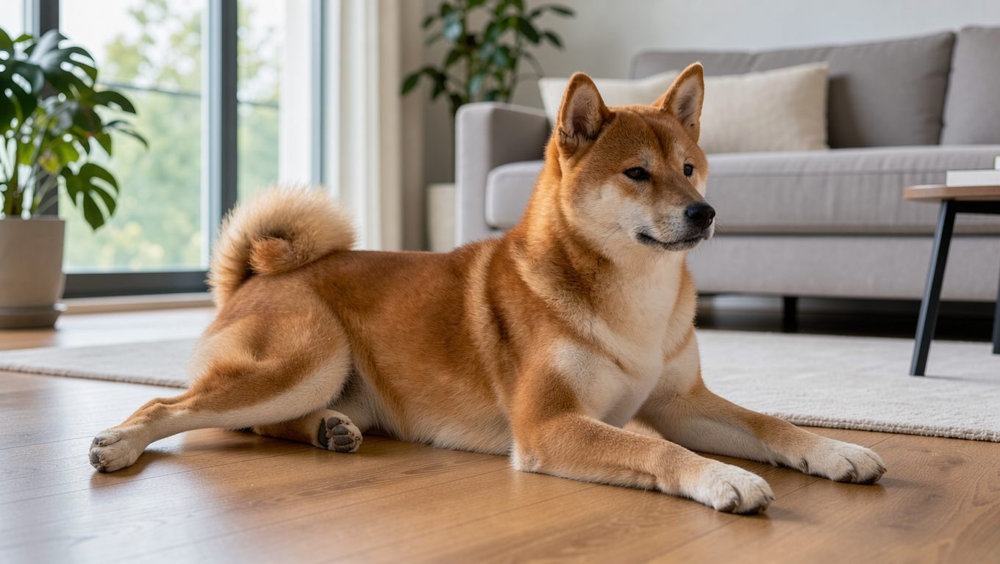

**2026년 11월 9일 기준** — 국내 양육비 정보는 이 날짜를 기준으로 합니다.

## 빠른 답

- **성격 한 줄**: 가족에게 충실하고 평소에는 조용하지만, 독립심과 경계심이 강해 대형견 양육 경험이 있는 보호자에게 맞습니다.
- **아파트에서 키울 수 있나요?**: 짖음이 적어 소음 부담은 비교적 작은 편입니다. 다만 매일 산책을 시키고 꾸준히 사회화할 수 있어야 현실적으로 양육할 수 있습니다.
- **처음 키우는 사람에게 맞나요?**: 고집이 세고 훈련 반응이 느린 편이라 처음 대형견을 키우는 보호자에게는 어렵습니다.

## 품종 개요

아키타는 일본 아키타현이 원산지인 대형견입니다. 역 앞에서 보호자를 기다린 것으로 알려진 하치코의 견종으로 유명하고, 일본에서는 천연기념물로 지정되어 보호받아 왔습니다. 근육질의 당당한 체형에 곰을 닮은 얼굴, 등 위로 말려 올라간 꼬리가 특징입니다. 같은 일본 원산 견종인 [시바견](/breeds/shiba-inu/)은 소형견인 반면, 아키타는 대형견으로 체급 차이가 큽니다.

혈통은 일본계 아키타견과 미국에서 대형화된 아메리칸 아키타, 두 계열로 나뉩니다. 미국의 견종 정보에서는 두 계열을 같은 견종으로 분류하며, 아메리칸 아키타가 일본계 아키타보다 체구가 조금 더 크다고 설명합니다(PetMD). 국내 반려견 정보 사이트인 펫집의 견종 페이지에서는 일본계 아키타와 아메리칸 아키타의 모색 범위가 서로 다르다고 설명합니다. 일본계 아키타는 붉은색과 참깨색 등이 대표적인 모색인 반면, 아메리칸 아키타는 검은 마스크와 파이볼드, 브린들 등 다양한 무늬가 허용됩니다(펫집).

<dl>
<dt>크기</dt><dd>대형</dd>
<dt>체중</dt><dd>32~59kg</dd>
<dt>체고</dt><dd>61~71cm(PetMD) — 아메리칸 아키타 기준</dd>
<dt>수명</dt><dd>10~14년(PetMD) 또는 10~13년(펫집)</dd>
<dt>운동량</dt><dd>하루 1시간 안팎 산책과 놀이</dd>
<dt>털 관리</dt><dd>평소 주 1~2회 빗질, 환모기에는 매일</dd>
<dt>초보 적합도</dt><dd>낮음</dd>
</dl>

## 성격과 기질

아키타는 가족에게 깊이 충성하고 보호 본능이 강한 견종입니다. 평소에는 침착하고 과묵하며 짖음이 적어 실내에서도 비교적 조용하게 지내는 편입니다(펫집). 낯선 사람에게는 처음에 거리를 두거나 불편해할 수 있습니다(PetMD).

독립심과 고집이 강해 보호자의 지시를 곧바로 따르지 않는 경우가 많습니다. 대형견을 키워 본 경험이 없는 보호자에게는 양육하기 까다로운 견종으로 소개됩니다(펫집, PetMD).

다른 개, 특히 동성견에게 경계심과 공격성을 보이기 쉽습니다(펫집). 다른 개와의 갈등 가능성을 고려하면 한 집에서 한 마리만 키우는 것이 더 적합할 수 있다는 설명도 있습니다(PetMD). 어릴 때부터 다양한 사람과 동물, 환경을 접하는 사회화가 중요합니다(펫집).

## 한국에서 키울 때

국내에서 아키타를 키우는 월 양육비는 20~40만 원 수준으로 제시됩니다. 아메리칸 아키타는 30~50만 원으로 조금 더 높습니다(펫집).

국내 분양가는 공개된 통계를 확인하지 못해 이 글에서는 수치를 제시하지 않습니다. 분양을 알아볼 때는 부모견의 고관절 검진과 눈 검진 이력을 확인하는 것이 좋습니다.

### 아파트 생활

아키타는 짖음이 적어 층간소음 부담이 비교적 작은 편입니다. 다만 대형견이라 매일 산책할 시간을 확보해야 하고, 경계심이 강해 산책길에서 사람과 다른 개를 만나는 연습이 필요합니다(펫집).

**딱지허브 평가**: 자료에서는 하루 한 시간 안팎의 산책을 권장합니다. 한국의 아파트 생활에서는 평일 저녁 산책과 주말 공원 활동을 병행하는 방식이 현실적입니다. 짖음에 따른 소음보다 충분한 운동량 확보와 꾸준한 사회화가 양육의 핵심입니다.

### 여름나기

두꺼운 이중모를 가진 대형견이라 한국의 습한 여름에는 더위 부담이 커질 수 있습니다. 한낮 산책을 피하고 이른 아침이나 해가 진 뒤로 시간을 옮기는 것이 좋습니다. 실내에서는 냉방과 환기로 온도를 낮게 유지해 주세요.

### 유전병

아키타에서 자주 보고되는 질환은 고관절 이형성증, 갑상선기능저하증, 눈꺼풀이 안쪽으로 말려 들어가는 안검내반, 진행성 망막위축, 위가 뒤틀리는 위확장과 염전 등입니다(PetMD, 펫집). 펫집에서 유전성 질환으로 명시한 질환은 진행성 망막위축뿐입니다.

## 관리법

### 운동

아키타는 하루 1시간 안팎의 산책과 놀이가 권장됩니다. 힘이 세고 경계심이 강하므로 리드줄을 확실히 통제하는 훈련을 어릴 때부터 함께 해야 합니다(펫집). 위확장과 염전을 예방하려면 식사 전후 한 시간은 격한 운동을 피하는 것이 좋습니다(PetMD).

대형견의 운동량을 견종별로 비교하려면 [대형견 10종 비교](/guides/large-dog-types/)를 참고해 주세요.

### 털 관리

짧고 촘촘한 이중모를 가지고 있어 평소에는 주 1~2회 빗질로 관리할 수 있습니다. 봄과 가을 환모기에는 빠진 속털을 매일 빗겨 주는 것이 좋습니다. 목욕은 월 1회 정도면 충분하고 체취가 적은 편입니다(펫집).

### 훈련과 사회화

독립심이 강하고 고집이 있어 훈련 반응이 빠르지 않은 편입니다. 어릴 때부터 다양한 사람과 동물, 환경에 노출하는 사회화가 특히 중요합니다(펫집).

## 자주 묻는 질문

### 아키타와 아메리칸 아키타는 다른 견종인가요?

일본계 아키타와 혈통을 공유하지만, 미국에서 체구가 커진 계열을 아메리칸 아키타라고 부릅니다. 미국 쪽 견종 정보는 두 계열을 같은 견종으로 보면서 아메리칸 쪽이 조금 더 크다고 설명합니다(PetMD).

### 하루에 얼마나 산책해야 하나요?

하루 1시간 안팎의 산책과 놀이가 기준입니다. 힘이 세므로 리드줄 통제 훈련을 함께 해 주세요. 식사 전후 한 시간은 격한 운동을 피하는 것이 좋습니다.

### 털 빠짐은 심한가요?

이중모라 봄과 가을 환모기에 털이 많이 빠집니다. 평소 주 1~2회, 환모기에는 매일 빗질해 주는 것이 좋습니다.

### 다른 개와 함께 키울 수 있나요?

동성견에게 공격성을 보이기 쉬우므로 다른 개와 함께 키우는 데 주의가 필요하며, 한 집에서 한 마리만 키우는 편이 더 적합할 수 있습니다(PetMD, 펫집). 여러 마리를 키운다면 어린 시기부터 함께 사회화하고, 식사와 휴식 공간을 나누어 주는 것이 좋습니다.

### 더위에 약한가요?

두꺼운 이중모로 더위에 부담을 받을 수 있습니다. 한낮 산책을 피하고, 실내 온도를 시원하게 유지해 주세요.

## 출처

- [Akita — PetMD](https://www.petmd.com/dog/breeds/akita) (체고·체중·수명, 호발 질환, 식사 전후 운동 주의)
- [아키타 — 펫집](https://petjip.com/dog/breeds/akita/) (국내 월 양육비, 성격, 운동량, 털 관리)
- [아메리칸 아키타 — 펫집](https://petjip.com/dog/breeds/american-akita/) (두 계열의 차이, 목욕 주기, 월 비용)

표지 이미지는 AI로 생성했습니다.
