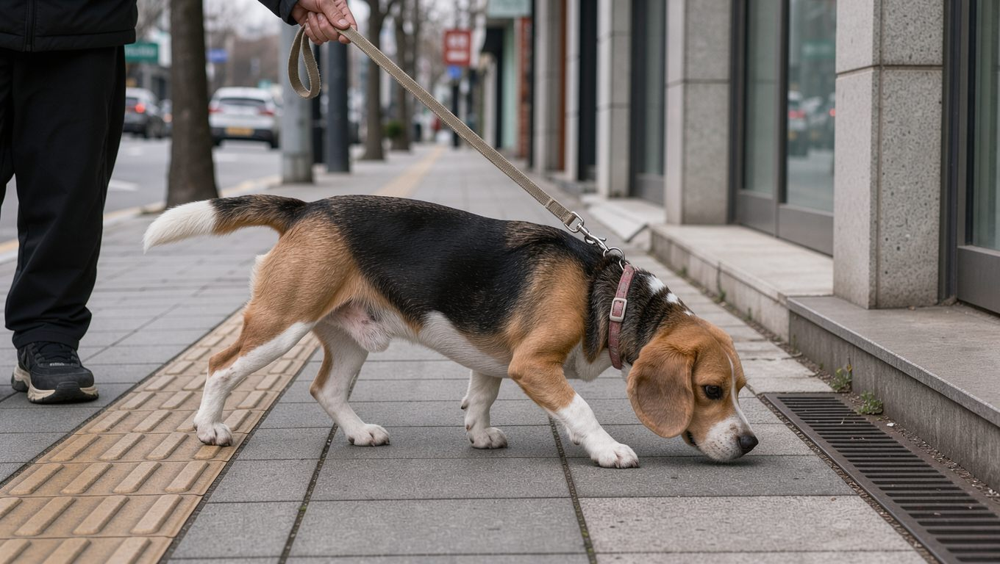

**2026년 11월 2일 기준** — 조달 단가와 분양 관련 정보는 이 날짜를 기준으로 확인한 자료입니다.

## 빠른 답

- **성격 한 줄**: 비글은 사람을 좋아하고 활동량이 많은 사냥개입니다. 냄새를 쫓기 시작하면 주변을 잘 살피지 않습니다.
- **아파트에서 키울 수 있나?**: 키울 수 있습니다. 다만 짖음과 하울링이 층간소음으로 이어질 수 있으며, 하루 한 시간 이상의 운동과 충분한 후각 활동이 필요합니다.
- **처음 키우는 사람에게 맞나?**: 성격은 순합니다. 다만 냄새 추적 본능과 강한 식탐을 다스리는 훈련이 필요해, 초보 보호자라면 산책 줄과 훈련 계획을 미리 준비하는 편이 좋습니다.

## 사냥개에서 반려견으로

비글은 사냥개입니다. 미국 켄넬 클럽(AKC)은 비글을 뛰어난 사냥개이자 충성스러운 반려견으로 소개하며, 무리를 지어 사냥하도록 개량된 견종이라고 설명합니다. 동료와 함께 있는 것을 즐기고, 표정은 애원하는 눈빛이며 성격은 쾌활하고 익살스럽다고 표현합니다. 이름의 유래는 확실하지 않고, 프랑스어 'begueule(열린 목구멍)'에서 왔다는 설이 있습니다.

비글은 체고를 기준으로 두 체급으로 나뉩니다. 작은 체급은 체고 33cm 이하에 체중 9kg 이하, 큰 체급은 체고 33~38cm에 체중 9~13.6kg입니다. 사냥개로서 코를 쓰는 일이 본능에 가깝고, 이 특징이 반려견 생활의 장점과 단점을 함께 만듭니다.

<dl>
<dt>크기</dt>
<dd>중형견 — 두 체급(체고 33cm 이하 / 33~38cm)</dd>
<dt>체중</dt>
<dd>약 9~13.6kg</dd>
<dt>수명</dt>
<dd>10~15년</dd>
<dt>운동량</dt>
<dd>하루 최소 1시간에 후각 활동을 더합니다</dd>
<dt>털 관리</dt>
<dd>주 1회 빗질, 4주 간격 목욕</dd>
<dt>초보 적합도</dt>
<dd>성격은 순하지만 냄새와 식탐 관리가 필요합니다</dd>
</dl>

## 성격과 기질

비글은 사교적인 견종입니다. 무리 사냥개로 개량되어 동료와 사람 곁에 있는 것을 좋아하고, 아이들이나 다른 반려동물과도 대체로 잘 지냅니다. 활동량이 적어 무릎 위에서 조용히 지내는 견종이 아니라, 충분히 움직이고 냄새를 맡을 기회가 있어야 만족하는 견종입니다.

- **사교성**: 사람과 무리를 좋아해, 함께 있는 시간이 많은 환경에서 만족도가 높습니다.
- **발성**: 짖음, 길게 끄는 사냥개 울음(베이), 하울링이 자연스러운 행동입니다.
- **후각**: 냄새에 대한 집중이 강해 호출 반응이 늦어질 수 있습니다.
- **식탐**: 식욕과 음식에 대한 반응이 강해 비만 위험이 있습니다.

## 코를 앞세운 산책

비글은 냄새에 몰입하는 견종입니다. 관심 가는 냄새를 찾으면 보호자의 부름을 놓치기 쉬워, 목줄을 놓거나 울타리 없이 두는 관리는 피해야 합니다. PetMD는 감독과 목줄, 안전한 울타리를 함께 안내합니다. 산책 중에는 냄새를 맡을 시간을 충분히 주되, 다른 개나 차도에는 주의를 기울여야 합니다.

냄새를 맡는 시간은 운동이자 정신적 자극입니다. 산책 코스에 풀밭이나 조용한 길을 섞고, 집에서는 [집에서 하는 노즈워크](/guides/home-nosework/)처럼 간식을 숨겨 찾게 하는 놀이를 더하면 도움이 됩니다. 산책 기본 규칙과 나이별 기준은 [강아지 산책 가이드](/guides/dog-walking/)에서 확인할 수 있습니다.

## 털과 색상

비글의 털은 짧은 이중모입니다. 털은 연중 적당히 빠지고 봄과 가을에는 더 심해집니다. 주 1회 빗질이 기본이며, 목욕은 4주 간격이 기준으로 제시됩니다.

비글은 사냥개 계열의 털색을 폭넓게 인정하는 견종입니다. 가장 흔한 것은 검정·갈색·흰색이 섞인 트라이컬러이고, 레드 앤 화이트나 레몬 앤 화이트도 볼 수 있습니다. 털이 짧아 미용 부담은 크지 않지만, 이중모라 털 빠짐 자체는 일상적으로 이어집니다.

## 한국에서 키울 때

국내 비글 분양가는 공개된 통계가 거의 없어 수치를 단정하기 어렵습니다. 대신 실험용 개체의 조달 기록은 확인됩니다. 조달경제신문이 나라장터 공공조달 기록을 분석한 결과, 2023년부터 2026년까지 실험용 비글 77마리가 2억 4,320만 원 규모로 조달됐습니다. 마리당 단가는 189만~286만 원이었습니다. 이 단가는 반려견 분양가가 아니라는 점을 구분해야 합니다.

아파트 생활에서는 짖음과 하울링이 가장 큰 변수입니다. 하울링은 이 견종의 자연스러운 행동입니다. 운동량도 적지 않아, 산책 시간을 꾸준히 확보하기 어려운 생활이라면 다른 견종도 함께 검토하는 편이 좋습니다.

여름에는 짧은 털 덕분에 더위에 비교적 잘 적응하는 편입니다. 다만 습한 날씨에는 귀 안에도 습기가 차기 쉬우므로 귀 상태를 자주 확인하고 관리하는 것이 좋습니다.

## 건강과 관리

### 자주 보는 건강 문제

PetMD가 정리한 비글의 호발 질환은 다음과 같습니다.

<dl>
<dt>귀 감염</dt>
<dd>귀가 늘어져 있어 내부에 습기가 차기 쉽습니다. 귀 감염의 약 50%가 알레르기와 관련된다는 안내도 있습니다.</dd>
<dt>비만</dt>
<dd>식탐이 강해 비만 위험이 높습니다. 계량 급식과 간식 관리가 기본입니다.</dd>
<dt>제3안검 탈출(체리 아이)</dt>
<dd>대부분 수술이 필요한 것으로 안내됩니다.</dd>
<dt>간질</dt>
<dd>1~5세에 시작하는 경우가 많습니다.</dd>
<dt>갑상선 기능 저하증</dt>
<dd>체중 증가와 무기력이 나타날 수 있습니다.</dd>
<dt>그 밖에</dt>
<dd>알레르기, 림버 테일(꼬리 근육 통증), 추간판 탈출증, 고관절 형성부전, 슬개골 탈구가 가능성으로 언급됩니다.</dd>
</dl>

### 먹이와 체중

식탐이 강한 견종이라 자유 급식보다 계량 급식이 안전합니다. 성견은 하루 2~3회, 어린 시기는 4회까지 나눠 급여하고, 간식은 하루 섭취 열량의 10%를 넘기지 않습니다. 빠르게 먹는 개체에는 슬로 피더가 도움이 되고, 사료는 AAFCO 기준을 충족한 제품을 고르는 것이 좋습니다.

### 운동과 훈련

PetMD는 비글에게 하루 최소 1시간의 운동과 정신적 자극, 후각을 쓰는 활동을 함께 권합니다. 사회화는 어린 시기부터 시작하고, 보상을 활용한 긍정 강화 방식으로 훈련하는 것이 효과적입니다. 음식 보상이 잘 먹히지만 집중 시간이 짧을 수 있어 짧게 여러 번 나누는 편이 좋습니다.

**딱지허브 평가**: PetMD가 제시한 하루 한 시간은 최소 기준입니다. 한국 아파트 생활에서는 이 시간을 한 번에 채우기 어려울 수 있으니, 평일에는 30분 산책 두 번과 실내 코놀이로 나누고 주말에 공원에서 길게 걷는 방식이 현실적입니다. 운동이 부족하면 짖음과 파괴 행동으로 이어질 수 있으니 후각 활동으로 보완해 주세요.

## 자주 묻는 질문

### 비글은 초보자가 키우기 어렵나요?

성격 자체는 순하고 사람을 잘 따릅니다. 다만 냄새 추적 본능과 식탐이 강해 산책 줄 관리와 식사량 관리가 어려울 수 있습니다. 사회화와 기본 훈련을 어린 시기부터 시작하면 난이도는 크게 낮아집니다.

### 비글은 왜 짖음이 많나요?

사냥개로 무리와 함께 움직이도록 개량된 견종이라 짖음과 하울링이 자연스러운 행동입니다. 지루함이나 운동 부족이 짖음을 늘릴 수 있어, 산책과 후각 활동을 충분히 해 주는 것이 도움이 됩니다.

### 비글은 아파트에서 키울 수 있나요?

가능하지만 소음과 운동량을 먼저 따져야 합니다. 하울링이 층간소음으로 이어질 수 있고 하루 운동량도 적지 않습니다. 이웃과의 소음 문제를 미리 점검하고 실내 후각 활동을 준비하면 적응에 도움이 됩니다.

### 비글 털은 많이 빠지나요?

짧은 이중모라 관리 부담은 크지 않습니다. 그래도 연중 털이 빠지고 봄과 가을에는 양이 늘어납니다. 주 1회 빗질과 4주 간격 목욕이 기본이며, 목욕만으로 털 빠짐 자체를 줄이기는 어렵습니다.

### 비글의 단점은 무엇인가요?

냄새를 쫓는 본능, 짖음과 하울링, 강한 식탐이 대표적입니다. 운동과 후각 활동이 부족하면 지루함이 쌓여 짖음이나 파괴 행동으로 나타날 수 있습니다. 성격이 나쁘다기보다 본능을 채워 주지 못할 때 생기는 문제입니다.

## 출처

- [Beagle — PetMD](https://www.petmd.com/dog/breeds/beagle) (체고·체중·수명·운동량·털 관리·호발 질환)
- [Beagle — American Kennel Club](https://www.akc.org/dog-breeds/beagle/) (사냥개 기원·성격)
- [나라장터서 거래되는 비운의 실험용 개는? — 조달경제신문](https://www.jodaleconomy.com/news/articleView.html?idxno=3317) (실험용 비글 조달 규모와 마리당 단가)

*표지와 본문 이미지는 AI로 생성한 이미지입니다.*
