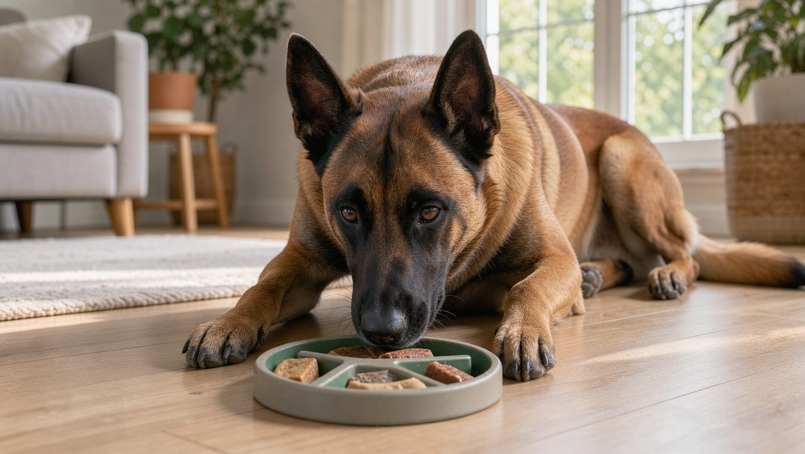

**2026년 10월 13일 기준**

## 빠른 답

- **하루 몇 시간 운동해야 하나?**: 성견 기준 강한 활동 1시간 30분~2시간에 두뇌 작업 30분 이상을 더하는 것이 Petful·PetsRadar의 권고다. PetMD는 보호자와 함께하는 운동을 하루 40분 이상 하도록 권장한다.

  **딱지허브 평가**: Petful·PetsRadar가 권하는 하루 1시간 30분~2시간의 고강도 운동은 주당 12~17시간에 해당합니다. 이 운동량을 매일 그대로 채우는 보호자는 사실상 없습니다. 아파트에서 생활한다면 평일에는 1시간 안팎 산책에 노즈워크·훈련 10~20분을 더하고, 주말에는 공원에서 충분히 뛰게 하는 방식으로 운동량을 조절할 수 있습니다. 정해진 운동 시간을 채우는 것보다 짖음이나 물건을 파괴하는 행동 등 운동 부족 신호가 나타나는지 살펴보는 것이 더 중요합니다.
- **산책만으로 충분할까?**: 아니다. 이 견종에게는 심박수를 높이는 신체 활동과 후각 활동·훈련을 통한 정신적 자극이 함께 필요하다. 단순히 걷는 것만으로는 각 자료에서 권장하는 운동량을 충족하기 어렵다.
- **아파트에서 키울 수 있나?**: 조건부다. 하루 두 번 충분한 운동 시간을 확보하는 동시에 정신적 자극을 위한 활동도 별도로 제공할 수 있어야 한다.

## 출처마다 다른 운동량 기준

벨지안 말리노이즈의 기질과 한국 실정 전반은 [벨지안 말리노이즈 허브](/breeds/belgian-malinois/)에서 다뤘다. 이번 글에서는 자료마다 다르게 제시하는 운동량 기준을 비교한다. 관련 자료에서 제시하는 기준은 크게 세 가지로 나뉜다.

- **PetMD — 하루 40분 이상**: 보호자와 함께 운동해야 한다는 조건이 붙는다. 강한 유산소 운동의 예로 아침 5마일(약 8km) 달리기를 든다.
- **Petful — 고강도 유산소 90분 이상 + 두뇌 30~60분**: 걷기는 배변과 긴장 완화를 위한 시간으로 분류한다. 심박수가 높아진 상태를 45~60분간 유지하는 활동만 운동 시간으로 인정하며, 운동과 정신적 활동을 합쳐 일주일에 총 12~17시간을 할애하도록 권장한다.
- **PetsRadar — 하루 약 2시간, 3회 분할**: 하루 최소 2시간을 강도 높은 신체 활동에 할애하도록 권장한다. 몰아서가 아니라 세 번으로 쪼개고, 매 분을 알차게 쓰라고 덧붙인다.

이처럼 권장 운동량은 자료마다 다르다. 단순히 운동 시간만 비교하기보다 어떤 활동을 운동으로 인정하는지, 어느 정도의 강도를 요구하는지도 함께 살펴봐야 한다. 신체 활동 시간만으로 말리노이즈에게 필요한 활동량을 판단하기는 어렵다. 운동 시간과 별개로 훈련, 후각 활동 같은 정신적 자극도 함께 고려해야 한다.

## 달리기만으로는 채워지지 않는다

말리노이즈에게 필요한 것은 신체 활동뿐만이 아니다. Petful은 정신적 활동이 신체 운동을 대신할 수 없으며, 두 가지를 반드시 병행해야 한다고 강조한다. 5~15분 복종 드릴, 냄새 찾기, 트릭 훈련, 퍼즐 급여기가 구체적인 예다.

집에서 곧바로 쓸 수 있는 것은 냄새 작업이다. 이 견종은 경찰의 체취 증거견이나 탐지견으로 활약할 만큼 후각을 활용하는 능력이 뛰어나다. 노즈워크는 말리노이즈에게 단순한 놀이를 넘어 일하는 것과 같은 자극을 제공한다. 준비물과 난이도 단계는 [집에서 하는 노즈워크](/guides/home-nosework/)에 정리했다.

운동이 모자라면 행동으로 티가 난다.

- 가구·벽·신발을 물어뜯는다
- 사소한 자극에도 짖는다
- 밤에 서성이며 안정하지 못한다
- 탈출을 시도한다

Petful은 이러한 신호가 두 가지 이상 나타나면 운동량이 부족한 것은 아닌지 살펴보라고 안내한다. 파괴 행동이 나타난다면 훈련 문제를 살펴보기에 앞서 활동량이 충분한지부터 점검하는 것이 좋다.

## 나이에 따라 달라지는 기준

- **퍼피 — 18개월까지**: 한 번에 월령에 5분을 곱한 시간만큼, 하루 두 번 운동하는 것이 기준이다. 8주는 10분씩, 6개월은 30분씩, 12개월은 60분씩 두 번으로 늘린다(Petful). 포장도로 조깅, 높은 점프, 자전거 동반 달리기는 이 시기까지 미룬다.
- **성견**: 고강도 90분~2시간에 두뇌 30분 이상.
- **시니어**: 수명이 10~14년인 견종이다(PetMD). 운동 기록을 늘리는 데 집중하기보다 관절 상태를 살피면서 적절한 운동량을 유지하도록 조정한다.

## 아파트·도시에서 채우는 법

Petful은 아파트에서도 말리노이즈를 키울 수 있지만, 상당한 어려움이 따른다고 설명한다. 하루 두 번의 60분 구조화 세션과 훈련 클럽 참여가 조건이다. 나아가 아파트에서 키우던 말리노이즈의 상당수가 12~18개월 안에 파양된다고 언급한다. 다소 강한 표현이지만, 그만큼 충분한 운동 환경을 마련하는 것이 중요하다는 의미다.

한국 주거 환경에서 만들 수 있는 형태는 이렇다.

- **이른 아침**: 심박이 오르는 구간을 섞은 60분 안팎의 달리기·빠른 걸음
- **저녁**: 공놀이·복종 드릴 20~30분
- **자기 전**: 노즈워크·트릭 10~15분

폭염이나 한파로 야외 운동이 어려운 날에는 저녁 운동을 실내 훈련으로 대체한다. 한낮 운동과 뜨거운 바닥은 피한다. 계단 오르내리기와 높은 점프는 관절 부담이 커서 어린 개체에게는 시키지 않는다.

## 자주 묻는 질문

### 말리노이즈는 하루 몇 시간 운동시켜야 하나요?

성견 기준으로 고강도 운동 1시간 30분~2시간과 두뇌 작업 30분 이상을 권하는 자료가 많습니다(Petful·PetsRadar). PetMD는 보호자와 함께하는 하루 40분 이상을 최소선으로 제시합니다. 처음에는 하루 40분을 기준으로 시작하되, 반려견의 체력과 상태에 따라 운동량을 점차 늘려 주세요.

### 산책만 시키면 안 되나요?

운동량이 채워지지 않습니다. Petful은 목줄 산책을 배변과 긴장 완화를 위한 시간으로 분류하며, 이와 별도로 심박수를 높이는 유산소 운동과 정신적 활동을 병행하도록 권장합니다. 단순히 걷는 시간을 늘리기보다 빠르게 걷는 구간을 추가하고 후각 활동을 병행하는 것이 효과적입니다.

### 아파트에서도 운동량을 채울 수 있을까요?

가능은 하지만 조건이 붙습니다. Petful이 드는 조건은 하루 두 번의 60분 세션과 훈련 클럽 참여입니다. 이러한 조건을 충족하지 못하면 문제 행동이 나타날 가능성이 높다고 설명합니다. 새벽이나 야간에 충분한 운동 시간을 확보할 수 있는지부터 확인해 보시기 바랍니다.

### 새끼는 언제부터 얼마나 운동시켜야 하나요?

한 번에 월령에 5분을 곱한 시간만큼, 하루 두 번 운동하는 것이 기준입니다. 8주에 10분씩 두 번, 6개월에 30분씩 두 번으로 늘립니다. 포장도로 조깅과 높은 점프는 18개월까지 피합니다.

### 운동이 부족하면 어떤 증상이 나타나나요?

가구를 물어뜯거나 사소한 자극에도 짖고, 밤에 서성이며 안정하지 못하는 것이 대표적입니다(Petful). 이러한 신호가 두 가지 이상 나타난다면 활동량이 충분한지부터 점검해 보시기 바랍니다.

## 출처

- [Belgian Malinois Training and Exercise Guide — Petful](https://www.petful.com/dog-breeds/belgian-malinois-exercise/) (고강도 유산소 90분·두뇌 30~60분·주간 총 투자 12~17시간, 퍼피 월령 규칙, 아파트 조건, 운동 부족 신호)
- [Belgian Malinois breed profile — PetsRadar](https://www.petsradar.com/features/belgian-malinois-breed-profile) (강한 활동 하루 최소 2시간·3회 분할 권장)
- [Belgian Malinois Dog Breed Health and Care — PetMD](https://www.petmd.com/dog/breeds/belgian-malinois) (하루 40분 이상 최소선, 수명)
- 표지 이미지: AI 생성
