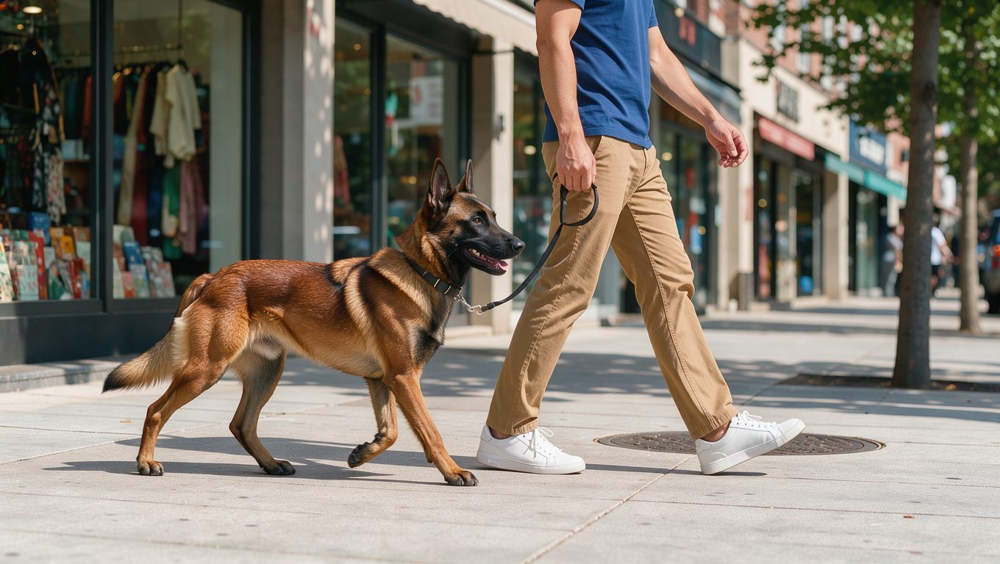

**2026년 10월 28일 기준**

## 빠른 답

**말리노이즈 수명은 몇 년인가요?** PetMD와 Great Pet Care 두 곳 모두 10~14년으로 제시합니다.

**크기는 어느 정도인가요?** 체고 56~66cm, 체중 18~36kg입니다. 수컷과 암컷의 차이는 아래에서 숫자로 정리합니다.

## 수명 10~14년 — 두 출처가 동일한 범위를 제시합니다

벨지안 말리노이즈의 수명으로 해외 수의학 매체 두 곳이 같은 범위를 제시합니다.

<ul>
<li><strong>PetMD</strong>: 10~14년</li>
<li><strong>Great Pet Care</strong>: 10~14년</li>
</ul>

두 출처가 동일한 범위를 제시하므로, 말리노이즈의 기대 수명은 10~14년으로 볼 수 있습니다. 수명에 영향을 주는 요소는 매체들이 꼽는 관리 항목에서 찾을 수 있습니다. PetMD는 책임감 있는 브리더의 번식이 건강에 영향을 준다고 짚습니다. Great Pet Care는 고관절 이형성과 팔꿈치 이형성, 진행성 망막 위축(PRA)을 이 견종의 주요 건강 문제로 듭니다. 이러한 질환은 삶의 질에 영향을 줄 수 있으며, 건강 상태에 따라 기대 수명에도 영향을 미칠 수 있습니다.

## 크기 — 수컷과 암컷의 체격 차이가 큽니다

PetMD가 제시한 성별 수치입니다.

<dl>
<dt>수컷</dt>
<dd>체고 24~26인치(약 61~66cm), 체중 60~80파운드(약 27~36kg)</dd>
<dt>암컷</dt>
<dd>체고 22~24인치(약 56~61cm), 체중 40~60파운드(약 18~27kg)</dd>
</dl>

Great Pet Care는 전체 범위를 체고 22~26인치(56~66cm), 체중 40~80파운드(18~36kg)로 제시합니다. 같은 견종이라도 수컷의 최대 체중은 36kg, 암컷의 최소 체중은 18kg으로 두 배 차이가 납니다.

체고는 저먼 셰퍼드와 비슷하지만 체중은 상대적으로 가볍습니다. PetMD는 벨지안 말리노이즈 40~80파운드와 저먼 셰퍼드 50~90파운드를 비교하며 두 견종의 키가 비슷하다고 설명합니다. 두 대형 작업견을 구별할 때는 체고뿐 아니라 체중에서도 차이가 난다는 점을 기억해 두시면 좋습니다.

## 성장기와 체격 편차

PetMD는 벨지안 말리노이즈 퍼피가 빨리 자라고 칼로리 요구량이 계속 바뀐다고 설명합니다. 성장이 빠른 만큼 같은 표준 범위 안에서도 개체의 실제 체격은 차이가 날 수 있습니다. 표준 범위만 보더라도 체고는 10cm, 체중은 18kg까지 차이가 나기 때문입니다.

국내에서는 말리노이즈의 수명과 크기에 관한 통계 자료를 찾기 어렵습니다. 국제적으로 제시된 표준 수치를 참고하되, 실제 체격은 부모견의 체격과 성장기의 영양 상태 등에 따라 달라질 수 있습니다.

## 한국 생활에서 체감되는 크기

체고 61~66cm는 숫자만으로는 실감하기 어렵지만, 엘리베이터나 계단, 차량 뒷좌석에서는 대형견의 체격을 확실히 느낄 수 있는 크기입니다. 체중이 27~36kg인 수컷과 산책할 때는 개가 목줄을 당기는 힘에 대비해야 합니다.

아파트 생활에서 중요한 것은 체격 자체보다 넘치는 에너지를 어떻게 해소해 주느냐입니다. 벨지안 말리노이즈는 많은 운동량이 필요한 작업견입니다. 자세한 운동 기준은 [말리노이즈 운동량 글](/breeds/belgian-malinois-exercise/)에서 확인할 수 있습니다. 적정 체중을 유지하고 있는지 확인하려면 [강아지 적정 체중 계산기](/tools/dog-ideal-weight/)를 활용해 현재 체중을 점검해 보시길 권합니다.

**딱지허브 평가**: 체고가 61~66cm인 말리노이즈는 국내 아파트 생활에서 공간이 좁게 느껴지는 순간이 생길 수 있습니다. 다만 함께 생활하기에 편안한 환경을 만드는 데는 체격뿐 아니라 매일 산책하고 실내 활동을 통해 에너지를 충분히 해소해 주는 것이 중요합니다.

## FAQ

### 말리노이즈 수명은 몇 년인가요?

벨지안 말리노이즈 수명은 10~14년입니다. 기대 수명은 평균값일 뿐이라, 개체의 건강 상태에 따라 달라질 수 있습니다.

### 말리노이즈는 대형견인가요?

벨지안 말리노이즈 체중은 18~36kg입니다. 수컷(27~36kg)은 대형견에 해당하는 체중대이며, 암컷(18~27kg)은 중형견과 대형견의 경계에 해당할 수 있습니다. 체급 구분 기준은 기관마다 달라 단정하기 어렵습니다.

### 수컷과 암컷 크기 차이가 큰가요?

체중에서 차이가 두드러집니다. 표준 수치로는 수컷 27~36kg, 암컷 18~27kg이라 최대 18kg까지 차이가 날 수 있습니다. 체고도 수컷은 61~66cm, 암컷은 56~61cm로 약 5cm 차이가 납니다.

### 말리노이즈 체고는 얼마나 되나요?

전체 56~66cm입니다. 수컷 61~66cm, 암컷 56~61cm로 성별 차이가 있습니다.

### 수명을 늘리려면 무엇을 관리해야 하나요?

건강한 번식 환경과 유전적 요인을 고려하는 것에서부터 시작합니다. 성견기에는 적정 체중을 유지하고 관절 건강을 관리하며, 노년기에는 정기 검진을 통해 고관절 이형성이나 진행성 망막 위축 등 건강 문제를 조기에 확인하시길 권합니다. 수명은 통계적 기대값이라 개체마다 다르다는 점도 기억해 두시면 좋습니다.

## 출처

- [Belgian Malinois Dog Breed Health and Care — PetMD](https://www.petmd.com/dog/breeds/belgian-malinois) (수명 10~14년, 성별 체고·체중, 저먼 셰퍼드와의 체중 비교, 책임감 있는 번식)
- [Belgian Malinois Info: Personality, Facts and More — Great Pet Care](https://www.greatpetcare.com/dog-breeds/belgian-malinois/) (수명 10~14년, 전체 체고·체중 범위, 고관절 이형성·팔꿈치 이형성·PRA)

본문·표지 이미지는 AI로 생성했습니다.
