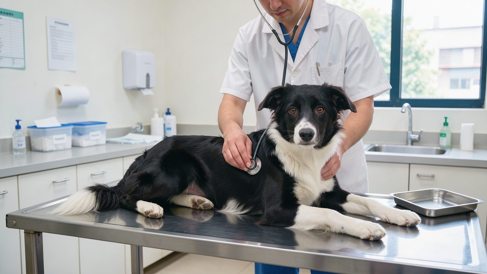

**2026년 10월 18일 기준**

보더콜리는 겉으로 건강해 보여도 부모에게서 유전적 변이를 물려받아 특정 질환이 발생할 수 있습니다. 보인자 부모는 증상 없이 변이를 자손에게 넘길 수 있습니다. 따라서 분양 전에는 외모나 겉으로 드러나는 건강 상태뿐 아니라 부모견의 유전자 검사 기록도 확인하는 것이 좋습니다. 보더콜리의 기본적인 성격과 분양 시세는 [보더콜리 허브](/breeds/border-collie/)에서 다룹니다.

## 빠른 답

**보더콜리 유전병은 무엇부터 확인해야 하나요?**

보더콜리의 유전 질환 및 유전적 소인을 확인할 때는 TNS, NCL, 콜리 눈 기형(CEA), MDR1 약물 감수성 등의 DNA 검사를 고려할 수 있습니다. 고관절 이형성증과 간질은 DNA 검사만으로 확인하기 어려우므로 부모견의 검진 기록과 병력도 살펴봐야 합니다. 분양 전에 부모견 두 마리의 검사 결과를 요청하는 것이 가장 확실한 대비입니다.

## 보더콜리에서 검사 항목이 되는 질환

수의학 자료에서 보더콜리의 유전병으로 꾸준히 언급되는 질환은 다음과 같습니다.

- **TNS(트랩트 뉴트로필 증후군)** — 보더콜리에 특이하게 나타나는 면역 결핍 질환입니다. 골수에 호중구가 갇혀 만성 감염이 반복되고, 새끼는 체구가 작고 발달이 늦습니다. 완치 방법이 없고 치명적일 수 있으며, 영향을 받은 강아지는 생후 몇 달을 넘기지 못하는 경우가 많다고 PetMD는 설명합니다.
- **NCL(신경세포성 리포푸신증)** — 신경세포에 단백질이 쌓이면서 발작과 성격 변화, 시력 상실로 이어지는 질환입니다. 보통 15~20개월에 증상이 시작되고 수명이 크게 줄어듭니다(PetMD).
- **CEA(콜리 눈 기형)** — 망막과 시신경이 제대로 발달하지 못해 시력이 떨어지거나 실명에 이르는 선천성 질환입니다. 태어날 때부터 있고 보통 5~6주에 발견되며, 유전자 검사가 있으나 치료 선택지는 넓지 않다고 PetMD는 밝힙니다.
- **MDR1(약물 감수성)** — 일부 수의약품과 벼룩, 진드기 예방 제품에 유난히 민감하게 반응하는 유전 변이입니다. 혈액이나 구강 점액 검사로 확인합니다(PetMD).
- **고관절 이형성증** — 관절의 공과 소켓이 맞지 않아 염증과 통증, 관절염으로 진행하는 질환입니다. 여러 유전자와 환경이 함께 작용해 DNA 검사가 없고, 번식견은 OFA나 PennHIP 검진으로 확인한다고 PetMD는 권고합니다.
- **간질** — 2~5세에 첫 발작이 나타나는 경우가 많고 항경련제 치료가 필요할 수 있습니다. PetMD는 보더콜리가 이 질환에 취약한 견종으로 꼽힌다고 설명합니다.

미국 보더콜리 협회(BCSA)는 이 밖에도 녹내장과 전방각이상, 조기 성견 난청, 수정체 탈구, 코발라민 흡수 장애, 퇴행성 척수병증 같은 질환을 검사 항목으로 안내합니다. 검사기관마다 검사 항목이 다르므로, 모든 업체가 모든 질환을 검사하는 것은 아니라는 점도 함께 안내하고 있습니다.

## 검사 결과는 세 단계로 읽습니다

BCSA는 DNA 검사 결과를 정상 유전자 두 개를 가진 클리어, 정상 유전자와 변이를 하나씩 가진 보인자, 변이 두 개를 가진 개체로 구분합니다. 보인자는 겉모습이 건강하므로 검사하지 않고는 구분할 수 없습니다. BCSA는 보인자 개체를 클리어 개체와 교배하도록 권장합니다. 이렇게 하면 변이를 두 개 가진 발병 자손이 태어나지 않기 때문입니다.

검사 방식에도 차이가 있습니다. 대부분은 질환을 일으키는 유전자 자체를 확인하는 직접 검사입니다. 반면 녹내장과 전방각이상, 조기 성견 난청은 질환과 연관된 표지자를 보는 검사여서, 표지자가 질환의 유일한 원인이라고 증명된 것은 아니라고 BCSA는 설명합니다. 검사는 혈액이나 구강 면봉으로 검체를 채취하는 방식으로 진행할 수 있습니다(PetMD).

## 분양 전에 확인할 순서

1. 부모견 두 마리의 DNA 검사 결과지를 요청합니다. 질환별로 클리어, 보인자, 발병 위험 가운데 어느 판정인지 확인하면 됩니다.
2. 검사기관과 검사일을 함께 살펴봅니다. 검사 시점이 오래됐다면 이후 새로운 검사 항목이 추가됐는지도 확인하는 것이 좋습니다.
3. 고관절 검진 기록이 있는지도 물어봅니다. DNA 검사가 없는 질환은 부모견의 X선 판독 등급이 중요한 근거가 됩니다.
4. 검사 결과가 없다면 가격이나 외모만 비교하기보다 부모견의 검사 이력을 확인할 수 있는 브리더인지 먼저 살펴보는 것이 좋습니다.

**딱지허브 평가**: PetMD와 BCSA가 제시하는 기준은 번식견 전수 DNA 검사입니다. 다만 국내 분양 현장에서는 검사 결과지를 기본으로 제공하지 않는 곳도 있으므로, 보호자가 직접 요청해야 확인할 수 있는 경우가 있습니다. 분양 문의 첫 단계에서 부모견 검사 여부를 묻고, 결과지를 보여줄 수 있는 곳인지 확인하는 편이 안전합니다.

## 검사 이후에도 관리가 필요합니다

DNA 검사는 특정 유전적 변이의 보유 여부를 확인해 단일 유전자 질환의 발병 위험을 평가하는 데 도움을 주는 도구입니다. 검사 결과가 좋아도 고관절 이형성증과 간질처럼 여러 요인이 얽힌 질환은 생활 속 관리가 따로 필요합니다.

- MDR1 유전자 변이가 확인되면 약물을 처방받기 전에 수의사에게 검사 결과를 알리는 것이 좋습니다. 일부 수의약품과 벼룩, 진드기 예방 제품에 민감하게 반응할 수 있기 때문입니다(PetMD).
- 고관절이 약한 개체는 적정 체중을 유지하고, 급성장기에는 계단과 미끄러운 바닥을 피하는 것이 좋습니다.
- 간질이 있는 경우 발작 시간과 횟수를 기록해 두면 진료에 도움이 됩니다.

운동 강도와 관절을 함께 관리하는 방법은 [보더콜리 운동량 글](/breeds/border-collie-exercise/)에서 더 자세히 다뤘습니다.

## 자주 묻는 질문

### 보더콜리 DNA 검사는 어디에서 받을 수 있나요?

동물병원에서 상담한 뒤 구강 면봉이나 혈액으로 검체를 채취해 검사기관에 보내는 방식입니다. BCSA는 여러 검사기관을 안내하면서, 업체마다 다루는 질환이 다르므로 받으려는 항목을 실제로 검사하는 곳인지 확인해야 한다고 안내합니다.

### 부모견이 보인자면 새끼도 유전병에 걸리나요?

해당 질환이 열성 유전 방식으로 유전되는 경우, 보인자와 클리어를 교배하면 그 질환이 발병할 유전형을 가진 자손은 태어나지 않습니다. 다만 새끼 가운데 보인자가 나올 수 있어, 다음 세대를 계획한다면 검사가 다시 필요합니다. 보인자끼리 교배하면 변이를 두 개 가진 새끼가 태어날 수 있습니다(BCSA).

### 유전자 검사 결과가 정상이면 유전병 걱정은 없나요?

DNA 검사로 확인하는 것은 단일 유전자 질환입니다. 고관절 이형성증과 간질처럼 여러 유전자와 환경이 함께 작용하는 질환은 검사 범위 밖이므로, 부모견 검진과 생활 관리가 따로 필요합니다(PetMD).

### 유전병 검사는 언제 받는 것이 좋나요?

번식 목적이라면 교배 전에 부모견 두 마리가 받는 것이 좋습니다. 반려 목적으로 분양받는다면 강아지를 데려오기 전에 브리더에게 부모견의 검사 결과를 요청하는 것이 좋습니다. 필요에 따라 분양 후에도 수의사와 상담해 추가 검사를 고려할 수 있습니다. 입양 후에도 궁금하다면 동물병원에서 검사를 의뢰할 수 있습니다.

## 출처

- [Border Collie — PetMD](https://www.petmd.com/dog/breeds/border-collie) (TNS, NCL, CEA, MDR1, 고관절 이형성증, 간질의 증상과 검진 권고)
- [DNA Testing — Border Collie Society of America](https://bordercolliesocietyofamerica.com/dna-testing) (검사 대상 질환 목록, 클리어, 보인자, 발병 위험 판정, 검사기관 유의 사항)

표지 이미지는 AI로 생성했습니다.
