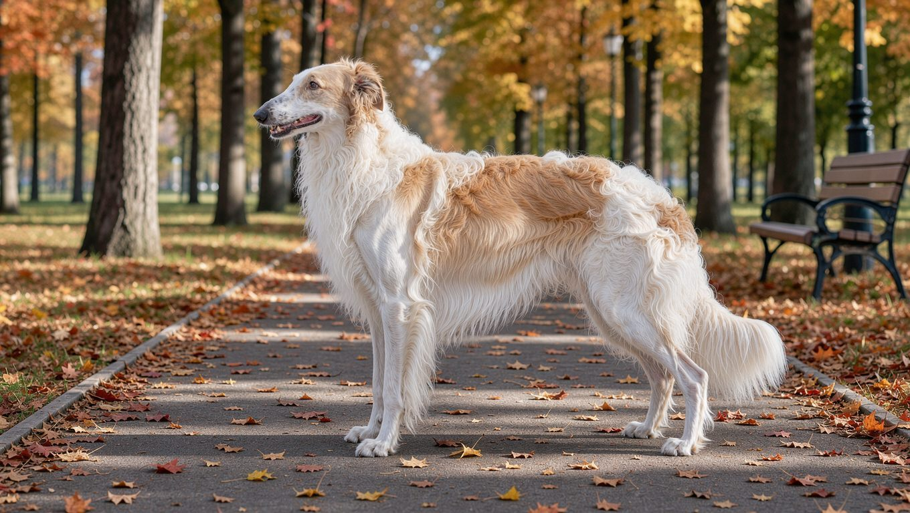

**2026년 10월 26일 기준**

## 빠른 답

- **털은 얼마나 빠지나요?**: 실키한 장모는 일 년 내내 조금씩 빠지며, 일 년에 한 번 몇 주 동안 집중적으로 털갈이하는 시기가 있습니다.
- **빗질은 얼마나 자주 해야 하나요?**: 출처에 따라 주 2~3회와 1~2일 간격으로 갈립니다. 털갈이 시기에는 횟수를 늘리는 편이 좋습니다.
- **목욕은 자주 해야 하나요?**: 피부가 예민한 편은 아니어서 필요할 때만 씻기면 됩니다. 대형견이라 가정 욕실에서 씻기는 일은 쉽지 않습니다.

## 보르조이 털의 구조

보르조이의 몸통은 길고 실키한 장모로 덮여 있습니다. 머리와 귀, 앞다리의 앞쪽은 짧고 매끄러우며, 목과 가슴, 꼬리에는 장식털이 풍성하게 자랍니다. 이 장식털이 멀리서도 보르조이를 알아볼 수 있게 하는 실루엣을 만듭니다.

특히 관리에 신경 써야 하는 부분은 장식털입니다. 목 둘레와 귀 뒤, 앞다리 뒤쪽, 다리 사이는 털이 서로 스치며 엉키기 쉬운 자리입니다. 견종 전반의 성격과 건강 관리는 [보르조이 견종 안내](/breeds/borzoi/)에서 볼 수 있고, 빗질을 시작하기 전에는 [강아지 빗과 브러시 비교](/guides/dog-brush-comparison/)에서 도구별 역할을 살펴보면 준비가 수월합니다.

## 털갈이 시기와 양

PetMD는 보르조이의 털이 일 년 내내 조금씩 빠진다고 설명합니다. 같은 자료에 따르면 미국 보르조이 클럽(BCA)은 일 년에 한 번 집중적으로 털갈이하는 시기가 있다고 안내합니다. Bil-Jac은 그 집중 털갈이가 한 해에 몇 주 동안 이어진다고 설명합니다. 계절을 특정한 자료는 찾기 어려웠습니다.

국내 실내 생활에서는 털갈이 시기가 더 흐려질 수 있습니다. 난방과 냉방으로 실내 온도가 일정하게 유지되면 몸이 계절을 덜 타기 때문입니다. 털갈이 시기를 특정하기보다 실제로 빠지는 털의 양에 맞춰 관리하는 편이 낫습니다.

털갈이철에 함께 늘어나는 일은 다음과 같습니다.

<ul>
  <li><strong>빠지는 털</strong>: 바닥과 옷, 침구에 붙는 털이 눈에 띄게 늘어납니다.</li>
  <li><strong>엉킴</strong>: 빠진 털이 남은 털에 섞여 뭉치면 장식털이 쉽게 엉킵니다.</li>
  <li><strong>그루밍 시간</strong>: 평소보다 빗질에 쓰는 시간이 길어집니다.</li>
</ul>

## 빗질 주기와 도구

빗질 주기는 출처마다 조금 다릅니다. PetMD는 단단한 브리슬 브러시로 일주일에 최소 두세 번, 가능하면 매일 빗겨 줄 것을 권합니다. Bil-Jac은 1~2일 간격으로 빗질하라고 안내합니다. 두 기준 모두 빗질을 자주 하라는 의미이므로, 구체적인 주기는 생활 여건에 맞춰 정하면 됩니다.

실키한 장모를 관리할 때는 핀 브러시와 일자빗을 기본 도구로 사용합니다. 먼저 핀 브러시로 털을 전체적으로 정돈한 뒤, 일자빗으로 남은 엉킴을 확인합니다. 털이 뭉친 부분은 슬리커 브러시로 털 끝부터 조금씩 풀어 주면 당기는 느낌을 줄일 수 있습니다.

빗질 순서는 이렇게 잡습니다.

<ol>
  <li>귀 뒤와 목덜미부터 시작합니다. 엉킴이 가장 먼저 생기는 자리입니다.</li>
  <li>결을 따라 목과 가슴, 옆구리로 내려갑니다.</li>
  <li>앞다리 뒤쪽과 다리 사이를 빗습니다.</li>
  <li>마지막에 일자빗으로 온몸을 한 번 훑어 남은 엉킴을 확인합니다.</li>
</ol>

## 목욕

PetMD는 보르조이의 피부가 특별히 예민한 편이 아니라 가끔 씻는 것으로 충분하다고 설명합니다. 목욕할 때는 피부를 건조하게 하는 샴푸를 피하고, 알로에나 오트밀이 든 순한 제품이 좋습니다. 목욕 사이에는 드라이 샴푸로 털을 정돈할 수 있습니다. 같은 자료에서는 대형견의 특성상 목욕시키는 일 자체가 쉽지 않다는 점도 언급합니다.

**딱지허브 평가**: 출처는 가끔 씻으면 충분하다는 기준을 제시하지만, 체고 70cm 안팎에 40kg 안팎까지 나가는 대형견을 한국 아파트 욕실에서 씻기는 일은 쉽지 않습니다. 대형견 전용 셀프 목욕장이나 미용실을 이용하고, 목욕 후에는 털을 완전히 말릴 수 있도록 시간을 충분히 확보하는 것이 현실적입니다.

목욕 뒤에는 귀 안쪽에 들어간 물기를 닦아 주고, 젖은 털을 오래 그대로 두지 않습니다. 장모는 젖으면 마르는 데 시간이 걸려 엉킴과 냄새의 원인이 되기 쉽습니다. 목욕 전에 먼저 빗질해야 하는 이유는 [강아지 목욕 주기 가이드](/guides/dog-bath-schedule/)에서 자세히 확인할 수 있습니다.

## 발톱과 귀

PetMD는 발톱을 정기적으로 다듬으라고 안내합니다. 산책을 많이 하는 개도 발톱이 다 닳지는 않으므로, 걸을 때 바닥에서 소리가 나면 다듬을 시기로 봅니다. 발톱이 검다면 한 번에 조금씩 잘라 출혈을 피하는 것이 좋습니다.

귀는 안쪽에 물기와 먼지가 남지 않게 닦아 주고, 냄새나 붉은 기가 보이면 동물병원에 상담합니다. 눈은 눈물 자국이 늘었는지 가끔 살펴봅니다.

## 장마철과 겨울 관리

한국의 장마철에는 습도가 높아 장모가 축축해지고 서로 엉키기 쉽습니다. 빗질로 털이 뭉치지 않도록 관리하고, 비를 맞았다면 바로 말려 주는 것이 좋습니다. 습기가 오래 머물면 피부 트러블로 이어질 수 있습니다.

겨울에는 난방으로 실내 공기가 건조해지면서 털에 정전기가 발생하고 엉킴이 심해질 수 있습니다. 가습기로 습도를 조절하고, 잠자리는 난방기에서 떨어뜨리면 도움이 됩니다. 여름 산책은 이른 아침이나 해가 진 뒤로 옮기고, 산책 뒤에는 귀와 발바닥을 확인합니다.

## 자주 묻는 질문

### 보르조이는 털갈이가 심한 편인가요?

털갈이 시기에는 집안에 털이 부쩍 늘어납니다. 평소에도 일 년 내내 조금씩 빠지므로, 장모견 가운데 관리가 필요한 편에 속합니다.

### 보르조이 빗질은 매일 해야 하나요?

자주 할수록 엉킴이 줄어듭니다. 매일 빗질하기 어렵다면 최소한 일주일에 두세 번은 빗질하는 것이 좋습니다.

### 보르조이는 목욕을 자주 해도 되나요?

목욕을 자주 시킬 필요는 없습니다. 피부가 예민한 편은 아니지만, 잦은 목욕은 피부를 건조하게 할 수 있습니다. 냄새가 나거나 털이 오염되었을 때 목욕시키고, 그 사이에는 드라이 샴푸로 털을 정돈하면 됩니다.

### 보르조이 털을 밀어도 되나요?

권하지 않습니다. 장모와 장식털은 피부를 보호하고 햇빛에 직접 노출되는 것을 줄여 줍니다. 한 번 밀면 원래 결로 돌아오는 데 오랜 시간이 걸릴 수 있어, 더위가 걱정된다면 털을 미는 대신 산책 시간과 실내 온도를 조절하는 편이 좋습니다.

### 털갈이철 집안 털은 어떻게 줄이나요?

빗질 횟수를 늘리는 것이 집안에 날리는 털을 줄이는 데 가장 효과적입니다. 청소기와 롤러를 자주 쓰고, 침구는 주기적으로 털어 주면 도움이 됩니다. 실내 습도를 적절히 유지하는 것도 털이 날리는 양을 줄이는 데 보탬이 될 수 있습니다.

## 출처

- [Borzoi — PetMD](https://www.petmd.com/dog/breeds/borzoi) (털 구조·빗질 주기와 도구·털갈이·목욕·발톱 관리)
- [Borzoi Breed Info — Bil-Jac](https://www.bil-jac.com/breed-library/borzoi/) (1~2일 간격 빗질·한 해 몇 주간의 집중 털갈이)

표지는 AI로 생성한 이미지입니다.
