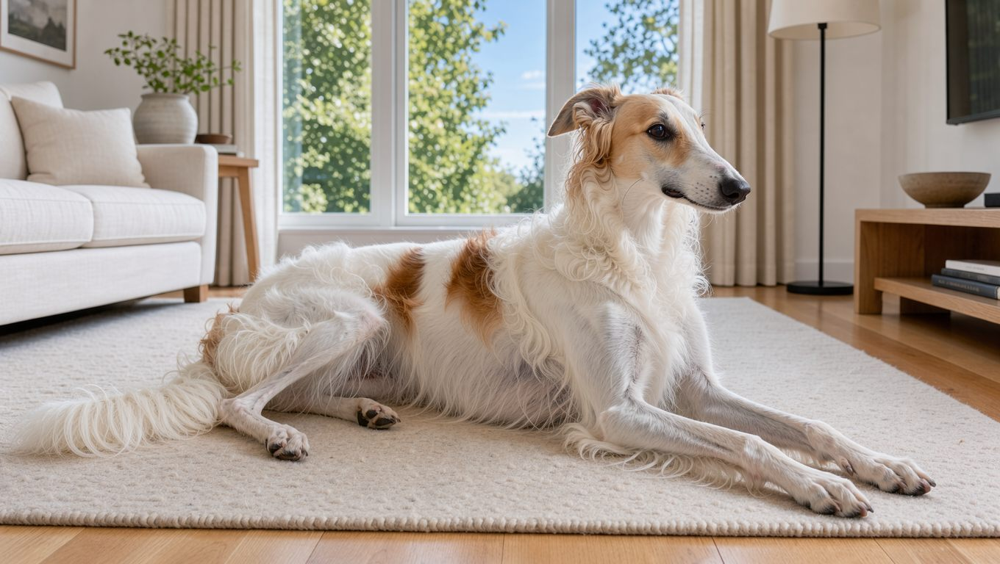

## 빠른 답

- **성격 한 줄**: 차분하고 우아한 대형 사이트하운드(시각 하운드)입니다. 가족에게는 애정이 깊고 낯선 사람에게는 거리를 둡니다.
- **아파트에서 키울 수 있나?**: 짖음이 적고 실내에서 차분해, 아파트 생활에 쉽게 적응할 수 있다는 평가가 있습니다(PetMD). 다만 달리고 쫓는 본능이 강해 목줄과 안전한 운동 공간을 꼭 챙겨야 합니다.
- **처음 키우는 사람에게 맞나?**: 독립심이 강하고 훈련 반응이 빠르지 않아, 사이트하운드의 기질을 미리 공부한 보호자에게 더 맞습니다.

## 품종 개요

보르조이는 러시아 귀족 문화가 만든 사냥견입니다. 17세기 무렵 러시아 귀족들은 말을 타고 넓은 영지를 달리며 늑대를 사냥했습니다. 보르조이는 그 사냥에 맞춰 긴 다리와 깊은 가슴, 멀리 보는 눈을 갖도록 개량되었습니다.

사냥 방식은 말을 탄 사냥꾼이 늑대를 몰아붙이고, 보르조이가 따라붙어 붙잡는 식이었습니다. 한때 '러시아 울프하운드'로 불렸고, 1891년 미국 켄넬 클럽(AKC)에 등록된 뒤 1936년 지금의 이름으로 정리되었습니다.

오늘날에는 영지 대신 도시와 마당에서 가족견으로 살아갑니다. 빠른 발은 그대로 남아, AKC는 보르조이가 시속 56~64km로 달릴 수 있다고 설명합니다. 사이트하운드 계열의 다른 견종은 [하운드 9종 도감](/guides/hound-types/)에서 함께 비교해 볼 수 있습니다.

## 외모와 털

보르조이는 견종 표준에서 대형견으로 분류됩니다. 몸은 길고 가슴은 깊으며, 허리는 활처럼 휘어 오르는 독특한 실루엣을 가집니다. 주둥이는 길고 좁으며, 멀리 있는 사냥감을 포착하기에 알맞은 형태입니다.

PetMD가 정리한 신체 정보는 다음과 같습니다.

<dl>
  <dt>체고</dt>
  <dd>수컷 약 71cm, 암컷 약 66cm</dd>
  <dt>체중</dt>
  <dd>수컷 34~48kg, 암컷 27~39kg</dd>
  <dt>수명</dt>
  <dd>9~14년</dd>
</dl>

털은 실크처럼 매끄럽고 물결이 잡히는 장모입니다. 모색은 블랙, 브린들, 크림, 화이트를 비롯해 다양한 색과 무늬가 있습니다(PetMD).

## 성격과 기질

PetMD는 보르조이를 다정하고 사교적이며 장난기 있는 견종으로 소개합니다. 가족과 강한 유대를 맺고, 함께 있는 시간을 좋아합니다.

낯선 사람에게는 조심스럽고 거리를 두는 편입니다. 어린 시기의 사회화가 충분하지 않으면 소심한 성격으로 남을 수 있어, 다양한 사람과 환경을 경험하게 해 주는 것이 좋습니다. 아이와는 대체로 잘 지내지만 거친 놀이는 싫어하므로, 어린이와의 접촉은 어른이 지켜봐야 합니다.

독립심이 강한 것도 특징입니다. 훈련 반응이 빠른 편이 아니어서, 큰 소리로 다그치기보다 칭찬과 간식으로 이끄는 편이 효과적입니다. 혼자 있는 시간이 길면 스트레스를 받을 수 있으므로, 외출이 잦은 가정이라면 분리 불안에 대비하는 것이 좋습니다.

## 한국에서 키울 때

보르조이는 국내에서 흔히 만나는 견종이 아닙니다. 공개된 분양 시세 통계를 찾기 어려우며, 실제 분양가는 브리더와 수입 경로에 따라 달라집니다. 분양을 알아볼 때는 부모견의 고관절과 팔꿈치, 눈 검진 이력을 확인하는 것이 좋습니다.

아파트 생활은 의외로 무난한 편입니다. 짖음이 적고 실내에서 차분해, PetMD는 아파트 적응이 쉽다고 평가합니다. 아파트 생활에서 중요한 것은 소음보다 충분한 운동을 확보하는 일입니다. 보르조이는 움직이는 것을 쫓는 본능이 강해, 공용 공간에서는 목줄을 짧게 잡아야 하고 달릴 수 있는 안전한 공간을 따로 마련해야 합니다.

**딱지허브 평가**: PetMD의 아파트 생활 관련 설명을 참고하더라도, 보르조이에게는 마당이나 울타리가 있는 운동 공간을 확보하는 것이 중요합니다. 한국 아파트에서는 평일 짧은 산책으로 냄새를 맡게 하고, 주말에는 울타리가 있는 애견 운동장에서 달리게 하는 구성이 현실적입니다.

여름에는 더위 관리가 필요합니다. 장모 견종이라 한낮 산책은 피하고, 이른 아침이나 해가 진 뒤로 시간을 옮기는 것이 좋습니다.

건강 관리에서 특히 주의해야 할 질환은 위확장·위염전(GDV)입니다. 흉곽이 깊은 대형견에게서 흔한 문제이고, 보르조이도 예외가 아닙니다(PetMD). 배가 부풀고 헛구역질을 하며 침을 흘리거나 서성이는 모습이 보이면 즉시 응급 병원으로 가야 합니다. 사이트하운드는 체지방이 적어 마취 관리에 주의가 필요하므로(PetMD), 중성화 수술이나 치과 치료 전에는 수의사에게 견종을 미리 알리는 것이 좋습니다. 이 밖에 고관절과 팔꿈치 이형성, 골연골증(OCD), 진행성 망막위축(PRA)이 보고됩니다.

## 관리법

털 관리의 기본은 빗질입니다. 털은 일 년 내내 조금씩 빠지고, 한 해에 한 번 크게 털갈이를 합니다(PetMD). 빗질은 일주일에 두세 번 하는 것이 기본이며, 가능하면 매일 해 주는 것이 좋습니다(PetMD). 목욕은 필요할 때만 하고, 발톱과 귀, 눈은 정기적으로 확인합니다. 털갈이 시기와 빗질 도구, 목욕 요령은 [보르조이 털갈이와 그루밍](/breeds/borzoi-grooming/)에서 더 자세히 다룹니다.

운동은 긴 산책에 울타리 안에서 자유롭게 달릴 수 있는 시간을 더하는 방식이 권장됩니다(PetMD). 공공장소에서는 목줄을 놓지 않습니다. 움직이는 모든 것을 쫓는 본능이 살아 있기 때문입니다. 성장기에는 미끄러운 바닥에서의 급한 방향 전환을 줄이고, 식후에는 바로 격하게 뛰지 않게 하는 것이 좋습니다. 강아지 하루 운동량은 [운동량 가이드](/guides/dog-exercise-amount/)에서 더 자세히 볼 수 있습니다.

훈련은 짧게 자주 하는 편이 좋습니다. 사이트하운드는 반복적인 훈련보다 시각과 후각을 활용하는 놀이에 더 흥미를 보일 수 있습니다.

## 자주 묻는 질문

### 보르조이는 초보자가 키우기 어려운 견종인가요?

다루기 쉬운 견종은 아닙니다. 독립심이 강하고 훈련 반응이 빠르지 않으며, 사냥 본능을 관리해야 합니다. 다만 차분하고 짖음이 적어, 사이트하운드의 특성을 미리 공부한 보호자라면 충분히 함께 살아갈 수 있습니다.

### 보르조이는 아파트에서 키울 수 있나요?

가능하다는 평가가 있습니다. 짖음이 적고 실내에서 차분한 편입니다. 운동 공간과 목줄 관리가 관건입니다.

### 보르조이는 하루에 얼마나 운동해야 하나요?

긴 산책과 울타리 안 달리기를 함께 구성하는 것이 좋습니다. 활동량은 개체마다 달라, 산책 후 지친 기색과 체중 변화를 보며 조절합니다.

### 보르조이 털은 얼마나 자주 빗어야 하나요?

일주일에 두세 번이 기준이고, 가능하면 매일 빗겨 주는 것이 좋습니다. 털갈이가 심한 시기에는 빗질 횟수를 늘리면 집안에 빠지는 털을 줄이는 데 도움이 됩니다.

### 보르조이는 다른 반려동물과 함께 키울 수 있나요?

작은 동물을 쫓으려는 본능이 강하므로, 고양이나 소형견과 함께 키울 때는 신중하게 판단해야 합니다. 어린 시기부터 함께 지냈다면 적응할 수 있지만, 처음 소개할 때는 목줄을 잡은 채 짧게 만나게 하고 보호자가 지켜봐야 합니다.

## 출처

- [Borzoi — PetMD](https://www.petmd.com/dog/breeds/borzoi) (체격·수명·성격·운동·털 관리·위염전과 마취 주의)
- [Borzoi — American Kennel Club](https://www.akc.org/dog-breeds/borzoi/) (품종 소개·달리기 속도)

표지는 AI로 생성한 이미지입니다.
