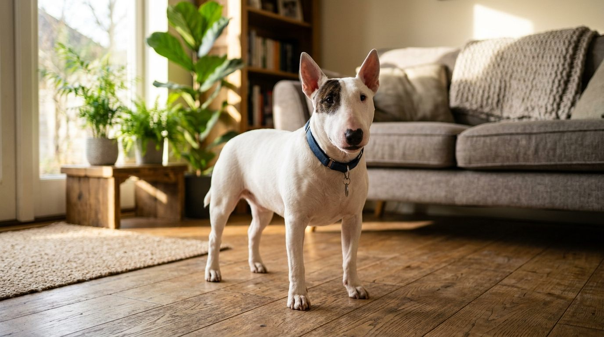
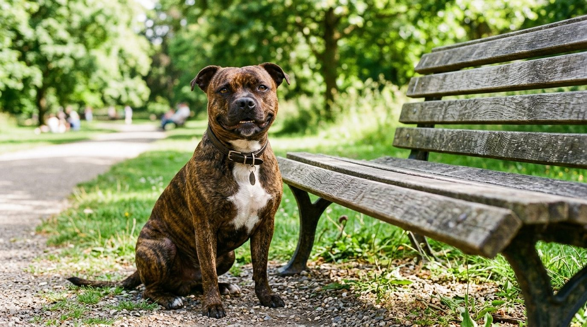
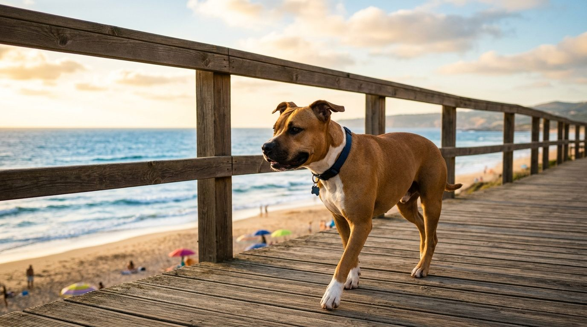
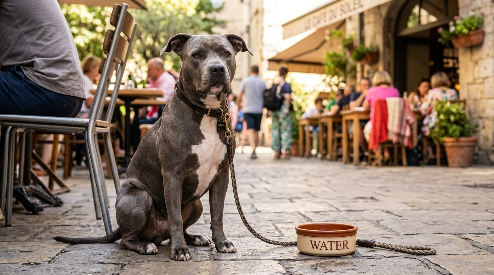

**2026년 9월 21일 기준**

"불테리어"를 검색하면 핏불테리어에 관한 내용도 함께 나온다. 스태퍼드셔 불테리어와 미니어처 불테리어 역시 서로 구분해야 하는 견종이다. 이름에 '불'과 '테리어'가 들어가는 견종은 생각보다 다양하다. 어떤 것이 불테리어에서 갈라진 것이고, 어떤 것이 그저 이름만 닮았을까.

## 빠른 답

**"불테리어에서 파생된 견종은 어떤 것이 있나요?"**

엄밀히 불테리어에서 직접 갈라진 견종은 **미니어처 불테리어 하나**다. 스태퍼드셔 불테리어, 아메리칸 스태퍼드셔 테리어, 아메리칸 핏불 테리어는 불테리어의 후손이 아니라 **같은 조상인 '불앤테리어'에서 갈라져 나간 형제 견종**이다. 이 다섯 견종의 관계를 한눈에 정리하면 각 견종의 특징과 차이를 이해하기 쉽다. 불테리어 본체의 특징은 [불테리어 품종 가이드](/breeds/bull-terrier/)에서 다룬다.

## 공통 조상, 19세기의 불앤테리어

19세기 초 영국에서 황소싸움용이던 올드 잉글리시 불독에 여러 테리어를 섞은 개들이 나왔다. '불앤테리어'라 불린 이 혼합견들은 황소싸움이 금지된 뒤 쥐잡이나 투견 등에 이용됐다. 오늘날 불 계열로 분류되는 여러 견종은 이 혼합견에서 유래했다. 이후 품종별로 서로 다른 방향으로 개량됐다.

- **버밍엄의 개량가 제임스 힝크스**는 기존 혈통에 잉글리시 화이트 테리어 등을 더해 흰색의 우아한 개로 개량했다. 이렇게 만들어진 견종이 오늘날의 불테리어다. '화이트 캐벌리어'라는 별명으로도 알려져 있다. AKC 등록은 1885년이다.
- **스태퍼드셔 지방** — 투견 용도를 유지하던 혈통을 따로 정리해 1935년 영국 켄넬클럽에 스태퍼드셔 불테리어로 등록했다.
- **미국**에서는 이민자들이 가져온 불 계열 혈통이 서로 다른 방향으로 발전했다. UKC는 1898년 아메리칸 핏불 테리어를 등록했고, AKC는 1936년 같은 뿌리의 개를 '스태퍼드셔 테리어'로 등록했다. 이후 AKC는 1972년에 품종명을 '아메리칸 스태퍼드셔 테리어'로 변경했다.
- **소형화** — 19세기 말부터 작은 개를 골라 만든 축소 라인이 미니어처 불테리어다. AKC는 1991년 별도 품종으로 인정했다.

## 유일한 직계 파생, 미니어처 불테리어

AKC 표준 체고는 25~36cm(10~14인치)이고, 체중은 수치를 정하지 않고 체고에 비례한다. 외형과 성격 모두 불테리어와 닮았다. AKC도 이 견종을 "대부분의 면에서 불테리어의 더 작은 버전"이라고 소개하며, 특유의 달걀형 머리와 장난기 많은 성격을 설명한다. AKC는 이 견종을 '개들의 왕국의 익살꾼 왕자(Clown Prince of Dogdom)'라고 부른다. 테리어 특유의 활발한 기질과 두려움 없는 성격도 주요 특징으로 꼽는다.

*미니어처 불테리어 — 몸은 작아도 달걀머리는 그대로다*

재미있는 것은 나라마다 등록 대우가 다르다는 점이다. 미국 AKC는 불테리어와 미니어처 불테리어를 서로 다른 품종으로 관리하지만, 영국 켄넬클럽은 불테리어 한 품종 안의 소형 형태(variety)로 본다. 같은 혈통에서 유래했지만, 품종을 분류하는 기준은 나라별로 다른 셈이다.

양육할 때는 작은 체구에도 테리어 특유의 활발한 기질이 있다는 점을 고려해야 한다. 몸집은 작지만 에너지가 넘치고 고집이 있는 편이므로, 충분한 산책과 두뇌를 활용하는 놀이를 함께 제공하는 것이 좋다.

## 같은 뿌리에서 갈라진 형제 견종 셋

### 스태퍼드셔 불테리어

체고 36~41cm, 체중 11~17kg. 몸집은 작아도 근육 밀도가 높아 단단해 보인다. 영국에서는 오랫동안 가족견으로 사랑받아 왔으며, 사람과 유대감을 형성하는 성향이 강한 견종으로 알려져 있다. 머리는 불테리어의 달걀형이 아니라 넓은 두개골에 뭉툭한 주둥이를 가진 쪽이다. 한국에서는 법정 맹견으로 지정돼 있어 불테리어와 가장 자주 섞이는 이름이기도 하다.

*스태퍼드셔 불 테리어 — 넓은 두개골에 뭉툭한 주둥이가 특징*

### 아메리칸 스태퍼드셔 테리어 · 아메리칸 핏불 테리어

두 견종은 미국의 공통된 혈통에서 유래했지만, 서로 다른 품종 기준에 따라 발전했다. AKC는 아메리칸 스태퍼드셔 테리어를, UKC는 아메리칸 핏불 테리어를 각각 별도 품종으로 등록하고 있다. 체고는 아메리칸 스태퍼드셔 테리어가 약 43~48cm, 아메리칸 핏불 테리어가 약 43~53cm다. '핏(pit)'이라는 이름 자체가 투견장에서 왔고, 두 견종 모두 한국에서는 법정 맹견으로 지정된다.

*아메리칸 스태퍼드셔 테리어 — 같은 뿌리의 AKC 등록 라인*

*아메리칸 핏불 테리어 — UKC 등록 1호 견종*

### 구분은 머리 모양부터

불테리어는 옆에서 봤을 때 달걀형으로 이어지는 머리와 삼각형 눈이 특징이다. 반면 스태퍼드셔 계열은 넓은 두개골과 뭉툭한 주둥이가 두드러진다. 이름은 비슷하지만 머리 형태에서 차이를 확인할 수 있다. 체고는 오히려 불테리어가 이 그룹에서 가장 큰 편이다.

## 한눈에 비교

- **불테리어** — 체고 약 53~56cm · 체중 약 23~32kg · 순혈 등록: AKC 1885 · 한국 맹견 지정 아님
- **미니어처 불테리어** — 체고 25~36cm · 체중 체고에 비례(수치 규정 없음) · 순혈 등록: AKC 1991 · 한국 맹견 지정 아님
- **스태퍼드셔 불테리어** — 체고 36~41cm · 체중 11~17kg · 순혈 등록: 영국 KC 1935 · AKC 1975 · 한국 맹견 **지정**
- **아메리칸 스태퍼드셔 테리어** — 체고 약 43~48cm · 체중 체고에 비례(수치 규정 없음) · 순혈 등록: AKC 1936 · 한국 맹견 **지정**
- **아메리칸 핏불 테리어** — 체고 약 43~53cm · 체중 체고에 비례(수치 규정 없음) · 순혈 등록: UKC 1898 · 한국 맹견 **지정**

수치는 AKC·UKC의 견종 표준과 품종 소개 자료를 바탕으로 정리했으며, 실제 체격은 개체마다 다를 수 있다. 불테리어는 품종 표준에 체고와 체중의 구체적인 수치가 없어 AKC의 견종 소개에 제시된 값(체고 21~22인치, 체중 50~70파운드)을 환산해 사용했다.

## 한국 실정: 이름 한 단어로 갈리는 맹견 지정

동물보호법 시행규칙 별표가 정한 맹견은 다섯 종이다. 도사견, 아메리칸 핏불 테리어, 아메리칸 스태퍼드셔 테리어, 스태퍼드셔 불 테리어, 로트와일러. 잡종도 포함된다.

여기서 불 계열 견종의 법적 지위가 달라진다. 스태퍼드셔 계열의 세 견종은 모두 법정 맹견으로 지정돼 있지만, **불테리어와 미니어처 불테리어는 지정 대상에 포함되지 않는다.** "불테리어=핏불"이라는 통념과 실제 법정 지정이 정확히 어긋나는 지점이다.

법정 맹견으로 지정된 견종에는 별도의 관리 규정이 적용된다. 2024년 관련 규정이 개정되면서 양육·판매·전시 등에 지방자치단체장의 허가가 필요해졌으며, 외출할 때는 2m 이하의 목줄과 입마개를 착용해야 한다. 종류별 입마개 고르기와 익히기는 [강아지 입마개 가이드](/guides/dog-muzzle/)에서 다룬다. 보호소에서 입양하거나 분양받을 계획이라면 해당 견종과 혈통을 먼저 확인해야 한다. 법정 맹견으로 지정된 견종의 잡종에도 관련 규정이 적용된다.

## 이름만 비슷한 다른 견종들

- **보스턴 테리어** — 불독과 잉글리시 화이트 테리어 등의 혈통에서 유래한 미국 견종이다. 불앤테리어의 투견 계통과는 구분되며, 반려견으로 발전했다.
- **불독 · 프렌치 불도그** — 불독 계통에서 유래한 견종으로, 테리어 계통과는 구분된다.
- **불마스티프** — 19세기 영국에서 밀렵 감시를 위해 불독과 마스티프를 섞어 만든 경비견.

## FAQ

**불테리어와 미니어처 불테리어는 서로 다른 견종인가요?**

두 견종은 같은 혈통에서 유래했지만, 국가별 품종 분류 기준이 다릅니다. 미국 AKC는 별도 품종으로 분류하는 반면, 영국 켄넬클럽은 불테리어의 소형 형태로 분류합니다.

**불테리어도 한국에서 맹견으로 지정되나요?**

아닙니다. 법정 맹견 다섯 종은 도사견, 아메리칸 핏불 테리어, 아메리칸 스태퍼드셔 테리어, 스태퍼드셔 불 테리어, 로트와일러입니다. 불테리어는 빠져 있고, 스태퍼드셔 불 테리어와의 이름 혼동이 가장 흔한 오해입니다.

**핏불테리어와 불테리어는 어떻게 구분하나요?**

가장 쉽게 구분할 수 있는 특징은 머리 모양입니다. 불테리어는 아래쪽으로 길게 이어지는 달걀형 머리와 삼각형 눈이 특징이며, 아메리칸 핏불 테리어는 상대적으로 넓은 두개골과 주둥이를 가지고 있습니다. 체고는 오히려 불테리어가 더 큰 편입니다.

**미니어처 불테리어는 아파트에서 키울 수 있나요?**

체고가 25~36cm로 비교적 작아 공간 부담은 적지만, 테리어 특유의 활발한 기질을 고려해야 합니다. 충분한 산책과 두뇌를 활용하는 놀이로 에너지를 발산할 수 있도록 해주는 것이 중요합니다.

**스태퍼드셔 불 테리어를 들이려면 무엇부터 확인해야 하나요?**

법정 맹견으로 지정돼 있어 양육 허가 절차와 외출 규정(2m 이하 목줄·입마개)이 적용됩니다. 입양하기 전에 지방자치단체의 허가 절차와 [입마개 가이드](/guides/dog-muzzle/)를 먼저 확인하는 것이 좋습니다.

## 출처

- [AKC – Miniature Bull Terrier](https://www.akc.org/dog-breeds/miniature-bull-terrier/) ("대부분의 면에서 불테리어의 더 작은 버전", 'Clown Prince of Dogdom' 별명, 테리어 기질)
- 맹견 지정 5종과 사육 허가제 규정은 [강아지 입마개 가이드](/guides/dog-muzzle/)의 출처를 따른다.

이 글의 표지와 본문 이미지는 AI로 생성했다.
