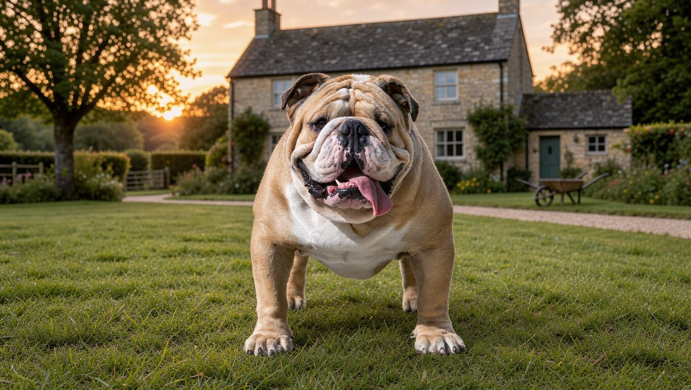

**2026년 11월 14일 기준** — 여름 관리와 항공 운송 규정처럼 달라질 수 있는 내용은 이날 확인한 자료를 기준으로 적었습니다.

## 빠른 답

- **성격 한 줄**: 사람을 좋아하고 온순하지만, 자기 방식대로 하려는 고집이 있습니다.
- **아파트에서 키울 수 있나?**: 가능한 편입니다. 운동량이 많지 않고 실내에서 조용히 지내는 편이라 주거 형태보다 온도 관리가 더 중요합니다.
- **처음 키우는 사람에게 맞나?**: 성격은 초보자에게도 순한 편입니다. 다만 호흡기와 피부를 꾸준히 관리해야 하므로, 건강 관리 부담을 감수할 수 있어야 합니다.

## 품종 개요

잉글리시 불독은 흔히 '불독'이라고 불리는 견종입니다. 프렌치 불독과는 별개의 견종으로, 과거 영국에서 소와 싸우게 하던 '불 베이팅' 풍습에서 이름이 유래했습니다. 그 풍습이 금지된 뒤에는 사나운 성격보다 온순한 기질을 기준으로 개량되었고, 오늘날에는 가족과 함께 지내는 반려견으로 자리 잡았습니다.

현대의 불독은 넓은 가슴과 굵은 뼈대, 주름이 많은 얼굴이 특징입니다. 몸은 낮고 다부진 체형이지만, 실제 체중은 결코 가볍지 않습니다. 미국 켄넬클럽(AKC) 기준으로 체고는 약 36~38cm이며, 성견 수컷의 체중은 약 23kg, 암컷은 약 18kg입니다. 기대 수명은 8~10년입니다. 기질은 '온순하지만 용감하고, 친근하지만 위엄이 있다'고 소개됩니다(AKC).

<dl>
<dt>크기</dt>
<dd>체고는 약 36~38cm이며, 몸통이 넓고 뼈대가 굵어 체중은 중형견에 해당합니다.</dd>
<dt>체중</dt>
<dd>수컷 23kg 안팎, 암컷 18kg 안팎입니다.</dd>
<dt>수명</dt>
<dd>8~10년 안팎입니다.</dd>
<dt>운동량</dt>
<dd>하루 두 차례의 짧은 산책으로 충분한 편입니다.</dd>
<dt>털 관리 난이도</dt>
<dd>짧은 털이라 빗질은 쉬운 편이지만, 얼굴 주름을 꾸준히 닦아야 합니다.</dd>
<dt>초보 적합도</dt>
<dd>성격은 순하지만 건강 관리 난도가 높은 편입니다.</dd>
</dl>

비글, 코카 스패니얼 등 다른 중형견과 체중과 성격을 비교하고 싶다면 [중형견 10종 비교](/guides/medium-dog-types/)를 참고하세요.

### 털색과 무늬

불독의 표준 모색에는 폰(황갈색), 레드, 브린들(호랑이 무늬), 화이트, 파이드(얼룩) 등이 있으며, 여러 색이 조합된 형태도 인정됩니다(AKC). 같은 불독이라도 무늬 조합에 따라 인상이 크게 달라집니다.

## 성격과 기질

불독은 사람을 좋아하며 낯선 상황에서도 쉽게 흥분하지 않는 편입니다. 낯선 사람을 보고 심하게 짖는 경우도 드뭅니다. 놀이를 즐기지만, 활동을 마치면 금방 잠드는 느긋한 면도 있습니다.

반면 자신이 원하지 않는 일에는 쉽게 응하지 않는 고집이 있습니다. 훈련을 이해하지 못한다기보다 반응이 느린 편에 가깝습니다. 짧게 나누어 보상으로 진행하면 훨씬 수월합니다. 아이와 함께 지낼 때는 어른이 곁에서 지켜보는 것이 좋습니다.

## 건강 관리 — 짧은 주둥이가 만드는 약점

불독의 건강에 가장 큰 영향을 미치는 특징은 주둥이가 짧은 단두종 체형입니다. 콧구멍이 좁고 기도가 짧아 호흡에 어려움을 겪기 쉬우며, 코골이나 거친 숨소리가 자주 나타납니다. 증상이 심하면 수의사와 상담해 기도 폐쇄 문제를 확인해야 합니다. 이러한 호흡기 구조는 대한항공이 불독의 화물 운송을 제한하는 이유 중 하나이기도 합니다.

얼굴과 꼬리 주변의 주름은 피부염이 발생하기 쉬운 부위입니다. 주름 사이에 습기가 남지 않도록 깨끗하게 닦고 완전히 말려 주어야 합니다. 체중이 늘어나면 관절과 호흡기에 모두 부담이 커지므로, 적정량을 급여해 체중을 관리하는 것이 중요합니다. 골반과 체형 때문에 출산 때 자연분만이 어려운 경우가 많다는 점도 미리 알아 두면 좋습니다.

## 한국에서 키울 때

### 여름 — 불독에게 가장 긴 시험

한국의 여름은 기온과 습도가 모두 높아 불독이 지내기에 특히 힘든 계절입니다. 체내 열을 효과적으로 배출하기 어려운 신체 구조 때문에 열사병에 걸릴 위험도 높습니다. 한낮 산책을 피하고, 이른 아침이나 해가 진 뒤에 짧게 다녀오는 것이 좋습니다. 실내 온도는 시원하게 유지하고 물을 가까이에 두는 것이 좋습니다. 숨을 심하게 몰아쉬거나 헐떡임이 멈추지 않는다면 즉시 시원한 곳으로 옮긴 뒤 동물병원에 연락해야 합니다.

**딱지허브 평가**: 일반적인 단두종 관리 지침에서는 더위를 피하는 것이 중요하지만, 한국의 폭염과 장마철 높은 습도를 고려하면 에어컨을 가동하고 서늘한 휴식 공간을 마련하는 것이 필수적입니다. 무더운 날에는 밤에도 산책이 위험할 수 있으므로, 실내 놀이와 배변으로 대체하는 것이 안전합니다.

### 항공·이동

대한항공 화물은 2020년 10월 1일(출발일 기준)부터 불독을 비롯한 단두종 개와 고양이의 화물 운송을 제한하고 있습니다(대한항공 화물). 제한 품종 목록에 불독이 이름을 올리고 있습니다. 이사나 해외 이동을 계획하고 있다면, 항공사별 운송 가능 여부와 대체 이동 수단을 미리 확인해야 합니다.

### 분양 전 확인할 것

분양을 문의할 때는 가격뿐 아니라 부모견의 호흡 소리와 피부 상태도 직접 확인해야 합니다. 얼굴 주름의 상태와 콧구멍의 넓이도 함께 살펴보는 것이 좋습니다. 가능하면 분양처를 직접 방문해 어미견의 건강 상태와 생활 환경을 확인하는 것이 좋습니다.

## 일상 관리

- **털과 피부**: 짧은 털을 가지고 있어 빗질 부담은 적은 편입니다. 주 2~3회 정도 빗질하면 되며, 털갈이도 비교적 적은 편입니다. 목욕은 피부가 건조해지지 않도록 간격을 두는 것이 좋습니다.
- **주름**: 매일 또는 격일로 부드러운 천으로 닦고, 물기를 완전히 말립니다.
- **운동**: 하루 두 번 짧게 걷는 산책이 기본입니다. 숨이 차면 바로 쉬게 하고, 더운 시간대는 피하는 것이 좋습니다. 격렬한 공놀이보다는 천천히 걷는 산책이 더 적합합니다.
- **훈련**: 고집이 있는 편이지만, 간식이나 음식 보상을 활용하면 훈련에 더 잘 반응합니다. 한 번에 길게 하지 말고 짧게 나누어 진행하는 것이 좋습니다.
- **식사**: 정량 급여를 지키고 간식은 하루 급여량 안에서 조절합니다. 살이 찌면 호흡기와 관절 부담이 함께 커집니다.

## 자주 묻는 질문

### 불독 수명은 얼마나 되나요?

8~10년 안팎입니다. 호흡기 건강과 체중을 꾸준히 관리하는 것이 건강한 생활을 유지하는 데 도움이 됩니다. 다만 단두종 특성상 더위와 과체중에는 특히 주의해야 합니다.

### 불독은 아파트에서 키우면 안 되나요?

꼭 그렇지는 않습니다. 운동량이 많지 않고 실내에서 조용히 지내는 편이라 아파트 생활에도 비교적 잘 적응하는 경우가 많습니다. 중요한 것은 넓은 공간보다 시원한 실내 환경과 짧은 산책의 규칙입니다.

### 불독이 더위에 약한 이유는 무엇인가요?

주둥이가 짧은 단두종 구조 때문에 체내 열을 효과적으로 배출하기 어렵기 때문입니다. 특히 헐떡임을 통한 열 배출도 원활하지 않습니다. 여름에는 산책 시간을 줄이고 실내 온도를 낮게 유지하는 것이 기본입니다.

### 처음 개를 키우는 사람도 불독을 키울 수 있나요?

성격만 보면 초보자에게 어렵지 않은 편입니다. 다만 평생 호흡기와 피부, 체중을 꾸준히 관리해야 하며, 이 과정에서 동물병원을 자주 방문해야 할 수도 있습니다. 분양 전에 가까운 동물병원의 상담을 받아 보는 것을 권합니다.

### 분양 전에 무엇을 확인해야 하나요?

부모견의 호흡 상태와 피부 건강을 직접 확인하는 것이 가장 중요합니다. 얼굴 주름과 콧구멍 모양, 체중도 함께 확인하는 것이 좋습니다. 온라인 사진과 설명만으로 결정하지 말고 분양처를 방문하는 편이 좋습니다.

## 출처

- [Bulldog — American Kennel Club](https://www.akc.org/dog-breeds/bulldog/) (견종 표준·체고·체중·수명·기질·모색)
- [단두종 개, 고양이 운송 금지 안내 — 대한항공 화물](https://cargo.koreanair.com/en/node/2105) (화물 운송 제한 품종과 시행일)

본문 표지는 AI로 생성한 이미지입니다.
