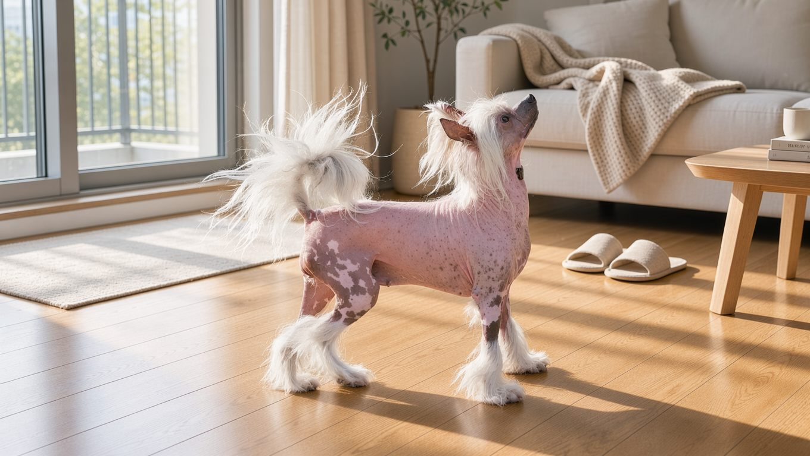
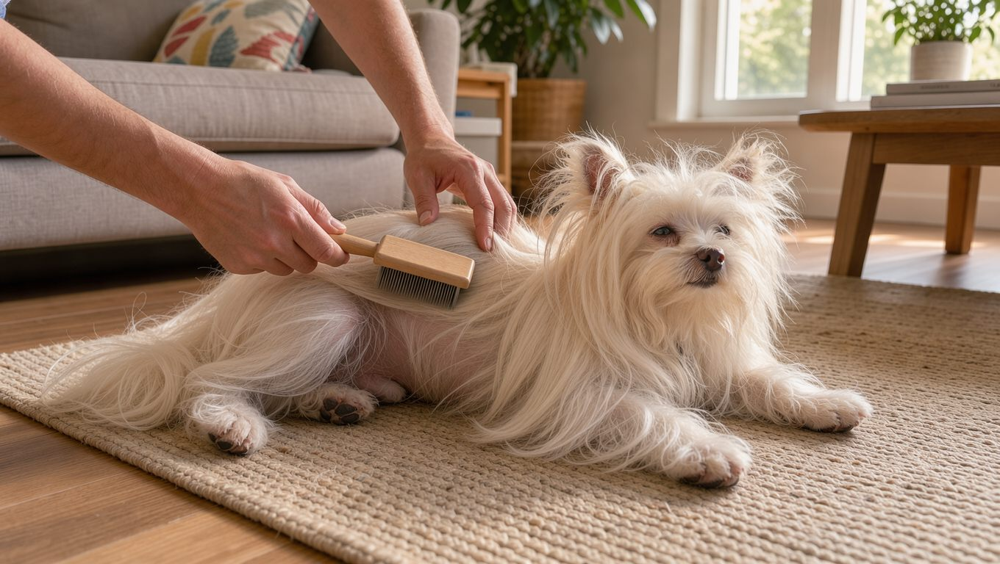

**2026년 11월 1일 기준**

## 빠른 답

**차이니즈 크레스티드 피부 관리는 어떻게 해야 하나요?**

털이 없는 헤어리스는 주 1회 목욕과 보습을, 전신이 긴 털로 덮인 파우더퍼프는 매일 빗질하는 것을 기본으로 합니다. 피부가 드러난 헤어리스는 자외선과 한파에 취약하므로 외출할 때 노출 부위를 보호해 주세요.

## 같은 품종인데 관리법이 두 갈래로 갈립니다

차이니즈 크레스티드는 헤어리스와 파우더퍼프라는 두 가지 모습으로 태어나는 견종입니다. 생김새가 크게 다른 만큼 피부와 털을 관리하는 방법도 서로 다릅니다.

<dl>
<dt>헤어리스</dt>
<dd>머리와 발, 꼬리에만 털이 있고 몸통은 피부가 드러납니다. 피부가 자극과 자외선에 그대로 노출되는 쪽입니다.</dd>
<dt>파우더퍼프</dt>
<dd>전신이 부드러운 실크 이중모로 덮여 있습니다. 털 관리가 일상의 중심이 됩니다.</dd>
</dl>

VCA 동물병원은 두 바리에티의 관리가 털 유형에 따라 달라진다고 설명합니다. 이 글에서는 피부가 드러나는 헤어리스의 피부 관리와 긴 털을 가진 파우더퍼프의 털 관리 방법을 각각 살펴봅니다.

품종의 기원과 성격, 유전병은 [차이니즈 크레스티드 허브](/breeds/chinese-crested/)에서 다룹니다.

## 헤어리스: 씻고, 바르고, 완전히 말리기

VCA 동물병원은 헤어리스의 피부 관리를 **목욕과 보습을 주 1회**로 안내합니다. 털이 없어 피부가 외부에 직접 노출되는 만큼, 목욕 후 보습까지 꼼꼼하게 관리해야 합니다.

목욕은 강아지용 순한 샴푸로 하고, 헹굴 때는 잔여물이 남지 않도록 물로 충분히 헹궈 주세요. 털이 없어 몸 전체의 물기를 닦기는 쉽지만, 주름과 겨드랑이, 다리 사이에 남은 물기는 수건으로 꼼꼼히 제거해야 합니다.

목욕하지 않는 날에는 젖은 수건으로 몸을 가볍게 닦아 주면 피지와 먼지가 쌓이는 것을 줄일 수 있습니다. 피부가 드러난 견종인 만큼 여드름이나 블랙헤드 같은 모공 문제가 생기기 쉬운 것으로 알려져 있습니다. 눈에 띄는 여드름은 짜지 말고 병원에서 상담해 주세요.

## 선크림: 사람용은 쓰면 안 됩니다

Whole Dog Journal은 헤어리스 견종, 흰 털이나 얇은 털을 가진 개, 코와 눈꺼풀이 분홍빛인 개를 자외선에 취약한 그룹으로 꼽습니다. 차이니즈 크레스티드 헤어리스는 이 그룹에 해당합니다.

사람용 선크림에 흔히 들어 있는 **산화아연**과 **PABA**는 개에게 유독합니다. 반려견이 선크림을 바른 부위를 핥으면 유해 성분을 그대로 삼킬 수 있으므로 사람용 제품은 사용하지 않아야 합니다.

강아지 전용 선크림을 선택해 콧등과 코끝, 귀 끝, 입 주변, 안쪽 허벅지와 사타구니처럼 털이 적고 피부색이 옅은 부위에 발라 주세요. 눈가에는 바르지 않습니다. 처음 쓰는 제품은 작은 부위에 먼저 테스트하고 24~48시간 뒤에 자극이 생기는지 확인하는 것이 좋습니다.

제품에 따라 자외선 차단 효과가 나타나기까지 15~20분이 걸릴 수 있으므로 외출 전에 미리 발라 주세요. 다시 바르는 주기는 제품 라벨을 따르고, 물놀이를 한다면 방수 제품을 고르는 편이 좋습니다.

햇빛이 강한 오전 10시부터 오후 2시까지는 그늘에서 쉬게 하고, 아스팔트나 콘크리트 위에서 햇빛을 오래 쬐지 않도록 해 주세요. 자외선 아래 30분만 있어도 피부가 붉어질 수 있습니다.

**딱지허브 평가**: Whole Dog Journal이 제시한 오전 10시~오후 2시 회피는 자외선이 가장 강한 시간을 피하라는 기준입니다. 한국 여름 아파트 생활에서는 산책을 오전 7시 이전이나 해 질 무렵으로 옮기고, 낮 외출이 불가피할 때만 노출 부위에 강아지용 선크림을 바르는 편이 현실적입니다.

## 여름과 겨울: 온도 양 끝을 조심합니다

VCA는 차이니즈 크레스티드를 극심한 더위와 추위에 민감한 견종으로 분류합니다. 여름에는 그늘과 시원한 물을 준비하고, 한낮의 장시간 야외 활동은 피하는 것이 좋습니다. 해변이나 공원처럼 햇빛이 강한 곳에서는 얇은 선슈트나 면 셔츠가 선크림을 보완하는 대안이 됩니다.

겨울에는 보온 옷을 입히고 산책 시간을 짧게 나누어 여러 차례 다녀오는 것이 좋습니다. 목욕 직후 젖은 피부로 찬 바깥에 나가면 체온이 빠르게 떨어질 수 있으므로, 몸을 완전히 말린 뒤 외출합니다.

겨울철에는 실내 난방으로 공기가 건조해지면서 피부도 쉽게 건조해질 수 있습니다. 목욕 후에는 보습제를 발라 주고, 각질이 생기거나 피부가 붉어지면 보습 관리에 더욱 신경 써 주세요.

## 파우더퍼프: 실크 이중모는 매일 빗질이 답입니다

VCA 동물병원은 파우더퍼프의 털 관리를 **매일 빗질**로 안내합니다. 실크처럼 가늘고 부드러운 이중모는 쉽게 엉키므로 하루 한 번 빗질해 엉킨 털을 풀어 주는 것이 좋습니다. 빗질은 엉킨 털을 정리하는 동시에 피부에 이상이 없는지 살펴볼 수 있는 시간이기도 합니다.

목욕은 털이 더러워졌을 때 하고, 목욕 전에 먼저 빗질해 엉킨 털을 풀어 주세요. 젖은 털은 쉽게 엉키므로 목욕 후에는 약한 바람으로 털 뿌리까지 충분히 말려 주세요. 목욕 주기와 순서는 [강아지 목욕 주기 가이드](/guides/dog-bath-schedule/)에 정리되어 있습니다.

## 자주 묻는 질문

**헤어리스 피부가 유독 예민한 이유는 무엇인가요?**

몸통에 털이 없어 피부가 외부 자극과 자외선에 직접 노출되기 때문입니다. VCA도 노출된 피부는 자극과 환경 손상에 더 취약하다고 설명합니다.

**헤어리스와 파우더퍼프 중 관리가 더 쉬운 쪽은 어느 쪽인가요?**

씻고 보습하는 일이 잦은 헤어리스와 매일 빗질해야 하는 파우더퍼프는 번거로움의 종류가 다릅니다. 피부 관리에 부담을 느낀다면 헤어리스를 신중하게 고려하고, 매일 빗질할 시간이 부족하다면 파우더퍼프는 피하는 것이 좋습니다.

**사람용 선크림을 조금 발라도 괜찮을까요?**

안 됩니다. 사람용 선크림에 흔한 산화아연과 PABA가 개에게 유독하고, 반려견이 핥아 삼킬 수도 있습니다. 강아지 전용 제품만 사용해 주세요.

**겨울 실내에서도 보습이 필요한가요?**

난방으로 실내 공기가 건조해지면 피부도 쉽게 건조해질 수 있습니다. 목욕 뒤 보습을 빠뜨리지 않고, 피부가 하얗게 일어나면 보습제를 한 번 더 발라 주세요.

**피부가 붉어지거나 벗겨지면 병원에 가야 하나요?**

햇빛에 노출된 후 피부가 붉어지거나 열감이 생기고 각질이 벗겨진다면 일광화상을 의심할 수 있습니다. 붓거나 물집이 잡히는 등 증상이 심하면 수의사 진료를 받으세요.

## 출처

- [Chinese Crested | VCA Animal Hospitals](https://vcahospitals.com/know-your-pet/chinese-crested) (헤어리스 주 1회 목욕과 보습, 파우더퍼프 매일 빗질, 노출 피부의 자외선과 한파 주의, 온도 극단 민감)
- [Do Dogs Need Sunscreen? | Whole Dog Journal](https://www.whole-dog-journal.com/health/do-dogs-need-sunscreen/) (사람용 선크림의 산화아연과 PABA 독성, 강아지용 선크림 사용법, 자외선 시간대, 일광화상 신호)

표지 이미지는 AI로 생성한 이미지입니다.
