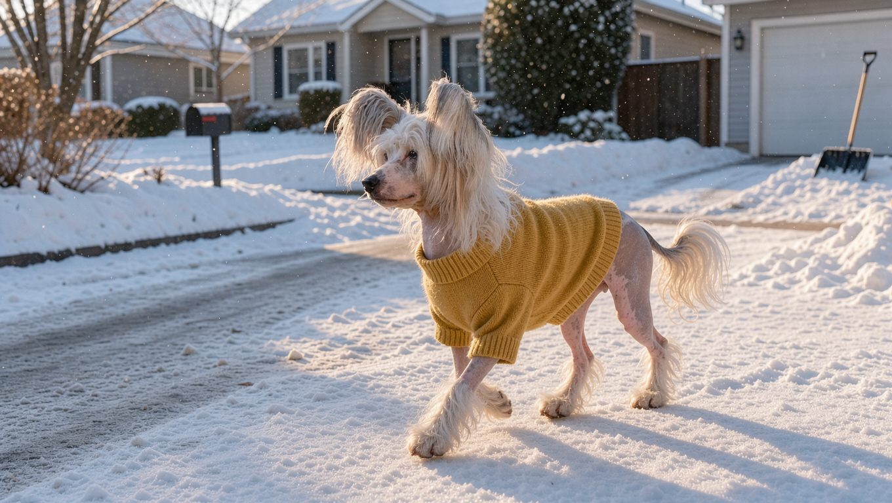

**2026년 10월 16일 기준** — 분양가 등 시점에 따라 달라지는 정보를 담았으며, 수치의 출처는 글 아래에 정리했습니다.

## 빠른 답

- **성격 한 줄**: FCI 표준은 이 견종의 기질을 "쾌활하며 결코 사납지 않다(Happy, never vicious)"로 규정합니다. 사람과 함께하는 것을 좋아하는 반려견으로 소개됩니다.
- **아파트에서 키울 수 있나?**: 가능합니다. 체구가 작아 아파트 생활에도 비교적 잘 적응하는 견종으로 소개됩니다(PetMD). 다만 헤어리스는 계절마다 햇빛과 추위 대비가 필요합니다.
- **처음 키우는 사람에게 맞나?**: 성격이 온순한 편이라 기본적인 양육이 크게 어렵지는 않습니다. 다만 헤어리스는 피부 관리가, 파우더퍼프는 빗질과 미용이 일상적인 관리의 일부가 됩니다. 이 관리가 꾸준히 가능한지가 첫 견종으로 고를 때의 판단 기준입니다.

## 품종 개요

차이니즈 크레스티드(차이니스 크레스티드로 표기하기도 합니다)는 중국이 원산지로 알려진 소형 반려견입니다. FCI(국제 애견 연맹) 표준은 원산지를 중국, 보증국을 영국으로 적고 있습니다. 한(Han) 왕조 시대에 보물 창고를 지키던 개에서 비롯됐다는 기원설이 전해집니다. 1885년부터 1926년까지는 미국 도그쇼에도 모습을 드러냈습니다. 이름과 달리 유전체 연구는 이 견종의 기원이 멕시코 쪽일 가능성을 가리킵니다(PetMD).

<dl>
<dt>크기</dt>
<dd>소형견입니다. FCI 표준 체고는 수컷 28~33cm, 암컷 23~30cm입니다.</dd>
<dt>체중</dt>
<dd>3.6~5.4kg 안팎입니다. FCI 표준은 5.4kg을 넘지 않도록 정하고 있습니다.</dd>
<dt>수명</dt>
<dd>13~18년입니다. 소형견 중에서도 수명이 긴 편으로 알려져 있습니다(PetMD).</dd>
<dt>그룹</dt>
<dd>AKC 기준 토이 그룹, FCI 기준 9그룹(반려견)입니다.</dd>
<dt>털 관리 난이도</dt>
<dd>바리에티에 따라 완전히 갈립니다. 헤어리스는 피부 관리, 파우더퍼프는 빗질과 미용이 중심입니다.</dd>
</dl>

## 헤어리스와 파우더퍼프 — 한 견종, 두 가지 모습

차이니즈 크레스티드의 가장 큰 특징은 한 견종 안에 두 가지 바리에티(계열)가 있다는 점입니다. 같은 배에서 헤어리스와 파우더퍼프가 함께 태어나기도 합니다.

- **헤어리스**: 몸통이 매끈한 피부로 덮여 있으며, 털은 머리의 크레스트(볏), 발의 양말, 꼬리의 플룸(장식 깃털) 등에 자랍니다. 노출된 피부색은 분홍빛부터 짙은 색까지 개체마다 다릅니다.
- **파우더퍼프**: 전신을 덮는 긴 실크 털을 가진 이중모 타입입니다. 겉보기에는 일반적인 장모 소형견과 비슷한 실루엣입니다.
- **공통**: 체형은 섬세한 사슴형(deer)과 묵직한 코비형(cobby)으로 나뉘고, 모색은 메를을 제외하면 어떤 색이든 허용됩니다(FCI).

헤어리스에게는 유전적으로 나타나는 특징이 하나 더 있습니다. 피부 노출을 만드는 유전자가 치아 발달에도 영향을 주어, 결손이나 배열 이상이 비교적 흔한 편입니다. FCI 표준도 헤어리스의 치아 결손은 감점하지 않습니다. 앞으로 향한 송곳니 역시 원시적인 특징으로 취급합니다.

## 성격과 기질

차이니즈 크레스티드의 FCI 표준 기질 문구는 짧고 분명합니다. "쾌활하며 결코 사납지 않다"는 한 줄입니다. PetMD는 이 견종을 애정 표현이 많은 반려견으로 소개하며, 고양이를 닮은 태도를 보인다고 설명합니다. 골격이 가늘고 섬세한 편이므로 어린아이가 만지거나 안을 때는 어른이 곁에서 지켜보는 것이 안전합니다(PetMD).

## 한국에서 키울 때

### 분양가

2026년 10월 국내 반려동물 문답에 올라온 차이니즈 크레스티드 분양가 참고치는 300만~500만 원입니다. 통계에 근거한 자료가 아니라 개별 답변에서 제시된 금액이므로 참고치로만 보는 것이 좋습니다. 미국에서는 평판 좋은 브리더를 통해 분양받는 경우 수천 달러 수준으로 안내됩니다(PetMD). 분양 전에는 부모견의 검진 이력을 확인하는 것이 좋습니다.

### 아파트와 법

체구가 작아 아파트 생활에 잘 맞는 견종으로 안내됩니다(PetMD). 법정 맹견 5종에 해당하지 않아 입마개 의무 대상이 아니며, 국내에서 양육이 제한되는 견종도 아닙니다.

### 여름과 겨울

헤어리스는 노출된 피부가 햇빛을 그대로 받습니다. 여름 산책에는 강아지용 선크림이나 옷으로 가려 주는 것이 안내되고, 자외선 노출이 쌓이면 피부 종양 위험이 높아질 수 있습니다. 겨울에는 털이 거의 없는 피부가 추위에 직접 노출되므로 추위에 취약합니다. PetMD는 비교적 온화한 날에도 스웨터나 코트가 필요할 수 있다고 설명합니다. 파우더퍼프도 체구가 작아 한파에는 보온에 신경 쓰는 것이 좋습니다.

### 건강에서 주의할 것

<dl>
<dt>치아</dt>
<dd>치아 결손과 치주질환이 흔해 어린 나이부터 치아 건강에 각별히 신경 써야 합니다. 구강 문제를 오래 두면 전신 건강에도 부담이 될 수 있습니다. 관리 방법은 <a href="/guides/dog-periodontal-disease/">강아지 치주질환 가이드</a>에서 자세히 다룹니다.</dd>
<dt>눈</dt>
<dd>원발성 수정체 탈구(PLL)와 진행성 망막 위축(PRA)이 보고됩니다. PLL은 경우에 따라 수술적 치료가 가능하지만, PRA는 치료법이 없어 시력 상실로 이어질 수 있습니다(PetMD).</dd>
<dt>관절</dt>
<dd>슬개골 탈구, 고관절 형성부전, 레그-페르테스병이 관리 대상으로 꼽힙니다(PetMD). 증상과 대처는 <a href="/guides/dog-patellar-luxation/">강아지 슬개골 탈구 가이드</a>를 참고하면 좋습니다.</dd>
<dt>그 외</dt>
<dd>태어날 때부터 들리지 않는 개체도 있어 수화 신호 훈련이 권장됩니다. OFA는 번식 전에 눈, 슬개골, 심장, PLL, PRA, 청력 및 고관절 검사를 받을 것을 권장합니다(PetMD).</dd>
</dl>

## 관리법

### 피부 관리(헤어리스)

헤어리스의 피부는 건조해지기 쉽고 막힌 모공(코메돈)이 생기기도 합니다. 강아지용 선크림과 보습제를 상비하고, 순한 샴푸로 씻어 주는 것이 기본 관리로 안내됩니다(PetMD).

### 털 관리(파우더퍼프)

파우더퍼프는 일주일에 몇 차례 빗질하고 정기적으로 미용 트리밍을 받는 것이 좋습니다(PetMD). 빗질과 미용이 꾸준히 필요하다는 점에서 헤어리스와 관리 방식이 크게 다릅니다.

### 치아 관리

헤어리스와 파우더퍼프 모두 치아 관리가 중요합니다. 매일 양치를 기본으로 하고, 수의사와 상담해 정기 클리닝 일정을 잡는 것이 권장됩니다(PetMD). 이 견종은 치아 결손과 치주질환이 특히 흔하므로 어릴 때부터 양치 습관을 들이는 것이 좋습니다.

## 자주 묻는 질문

### 차이니즈 크레스티드는 정말 털이 없나요?

헤어리스도 머리의 크레스트와 발의 양말, 꼬리의 플룸에는 털이 있습니다. 완전히 매끈한 것은 몸통뿐입니다. 파우더퍼프는 전신이 긴 털로 덮인 이중모 타입이며, 두 타입은 같은 배에서 함께 태어나기도 합니다.

### 헤어리스와 파우더퍼프 중 어떤 쪽을 고르면 좋나요?

갈리는 지점이 다릅니다. 헤어리스는 빗질이 필요 없는 대신 피부 관리(선크림, 보습, 계절 보온)가 따라오고, 파우더퍼프는 피부 부담이 적은 대신 빗질과 미용이 꾸준히 필요합니다. 일상에서 어느 쪽을 감당할 수 있는지로 고르면 좋습니다.

### 차이니즈 크레스티드 수명은 얼마나 되나요?

13~18년으로 안내됩니다(PetMD). 소형견 중에서도 수명이 긴 편이므로 노령기에 필요한 관리까지 미리 고려하는 것이 좋습니다.

### 분양가 참고치는 얼마인가요?

2026년 10월 기준 국내 문답 참고치는 300만~500만 원입니다. 통계가 아니므로 참고치로만 보고, 분양 전에는 부모견의 검진 이력을 확인하는 것이 좋습니다. 미국에서는 평판 좋은 브리더 분양가가 수천 달러대로 안내됩니다(PetMD).

### 추위와 더위는 얼마나 타나요?

헤어리스는 더위와 추위 모두에 취약한 편입니다. 여름에는 노출 피부를 선크림과 옷으로 가려 주고, 겨울에는 스웨터나 코트로 보온하는 것이 안내됩니다(PetMD). 파우더퍼프도 체구가 작아 한파에는 보온에 신경 쓰는 것이 좋습니다.

## 출처

- [Chinese Crested — PetMD](https://www.petmd.com/dog/breeds/chinese-crested) (체고·체중·수명·바리에티·피부 관리·치아·유전병·아파트 적합성)
- [FCI Standard No. 288 — Chinese Crested Dog](http://fci.be/Nomenclature/Standards/288g09-en.pdf) (체고·체중 상한·바리에티·체형 구분·모색 허용 범위·치아 규정·기질 문구)
- [궁금하넷 문답 — 차이니즈 크레스티드 분양가](https://ggha.net/content/view.php?cate=7&page=27&id=115526) (2026년 10월 국내 분양가 참고치)

표지는 AI로 생성한 이미지입니다.
