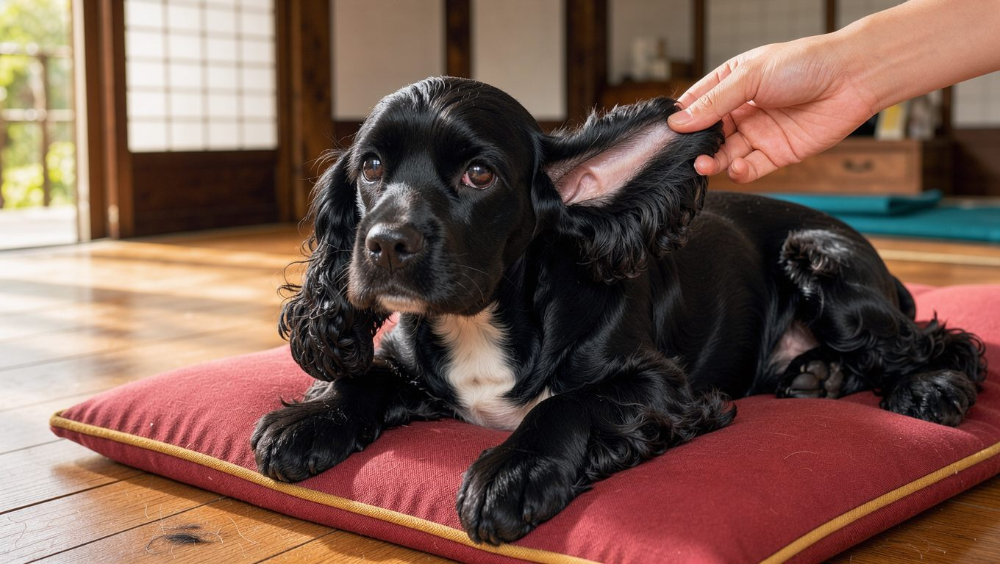

**2026년 11월 10일 기준** — 분양 시세처럼 달라질 수 있는 정보는 확인 시점을 함께 밝힙니다.

## 빠른 답

- **성격 한 줄**: 밝고 장난기 많으며 사람을 좋아합니다. 칭찬과 보상에 잘 반응해 기본 교육도 수월한 편입니다.
- **아파트에서 키울 수 있나?**: 활동량이 지나치게 많은 견종은 아니어서 아파트에서도 생활할 수 있습니다. 다만 긴 털과 접힌 귀를 꾸준히 관리해야 합니다.
- **처음 키우는 사람에게 맞나?**: 성격은 온순한 편이라 처음 강아지를 키우는 사람에게도 잘 맞습니다. 다만 빗질과 귀 관리를 꾸준히 해 줄 수 있어야 합니다.
- **귀 관리는 왜 중요한가?**: 늘어진 귀는 통풍이 잘되지 않아 습기가 차기 쉽고, 이로 인해 외이염이 발생할 가능성이 높습니다. 목욕이나 수영 뒤에는 귀를 잘 말려 주는 것이 좋습니다.

## 품종 개요

코카 스패니얼은 사냥개에서 출발한 스포팅 그룹 견종입니다. 큰 눈과 명랑하고 장난기 넘치는 표정이 특징이며, 오늘날에는 사냥개보다 가족과 함께하는 반려견으로 더 널리 알려져 있습니다(AKC). 한국에서는 '코카스파니엘'이라는 표기가 더 익숙하며, 일반적으로 미국식 코카 스패니얼을 가리킵니다.

영국식 코카 스패니얼인 잉글리시 코카 스패니얼은 미국식보다 체격이 크고 주둥이가 길며 활동량도 많은 편입니다. 두 견종은 같은 조상에서 유래했지만 체형과 털 관리 방식에는 차이가 있습니다. 이 글에서는 한국에서 흔히 '코카 스패니얼'이라고 부르는 미국식 코카 스패니얼을 중심으로 설명합니다.

기본 정보는 다음과 같습니다.(PetMD)

<dl>
<dt>체고</dt><dd>약 34~39cm</dd>
<dt>체중</dt><dd>약 9~14kg</dd>
<dt>수명</dt><dd>10~14년</dd>
<dt>그룹</dt><dd>AKC 스포팅</dd>
<dt>털 관리</dt><dd>주 1회 이상 빗질, 정기 전문 미용</dd>
<dt>초보 적합도</dt><dd>보통 — 성격은 순하지만 관리 시간이 필요합니다</dd>
</dl>

국립축산과학원의 중형견 체중 기준은 10~25kg이며, 코카 스패니얼도 이 범위에 해당합니다. [중형견 10종 비교 가이드](/guides/medium-dog-types/)에서 다른 중형견과 체중, 성격, 운동량을 나란히 볼 수 있습니다.

## 성격과 기질

코카 스패니얼은 사람을 좋아하며 다른 사람이나 동물과도 대체로 잘 어울립니다. 장난기 넘치는 모습으로 보호자를 따라다니는 것도 이 견종이 사랑받는 이유 중 하나입니다. 칭찬과 보상에 반응이 좋아 기본 훈련이나 예절 교육이 어렵지 않은 편입니다(PetMD).

애교가 많고 보호자와 함께 있으려는 성향도 강합니다. 혼자 있는 시간에 적응하는 연습은 어린 시기부터 조금씩 시작하는 것이 좋습니다.

## 털과 색상

코카 스패니얼은 이중모를 가진 견종으로, 계절에 관계없이 털이 조금씩 빠집니다. 털이 엉키면 피부 문제로 이어질 수 있으므로 주 1회 이상, 가능하면 주 2~3회 빗질해 주는 것이 좋습니다(PetMD). 특히 다리와 귀 주변의 긴 털은 쉽게 엉키므로 정기적인 미용 일정을 정해 관리하는 것이 좋습니다.

목욕 후에는 털을 충분히 말려 피부와 귀 주변에 습기가 남지 않도록 해야 합니다. 정기적으로 전문 미용을 받으면 털을 깔끔하게 정돈할 수 있을 뿐 아니라 피부 상태도 함께 살펴볼 수 있습니다(PetMD). 털 유형에 맞는 목욕 주기는 [강아지 목욕 주기 가이드](/guides/dog-bath-schedule/)에서 확인할 수 있습니다.

색상은 크게 세 갈래입니다. 블랙, 흰색이 섞인 파티컬러, 블랙을 제외한 단색(ASCOB)입니다. 단색 계열에는 버프, 레드, 브라운, 실버 등이 포함됩니다. 털 색은 견종 표준에서 명칭을 정해 두므로, 분양처에서 부르는 색 이름과 표준 명칭이 다를 수 있습니다.

## 귀 관리 — 접힌 귀가 만드는 숨은 리스크

코카 스패니얼을 키울 때 특히 신경 써야 할 부분은 귀 관리입니다. 늘어진 귀가 귓구멍을 덮으면 통풍이 원활하지 않아 습기가 쉽게 차며, 귀 내부가 축축해지면 세균과 효모가 번식하기 좋은 환경이 됩니다(PetMD).

귀를 자주 긁거나 머리를 반복해서 흔드는 행동, 귀에서 나는 냄새와 붉어짐, 분비물 등은 염증을 의심할 수 있는 신호입니다. 목욕이나 수영 후에는 귀 주변을 충분히 말려 주고, 귀 청소 주기는 수의사와 상의해 정하는 것이 좋습니다(PetMD).

한국은 장마철에 습도가 높아 귀 내부에도 습기가 차기 쉽습니다. 장마와 무더위가 이어지는 시기에는 귀 상태를 더욱 자주 확인하고, 이상 징후가 나타나면 동물병원에서 진료받는 것이 좋습니다.

## 한국에서 키울 때

국내 반려동물 통계 플랫폼 PetLens에 따르면 누적 동물등록 건수는 349만 건이며, 매년 약 26만 건이 새로 등록됩니다. 국내 반려견 수는 546만 마리이며, 반려동물을 키우는 가구는 591만 가구로 집계됩니다. 말티즈와 푸들이 인기 품종의 절반가량을 차지하며, 코카스파니엘은 상위 5위권에는 들지 않지만 중형 스포팅 견종 가운데 꾸준한 분양 수요가 있는 품종으로 소개됩니다(PetLens).

국내 분양 시세는 공개된 통계가 없어 업체별 차이가 큽니다. 혈통과 부모견의 건강검진 기록, 강아지의 상태 등에 따라 분양가가 달라집니다. 따라서 지나치게 낮은 가격만을 기준으로 선택하기보다 부모견의 눈과 귀 검진 기록, 강아지의 접종 이력을 직접 확인하는 것이 안전합니다.

여름철에는 이중모와 접힌 귀의 특성을 고려해 습기 관리에 더욱 신경 써야 합니다. 산책은 해가 뜨기 전이나 진 뒤로 옮기고, 실내에서는 서늘한 자리를 마련해 주는 것이 좋습니다.

## 아파트 생활과 운동

코카 스패니얼은 활동량이 비교적 적당한 견종입니다. 하루 여러 차례 산책하고 공 가져오기나 실내 놀이를 함께 해 주면 활동 욕구를 충족하는 데 도움이 됩니다(PetMD). 따라서 넓은 마당이 없는 환경에서도 충분히 생활할 수 있습니다.

실내에서는 노즈워크나 간단한 장애물 놀이로 정신적 자극을 주면 좋습니다. 다만 이중모와 접힌 귀를 가진 견종인 만큼 실내에서도 습기가 차지 않도록 관리해야 합니다. 목욕이나 물놀이 후에는 털과 귀 주변을 충분히 말려 주고, 여름철에는 기온이 낮은 시간대를 골라 산책하는 것이 좋습니다.

## 자주 묻는 질문

### 코카 스패니얼의 수명은 얼마나 되나요?

평균 수명은 10~14년입니다. 고관절 이형성증이나 폰빌레브란트병 등의 질환이 발생할 수 있으므로 정기적인 건강검진을 받는 것이 좋습니다(PetMD).

### 코카 스패니얼과 잉글리시 코카 스패니얼은 어떻게 다른가요?

한국에서 '코카 스패니얼'이라고 하면 일반적으로 미국식 코카 스패니얼을 의미합니다. 잉글리시 코카 스패니얼은 체격이 더 크고 주둥이가 길며 활동량이 많은 편입니다. 두 견종 모두 사냥개에서 유래했기 때문에 사람과 함께 활동하는 것을 좋아합니다.

### 귀 청소는 얼마나 자주 해야 하나요?

귀 청소는 일률적인 주기를 따르기보다 귀 상태에 맞춰 관리하는 것이 좋습니다. 목욕이나 수영 뒤에는 반드시 귀를 말리고, 귀를 자주 긁거나 냄새가 나면 수의사와 청소 주기를 상의하는 것이 좋습니다(PetMD).

### 털 빠짐이 심한가요?

이중모를 가진 견종으로 계절에 관계없이 털이 조금씩 빠집니다. 주 1회 이상 빗질하고 정기적으로 미용을 받으면 털 엉킴을 줄이고 집안에 빠지는 털도 관리하는 데 도움이 됩니다(PetMD).

### 분양 시세는 어느 정도인가요?

공개된 통계가 없어 업체마다 다릅니다. 가격보다 부모견의 검진 기록과 접종 이력을 직접 확인하는 것이 안전합니다.

## 출처

- [Cocker Spaniel Dog Breed Health and Care](https://www.petmd.com/dog/breeds/cocker-spaniel) — 체고·체중·수명, 성격, 털과 귀 관리, 주요 질환
- [Cocker Spaniel](https://www.akc.org/dog-breeds/cocker-spaniel/) — 사냥견 기원과 기질
- [코카스파니엘 등록 현황과 인기 추이](https://petlens.kr/%ec%bd%94%ec%b9%b4%ec%8a%a4%ed%8c%8c%eb%8b%88%ec%97%98-registration/) — 국내 동물등록 통계와 품종 인기
- 표지 이미지는 AI로 생성했습니다.
