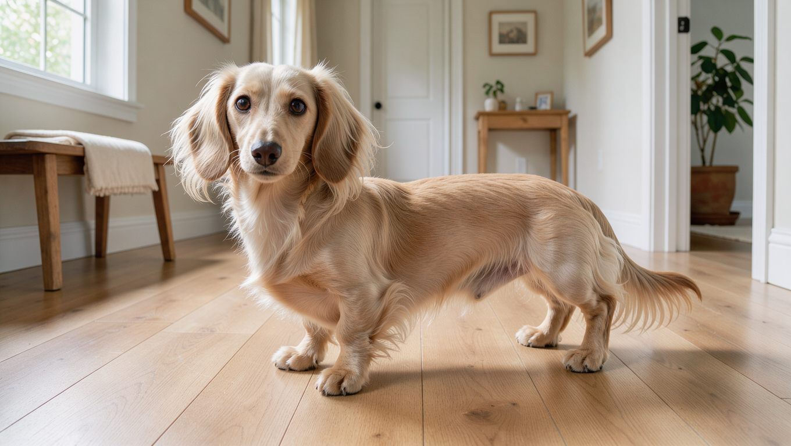
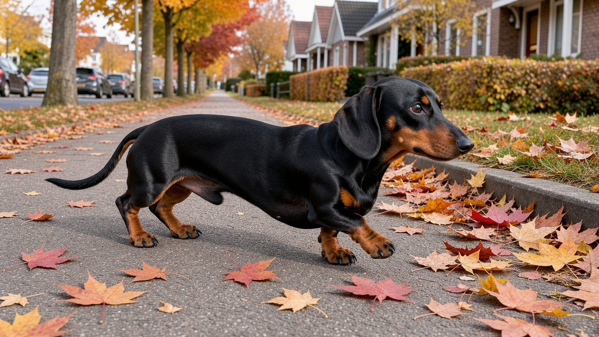
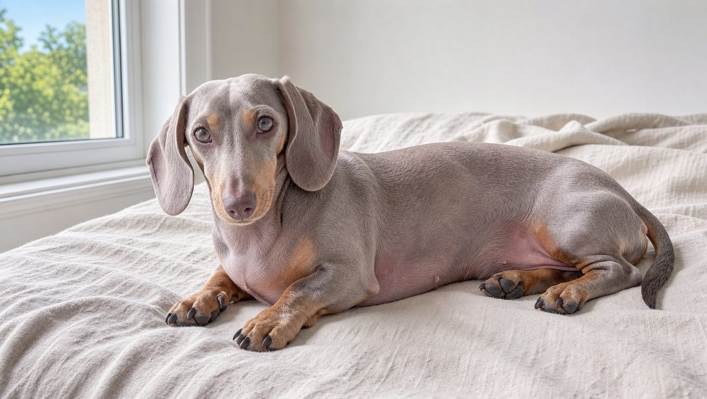
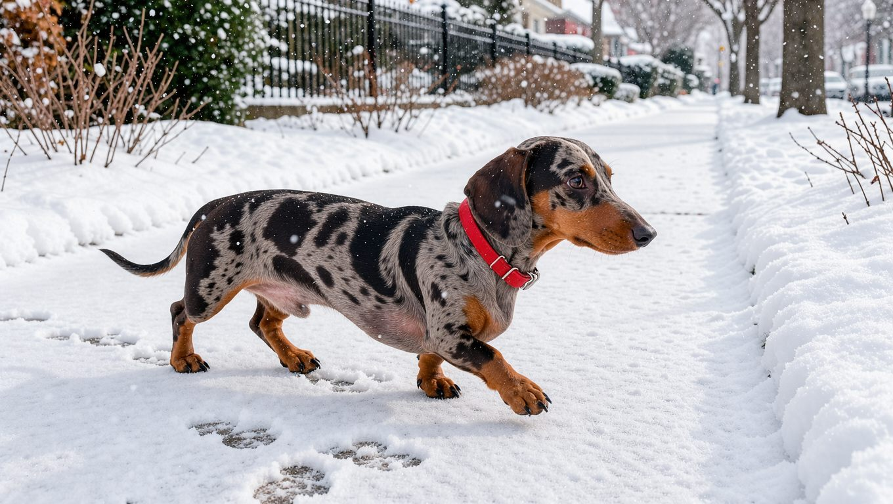
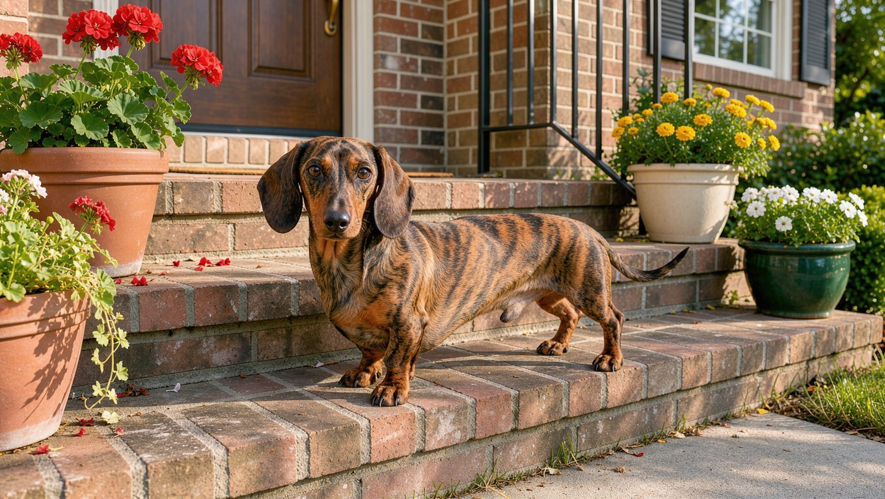

닥스훈트는 단모, 장모, 강모 세 가지 모질을 가진 견종으로, 바탕색과 무늬의 조합에 따라 색상 이름이 달라집니다. 이 글에서는 미국 닥스훈트클럽(DCA)의 색상 문서를 기준으로 색상 이름이 만들어지는 구조와 색상별 특징, 국내에서 통하는 표기, 그리고 색과 함께 확인해야 할 건강 요소를 다룹니다. 견종의 성격과 척추 관리법이 먼저 궁금하다면 [닥스훈트 허브 글](/breeds/dachshund/)을 참고해 보세요.

## 빠른 답

**닥스훈트 색상은 몇 가지이고, 어떤 색이 인기인가요?**

DCA의 품종 표준이 기본으로 삼는 색상은 레드, 크림, 블랙 앤 탄, 초콜릿 앤 탄, 와일드 보어, 그레이(블루), 폰(이자벨라) 일곱 가지입니다. 여기에 데플, 브린들, 세이블, 파이볼드 같은 무늬가 조합되어 이름이 훨씬 다양해집니다. 국내 자료에서는 블랙 앤 탄(블랙탄)이 인기가 많고 레드도 흔하게 보인다고 설명하며, 블루 계열은 '실버', 데플은 '점박이'라는 통칭으로 더 자주 불립니다. 색마다 유전 방식이 달라서, 희석 색상과 데플은 입양 전에 확인할 항목이 있습니다.

## 색 이름을 읽는 기본 구조

개의 털 색소는 검정과 빨강 두 가지뿐이고, 나머지 색상은 이 두 색소를 희석하거나 배분하는 유전자 조합으로 만들어집니다. 흰 털은 색소가 만들어지지 않은 부분입니다. DCA 문서는 무늬가 있는 개체의 이름을 만들 때 바탕색을 앞에, 무늬를 뒤에 적는다고 설명합니다.

<dl>
<dt>바탕색이 먼저</dt>
<dd>'블랙 앤 탄 데플'은 블랙 앤 탄 바탕에 데플 무늬가 얹힌 개체라는 뜻입니다.</dd>
<dt>탄(tan) 마킹</dt>
<dd>눈썹 위 점, 주둥이, 가슴, 다리 등에 들어가는 밝은 갈색 마킹입니다. 검정이나 초콜릿 바탕과 짝을 이루며, 마킹의 밝기와 범위는 개체마다 다릅니다.</dd>
</dl>

## 원색(단색) 계열 — 레드와 크림

### 레드

DCA 문서는 레드와 블랙 앤 탄을 단모종과 장모종에서 가장 흔한 바탕색으로 소개합니다. 레드는 탄 마킹 없이 몸 전체가 붉은 갈색 계열로 이어지는 단색입니다. 같은 레드라도 일부는 블랙 앤 탄 유전자를 품고 있어서, 레드끼리 교배해도 블랙 앤 탄 새끼가 태어날 수 있습니다.

### 크림

붉은 기가 거의 없는 아이보리 계열의 밝은 단색입니다. DCA의 기본 색상 목록에 순백 단색은 없다는 점도 함께 알아 두면 좋습니다. 흰 털은 색소가 없는 부분이어서, 흰 무늬는 파이볼드 같은 무늬의 형태로 나타납니다.

## 검정과 초콜릿 바탕 — 블랙 앤 탄과 초콜릿 앤 탄

### 블랙 앤 탄

검은 바탕에 눈썹, 주둥이, 가슴, 다리에 탄 마킹이 들어가는 조합입니다. 국내에서는 '블랙탄'으로 줄여 부르며 가장 익숙한 색상 가운데 하나입니다. 같은 블랙 앤 탄이라도 탄 마킹의 밝기와 범위는 개체마다 다릅니다.

### 초콜릿 앤 탄

초콜릿 바탕에 탄 마킹이 들어가는 조합으로, 국내에서는 '초코탄'이라고 부릅니다. 짙은 밤색 바탕이라 검정 바탕보다 부드러운 인상을 주며, 국내에서는 블랙 앤 탄만큼 흔하게 보이지는 않는 편입니다.

## 희석 색상 — 블루 앤 탄과 이자벨라

블루와 이자벨라는 새 색소가 아니라, 검정과 초콜릿이 유전적으로 희석되어 나타나는 색입니다. DCA 문서는 블루를 검정의 희석으로, 이자벨라(폰)를 초콜릿의 희석으로 봅니다.

### 블루 앤 탄

검정이 희석되어 푸르스름한 은회색으로 보이는 색입니다. 국내에서 '실버'라는 이름으로 부르는 개체는 대개 이 블루 계열이거나, 아래에서 소개할 블랙 앤 탄 데플입니다.

DCA 문서는 블루와 이자벨라 같은 희석 색상이 얇은 털, 피부 민감, 백신 접종 실패, 수명 단축과 연관될 수 있다고 밝히고 있습니다. 다만 원문 표현 그대로 '가능성'이며, 색만으로 개체의 건강이 결정되는 것은 아닙니다.

### 이자벨라(폰)

초콜릿이 희석되어 분홍빛이나 연보라빛이 도는 회색으로 나타나는 색입니다. 표준 문서에는 폰(Fawn) 또는 이자벨라(Isabella)로 적혀 있고, 국내에서는 '이사벨라'로 표기하는 경우가 많습니다.

## 와일드 보어

DCA 표준은 와일드 보어를 색상으로 분류하지만, 문서는 실제로는 무늬에 가깝다고 설명합니다. 털 한 올 한 올에 색 띠가 들어가 전체가 회끗회끗한 느낌을 주며, 주로 강모종에서 보입니다.

## 무늬 계열 — 데플, 브린들, 세이블, 파이볼드

바탕색 위에 더해지는 무늬입니다. 같은 바탕색이라도 무늬에 따라 이름이 완전히 달라집니다.

### 데플(점박이)

바탕색 위에 밝은 부분과 어두운 부분이 불규칙하게 섞이는 무늬로, 국내에서는 '점박이'나 '데플'로 부릅니다. 멀(merle) 유전자는 한쪽만 있어도 무늬가 나타나는 우성 유전자입니다. 블랙 앤 탄 데플은 회색 얼룩이 강해 흔히 '실버 데플'로 불리는데, DCA 문서도 이 이름이 공식 명칭이 아니라 통칭이라는 점을 짚고 있습니다. 데플은 눈이 푸르스름하게 섞일 수 있고, 가슴의 넓은 흰 무늬도 허용됩니다.

**데플끼리 교배하면 더블 데플이 태어날 수 있습니다.** 이론상 새끼의 25%가 더블 데플로 태어납니다. 더블 데플은 청력 이상 비율이 25%로 일반 데플(5%)보다 높고, 눈이 작아지는 문제나 시력 저하, 몸의 넓은 흰 무늬가 함께 나타날 수 있습니다. 이 때문에 DCA는 데플을 블랙 앤 탄이나 초콜릿 앤 탄과 교배하도록 권하고, 수의유전학 자료도 데플끼리의 교배를 피하도록 권장합니다. 겉보기에 단색인 레드 데플은 성장하면서 얼룩이 흐려져 알아보기 어려울 수 있어, 무늬 보유 여부는 유전자 검사로 확인하기도 합니다.

**딱지허브 판단**: 데플끼리의 교배를 피하는 것이 원칙이지만, 이미 태어난 더블 데플 개체가 모두 같은 문제를 겪는 것은 아닙니다. 다만 국내에서 '실버 데플', '초코 데플' 이름으로 분양 글을 볼 때는 색상 이름보다 부모견의 무늬 조합을 확인하고, 흰 무늬가 넓은 개체라면 청력과 시력 확인 이력을 물어보는 것이 안전합니다.

### 브린들

바탕색 위에 더 짙은 색 줄무늬가 반복되는 무늬입니다. DCA 문서는 브린들이 나타나려면 부모 중 적어도 한쪽이 브린들이어야 한다고 설명합니다. 붉은 바탕에 검은 줄무늬가 얹힌 모습으로 자주 나타납니다.

### 세이블

DCA 문서는 세이블이 와일드 보어와 같은 띠 무늬 계열로, 붉은 털 위에 어두운 색이 덮이는 형태라고 설명합니다. 이마 한가운데에 검은 삼각형 무늬가 들어가는 것이 특징이며, 진짜 세이블이려면 부모 중 한쪽이 세이블이어야 합니다. 레드 장모에 검은 톤이 덮인 개체를 세이블로 오인하기 쉽다는 점도 문서가 함께 언급합니다.

### 파이볼드

바탕색 위에 흰 얼룩이 대칭으로 들어가는 무늬로, 국내에서는 '파이볼트'라고 적거나 바둑이 무늬로 부르기도 합니다. 눈에 파란 기가 없고 꼬리 끝이 희며, 점박이(티킹)가 섞이기도 합니다. DCA 기준으로 파란 눈, 머리 절반을 넘는 흰색, 귀나 눈가의 흰색, 머리를 뺀 몸통 전체의 흰색은 실격 사유입니다.

## 분양 글에서 보이는 한국식 이름

같은 색을 표기마다 다르게 부르는 경우가 많아, 색상 이름만으로 판단하기는 어렵습니다. 국내에서 자주 보이는 이름은 다음과 같습니다.

<dl>
<dt>블랙탄</dt>
<dd>블랙 앤 탄의 준말로, 국내에서 가장 흔하게 쓰이는 표기입니다.</dd>
<dt>초코탄</dt>
<dd>초콜릿 앤 탄의 준말입니다.</dd>
<dt>실버</dt>
<dd>표준에 없는 통칭으로, 블루 계열이나 블랙 앤 탄 데플을 가리킬 때 쓰입니다.</dd>
<dt>데플, 점박이</dt>
<dd>같은 무늬를 영문 이름과 번역 이름으로 부르는 경우입니다.</dd>
<dt>이사벨라</dt>
<dd>폰(이자벨라)의 국내 표기입니다.</dd>
<dt>파이볼트, 바둑이 무늬</dt>
<dd>파이볼드를 다르게 적거나 옮긴 표기입니다.</dd>
<dt>쉐이드</dt>
<dd>꼬리나 귀 끝 등에 검은색이 섞여 드는 경우를 이르는 말입니다.</dd>
</dl>

색상 이름은 자료마다 다르게 쓰이니, 분양 글을 볼 때는 이름보다 바탕색과 무늬, 부모견의 모색을 직접 확인하는 편이 확실합니다. 닥스훈트를 포함한 소형견의 건강 관리 항목을 견종별로 비교해 보고 싶다면 [소형견 종류 도감](/guides/small-dog-types/)을 참고해 보세요.

## 자주 묻는 질문

### 실버 닥스훈트는 어떤 색인가요?

실버는 품종 표준에 있는 공식 색상 이름이 아니라 통칭입니다. DCA 문서는 블랙 앤 탄 데플을 흔히 '실버 데플'로 잘못 부른다고 적고 있고, 국내에서는 블루 계열까지 묶어 실버로 부르는 경우가 많습니다. 분양 글에서 실버를 봤다면 바탕색이 블루인지, 무늬가 데플인지 확인해 보시는 것이 좋습니다.

### 데플과 더블 데플은 어떻게 다른가요?

데플은 멀 유전자 한쪽만 있어도 나타나는 무늬이고, 더블 데플은 부모 양쪽에서 멀 유전자를 물려받은 상태입니다. 더블 데플은 청력 이상 비율이 25%로 일반 데플보다 높고 시력 문제가 동반될 수 있어, 데플끼리의 교배는 피하도록 권장됩니다.

### 색상이 성격이나 수명에 영향을 주나요?

모색이 성격을 결정한다는 근거는 없습니다. 건강 쪽은 색에 따라 확인할 항목이 다릅니다. DCA는 블루, 이자벨라 같은 희석 색상이 얇은 털, 피부 민감 같은 문제와 연관될 수 있다고 밝히고 있고, 더블 데플은 청력과 시력 위험이 커집니다.

### 국내에서 가장 흔한 색상은 무엇인가요?

국내 자료에서는 블랙 앤 탄(블랙탄)이 인기가 많고 레드도 흔하다고 설명합니다. 초콜릿 앤 탄(초코탄)은 그보다 덜 보이는 편이고, 크림, 이자벨라, 데플 같은 색은 상대적으로 드물게 나타납니다.

### 어린 시기에 색이 바뀔 수 있나요?

레드 데플은 성장하면서 얼룩이 흐려져 무늬를 알아보기 어려워질 수 있습니다. 이 때문에 데플 여부를 유전자 검사로 확인하는 경우가 있다는 점도 DCA 문서가 함께 다루고 있습니다.

## 출처

- [Dachshund Colors & Patterns — Dachshund Club of America](http://www.dachshundclubofamerica.org/wp-content/uploads/2014/02/Dachshund-Colors-and-Patterns-2.pdf) (표준 색상·무늬 목록, 희석 색상 건강 언급, 실버 데플 통칭, 더블 데플 위험과 교배 권고)
- [Dog Genetic Profile – Merle — Laboratoire de génétique vétérinaire](https://labgenvet.ca/en/dog-genetic-profile-merle/) (멀 유전 방식, 더블 멀의 청력 이상 비율과 시력 위험)
- [닥스훈트 — 나무위키](https://namu.wiki/w/%EB%8B%A5%EC%8A%A4%ED%9B%88%ED%8A%B8) (국내 통용 모색 표기, 인기 색상 언급)
- 표지와 본문 이미지는 AI로 생성한 실사풍 이미지입니다.
