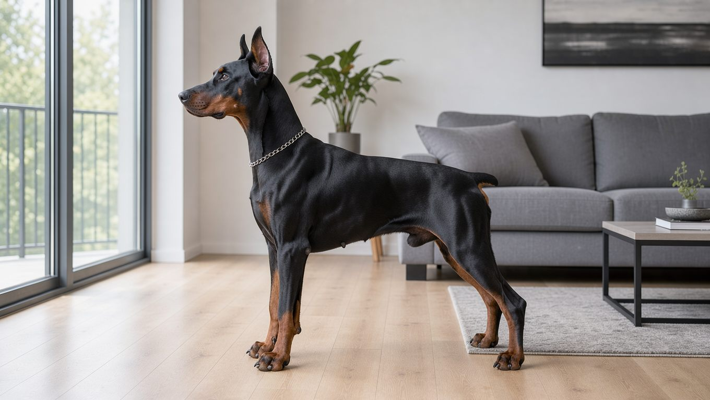
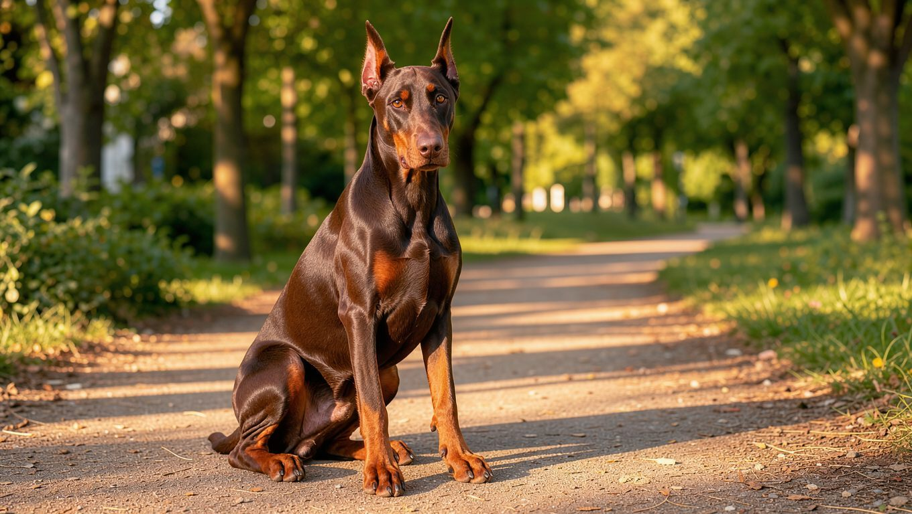
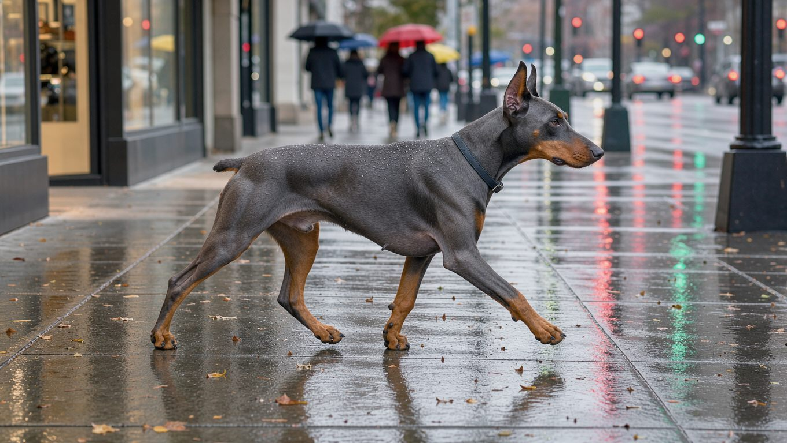
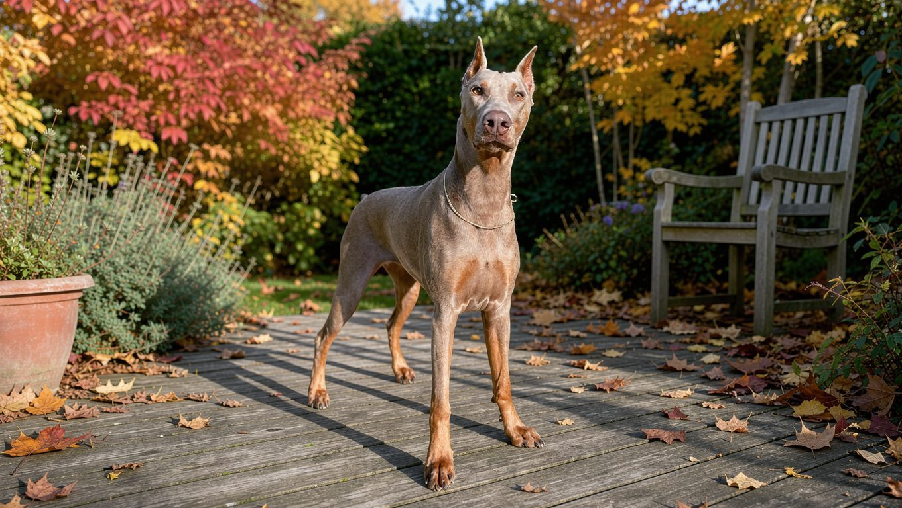

**2026년 10월 26일 기준**

## 빠른 답

**도베르만은 어떤 색상이 공인되어 있나요?**
공인 색상은 블랙, 레드, 블루, 폰 네 가지입니다. 네 색 모두 눈썹과 주둥이, 가슴, 다리, 꼬리 아래에 러스트(적갈색) 마킹을 갖춰야 합니다. 화이트는 이 네 가지에 들어가지 않습니다. 색소가 만들어지지 않는 알비노 변이이기 때문입니다.

**블루와 폰은 어떤 색인가요?**
블루는 블랙이 옅어진 희석색이고, 폰은 레드가 옅어진 희석색입니다. 표준에서 정식으로 인정하는 색상입니다.

## 색 이름을 읽는 법 — 기본색 두 개와 러스트 마킹

도베르만의 색은 블랙과 레드 두 기본색, 그리고 각각이 옅어진 블루와 폰으로 묶입니다. 미국 도베르만 핀셔 클럽(DPCA)은 블루를 "블랙의 희석", 폰을 "레드의 희석"이라고 설명하며, 네 색을 같은 품질 기준으로 평가한다고 밝힙니다. 색에 따라 우열을 두지 않는다는 뜻입니다.

색상을 구분하는 기준은 몸통의 털색만이 아닙니다. 표준에서는 네 가지 색상 모두 같은 위치에 러스트 마킹이 있어야 한다고 규정합니다.

- **러스트 마킹** — 눈 위의 점, 주둥이, 목과 앞가슴, 모든 다리와 발, 꼬리 아래에 또렷하게 들어가야 합니다.
- **가슴의 흰 점** — 0.5제곱인치(약 3cm², 10원 동전 크기) 이하일 때만 허용됩니다.
- **허용되지 않은 색** — 표준은 공인 색상이 아닌 개체를 결격으로 규정합니다.
- **눈동자** — 네 색 모두 어두운 눈을 요구합니다.

## 색상별 도감

### 블랙 앤 러스트 — 가장 흔한 기본색

도베르만 하면 가장 먼저 떠오르는 대표적인 색상입니다. 광택이 도는 검은 털 위로 러스트 마킹이 또렷하게 대비됩니다. DPCA는 블랙이 단위 면적당 털의 밀도가 가장 높아 코트가 가장 촘촘하다고 설명합니다. 국내 분양 시장에서도 가장 흔하게 볼 수 있는 색상입니다.

검은 털은 여름철 햇볕을 많이 흡수합니다. 한낮을 피해 아침이나 저녁에 산책하는 편이 좋습니다.

### 레드 앤 러스트 — 초콜릿빛 기본색

레드는 블랙과 함께 도베르만의 두 가지 기본색에 속합니다. 초콜릿이나 밤색에 가까운 진한 갈색이며, 러스트 마킹과의 경계가 블랙만큼 강하게 보이지 않아 전체적으로 부드러운 인상을 줍니다. 국내에서는 '레드' 또는 '레드 탄'으로 표기합니다.

### 블루 앤 러스트 — 블랙의 희석색

블루는 블랙이 옅어진 색입니다. 광택이 도는 청회색 털에 러스트 마킹이 들어갑니다. 빛이 강한 야외에서는 푸른 기가 도는 회색으로 보입니다. 희석 색 중에서는 비교적 자주 볼 수 있지만, 블랙보다는 개체 수가 적습니다. 국내에서는 '블루' 또는 '블루 탄'으로 표기합니다.

### 폰 앤 러스트 — 레드의 희석색

폰은 레드가 옅어진 색입니다. 크림에 가까운 밝은 갈색이며, '이자벨라(Isabella)'라는 이름으로도 통합니다. DPCA는 폰이 네 가지 색상 중 털 밀도가 가장 낮고 피모가 가장 성긴 편이라고 설명합니다. 또한 머리 부분의 털이 몸통보다 밝은 개체가 많다는 점도 덧붙입니다.

## 희석 색의 건강 주의 — 색소 희석 탈모증

블루와 폰은 색소 희석 유전자의 영향으로 나타나는 색상입니다. 이 조합에서는 색소 희석 탈모증(CDA)이 보고됩니다. VCA 캐나다 동물병원은 이 질환을 희석 색 개체에서 나타나는 모낭 이상으로 설명하고, 블루 도베르만을 대표적인 사례로 소개합니다.

태어날 때는 털 상태가 정상인 경우가 많습니다. 증상은 생후 4~18개월 무렵 나타나는 경우가 많으며, 등 중앙을 따라 털이 건조해지고 부서지면서 빠집니다. 머리와 꼬리, 다리의 털은 비교적 남는 편입니다. 털이 빠진 부위에는 비듬이 생기거나 이차 세균 감염이 발생할 수 있습니다.

완치는 없습니다. 치료는 약용 샴푸 등을 사용해 이차 감염을 관리하는 방식으로 이루어집니다. VCA는 영향을 받은 개체와 부모, 형제를 번식에서 제외하도록 권고합니다. 다만 희석 색 개체라고 해서 모두 이 질환이 발생하는 것은 아니며, 유전자 검사만으로 발병 여부를 예측할 수도 없습니다.

## 화이트 도베르만 — 색이 아니라 알비노

화이트는 도베르만의 공인 색상 목록에 포함되지 않습니다. DPCA는 화이트를 정식 색상이 아닌, 색소가 생성되지 않는 유전적 변이인 알비노로 설명합니다. 1976년 화이트 도베르만이 처음 등장한 이후 논란이 이어졌으며, 1982년 AKC는 DPCA의 요청을 받아들여 공인 색상이 아닌 개체를 결격으로 규정했습니다.

유전적 원인은 2014년 연구를 통해 밝혀졌습니다. SLC45A2 유전자에서 발생한 4,081 염기쌍의 결손이 눈과 피부의 색소 생성을 방해하며, 이 변이는 열성으로 유전됩니다.

화이트 도베르만에서는 다음과 같은 건강 문제도 보고됩니다. 화이트 도베르만은 밝은 빛을 견디기 어려워하고, 망막이 정상적으로 발달하지 못하는 경우가 있습니다. 같은 연구에서는 화이트 도베르만 20마리 중 12마리에게서 피부 종양이 확인됐으며, 표준 색 도베르만 20마리 중에서는 1마리에게서 확인됐습니다. 5세가 넘은 화이트 도베르만 8마리 모두에게서 피부 종양이 확인됐습니다.

DPCA는 알비노 개체를 번식에서 제외하도록 권고하며, 보인자 검사를 운영합니다. 국내에서 '희귀한 화이트 도베르만'이라는 이유로 높은 가격을 요구하는 매물을 발견했다면, 색상의 희귀성보다 등록 가능 여부와 건강 상태를 먼저 확인해야 합니다.

## 한국에서 색상 고르기

국내 분양 시장에서 가장 흔하게 볼 수 있는 색상은 블랙입니다. 블루와 폰은 국내에 유입되는 개체 수가 적어 분양 매물을 찾기 어려운 편입니다. 같은 색상도 판매처에 따라 표기하는 이름이 다릅니다. 레드는 '레드' 또는 '레드 탄', 블루는 '블루 탄', 폰은 '이자벨라'라는 이름으로도 올라옵니다.

색상에 따라 분양 가격을 다르게 책정하는 매물도 있습니다. 블루나 폰이라는 희귀 색상을 내세워 추가 비용을 요구하는 경우입니다.

**딱지허브 평가**: DPCA가 네 가지 색상을 동등한 기준으로 평가하더라도, 국내 시장에서 희귀 색상에 붙는 웃돈은 색 자체의 가치보다는 공급량의 차이에서 비롯된다고 볼 수 있습니다. 추가 비용을 지불하더라도 피부와 털 상태, 부모견의 건강검진 이력을 먼저 확인하시길 권합니다.

색상을 선택한 뒤에는 다음 항목을 확인하는 것이 좋습니다.

- 부모견의 색과 혈통서 기재
- 피부와 털 상태, 특히 희석 색의 등쪽 털
- 화이트 알비노 여부
- 등록 가능 여부와 접종, 검진 기록

색을 고르기 전에 견종의 성격과 운동량을 먼저 살펴보려면 [도베르만 견종 안내](/breeds/doberman/)가 도움이 됩니다.

## 자주 묻는 질문

### 도베르만에서 가장 흔한 색은 무엇인가요?

블랙 앤 러스트입니다. 도베르만을 대표하는 색상이며, 국내 분양 시장에서도 가장 흔하게 볼 수 있습니다.

### 블루 도베르만은 털이 잘 빠지나요?

희석 색에서는 색소 희석 탈모증이 보고됩니다. 등 쪽의 털이 건조해지고 부서지면서 빠지는 증상으로, 모든 블루 도베르만에게 나타나는 것은 아닙니다. 어릴 때 털 상태가 정상이더라도 생후 몇 달이 지난 뒤 증상이 나타날 수 있으므로, 분양 전에 부모견의 피부와 털 상태를 확인하시길 권합니다.

### 화이트 도베르만은 왜 등록이 안 되나요?

화이트는 공인 색상이 아닌 알비노 변이에 해당합니다. AKC는 공인 색상이 아닌 개체를 결격으로 규정하며, DPCA는 알비노 개체의 번식을 권고하지 않습니다. 밝은 빛에 대한 민감함과 피부 종양 위험이 보고됩니다.

### 레드와 폰은 어떻게 다른가요?

레드는 블랙과 함께 기본색이고, 폰은 레드가 옅어진 희석색입니다. 폰이 더 밝고 크림에 가깝습니다. 사진만으로는 조명 때문에 구분이 어려울 수 있어, 직접 보거나 부모견의 색을 확인하는 편이 확실합니다.

### 새끼 때 색이 자라면서 바뀌나요?

기본색은 성장하면서 크게 달라지지 않는 편입니다. 다만 털이 자라면서 러스트 마킹이 뚜렷해져 전체적으로 색이 더 진해 보일 수 있습니다. 희석 색은 생후 몇 달 뒤부터 털 빠짐이 시작될 수 있으므로, 성장기 피부 상태를 지켜보는 편이 좋습니다.

## 출처

- [Dobermans in Detail: 6-Coat — DPCA](https://dpca.org/breeded/dobermans-in-detail-6-coat/) (네 가지 공인 색상, 희석 색 설명, 코트 밀도, 가슴 흰 점 규정)
- [Albino Doberman Brochure — DPCA](https://dpca.org/wp-content/uploads/AlbinoBrochure_Update06_2021.pdf) (알비노는 색상이 아님, 번식 권고, 보인자 검사)
- [A partial gene deletion of SLC45A2 causes oculocutaneous albinism in Doberman pinscher dogs — PubMed](https://pubmed.ncbi.nlm.nih.gov/24647637/) (알비노 유전 원인, 광과민, 피부 종양 통계)
- [Color Dilution Alopecia in Dogs — VCA Canada](https://vcacanada.com/know-your-pet/color-dilution-alopecia-in-dogs) (희석 색 탈모증 증상, 관리, 번식 권고)

표지 이미지는 AI로 생성했습니다.
