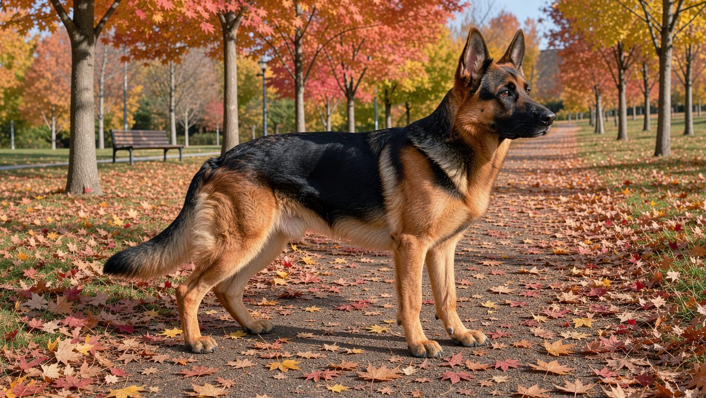
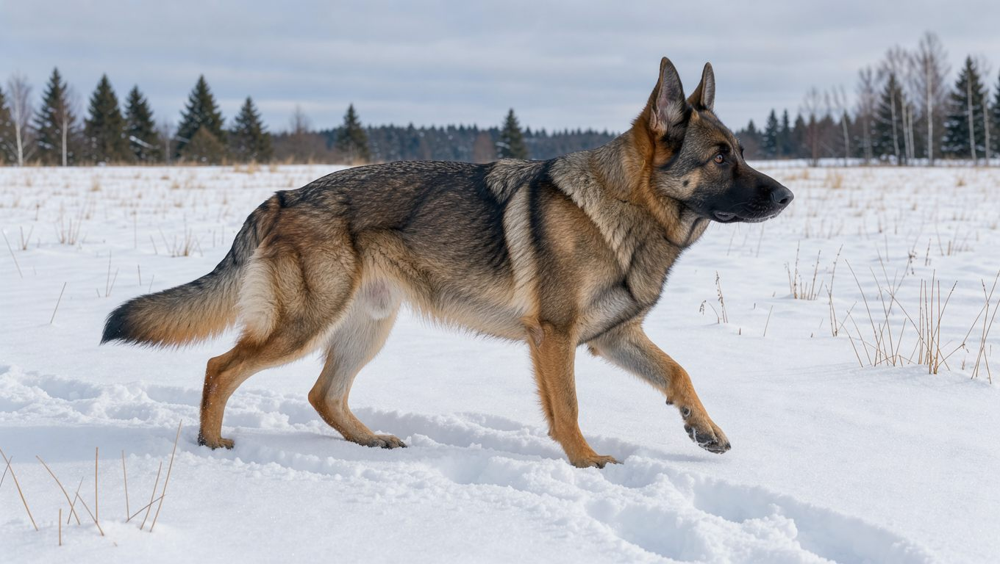
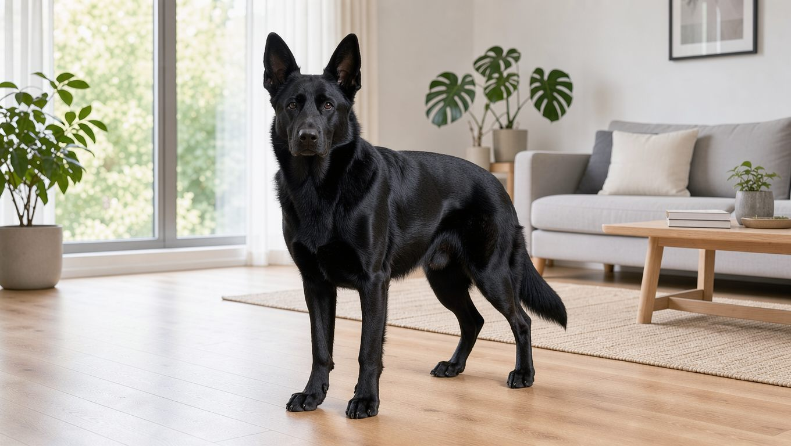
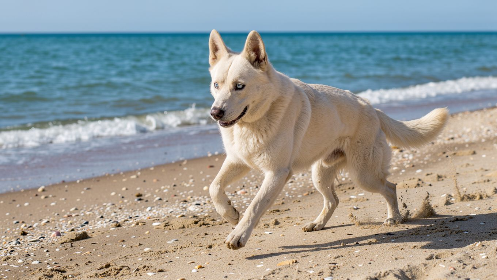

**2026년 11월 1일 기준**

## 빠른 답

**저먼 셰퍼드는 어떤 색이 있나요?**
표준 모색의 중심은 블랙 앤 탄, 바이컬러, 세이블, 순흑 네 계열입니다. 흰색은 표준에서 실격이고, 판다와 리버, 블루, 메를은 유전 기원이 다르거나 표준 밖에 있는 모색입니다.

## 색 이름이 겹치는 이유

국내에서 저먼 셰퍼드를 부르는 색 이름은 서로 겹칩니다. 등이 검고 다리가 갈색이면 '블랙탄', 늑대처럼 회갈색을 띠면 '세이블', 온몸이 하얗면 '흰둥이'나 '화이트 셰퍼드'라고 부릅니다. 같은 개를 두고도 부르는 이름이 달라질 수 있어, 색 이름만으로 판단하기는 어렵습니다.

저먼 셰퍼드 클럽 오브 아메리카(GSDCA)가 인용한 AKC 표준은 "저먼 셰퍼드의 색은 다양하며 대부분의 색이 허용된다"고 시작합니다. 이어서 "강하고 짙은 색이 선호되며, 옅고 바랜 색과 블루, 리버는 심결점"이라고 적고, "흰 개는 실격"이라고 명시합니다. 코가 주로 검지 않은 개도 실격 사유입니다. 작은 흰 털은 가슴과 발, 꼬리 끝 정도까지 허용되지만, 판다와 핀토, 파이볼드 같은 얼룩무늬는 표준이 바라는 모색이 아닙니다.

**딱지허브 평가**: GSDCA는 판다나 릴락 같은 이름을 희귀하거나 값어치 있는 색으로 보지 않습니다. 국내 매물에서 이런 이름으로 웃돈을 부른다면, 색 이름보다 부모견의 고관절 검사와 혈통, 건강 기록을 먼저 확인하는 편이 낫습니다.

## 표준 모색 도감

표준에서 인정하는 대표적인 모색은 네 가지 계열로 나뉩니다. 크기와 운동량, 수명처럼 색과 별개인 정보는 [대형견 10종 비교](/guides/large-dog-types/)에서 확인할 수 있습니다.

### 블랙 앤 탄 — 가장 익숙한 세퍼트의 얼굴

저먼 셰퍼드는 등과 척추를 따라 검은 털이 분포하고, 다리 안쪽과 가슴, 얼굴에는 황갈색 털이 나타납니다. GSDCA 자료는 블랙 앤 탄과 블랙 앤 레드처럼 갈색 계열의 밝기만 다른 이름도 함께 씁니다. '안장(saddle)'이라는 표현은 검은 털이 등에 안장처럼 얹힌 모양에서 나왔습니다.

### 바이컬러 — 갈색 면적이 줄어든 모색

검은 털이 등에서 다리까지 넓게 내려와 개체에 따라 거의 온몸이 검게 보입니다. 황갈색은 발끝과 얼굴 아래쪽에 조금 남습니다. 블랙 앤 탄과 같은 계열이지만 갈색 면적이 적어 이름을 따로 붙입니다.

### 세이블 — 털끝이 검게 그을린 회갈색

털끝은 검고 뿌리로 갈수록 밝아지는 특징이 있어 늑대의 털과 비슷한 인상을 줍니다. 개체마다 검은 기운의 농도가 크게 달라, 같은 세이블이라도 밝은 회색에 가까운 개와 짙은 흑회색 개가 나옵니다. 작업견 계통에서 흔하고, 성장기와 털갈이를 거치며 농도가 달라지는 경우도 있습니다.

### 순흑 — 검은 털만 남은 모색

갈색 마킹 없이 온몸이 검습니다. 표준 안에 들어가는 정식 모색이며, AKC 기준에서도 허용됩니다.

## 표준 밖의 색

### 흰색 — 실격이지만 알비노는 아닙니다

AKC 표준은 흰 개를 실격으로 처리합니다. 다만 흰색 저먼 셰퍼드는 색소가 아예 없는 알비노와는 다릅니다. White Shepherd Genetics는 흰색이 열성 e/e 조합으로 나타나며, 색소 세포는 그대로 있되 색소만 옅게 만드는 상태라고 설명합니다. 눈과 귀의 색소가 유지되므로, 색소 결손과 관련된 난청 위험도 다른 화이트 스패닝 무늬와는 차이가 있다고 설명합니다.

흰색 모색은 별도 품종으로 등록된 계통도 있습니다. 화이트 스위스 셰퍼드(버거 블랑 스위스)가 그 예입니다. 국내에서 '화이트 셰퍼드' 매물을 볼 때는 등록증의 품종명이 저먼 셰퍼드인지 별도 품종인지 확인할 필요가 있습니다.

### 판다 — 2000년 한 마리에서 시작된 돌연변이

판다는 검은 등과 갈색 다리를 바탕으로 가슴과 얼굴, 발 등에 흰색 무늬가 나타나는 모색입니다. Coats and Colors는 판다가 2000년 10월 미국에서 태어난 한 배에서 시작됐다고 설명합니다. 평범한 색의 부모 사이에서 태어난 암컷 'Lewcinka's Franka von Phenom'이 시조이고, 아버지의 생식세포에서 KIT 유전자 기능 상실 돌연변이가 생겼다는 것입니다.

상염색체 우성으로 유전되며, 무늬를 가진 개끼리 교배하면 두 개의 돌연변이 유전자를 받은 배아가 초기 단계에서 사망하는 것으로 알려져 있습니다. 그래서 살아 있는 판다 개체는 모두 돌연변이 유전자를 한 개만 가진 상태입니다. GSDCA는 판다를 표준이 바라지 않는 무늬로 분류합니다.

이 무늬 자체에 건강 문제가 따라온다는 근거는 확인되지 않았습니다. 다만 털색 마케팅과 건강은 별개이므로, 판다라는 이유로 일반 개체보다 높은 분양가를 부를 근거는 없습니다.

### 리버와 블루 — 검은 색소가 옅어진 색

리버는 초콜릿빛, 블루는 회청색으로 보이는 모색입니다. AKC 표준은 이 두 색을 심결점으로 분류하고, 코가 검지 않은 개는 실격 사유로 적습니다. 실제로 리버와 블루 개체는 코와 발바닥 색도 함께 옅어지는 경우가 많습니다.

### 메를 — 순종 저먼 셰퍼드에는 없는 무늬

메를은 회색 바탕에 얼룩무늬가 나타나며, 파란 눈을 가진 개체도 나타나는 모색입니다. White Shepherd Genetics는 메를이 순종 저먼 셰퍼드와 버거 블랑 스위스에는 나타나지 않는다고 설명합니다. 시장에 '메를 셰퍼드'가 있다면 다른 품종과의 교잡 혈통일 가능성을 먼저 살펴야 합니다. 메를끼리 교배해 태어난 더블 메를은 눈 결함과 선천성 난청 위험이 높습니다.

## 색을 정하는 유전 스위치

모색은 털의 색소 발현에 관여하는 여러 유전자의 조합에 따라 달라집니다. 같은 저먼 셰퍼드 안에서도 스위치가 다르면 표준 안과 밖의 모색이 나뉩니다.

<dl>
<dt>E 로커스</dt>
<dd>흰색을 만드는 열성 조합입니다. 색소 세포 자체는 남아 있고, 색소만 옅게 바뀝니다.</dd>
<dt>KIT 유전자</dt>
<dd>판다 무늬를 만드는 우성 돌연변이입니다. 순종 계통에서 한 번 발생한 뒤로 이어졌습니다.</dd>
<dt>색소 희석 유전자</dt>
<dd>리버와 블루처럼 털과 코, 발바닥 색을 함께 옅게 만듭니다.</dd>
</dl>

## 국내 매물에서 확인할 것

국내에서 저먼 셰퍼드를 분양받을 때 색상은 여러 확인 항목 중 하나일 뿐입니다. 색만으로 가격을 가늠하기는 어렵습니다.

- **흰색 매물** — 등록증의 품종명을 확인합니다. 화이트 스위스 셰퍼드로 등록된 개체인지 저먼 셰퍼드인지에 따라 표준상 위치가 다릅니다.
- **판다와 메를 매물** — GSDCA 기준 표준 밖 모색입니다. '희귀색'이라는 설명과 함께 웃돈을 요구한다면 근거를 요청해 보세요.
- **리버와 블루 매물** — 코 색을 확인합니다. 검지 않은 코는 AKC 표준에서 실격 사유입니다.
- **유전 건강** — 모색보다 고관절 검사, 퇴행성 척수증 검사, 부모견 혈통이 우선입니다. 견종 전반의 건강 정보는 [저먼 셰퍼드 허브](/breeds/german-shepherd/)를 참고해 주세요.

## 자주 묻는 질문

### 세이블 저먼 셰퍼드는 자라면서 색이 바뀌나요?

성장기와 털갈이를 거치며 검은 기운의 농도가 달라질 수 있습니다. 같은 부모에게서 태어난 강아지들도 성장하면서 모색에 차이가 생길 수 있으므로, 새끼 때의 색만으로 성견이 된 후의 모색을 단정하기는 어렵습니다.

### 블랙 앤 탄과 바이컬러는 무엇이 다른가요?

두 모색 모두 검은색과 갈색 털이 함께 나타나는 것이 특징입니다. 바이컬러는 검은 면적이 다리까지 넓게 퍼지고, 갈색은 발끝과 얼굴 아래에 남는 경우가 많습니다.

### 흰색 저먼 셰퍼드는 다른 품종인가요?

흰색 저먼 셰퍼드는 같은 견종에 속하며, 열성 유전자 조합으로 흰색 모색이 나타납니다. 다만 화이트 스위스 셰퍼드처럼 별도 품종으로 등록된 계통도 있어, 등록증의 품종명을 확인해야 합니다. AKC 표준에서는 저먼 셰퍼드의 흰색이 실격입니다.

### 판다 셰퍼드는 공식 모색인가요?

아닙니다. GSDCA는 판다를 표준이 바라지 않는 무늬로 분류합니다. 무늬 자체는 KIT 유전자 돌연변이로 설명되지만, 공인 모색은 아닙니다.

### 색에 따라 성격이나 건강이 다른가요?

모색이 성격을 결정한다는 과학적 근거는 확인되지 않았습니다. 건강은 모색보다 계통과 부모견의 검사 이력에서 더 크게 갈립니다. 흰색과 판다처럼 유전 기원이 뚜렷한 모색은 유전 방식이 다르다는 점만 참고하시면 됩니다.

## 출처

- [Color in German Shepherd Dogs — German Shepherd Dog Club of America](https://gsdca.org/color-in-german-shepherd-dogs/) (AKC 표준의 모색 문구, 흰색 실격, 리버와 블루 심결점, 판다 등 명칭 평가)
- [Panda Spotting in GSD — Coats and Colors](https://coatsandcolors.com/panda-spotting-in-gsd/) (판다의 KIT 유전자 돌연변이, 2000년 기원, 우성 유전과 동형 접합 치사, 건강 관련 언급)
- [Merle, Panda, and White: Three Patterns Routinely Confused in Shepherds — White Shepherd Genetics](https://white-shepherd-genetics.com/articles/merle-panda-white-patterns/) (흰색의 e/e 열성 기원, 메를 미보유, 더블 메를 위험)

표지와 본문 이미지는 AI로 생성한 실사 스타일 이미지입니다.
