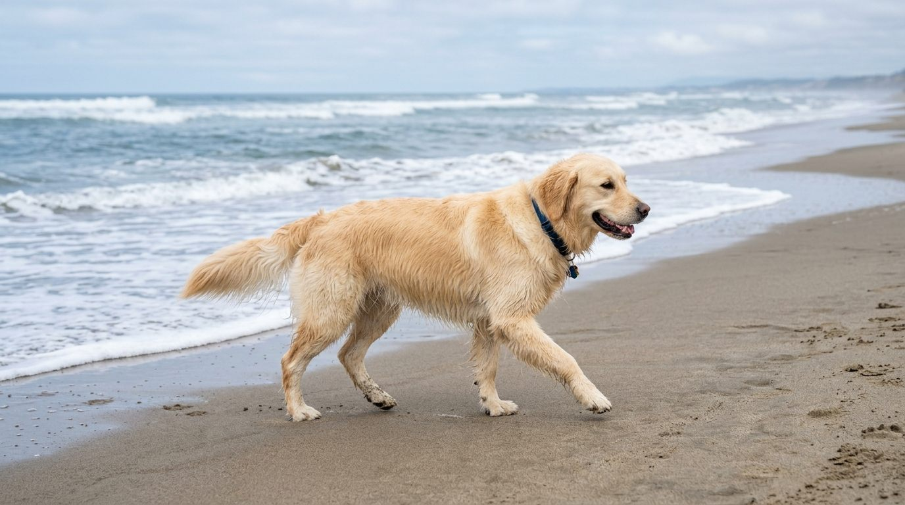
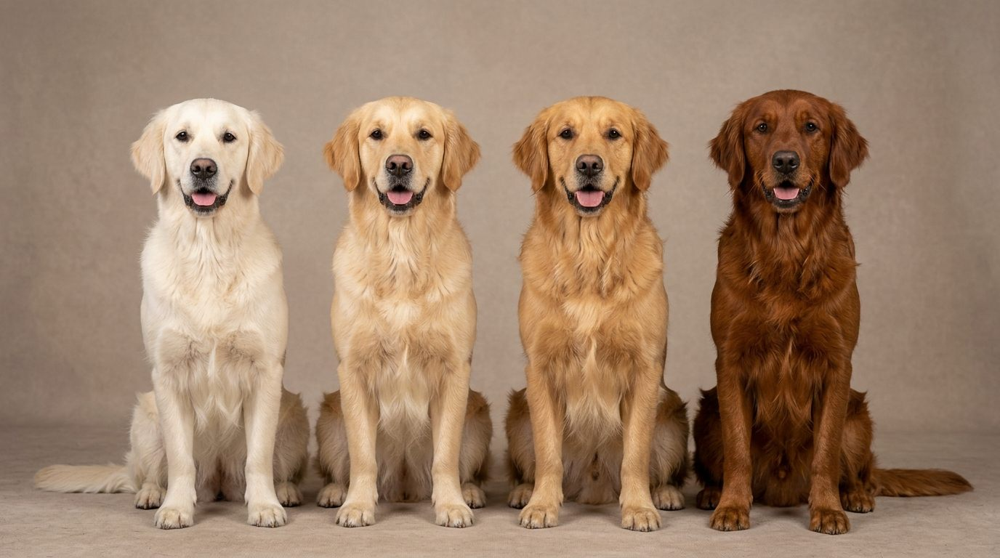
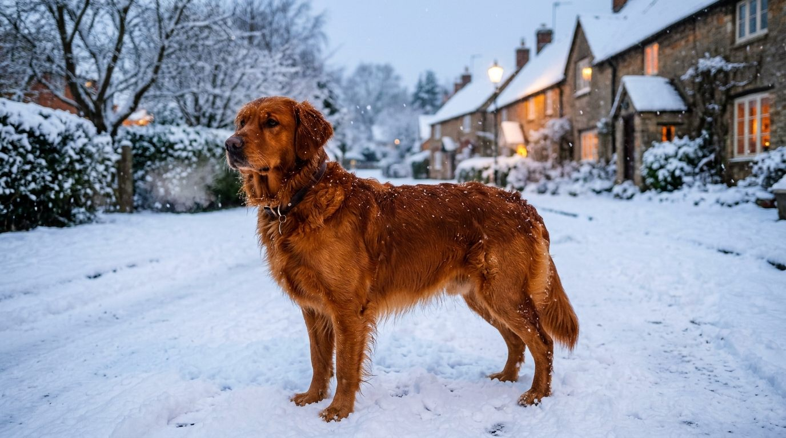

**2026년 9월 24일 기준**

## 빠른 답

**"골든 리트리버 색상 종류가 궁금하신가요?"**

AKC가 공식 등록 모색으로 분류하는 색은 **크림·라이트 골드·골드·다크 골드 4종**이다. 네 가지 색은 모두 골드 계열의 음영 차이이며, 서로 다른 품종을 의미하지 않는다. '잉글리시 크림', '레드 골든', '화이트 골든' 같은 이름은 표준 밖 명칭이거나 마케팅 용어다.

## 색이 다르다고 별도 품종이 아니다

골든 리트리버의 색상을 검색하면 다양한 명칭을 접할 수 있다. 영국식 크림, 플래티넘 골든, 잉글리시 화이트, 레드 골든, 마호가니. 그러나 견종 표준에서 인정하는 색상 범위는 골드 계열로 이어진다. 골드에서 크림까지의 음영이다. 그 밖의 명칭은 특정 혈통의 특징을 나타내거나 판매 과정에서 사용하는 수식어다.

이 글에서는 표준 모색 4종을 이미지로 살펴보고, 기관별 견종 표준의 차이와 '영국식 크림' 마케팅의 실체, 성장 과정에서 나타나는 모색 변화까지 알아본다. 품종 전반은 [골든 리트리버 품종 총정리](/breeds/golden-retriever/)에서 볼 수 있다.

## 표준 모색 4색 도감

### 크림 (Cream)

가장 옅은 모색으로, 우유빛에 가까운 아이보리 톤을 띤다. 귀·꼬리·다리의 장식털도 몸통과 비슷한 옅은 색을 보인다. 영국·유럽형 쇼 라인에서 많이 본다. 국내에서 '영국식 크림 골든'으로 불리며 인기가 높은 색이기도 하다.

### 라이트 골드 (Light Golden)

크림보다 한 단계 짙은 연한 금색이다. 실내에서는 크림과 경계가 흐려 보이고, 햇빛 아래에서는 은은한 금빛이 돈다. 쇼 라인·가정견 할 것 없이 폭넓게 나오는 색이다.

### 골드 (Golden)

일반적으로 골든 리트리버를 떠올릴 때 연상하는 중간 정도의 금색이다. 풍부하고 윤기 있는 금색으로, 견종 표준에서 제시하는 색상에 가깝다. 새끼부터 성견까지 색의 편차가 비교적 작은 편이다.

### 다크 골드 (Dark Golden)

진한 금색부터 구릿빛에 가까운 색까지 나타나는 모색이다. 미국 라인과 필드(수렵) 계열에서 자주 나온다. 필드 라인에는 레드에 가까울 만큼 진한 개체도 있는데, 이쯤 되면 표준의 경계 바깥이다.

### 모색 비교

- **크림** — 우유빛에 가까운 가장 옅은 색. 영국·유럽형 쇼 라인. 표준상 위치: 4색 안(백색에 가까워지면 지양)
- **라이트 골드** — 옅은 금색. 쇼·가정견 혼재. AKC 등록 4색 안
- **골드** — 중간 금색, 대표색. 전 라인. 모든 표준의 중심
- **다크 골드** — 진한 금색~구릿빛. 미국 라인·필드 계열. AKC 등록 4색 안(마호가니에 가까워지면 지양)

## 견종 표준 기관별 입장 — 같은 견종, 다른 문구

- **AKC(미국)** — 다양한 음영의 농후하고 광택 있는 골드(등록 모색 4종). 걸어 두는 색: 지나치게 옅은 색·지나치게 짙은 색
- **영국 KC** — 골드 또는 크림의 모든 음영(가슴의 흰 털 몇 가닥만 허용). 걸어 두는 색: 레드·마호가니
- **FCI(국제)** — 영국 계열 표준을 따름. 걸어 두는 색: 레드·마호가니
- **UKC(미국)** — 짙고 광택 있는 골드·크림의 모든 음영. 걸어 두는 색: 백색에 가까워지는 색·마호가니

영국 KC의 기준은 2025년 4월 개정된 견종 표준을 따른다. 여기서 주목할 점은 다음과 같다. 어느 표준이든 색의 축은 골드~크림 하나뿐이고, 양 끝(백색 쪽과 마호가니 쪽)을 걸어 둔다. 어느 색이 더 좋거나 나쁘다고 단정할 수는 없지만, 도그쇼 출전을 고려한다면 견종 표준에서 허용하는 색상 범위를 알아둘 필요가 있다.

## 레드 골든·마호가니 — 표준 밖의 진한 색

레드에 가까운 진한 개체는 실제로 존재한다. 주로 미국의 필드 라인에서 나오며, 수렵 능력 위주로 번식된 혈통에서 진한 색이 따라오는 경향이 있다. 영국·국제 표준에서는 결점으로 분류되지만, 가정견으로 키우는 데 아무 문제가 없다.

주의할 점은 '레드 골든 리트리버'를 별도 품종이나 희귀 변종인 것처럼 소개하는 판매 문구다. 견종은 골든 리트리버 하나고, 색이 표준 범위를 벗어났을 뿐이다. '희귀 종' 명목의 프리미엄은 근거가 없다.

## '영국식 크림' 마케팅 해부

국내에서 크림 모색은 '잉글리시 크림', '영국식 크림', '화이트 골든', '플래티넘 골든' 같은 이름으로 불리며 프리미엄이 붙는다. 실체를 정리하면 다음과 같다.

- **같은 골든 리트리버다.** 유럽형 쇼 라인에서 볼 수 있는, 표준 모색 중 가장 옅은 색상의 개체를 가리킨다. 별도 품종 등록은 어디에도 없다.
- **'더 건강하고 오래 산다'는 주장은 근거가 부족하다.** 일부 브리더와 블로그가 내세우는 주장이며, 모색 자체가 수명이나 유병률을 좌우한다는 연구는 확인되지 않는다. 건강 상태는 유전적 요인과 양육 환경 등 여러 요소의 영향을 받는다.
- **오히려 표준에서 가장 자주 걸리는 색이기도 하다.** 미국 계열 표준은 백색에 가까워질수록 지양한다. '순백 골든'은 어느 표준에도 존재하지 않는다.
- **가격 프리미엄은 시장이 만든 것이다.** 아래 시세 섹션에서 다룬다.

크림색이 마음에 들어 선택하는 것은 자연스럽다. 다만 '희귀 품종이라 더 비싸다'는 식의 홍보는 구분해서 살펴볼 필요가 있다. 모색 희소성을 근거로 한 프리미엄은 견종 표준과 무관한 시장 논리다.

## 모색별 시세 경향 — 국내 업체 안내가 기준

국내 분양 안내 업체 두 곳이 공개한 가격을 비교했다(2026년 9월 확인). 실제 분양가는 혈통과 건강검진 내역, 지역 등에 따라 크게 달라질 수 있다.

- **일반 가정 분양** — 서리펫 30만~75만 원 · 도그마루 30만~40만 원
- **혈통 보증 라인** — 서리펫 국제 혈통 80만 원~ · 도그마루 혈통 인증 50만~60만 원
- **쇼 퀄리티·'희귀 크림' 명목** — 도그마루 80만 원~ (서리펫은 공개 안내 없음)

여기서 주목할 점은 두 가지다. 첫째, 분양가는 모색뿐 아니라 혈통과 혈통 계열 등에 따라서도 달라진다. 둘째, 크림 프리미엄은 '희귀 컬러' 명목이 붙을 때 나타나는 구조다. 같은 크림이라도 가정 분양과 혈통 라인 사이에서 가격이 갈린다. 견종 전체 시세 흐름은 [골든 리트리버 품종 총정리](/breeds/golden-retriever/)의 시세에서 볼 수 있다.

## 새끼 때 색은 성견이 되며 바뀐다

골든 리트리버는 성장하면서 모색이 상당히 달라지는 개체가 많다. 새끼 털이 성견 털로 바뀌는 과정에서 색이 밝아지거나 어두워질 수 있으며, 이후 점차 성견의 모색을 띠게 된다.

브리더들 사이에서는 귀 끝의 색을 성견이 되었을 때의 모색을 예측하는 참고 지표로 활용한다. 몸통의 새끼 털은 옅더라도 귀 끝의 색이 진하면 성견이 되었을 때 모색이 더 짙어질 수 있다는 경험에 따른 판단이다. 과학적으로 확립된 법칙은 아니니 참고선으로만 쓰고, 분양 시점의 몸 색만 보고 성견 색을 단정하지 않는 편이 좋다.

## 블랙 골든은 존재하지 않는다

검색하다 보면 '블랙 골든 리트리버'라는 이름으로 소개된 사진을 볼 수 있다. 대부분 다음 두 경우 중 하나다. **플랫코티드 리트리버**(검은 긴 털의 별개 견종)이거나 혼혈이다. 골든 리트리버는 유전자적으로 검은 모색이 나오지 않는 품종이다. 형태가 비슷해 헷갈리기 쉬운 리트리버 6종의 차이는 [리트리버 종류 비교](/guides/retriever-types/)에서 정리했다.

## 모색으로 성격·건강을 판단하지 않는다

'크림이 더 온순하다', '다크 골드가 더 활동적이다' 같은 속설이 따라다닌다. 모색과 성격·건강을 잇는 근거는 없다. 차이가 있다면 모색보다는 혈통 계열에 따른 특성에서 찾아야 한다. 쇼 라인과 필드 라인은 체형과 에너지 수준에서 실제로 경향이 다르다.

유전병 위험도 모색이 아니라 혈통 검사로 확인하는 문제다. 골든의 대표 유전병과 검사 항목은 [허브 글](/breeds/golden-retriever/)의 유전병 섹션에 정리해 두었다.

## FAQ

### 골든 리트리버에서 가장 흔한 색은 무엇인가요?

중간톤의 '골드'가 가장 흔히 보이는 대표색입니다. 다만 라인에 따라 편차가 커서, 유럽형 쇼 라인 쪽으로 갈수록 크림·라이트 골드 비중이 높아집니다.

### 하얀 골든 리트리버는 별도 견종인가요?

아닙니다. '화이트 골든', '잉글리시 화이트'는 크림 모색에 붙인 마케팅 명칭입니다. 순백은 골든 리트리버 표준 어디에도 없고, 오히려 미국 계열 표준에서는 가장 지양하는 쪽입니다.

### 모색이 진하거나 옅하면 건강에 영향이 있나요?

없습니다. 모색은 털 색소의 표현 차이일 뿐입니다. 건강을 좌우하는 건 혈통 검사와 사육 환경이지 색의 농도가 아닙니다.

### 새끼 때 색이 바뀌기도 하나요?

바뀌는 개체가 많습니다. 성장하며 중간 단계를 거쳐 최종 모색에 정착하며, 브리더 경험칙상 귀 끝 색이 성견 색에 가깝다고 봅니다.

### 크림 골든이 더 건강하고 오래 산다던데 사실인가요?

확인된 근거가 없습니다. 일부 브리더와 블로그의 주장일 뿐, 모색이 수명이나 유병률을 좌우한다는 연구는 찾기 어렵습니다. 색보다 부모견의 유전병 검사 기록을 확인하는 편이 훨씬 중요합니다.

## 출처

- [AKC — Golden Retriever](https://www.akc.org/dog-breeds/golden-retriever/) (품종 표준·기본 정보 확인)
- 영국 왕립켄넬클럽 견종 표준(2025년 4월 개정) — "골드·크림의 모든 음영, 레드·마호가니 제외" 문구 확인
- 국내 분양 안내 업체 공개가(서리펫·도그마루, 2026년 9월 검색 확인) — 모색·라인별 시세 대역

*표지·본문 이미지는 AI로 생성한 실사 스타일 일러스트입니다.*
