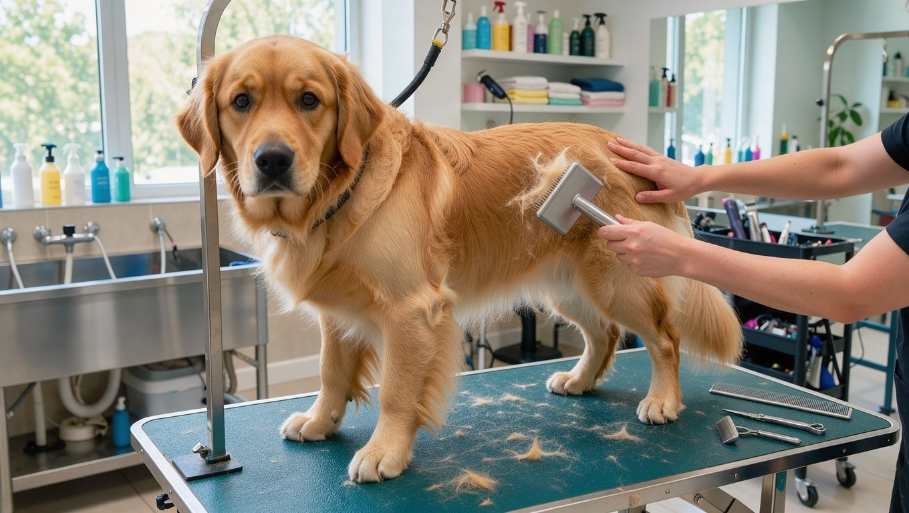
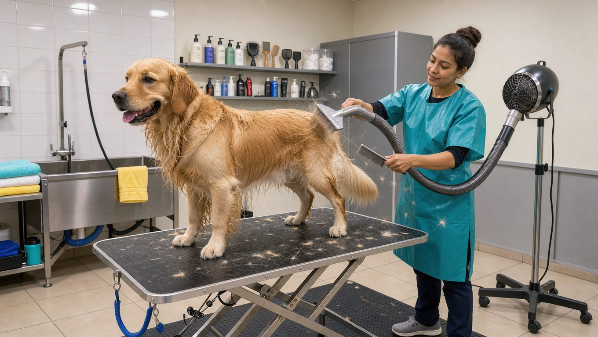

**2026년 10월 29일 기준**

골든 리트리버의 털은 두 겹입니다. 털이 많이 빠지며, 관리 방법도 단모견과 다릅니다. 털갈이 시기와 빗질 방법을 미리 알아 두면 집 안에 털이 쌓이는 양을 줄일 수 있습니다.

## 빠른 답

**골든 리트리버 털갈이는 언제, 얼마나 심한가요?**
골든 리트리버는 1년 내내 조금씩 털이 빠지고, 봄과 가을에 한두 번 크게 빠지는 시기가 찾아옵니다. 대털갈이 때는 매일 빗질하고, 평소에는 주 1회 빗질로 관리하는 것이 좋습니다.

## 골든 리트리버의 이중모 구조

골든 리트리버는 겉털과 속털이 겹쳐진 이중모 견종입니다. [골든 리트리버](/breeds/golden-retriever/)의 털은 두껍고 물을 튕겨 내며, AKC는 겉털이 몸을 감싸는 코트처럼 자란다고 설명합니다. 털결은 곧게 자라기도 하고 물결처럼 자라기도 합니다. 속털은 보온을 맡기 때문에 겨울철 체온 유지에 중요한 역할을 합니다.

이중모는 겉털과 속털이 모두 빠지며, 특히 속털이 많이 빠지는 시기에는 관리에 더 신경 써야 합니다. 빗질로 죽은 속털을 제거하지 않으면 빠진 털이 집 안에 쌓이고, 피부 가까이에서 털이 엉켜 통풍을 방해할 수 있습니다.

## 털갈이 시기, 연중 소량과 봄·가을 집중

AKC는 골든 리트리버의 털이 "1년 내내 보통 수준으로 빠지고, 1년에 한두 번 많이 빠진다"고 설명합니다. 털이 특히 많이 빠지는 시기는 대개 봄과 가을입니다. 이때는 속털이 집중적으로 빠지기 때문에 빗질을 소홀히 하면 바닥에 털이 쉽게 쌓입니다.

실내에서 주로 생활하는 반려견은 계절 변화의 영향을 덜 받아 털갈이 시기가 뚜렷하지 않거나, 털이 많이 빠지는 현상이 연중 비슷하게 나타나기도 합니다. 산책에서 돌아오면 몸에 붙은 털을 한 번 털어 주는 습관이 도움이 됩니다.

## 빗질 주기, 평소 주 1회와 대털갈이 매일

- **평소**: 핀 브러시로 주 1회 빗질합니다. AKC는 일상 관리로 주 1회 빗질을 권장하고, 빗살이 촘촘한 브리슬 브러시는 털 속까지 닿지 않아 피하라고 안내합니다.
- **대털갈이**: 매일 1회 핀 브러시로 빗질합니다. 털갈이가 집중되는 기간에는 매일 한 번씩 빗질합니다.
- **귀·가슴·다리·꼬리**: 금속 콤으로 결을 따라 빗어 정리합니다.
- **빗질 방향**: 몸통은 털이 자라는 방향의 반대로 빗어 죽은 속털을 푼 다음, 결을 따라 정리합니다.

도구별 차이가 궁금하시다면 빗 비교 가이드에서 다섯 가지 도구를 용도별로 비교해 두었습니다. [빗 비교 가이드](/guides/dog-brush-comparison/)

## 목욕과 블로워, 빗질을 돕는 수단

AKC는 골든 리트리버 목욕 전에 반드시 빗질하라고 안내합니다. 엉킨 털에 물이 스며들면 말리기 어렵고 피부 사이에 습기가 남아 있기 때문입니다. 목욕은 대체로 한 달에 한 번 정도 하되, 털이 더러워지거나 냄새가 날 때 추가로 씻기는 것도 좋습니다. 잦은 목욕은 피부의 자연 유분을 빼앗아 건조해질 수 있습니다.

목욕 후에는 블로워를 사용해 속털까지 충분히 말리는 것이 중요합니다. 골든 리트리버는 속털이 두꺼워 수건과 자연 건조만으로는 밑부분이 마르지 않을 수 있습니다. 애견미용실의 블로워는 풍량이 강해 죽은 속털을 제거하는 데도 도움이 됩니다.

## 삭모, 왜 피해야 하나

여름이 되면 털을 밀어 버리고 싶은 마음이 들 수 있습니다. 그러나 AKC는 골든 리트리버의 털을 밀거나 자르지 말라고 안내합니다. 이중모를 밀어도 털갈이는 멈추지 않으며, 털이 손상되면 피부가 자외선에 노출될 위험이 커지고 체온 조절에도 문제가 생길 수 있다고 설명합니다.

다리와 배, 꼬리 아래의 장식털은 미용실에서 가위로 가볍게 다듬는 정도가 적당합니다.

## 애견미용실에서 받는 관리

애견미용실에서는 목욕, 드라이, 발과 위생 부위 정리, 장식털 다듬기를 받을 수 있습니다. AKC는 털과 발 관리를 미용실에서 받는 경우 4~6주 간격으로 방문하는 방안을 제안합니다. 골든 리트리버는 대형견이므로 미용실을 예약할 때 체중과 털 상태에 따라 요금이 달라지는지 확인하는 것이 좋습니다. 엉킴이 심하면 추가 요금이 붙는 경우도 있습니다.

**딱지허브 평가**: AKC가 제시한 4~6주 간격은 털과 발 관리를 미용실에 맡기는 경우 참고할 수 있는 기준입니다. 미용실 비용과 이동 시간이 부담된다면 평소에는 집에서 주 1~2회 빗질하고, 털갈이가 집중되는 시기에만 미용실에서 블로워 관리를 받는 방법도 현실적입니다.

## 집에서 하는 털 관리

대털갈이 시기에는 빗질만 해도 집 안에 떨어지는 털을 상당히 줄일 수 있습니다. 빗질은 매트나 신문지 위에서 하고, 끝난 뒤에는 테이프롤러와 청소기로 바닥을 정리합니다. 꾸준히 빗질하면 빠진 털을 미리 제거할 수 있고, 피부 가까이에서 털이 엉키는 것도 예방할 수 있습니다.

- **발톱**: 월 1회 확인하고 길면 다듬습니다.
- **귀**: 주 1회 확인하고, 수영이나 목욕 후에는 물기를 말립니다.

## 자주 묻는 질문

### 골든 리트리버는 1년 내내 털이 빠지나요?
네. 골든 리트리버는 연중 꾸준히 털이 빠지고, 봄과 가을에 양이 크게 늘어납니다. 연중 관리가 기본이고, 대털갈이 시기에 빗질 횟수를 늘리는 방식이 좋습니다.

### 털갈이 시기에는 빗질을 하루 몇 번 해야 하나요?
하루 1회면 충분합니다. 대털갈이 시기에는 매일 빗질하고, 평소에는 주 1회로 유지합니다.

### 여름에 털을 밀어도 되나요?
권장하지 않습니다. 털을 밀어도 털갈이는 계속되고, 겉털과 속털이 손상되어 피부와 체온 조절에 문제가 생길 수 있습니다. 더위가 걱정된다면 시원한 시간대에 산책하고 실내 온도를 조절하는 편이 낫습니다.

### 목욕은 얼마나 자주 해야 하나요?
한 달에 한 번 정도를 기준으로 하되, 실외 활동으로 털이 더러워졌다면 추가로 목욕시킵니다. 목욕 전에 빗질을 먼저 해야 털이 엉키지 않습니다.

### 애견미용실은 얼마나 자주 가야 하나요?
털과 발 관리를 미용실에 맡긴다면 4~6주 간격이 기준입니다. 집에서 빗질을 꾸준히 하는 보호자라면 대털갈이 시기를 중심으로 이용해도 괜찮습니다.

## 출처

[How to Groom a Golden Retriever](https://www.akc.org/expert-advice/health/how-to-groom-golden-retriever/) (털 구조와 털갈이 빈도, 빗질 주기, 목욕 방법, 삭모 금지)
[How to Groom a Double-Coated Dog](https://www.akc.org/expert-advice/grooming/how-to-groom-a-double-coated-dog/) (삭모가 이중모에 미치는 영향, 빗질 도구)

이 글의 이미지는 AI로 생성한 것입니다.
