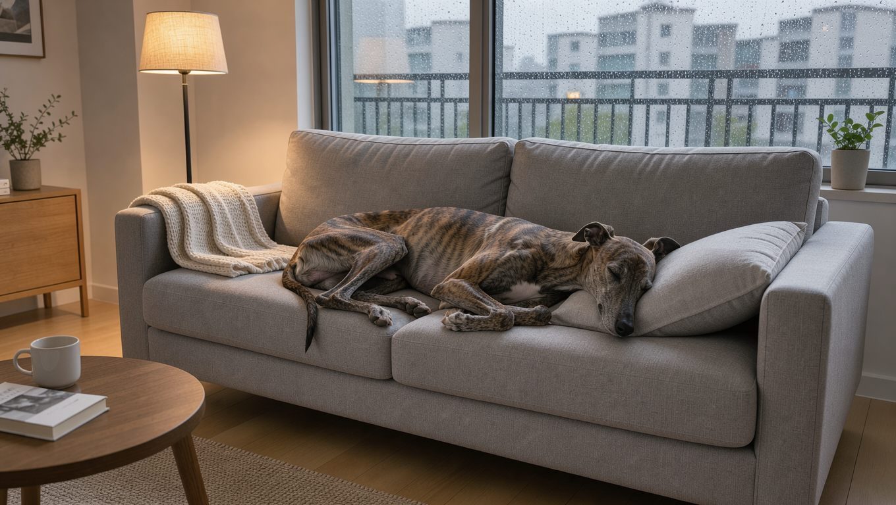

2026년 10월 18일 기준으로 분양가 정보를 정리했습니다.

## 빠른 답

- **성격 한 줄**: 온순하고 조용한 편이지만, 독립심과 사냥 본능이 남아 있는 시각 하운드입니다. 사람에게는 다정하지만 낯선 사람에게는 거리를 두는 경우가 많습니다.
- **아파트에서 키울 수 있나요?**: 충분히 운동한 그레이하운드는 실내에서 조용한 편이라 아파트 생활과 잘 맞을 수 있습니다. 다만 전속력으로 달릴 수 있는 안전한 공간을 따로 확보해야 합니다.
- **처음 키우는 사람에게 맞나요?**: 성격 자체는 순하지만, 마취 감수성 같은 고유 건강 이슈와 낮은 부름 응답률을 미리 알아야 합니다. 충분히 알아보지 않고 키우기 시작하기에는 고려할 점이 많은 견종입니다.

## 품종 개요

그레이하운드는 시각 하운드(sighthound) 계열을 대표하는 견종입니다. 사냥감을 눈으로 좇는 시각 하운드 가운데 가장 빠른 견종으로, AKC는 그레이하운드를 '개 세계의 챔피언 스프린터'라고 소개합니다. 같은 계열로는 살루키와 아프간 하운드, 휘핏 등이 있으며, 계열 간 구분은 [하운드 종류 가이드](/guides/hound-types/)에 정리해 두었습니다.

유선형 몸과 깊은 가슴, 긴 다리, 좁고 긴 머리가 특징입니다. 전속력으로 달릴 때는 네 다리가 모두 공중에 뜨는 더블 서스펜션 갤럽을 쓰며, 최고 시속은 약 72km(45마일)로 알려져 있습니다. 다만 이 속도를 오래 유지하지는 못하고, 짧은 구간을 몰아 달리는 스프린터입니다.

이름이 비슷한 이탈리안 그레이하운드는 그레이하운드보다 크기가 작으며, 별개의 견종입니다. 두 견종을 헷갈리기 쉽다면 [이탈리안 그레이하운드 허브](/breeds/italian-greyhound/)를 함께 보면 구분에 도움이 됩니다.

<dl>
<dt>크기</dt><dd>대형 — 체고 66~76cm (자료에 따라 26~30인치)</dd>
<dt>체중</dt><dd>27~32kg (60~70파운드)</dd>
<dt>수명</dt><dd>10~13년</dd>
<dt>운동량</dt><dd>매일 산책과 함께, 주기적으로 울타리 안에서 전속력 달리기</dd>
<dt>털 관리 난이도</dt><dd>낮음 — 짧은 단모</dd>
<dt>초보 적합도</dt><dd>보통 — 성격은 온순하지만 건강과 사냥 본능 변수를 고려해야 합니다</dd>
</dl>

## 성격과 기질

VCA는 그레이하운드를 충성스럽고 온순하지만 익살스럽고 독립적인 견종으로 설명합니다. PetMD도 온화하고 상냥한 성격에 독립심이 더해진 견종이라고 소개합니다. 가족에게는 애정을 보이지만 낯선 사람에게는 낯가림을 보일 수 있고, 고양이처럼 자기 공간을 지키는 태도를 보이기도 합니다.

사냥 본능은 살아 있습니다. 작고 빠르게 움직이는 동물을 쫓는 경향이 있고, 부름에 대한 반응도 좋은 편이 아닙니다. VCA는 목줄을 풀지 말고 울타리가 확실한 곳에서만 자유롭게 두라고 권장합니다.

아이들과 지낼 수 있지만, PetMD는 어린 자녀보다 나이가 있는 자녀나 아이가 없는 가정이 더 맞을 수 있다고 안내합니다. 장난에 대한 반응이 아이에게는 답답하게 느껴질 수 있기 때문입니다.

훈련은 음식 보상을 활용하면 반응이 빠릅니다. 다만 반복 학습에는 쉽게 흥미를 잃기 때문에 짧게 나누어 진행하는 것이 좋습니다.

## 털과 색상

그레이하운드는 짧고 매끄러운 단모입니다. 털갈이는 있지만 관리 부담은 크지 않으며, 털을 다듬는 미용도 필요하지 않습니다. 목욕은 털이 많이 더러워졌을 때로 충분하고, 평소에는 주 1회 정도 빗질로 정리하면 됩니다.

색상은 브린들(호랑이 줄무늬), 폰(모래빛), 블랙, 블루, 레드, 화이트와 이들의 조합 등으로 다양합니다. 흰 바탕에 색 반점이 섞인 개체도 있습니다. 모색에 따른 건강 차이는 알려진 바가 거의 없어, 취향과 혈통을 기준으로 고르는 편이 무난합니다.

## 한국에서 키울 때

국내 분양 시세를 정리한 공개 자료는 확인되지 않습니다. 직거래 장터 매물에서 그레이하운드 호가가 40만~85만 원대로 올라오지만, 이는 개별 매물 호가일 뿐이라 평균 시세로 보기는 어렵습니다. 혈통과 모색, 물량에 따라 편차가 커서 매물마다 조건이 다릅니다.

법정 맹견 5종(도사, 핏불 테리어, 아메리칸 스태퍼드셔 테리어, 스태퍼드셔 불 테리어, 로트와일러)에는 포함되지 않습니다. 다만 목줄 착용과 배변 수거 같은 기본 의무는 다른 견종과 똑같이 적용됩니다.

아파트 생활에도 비교적 잘 적응할 수 있습니다. VCA는 운동을 마친 그레이하운드를 '매우 조용한 실내견'이라고 표현하고, 짖음 항목도 낮게 평가합니다. 층간소음 걱정은 다른 견종보다 덜하지만, 복도와 엘리베이터에서의 예절 교육은 따로 필요합니다.

겨울 대비도 챙겨야 합니다. VCA는 짧은 털이 추위를 거의 막아 주지 못한다고 설명합니다. 체지방이 적은 체형이라 한겨울 산책에는 보온 옷이 필요하고, 여름에는 뜨거운 아스팔트에 발바닥이 닿지 않도록 산책 시간대를 조정하는 것이 좋습니다.

국내에서는 은퇴 경주견 입양 프로그램을 찾아보기 어렵습니다. 해외에서는 경주를 마친 그레이하운드를 가정견으로 입양하는 문화가 일반적이지만, 국내에서 그런 경로는 아직 자리 잡지 못했습니다.

## 건강

그레이하운드는 대체로 건강한 편이지만, 다른 견종과 다른 주의점이 몇 가지 있습니다.

**마취 감수성.** PetMD는 그레이하운드가 일부 마취제에 민감하게 반응하는 특성이 문서로 확인된 유일한 견종이라고 설명합니다. 이는 시토크롬 P450 계열 효소의 결핍과 관련이 있으며, 마취 후 각성과 회복이 더디게 진행될 수 있습니다. 수술 후 36~72시간이 지나 출혈이 나타나기도 합니다. 중성화 수술이나 치과 스케일링 전에는 반드시 수의사에게 그레이하운드라는 점을 알려야 합니다.

**위 팽창과 염전(GDV).** 깊은 가슴 구조 때문에 위가 비틀리는 위염전 위험이 있습니다. 배가 부풀고 헛구역질을 하며 침을 흘리는 증상이 나타나면 즉시 병원으로 가야 합니다. 식사를 하루 두세 번으로 나누는 방법이 예방에 도움이 됩니다 (PetMD).

**다발성 신경병증.** NDRG1 유전자 결손으로 생기는 그레이하운드 특유의 질환입니다. 부모 양쪽 모두 보인자인 경우 발병하며, 생후 3~9개월 무렵 근육 약화와 토끼처럼 깡충거리는 걸음걸이로 증상이 나타날 수 있습니다. 유전자 검사로 확인할 수 있습니다 (PetMD).

**체중 관리.** VCA는 마른 체형인 견종인데도 보호자가 과하게 먹이는 경우가 많다고 지적합니다. 갈비뼈가 살짝 만져지는 정도를 기준으로 급여량을 조정하는 것이 좋습니다.

## 운동과 관리

VCA는 그레이하운드의 하루 운동으로 적당한 강도의 산책이나 조깅, 또는 안전한 공간에서의 전력 질주를 권장합니다. 조깅 파트너 적합도는 4/5로 평가합니다. 울타리가 없는 곳에서는 목줄을 풀지 않는 것이 원칙이고, 공놀이나 간단한 트릭으로 정신적 자극을 주는 것도 권장합니다.

**딱지허브 평가**: 국내 도심에서 울타리가 있는 안전한 공간을 매일 확보해 그레이하운드가 전력 질주하도록 하기는 어렵습니다. 평일에는 30~40분 산책을 하루 두 번으로 나누고, 주말에 운동장이나 반려견 놀이터처럼 울타리가 있는 곳에서 마음껏 달리게 해 주는 방식이 현실적입니다.

관리에서 챙길 항목은 다음과 같습니다.

<ul>
<li><strong>산책</strong>: 목줄 착용을 기본으로 하고, 다른 개와의 거리도 넉넉히 둡니다. 갑자기 달려나갈 수 있어 고정식 목줄이나 하네스를 함께 쓰는 편이 안전합니다.</li>
<li><strong>훈련</strong>: 음식 보상으로 짧게 반복합니다. 부름 훈련은 성공률을 낮게 잡고, 야외에서는 부름에 기대지 않는 것이 안전합니다.</li>
<li><strong>실내 환경</strong>: 소형 동물과는 분리해 두는 것이 좋습니다. 사냥 본능이 남아 있어 작은 반려동물과의 합사는 신중해야 합니다.</li>
<li><strong>계절 관리</strong>: 겨울에는 보온 옷, 여름에는 아스팔트 온도 확인이 기본입니다. 짧은 털과 적은 체지방이 계절 변화에 취약한 이유입니다.</li>
</ul>

## 자주 묻는 질문

### 그레이하운드는 정말 시속 70km가 넘나요?
최고 속력이 시속 약 72km(45마일)로 알려져 있습니다. 다만 이 속도는 짧은 구간에서만 유지되고, 평소에는 산책과 느린 달리기로 충분합니다.

### 아파트에서 키우는 사람이 많은가요?
국내 통계는 확인되지 않습니다. 해외에서는 은퇴 경주견을 아파트에서 키우는 사례가 흔하며, 충분히 운동한 개체는 실내에서 조용합니다. 다만 달릴 수 있는 공간 확보가 전제입니다.

### 아이들과 함께 지내도 괜찮나요?
온순한 성격이라 대체로 무난하지만, 자기 공간을 지키려는 태도와 사냥 본능이 있습니다. 어린 아이보다는 나이가 있는 아이와 잘 맞는 경우가 많으므로, 만남은 보호자 감독 아래 천천히 진행하는 것이 좋습니다.

### 마취가 위험하다고 들었습니다.
일부 마취제에 민감하게 반응하는 특성이 문서로 확인된 유일한 견종입니다. 수술이나 스케일링 전에 견종을 수의사에게 알리고, 회복 과정을 관찰하는 것이 중요합니다. 자세한 내용은 위 건강 섹션에 정리했습니다.

### 털은 많이 빠지나요?
짧은 단모라 털갈이는 있지만 청소 부담은 크지 않습니다. 주 1회 빗질과 오염됐을 때의 목욕으로 충분하고, 미용실 컷은 필요하지 않습니다.

## 출처

- [Greyhound — PetMD](https://www.petmd.com/dog/breeds/greyhound) (성격, 마취 감수성, 위염전, 다발성 신경병증)
- [Greyhound — VCA Hospitals](https://vcahospitals.com/know-your-pet/greyhound) (수명, 운동량, 실내 성격, 짖음, 보온)
- [Greyhound — American Kennel Club](https://www.akc.org/dog-breeds/greyhound/) (시각 하운드 계열, 챔피언 스프린터 소개)
- [도그시장 그레이하운드 매물](http://dogsijang.co.kr/board_dog/view.php?tb=board_sale&pagenum=34&search_live=&search_dog=%ef%a7%9e%ea%be%a8%eb%a3%9b%e5%aa%9b%ef%bf%bd&no=394972&ckattempt=1) (국내 개별 매물 호가 40~85만 원)

표지는 AI 이미지 생성 도구로 만들었습니다.
