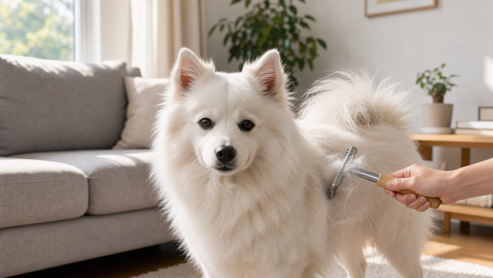

**2026년 11월 6일 기준** — 국내 유지비처럼 달라질 수 있는 정보는 이 날짜에 확인한 내용으로 적었습니다.

## 빠른 답

- **성격 한 줄**: 순백 이중모를 가진 일본 원산의 스피츠입니다. 가족에게 다정하고 영리하지만 소리에 예민하게 반응할 수 있습니다.
- **아파트에서 키울 수 있나?**: 체구가 크지 않아 아파트에서도 키울 수 있습니다. 다만 짖음과 분리불안에 대비한 교육이 필요합니다.
- **처음 키우는 사람에게 맞나?**: 털 관리와 짖음 훈련을 감당할 수 있다면 초보자도 키우기 어렵지 않다는 평가가 있습니다(펫집).

## 순백 이중모, 어디서 왔나

재패니즈 스피츠의 기원은 1920년대 일본으로 거슬러 올라갑니다(PetMD). 독일산 화이트 스피츠 계열을 바탕으로 개량되었으며, 일본켄넬클럽은 1948년에 품종 표준을 확립했습니다(펫집). 2019년에는 미국 AKC의 기초 혈통 등록 제도인 FSS에 등록되었습니다(펫집).

성격은 명랑하고 눈치가 빠르며 가족에게 다정한 편입니다(펫집). 어린 시기부터 사회화하면 아이, 다른 개, 고양이와도 대체로 잘 지낸다는 설명이 있습니다(PetMD).

## 크기와 수명 — 자료마다 범위가 다릅니다

재패니즈 스피츠는 비교적 작은 체구의 견종입니다. 다만 크기와 수명에 관한 수치는 자료마다 차이가 있어, 두 자료에서 제시한 범위를 함께 정리했습니다.

<dl>
<dt>체고</dt>
<dd>어깨 높이 30~38cm입니다(PetMD).</dd>
<dt>체중</dt>
<dd>약 4.5~11.3kg으로 제시됩니다(PetMD). 국내 자료는 5~10kg을 제시하기도 합니다(펫집).</dd>
<dt>수명</dt>
<dd>평균 10~14년(PetMD)과 12~16년(펫집)으로 차이가 있습니다.</dd>
</dl>

자료마다 수치에 차이가 있으므로 어느 한쪽을 절대적인 기준으로 삼기보다는, 분양 전 부모견의 건강 이력도 함께 확인하는 것이 좋습니다.

## 털 관리 — 봄과 가을 환모기가 승부처입니다

재패니즈 스피츠는 순백의 이중모를 가지고 있습니다(PetMD). 평소에는 주 1~2회 빗질로 충분합니다(펫집). 특히 봄과 가을에는 1년에 두 차례 속털이 집중적으로 빠지는 환모기가 찾아오며, 이 시기는 약 2~3주간 이어집니다(PetMD). 환모기에는 언더코트 레이크를 사용해 매일 속털을 정리해 주는 것이 좋습니다(펫집).

목욕은 두세 달에 한 번 정도가 적당하며, 목욕 후에는 이중모 안쪽까지 완전히 말려야 합니다(펫집). 전체 클리핑은 피하는 편이 좋습니다(펫집). 흰 털이라 눈물자국과 입 주변 착색이 잘 보이므로 매일 닦아 주는 관리가 필요합니다(펫집).

환모기에 쓸 도구는 [강아지 빗·브러시 비교](/guides/dog-brush-comparison/)에서 확인할 수 있습니다.

## 운동과 실내 생활

하루 30~60분 정도의 운동이 권장됩니다(PetMD). 산책에 공놀이와 노즈워크를 섞으면 운동과 정신적 자극을 함께 채울 수 있습니다. 실내에서 공놀이를 할 때는 미끄럼 방지 매트를 깔아 주면 미끄러짐을 줄이고 무릎 부담을 덜어주는 데 도움이 됩니다.

## 아파트에서 키울 때: 짖음과 분리불안

체구가 크지 않아 아파트에서도 비교적 무리 없이 생활할 수 있습니다. 다만 짖음으로 인한 소음 문제에는 주의해야 합니다. 재패니즈 스피츠는 흥분하거나 관심을 끌고 싶을 때 짖을 수 있고(PetMD), 경계심 때문에 낯선 소리에도 반응할 수 있습니다(펫집). 가족과 떨어져 오래 혼자 있으면 분리불안이 생길 수 있으므로, 어린 시기부터 혼자 있는 연습을 시키는 것이 좋습니다(PetMD, 펫집).

층간소음을 줄이려면 낮에 충분히 산책하며 에너지를 발산하게 하고, 짖기 시작하면 원인이 무엇인지 파악하는 것이 좋습니다.

## 건강 문제

비교적 건강한 견종으로 알려져 있지만(PetMD), 다음과 같은 질환이 발생할 수 있으므로 분양 전 부모견의 건강 및 유전질환 검사 이력을 확인하는 것이 좋습니다.

- **슬개골 탈구** — 무릎뼈가 제자리를 벗어나 절뚝이거나 다리를 드는 증상이 나타날 수 있습니다(PetMD, 펫집). [슬개골 탈구 가이드](/guides/dog-patellar-luxation/)에서 등급과 관리 방법을 확인할 수 있습니다.
- **진행성 망막위축(PRA)** — 야간 시력이 떨어지는 것으로 시작하는 유전 질환입니다(펫집). 번식견의 유전자 검사가 예방책으로 제시됩니다(펫집).
- **근육디스트로피** — 드물게 발생하는 유전 질환으로, 생후 10~12주 무렵 증상이 나타나기 시작하며 생후 1년 전후에 사망하는 경우도 있습니다(PetMD).
- **제7혈액응고인자 결핍증** — 혈액 응고 장애로 멍이 들거나 출혈이 오래 지속될 수 있습니다(PetMD).
- **치아 질환** — 치석과 잇몸 염증이 이른 나이에 생길 수 있어 어릴 때부터 양치와 정기적인 치과 검진이 권장됩니다(PetMD).
- **피부 알레르기와 눈물자국** — 빽빽한 이중모 안쪽은 습기가 차기 쉬우며, 흰 털은 눈물자국이 눈에 잘 띕니다(펫집).

## 한국 실정: 국내 인기와 유지비

재패니즈 스피츠는 국내에서도 오랫동안 알려진 견종입니다. 1980~90년대에는 흰색 스피츠가 큰 인기를 끌어 흔히 '스피츠'라고 불렸으며, '국민 견종'이라는 표현이 사용되기도 했습니다(펫집). 월 유지비는 10~15만 원 정도로 제시됩니다(펫집).

분양가를 확인할 수 있는 공신력 있는 통계 자료가 없어, 이 글에서는 구체적인 가격대를 제시하지 않습니다. 분양을 알아볼 때는 부모견의 PRA 검사 이력과 슬개골 상태를 확인하는 것이 좋습니다(펫집).

여름철에는 빗질로 속털을 정리하고 실내를 시원하게 유지하는 것이 좋습니다.

## 자주 묻는 질문

### 재패니즈 스피츠와 포메라니안은 어떻게 다른가요?

둘 다 스피츠 계열에 속하지만, 재패니즈 스피츠는 포메라니안보다 몸집이 크고 순백색의 이중모를 가진 것이 특징입니다. 두 견종 모두 털갈이와 짖음 관리가 필요합니다.

### 털이 많이 빠지나요?

이중모라 털이 적은 편은 아닙니다. 봄과 가을 환모기에는 집 안에 털이 많이 쌓일 수 있어 빗질과 청소를 자주 해야 합니다.

### 짖음이 심한 편인가요?

흥분했을 때나 낯선 소리가 들릴 때 짖는 경향이 있습니다. 어릴 때부터 사회화와 짖음 조절 훈련을 시작하는 것이 좋습니다.

### 혼자 오래 두면 어떻게 되나요?

혼자 있는 시간이 길어지면 분리불안이 나타날 수 있습니다. 혼자 있는 시간을 조금씩 늘려 가며 적응시키고, 외출할 때는 지루함을 달랠 수 있는 장난감을 준비해 주는 것이 좋습니다.

### 초보자가 키워도 괜찮나요?

훈련을 잘 받아들이고 가족에게 다정한 성격이라 초보자도 비교적 키우기 좋은 견종으로 평가됩니다. 다만 털 관리와 짖음, 분리불안에 대한 대비는 미리 해 두어야 합니다.

## 출처

- [PetMD — Japanese Spitz](https://www.petmd.com/dog/breeds/japanese-spitz) (체고, 체중, 수명, 운동량, 환모기, 유전 질환)
- [펫집 — 스피츠(재패니즈)](https://petjip.com/dog/breeds/japanese-spitz/) (기원, 성격, 털 관리, 국내 인기, 월 유지비, 유전 질환)
- 표지와 본문 이미지는 AI로 생성했습니다.
