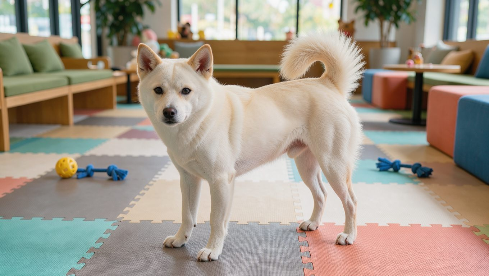

**2026년 11월 7일 기준**

## 빠른 답

- **성격 한 줄**: 충성심이 깊은 '한 사람의 개'입니다. 사람에게는 다정하지만 낯선 사람과 다른 개에게는 경계심을 먼저 보입니다.
- **아파트에서 키울 수 있나?**: 아파트에서도 기를 수 있습니다. 다만 중형 체구에 활동량이 적지 않고 경계심이 강해, 짖음과 산책 시간을 감당할 보호자에게 맞습니다.
- **처음 키우는 사람에게 맞나?**: 사회화와 기본 훈련에 시간을 낼 수 있다면 가능합니다. 성견이 된 후 입양하면 이전 보호자를 따르려는 성향 때문에 집을 벗어나려 할 수 있어, 어린 시절부터 함께하며 유대감을 쌓는 편이 좋습니다.

## 품종 개요

진돗개는 전라남도 진도 지역에서 오랫동안 길러 온 한국 토종견입니다. 섬 주민들은 진돗개를 집을 지키는 번견이자 사냥에 동행하는 사냥개로 길렀으며, 이러한 환경 속에서 강한 경계심과 충성심이 자리 잡았습니다.

지역 문화 백과사전 디지털진도문화대전의 기록을 보면, 1962년 12월 3일 '진도의 진도개'가 천연기념물 제53호로 지정되었습니다. 일제강점기인 1938년에도 지정된 적이 있고, 1939년 개체 수가 650마리에서 313마리로 줄자 1942년에는 반출 통제령이 내려졌습니다. 2021년 11월 19일 문화재청 고시 제2021-141호로 지정번호가 삭제되면서 지금은 '천연기념물 진도의 진도개'로 관리됩니다(디지털진도문화대전).

진돗개는 전체적으로 균형 잡힌 체형을 가진 중형견입니다. 머리는 위에서 보면 둥근 삼각형이고, 눈은 아몬드 모양입니다. 귀는 뾰족하게 서고 꼬리는 등 위로 말리며, 발은 고양이처럼 둥글고 털은 겉털과 속털로 나뉘는 이중모입니다.

<dl>
<dt>크기</dt>
<dd>수컷 체고 50~55cm, 체중 18~23kg. 암컷 체고 45~50cm, 체중 15~19kg입니다(비마이펫).</dd>
<dt>수명</dt>
<dd>대체로 12~15년으로 알려져 있습니다.</dd>
<dt>운동량</dt>
<dd>하루 30분 기준 산책을 두 번 정도 권장합니다(비마이펫).</dd>
<dt>털 관리</dt>
<dd>이중모라 환모기에는 빗질과 청소가 필요합니다.</dd>
<dt>초보 적합도</dt>
<dd>사회화와 훈련에 시간을 낼 수 있는 보호자에게 맞습니다.</dd>
</dl>

## 털무늬·모색

진돗개는 다양한 모색을 가지고 있습니다. 지역 문화 백과사전에는 황색, 흰색, 검은색, 호랑이무늬, 회색 등 다섯 가지 모색이 기록되어 있습니다. 이 가운데 황색과 흰색이 흔하며, 호랑이무늬는 드문 편입니다(디지털진도문화대전). 각각 황구, 백구, 흑구, 호구, 재구라고 부르며, 진돗개의 모색을 구분할 때 사용하는 명칭입니다.

- **황구**: 누런빛이 도는 황색 털입니다. 진돗개 하면 가장 먼저 떠오르는 모색입니다.
- **백구**: 흰 털에 검은 눈과 코가 선명하게 대비됩니다.
- **흑구**: 온몸이 검은 털로 덮입니다.
- **호구**: 호랑이처럼 줄무늬가 있는 모색으로, 보기 드문 편입니다.
- **재구**: 회색빛이 도는 털입니다.

## 성격과 기질

진돗개의 가장 큰 특징은 특정 보호자에게 깊은 애착과 충성심을 보인다는 점입니다. 반려동물 정보 사이트 비마이펫 크리에이터즈에 따르면, 보호자에 대한 충성심과 복종심, 집을 찾아오는 귀가성이 뛰어나며 낯선 사람을 경계합니다(비마이펫). 다른 개와 쉽게 어울리지 않는 경향이 있으며, 특히 수컷 개에게 경계심을 보이기도 합니다.

성견이 된 후 새로운 가정에 들어오면 이전 보호자를 따르려는 성향 때문에 집을 벗어나려 할 수 있다는 점도 알아 두셔야 합니다. 따라서 진돗개는 어린 시절부터 새 가족과 함께하며 충분한 유대감을 형성하는 것이 좋습니다. 같은 아시아 스피츠 계열인 [시바견 허브](/breeds/shiba-inu/)와 성격을 비교해 보는 것도 도움이 됩니다.

영리하고 기억력이 뛰어나 반복적인 훈련을 통해 명령을 빠르게 익히는 편입니다. 다만 자기 판단이 뚜렷해 무조건 따르는 방식보다 신뢰를 쌓는 훈련이 어울립니다(디지털진도문화대전).

## 한국에서 키울 때

진돗개는 한국에서 별도의 보호 및 관리 체계를 갖춘 대표적인 토종견입니다. 1999년 진도읍 동외리에 진도개시험연구소가 설립되어 약 50마리를 관리했으며, 이후 2014년 진도개테마파크로 확장되었습니다. 1998년에 마련된 표준에 따라 정기 심사를 진행하며, 60점 이상을 받은 개체에는 등록증을 발급하고 전자칩을 삽입합니다. 등록 개체는 진도축산업협동조합이 관리합니다(디지털진도문화대전).

분양가를 공식적으로 집계한 자료는 찾기 어려워 이 글에서는 금액을 제시하지 않습니다. 분양을 알아볼 때는 혈통 등록 여부와 부모견의 건강 기록을 함께 확인하는 것이 좋습니다.

아파트에서도 충분히 기를 수 있지만, 경계심이 강해 현관 초인종이나 복도 소리에 짖는 습관이 들기 쉽습니다. 어릴 때부터 집 안 소리에 둔감해지도록 연습시키고, 산책으로 에너지를 풀어 주는 것이 관건입니다.

추위에는 매우 강한 편입니다(비마이펫). 반대로 이중모를 가진 개는 한여름 더위에 부담을 받을 수 있어, 실내 온도를 시원하게 유지하고 산책은 해가 진 뒤로 옮기는 것이 좋습니다. 전반적으로 건강한 편으로 평가되지만, 알레르기 질환에는 주의가 필요합니다(비마이펫).

## 산책·훈련과 털 관리

하루 두 번, 한 번에 30분 안팎으로 산책하는 것이 기본입니다. 진돗개는 산책 중 냄새를 맡거나 주변을 살피는 데 시간을 보내는 편이므로, 목줄을 당기기보다 충분한 여유를 주며 걷는 것이 좋습니다.

사회화는 어린 시절이 중요합니다. 낯선 사람과 다른 개를 만나는 경험을 쌓지 못하면 경계심이 그대로 굳어질 수 있습니다. 짧은 연습을 자주 반복하고, 잘했을 때 간식으로 보상하는 방식이 잘 맞습니다.

털은 이중모라 봄과 가을 환모기에 속털이 많이 빠집니다. 이 시기에는 평소보다 빗질을 자주 해 주는 것이 좋습니다. 털길이에 맞는 도구를 고르는 방법은 [강아지 빗·브러시 비교](/guides/dog-brush-comparison/)에 정리되어 있습니다.

## 자주 묻는 질문

### 진돗개와 진도개는 같은 개인가요?

같은 견종을 가리키는 두 이름입니다. 진도 지역에서 길러 온 개를 가리키는 명칭으로 '진도개'와 '진돗개'가 모두 사용됩니다. 두 명칭 모두 같은 견종을 가리키므로 어느 쪽으로 검색해도 관련 정보를 찾을 수 있습니다.

### 진돗개 분양가는 얼마인가요?

공식적으로 집계된 시세 자료가 없어 이 글에서는 금액을 제시하지 않습니다. 분양을 고려하신다면 혈통 등록 여부와 부모견의 건강 기록을 확인하고, 가격보다 보호자 생활 환경에 맞는지부터 살펴보시는 것이 좋습니다.

### 진돗개는 털이 많이 빠지나요?

이중모라서 봄과 가을 환모기에는 속털이 많이 빠집니다. 평소에는 빗질로 관리하고, 환모기에는 횟수를 늘리면 집 안에 털이 쌓이는 것을 줄일 수 있습니다.

### 진돗개는 다른 개와 잘 지내나요?

다른 개와 쉽게 어울리지 않는 경향이 있으며, 특히 수컷 개에게 경계심을 보이기도 합니다(비마이펫). 어릴 때부터 다른 개와 만나는 경험을 쌓아 주시고, 산책 중 마주칠 때는 거리를 두는 편이 안전합니다.

### 진돗개는 초보자가 키우기 어려운가요?

불가능한 것은 아닙니다. 다만 경계심이 강하고 자기 판단이 뚜렷해 사회화와 기본 훈련에 시간을 내셔야 합니다. 성견보다 어린 시절부터 함께하는 편이 순탄합니다.

## 출처

- [진도의 진도개 — 디지털진도문화대전](https://www.grandculture.net/jindo/index/GC00501421) (천연기념물 지정, 진도개 관리, 모색과 표준)
- [한국 진도견 — 비마이펫 크리에이터즈](https://creators.mypetlife.co.kr/%eb%b0%98%eb%a0%a4%eb%8f%99%eb%ac%bc%eb%b0%b1%ea%b3%bcdog-%ed%95%9c%ea%b5%ad-%ec%a7%84%eb%8f%84%ea%b2%ackorea-jindo-dog/) (성격, 건강, 운동과 관리)
- 표지와 본문 이미지는 AI로 생성한 실사 스타일 이미지입니다.
