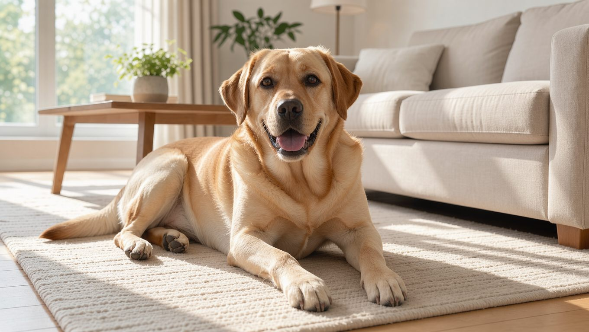

**2026년 10월 12일 기준**

## 빠른 답

**래브라도 리트리버 색상은 몇 가지인가요?** 블랙, 옐로우, 초콜릿 — 공식 표준 색상은 3가지뿐입니다. 실버, 차콜, 샴페인 같은 이름은 표준 밖의 유통 이름으로, 국제 공인 견종 클럽들은 래브라도의 색으로 인정하지 않습니다.

## 색상 이름부터 정리

래브라도 색을 검색하면 공식 이름과 유통 이름이 뒤섞여 나온다. 먼저 무엇이 공식인지부터 가리자.

- **블랙** — 공식 색상. 몸 전체가 검은색이다.
- **옐로우** — 공식 색상. 폭스 레드라 부르는 진한 붉은 노랑부터 라이트 크림까지 전부 옐로우 한 범주에 들어간다. '골든 래브라도'는 공식 명칭이 아니다.
- **초콜릿** — 공식 색상. 옅은 갈색에서 진한 갈색까지. 리버(liver)라는 이름으로도 불린다.
- **실버 · 차콜 · 샴페인** — 비공식. 희석 유전자가 만드는 색으로 표준에 없다. 아래에서 따로 다룬다.

래브라도의 성격이나 관리법 같은 기본 정보는 [래브라도 리트리버 허브](/breeds/labrador-retriever/)에 정리해 두었다.

## 색상 3종 도감

표준은 블랙과 초콜릿에 어떤 음영도 인정하지 않는다. 반면 옐로우는 색 폭이 넓어 짙고 옅음이 자연스러운 범위로 허용된다. 세 색 모두 가슴의 작은 흰 점 하나까지는 허용하되 바람직하지는 않다고 본다. 색마다 코와 눈 색소가 함께 움직인다는 점도 기억해 두면 좋다.

### 블랙

래브라도를 떠올릴 때 가장 먼저 그려지는 색이다. 광택이 도는 짧은 올블랙 털에 검은 코와 눈이 어울린다.

<dl>
<dt>털 색</dt>
<dd>전신 올블랙. 음영이 인정되지 않으므로 잡색이 섞이면 표준에서 벗어난다.</dd>
<dt>코·눈 색</dt>
<dd>검은색으로 통일된다. 갈색 계열 색소가 나오면 표준과 어긋난다.</dd>
<dt>실격 요소</dt>
<dd>브린들(호랑이 무늬)이나 탄(연한 갈색) 무늬가 섞인 블랙.</dd>
</dl>

### 옐로우

세 색 중 편차가 가장 큰 색이다. 폭스 레드라 불리는 진한 붉은 노랑에서 크림에 가까운 연노랑까지, 귀와 등 쪽이 배보다 짙게 나오는 것까지 표준이 허용한다. 폭스 레드는 별도 색이 아니라 옐로우 범주의 진한 음영이다.

옐로우를 '골든 래브라도'로 광고하는 분양 글도 있다. 공식 색상명은 어디까지나 옐로우다.

<dl>
<dt>털 색</dt>
<dd>폭스 레드에서 라이트 크림까지. 표준이 음영 차이를 폭넓게 허용한다.</dd>
<dt>코·눈 색</dt>
<dd>검은색이 일반적이다. 겨울철에 코 색이 분홍빛으로 옅어지는 스노우 노즈가 흔하다.</dd>
<dt>주의할 통칭</dt>
<dd>골든 래브라도, 크림 래브라도 — 공식 색상명이 아니다.</dd>
</dl>

### 초콜릿

검은 색소를 만들지 못하는 유전 조합에서 나오는 색이다. 그래서 털, 코, 눈, 입술 색소가 전부 갈색 계열로 통일된다. 초콜릿 개체에 검은 코가 나오면 표준에서 벗어난 것으로 본다.

<dl>
<dt>털 색</dt>
<dd>옅은 갈색에서 다크 초콜릿까지.</dd>
<dt>코·눈 색</dt>
<dd>갈색 계열로 통일된다.</dd>
<dt>다른 이름</dt>
<dd>리버(liver). 같은 색을 가리키는 관용 표현이다.</dd>
</dl>

## 색은 어떻게 정해지나

래브라도의 색은 두 단계 스위치가 정한다. 첫 스위치(E)가 꺼져 있으면 검정·갈색 색소가 아예 만들어지지 않아 무조건 옐로우가 된다. 켜져 있으면 두 번째 스위치(B)가 색을 가른다. 검은 색소를 만드는 B가 하나라도 있으면 블랙, 아예 없으면 초콜릿이다.

- **E 켜짐 + B 있음 → 블랙** — 갈색·옐로우 유전자를 숨기고 있을 수 있다.
- **E 켜짐 + B 없음 → 초콜릿** — 부모 양쪽에서 갈색 유전자(b)를 받아야 나온다.
- **E 꺼짐 → 옐로우** — 그 아래 블랙이든 초콜릿이든 겉으로 드러나지 않는다.

이 구조 때문에 두 블랙 부모 사이에서도 옐로우나 초콜릿 새끼가 태어날 수 있다. 부모가 둘 다 해당 색의 유전자를 품고 있는 보인자일 때다. 옐로우 새끼가 나오려면 부모 양쪽 모두 옐로우 유전자(e)를, 초콜릿 새끼가 나오려면 부모 양쪽 모두 갈색 유전자(b)를 물려주어야 한다. 부모견의 겉색만 보고 새끼 색을 단정할 수 없는 이유다.

## 실버·차콜·샴페인은 왜 논란인가

'실버 랩'이라는 이름으로 프리미엄을 붙여 팔리는 개들이 있다. 이 색을 만드는 것은 희석 유전자(dd)다. 검정이 희석되면 차콜, 초콜릿이 희석되면 실버, 옐로우가 희석되면 샴페인으로 불린다. 문제는 이 희석 유전자가 래브라도에서는 확인된 적이 없다는 점이다.

미국 래브라도 리트리버 클럽(LRC)은 "실버 래브라도는 순종 래브라도 리트리버가 아니다"라고 못 박는다. 근거로 두 가지를 든다. 희석 유전자가 래브라도 유전자 목록에 없어 순종 교배로는 나올 수 없다는 것, 그리고 실버 개체를 처음 만든 브리더들이 희석 유전자가 모든 개체에 있는 유일한 견종인 와이마라너에도 관여했다는 정황이다. 교배 사실을 확증하지는 못한다며, 오래전 교배가 유전자 풀에 숨어들었을 가능성도 함께 언급한다.

등록 문제도 얽혀 있다. AKC는 실버 개체 일부를 등록해 왔는데, 실버가 초콜릿의 한 음영이라는 해석을 따른 것으로 보인다. 클럽은 이를 반박한다. 블랙과 초콜릿에는 어떤 음영도 인정되지 않고, 옐로우의 음영은 희석 유전자가 아니라 ee 유전자 위의 조절인자에서 나온다는 것이다.

클럽은 이 색이 '희귀하고 순종'인 것처럼 포장돼 프리미엄 가격에 팔리고 있다고 경고한다.

## 분양 전에 확인할 것

- **등록 서류의 색상 표기** — 블랙·옐로우·초콜릿 중 무엇으로 기재됐는지 본다. 광고 문구와 등록상 색상 표기가 다를 수 있다.
- **dd 검사 결과** — 래브라도 클럽은 번식견 건강 검사 항목에 희석 유전자 검사를 넣고, 희석 유전자가 없을 것을 요구한다. 부모견 등록명으로 OFA 공개 데이터베이스(ofa.org/search)에서 검사 결과를 조회할 수 있다.
- **이름과 가격** — 클럽은 희석 색상이 '희귀하고 순종'인 것처럼 포장돼 프리미엄 가격에 팔린다고 경고한다. 색 이름만으로 웃돈을 받는 매물은 한 번 더 확인하는 편이 좋다.

## FAQ

### 옐로우 래브라도를 골든 래브라도라고 부르던데, 맞는 이름인가요?

공식 색상명은 옐로우입니다. 폭스 레드도 크림도 모두 옐로우 범주에 들어갑니다. 골든 래브라도는 업체가 붙인 통칭이고, 골든 리트리버와는 다른 견종입니다. 두 견종의 차이는 [골든 vs 래브라도 비교 글](/guides/golden-vs-labrador/)에 정리해 두었습니다.

### 블랙 래브라도 사이에서도 옐로우 새끼가 나올 수 있나요?

나올 수 있습니다. 옐로우는 열성 형질이라 부모 양쪽이 옐로우 유전자를 숨기고 있으면 블랙 부모 사이에서도 옐로우 새끼가 태어납니다. 초콜릿도 같은 원리로, 부모 양쪽에서 갈색 유전자를 물려받아야 나옵니다.

### 초콜릿 래브라도의 코는 왜 갈색인가요?

초콜릿을 만드는 유전 조합은 검은 색소를 만들지 못합니다. 그래서 털과 코, 눈, 입술 색소가 모두 갈색 계열로 통일됩니다. 초콜릿 개체에 검은 코가 나오면 표준에서 벗어난 모습으로 봅니다.

### 가슴에 흰 털이 있으면 실격인가요?

표준은 가슴의 작은 흰 점 하나는 허용하되 바람직하지 않다고 봅니다. 나이 들며 생기거나 상처에서 자란 흰 털은 무늬로 보지 않습니다. 다만 흰 점이 크거나 여러 부위로 번지면 표준에서 벗어납니다.

### 실버 랩은 등록이 되던데, 순종 아닌가요?

AKC가 일부를 등록해 온 것은 사실입니다. 클럽은 이를 '실버가 초콜릿의 음영'이라는 해석에 기댄 처리로 보고 반박합니다. 클럽 기준으로는 순종 래브라도가 아니며, 번식견 검사에서도 희석 유전자가 없는 개체만 인정합니다.

## 출처

- [FAQs for Puppy Buyers — The Labrador Retriever Club](https://thelabradorclub.com/faqs-for-puppy-buyers/) (표준 색상 3종과 폭스 레드의 위치, 실버·차콜·샴페인 구분, 희석 유전자 검사 안내)
- [The Issue of the Silver Labrador — The Labrador Retriever Club](https://thelabradorclub.com/the-issue-of-the-silver-labrador/) (희석 유전자 원리, 순종성 논란과 와이마라너 정황, AKC 등록 관행, 프리미엄 마케팅 경고)

*표지와 색상 이미지는 AI로 생성했습니다.*
