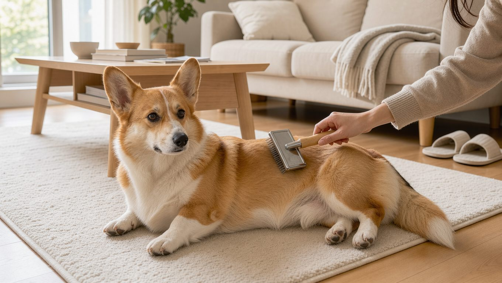

**2026년 11월 10일 기준** — 분양가는 시장 상황에 따라 달라질 수 있습니다.

## 빠른 답

- **성격 한 줄**: 목양견 특유의 활동성과 영리함을 지녔으며, 사람을 좋아하는 성격도 갖춘 견종입니다. 체구는 작지만 일할 때는 당차고 부지런합니다.
- **아파트에서 키울 수 있나요?**: 법적으로 사육이 제한되는 견종이 아니며, 체구도 중형견에 해당해 아파트에서 키우는 경우가 많습니다. 다만 짖음 관리와 허리 보호를 위한 생활 습관을 들이는 것이 중요합니다.
- **처음 키우는 사람에게 맞나요?**: 훈련 습득이 빠르고 사람과도 잘 어울려 초보 보호자도 키워 볼 만한 견종입니다. 식탐과 짖음, 비만 관리는 처음부터 신경 써야 합니다.

## 품종 개요

웰시코기는 영국 웨일스 펨브록셔 지방에서 소를 몰던 목양견입니다. 소의 발뒤꿈치를 물어 방향을 돌리는 방식으로 일했기 때문에 발이 빠르고 몸이 낮습니다. '코기(corgi)'라는 이름은 웨일스어로 '작은 개'를 뜻하는 것으로 알려져 있습니다.

한때 펨브록과 카디건은 하나의 견종으로 취급됐지만, 현재는 서로 다른 견종으로 구분됩니다. 한국에서 '웰시코기'로 통칭되는 개체는 대부분 펨브록입니다. 카디건은 꼬리가 길고 체구도 조금 더 크며, 국내에서는 개체 수가 적어 비교적 보기 드뭅니다(반려동물 가격 비교 사이트 FORPET).

AKC는 펨브록 웰시코기를 '강하고 날렵하며 활기찬 작은 목양견'으로 소개합니다(AKC). 짧은 다리와 긴 허리, 여우를 닮은 얼굴 때문에 귀여운 반려견이라는 이미지가 강하지만, 본래 소떼를 몰던 목양견이었다는 점을 이해하면 행동 특성을 파악하는 데 도움이 됩니다.

<dl>
<dt>크기</dt>
<dd>체고는 25~30cm로, 체구에 비해 몸통이 길고 다리가 짧은 중형견입니다.</dd>
<dt>체중</dt>
<dd>체중은 10~14kg입니다. 국내 분류 기준으로 중형견에 해당하며, <a href="/guides/medium-dog-types/">중형견 10종 비교</a>에서도 다른 견종과 함께 살펴볼 수 있습니다.</dd>
<dt>수명</dt>
<dd>12~15년으로 보는 자료가 있습니다(FORPET). 12~13년으로 보는 자료도 있습니다(국내 반려동물 정보 사이트 펫집).</dd>
<dt>운동량</dt>
<dd>하루 운동량은 자료에 따라 30분 이상에서 1시간까지 다양하게 제시됩니다.</dd>
<dt>털 관리</dt>
<dd>이중모라 빗질이 일상입니다. 환모기에는 손이 더 갑니다.</dd>
<dt>초보 적합도</dt>
<dd>훈련 습득이 빨라 초보도 도전할 만합니다. 짖음과 식탐은 처음부터 관리해야 합니다.</dd>
</dl>

## 성격과 기질

펨브록 웰시코기는 사람과 함께 있는 것을 좋아하면서도 지나치게 매달리지는 않는 성격으로 소개됩니다(AKC). 가족에게 애정이 깊으며, 낯선 사람에게도 비교적 친근하게 대하는 편입니다.

목양견의 본능은 일상생활에서 '허딩(Herding)' 행동으로 나타날 수 있습니다. 달리는 아이를 쫓아가 발뒤꿈치를 살짝 무는 행동이 대표적입니다. 이는 공격하려는 의도라기보다 소를 몰던 본능에서 비롯된 행동이므로, 어릴 때부터 허용되지 않는 행동을 구분해 가르치는 것이 좋습니다(펫집).

머리가 좋아 훈련 습득이 빠른 편입니다. 기본 훈련은 물론 노즈워크나 트릭 같은 놀이로 만족감을 채워 주기 좋습니다. 반대로 충분한 활동과 자극이 제공되지 않으면 짖거나 물건을 물어뜯는 등의 문제 행동으로 이어질 수 있습니다(펫집).

짖는 소리가 크고 짖는 빈도도 높은 편이라는 점은 미리 알아 두어야 합니다(펫집). 아파트에서 키운다면 초인종이나 복도 발소리 등에 과도하게 반응하지 않도록 어릴 때부터 소리 둔감화 훈련을 하는 것이 좋습니다.

식탐이 강해 비만 위험이 높습니다(펫집). 정해진 양을 정해진 시간에 주는 습관이 기본입니다.

## 털무늬·색상 변형

국내에서 가장 흔한 모색은 레드 앤 화이트입니다. 세이블이나 트라이컬러는 상대적으로 개체 수가 적어 분양가가 높게 형성되는 경향이 있습니다(FORPET).

견종 표준상 펨브록은 레드, 세이블, 폰, 블랙 앤 탄 계열에 흰 무늬가 조합됩니다. 카디건은 블루 머를과 브린들 등 허용 모색이 더 다양합니다.

모색은 개체의 성격이나 건강 상태를 직접적으로 결정하는 요소가 아닙니다. 모색을 정할 때는 외모보다 부모견의 검사 이력과 개체의 컨디션을 먼저 보는 것이 좋습니다.

## 한국에서 키울 때

**분양가** — 국내 웰시코기의 평균 분양가는 80만~150만 원 선으로 형성되어 있습니다(FORPET). 다만 분양 경로와 혈통 등에 따라 가격 차이가 크게 나타납니다.

- **가정 분양**: 60만~100만 원
- **전문 브리더**: 150만~300만 원, 도그쇼 챔피언 혈통은 200만 원을 넘기도 합니다
- **가격 요인**: 암컷이 수컷보다 10만~20만 원 높고, 수도권이 지방보다 10~20% 높습니다

**분양 전 확인할 것** — 분양가보다 먼저 확인해야 할 것은 건강 기록입니다.

- **유전자 검사서**: 부모견의 PRA, DM, vWD 검사 이력을 확인합니다
- **체중**: 8주령에 2.5~3.5kg인지 확인합니다
- **접종과 구충**: DHPPL 1~2차 접종을 비롯해 코로나 장염과 켄넬코프 예방접종 여부, 구충 기록을 확인합니다
- **계약서**: 분양 후 2주, 계약서상 15~30일의 건강 보장 조항이 있는지 확인합니다(FORPET)

**아파트 생활** — 법적으로 사육이 제한되는 견종은 아니지만, 짖음 관리와 허리 보호가 아파트 생활의 핵심입니다. 계단 대신 엘리베이터를 이용하고, 소파나 침대에 오르내릴 때는 반려견용 슬로프를 설치하는 것이 좋습니다. 미끄러운 바닥에는 러그나 매트를 깔아 미끄러짐을 예방해야 합니다.

**여름 관리** — 이중모는 외부의 열과 햇볕으로부터 피부를 보호하는 역할을 합니다. 털을 짧게 미는 것보다는 빗질로 죽은 속털을 제거하고, 산책은 이른 아침이나 해가 진 뒤에 하는 것이 안전합니다. 한여름에는 아스팔트 표면 온도가 매우 높아질 수 있으므로, 손등을 바닥에 대어 열기를 확인한 뒤 산책 여부를 결정하는 것이 좋습니다.

**흔한 유전병** — 짧은 다리와 긴 허리라는 신체 구조 때문에 발생할 수 있는 질환에 특히 주의해야 합니다.

- **퇴행성 척수증(DM)**: 주로 노령기에 발생하며, 진행되면 뒷다리의 근력 저하와 마비로 이어질 수 있는 질환입니다. 유전자 검사로 위험도를 확인할 수 있습니다
- **추간판 질환(IVDD)**: 긴 허리와 짧은 다리 구조로 인해 발생 위험이 높은 추간판 질환입니다
- **고관절 이형성증**: 성장기 과한 운동을 피하고 부모견의 검사 이력을 확인합니다
- **폰빌레브란트병**: 혈액 응고 장애라 수술 전 응고 검사를 권장합니다
- **비만**: 허리에 부담이 그대로 쌓이므로 정량 급여로 관리하는 것이 좋습니다(펫집)

**월 양육비** — 사료비와 미용비, 예방접종 비용 등을 포함한 월평균 양육비는 15만~20만 원 수준으로 소개됩니다(펫집). 실제 지출은 병원비와 미용 주기에 따라 달라질 수 있습니다.

## 관리법

**털 관리** — 이중모를 가진 견종으로 연중 털이 빠지며, 환모기에는 털 빠짐이 더욱 심해집니다. 평소에는 주 2~3회, 환모기에는 매일 언더코트 레이크를 사용해 속털을 제거하는 것이 좋습니다. 목욕 후에는 겉털뿐 아니라 속털까지 충분히 말려야 피부 질환을 예방하는 데 도움이 됩니다(펫집).

**운동** — 하루 최소 1시간의 운동을 권장하는 자료가 있는 반면(펫집), 30분 이상이면 충분하다고 보는 자료도 있습니다(FORPET). 하루 두 차례 산책에 공놀이나 노즈워크를 추가하는 방식이 권장됩니다(펫집). 짧은 다리로 장시간 달리면 관절과 허리에 부담이 생길 수 있으므로, 운동을 한 번에 몰아서 하기보다 여러 차례로 나누는 것이 좋습니다. 강아지의 나이와 체력별 기준은 <a href="/guides/dog-exercise-amount/">하루 운동량 가이드</a>에서 더 볼 수 있습니다.

**딱지허브 평가**: 출처에서 권장하는 '하루 1시간'은 이상적인 운동량에 해당합니다(펫집). 한국의 아파트 생활 환경에서는 평일에 30~40분씩 두 차례 산책하고 실내 노즈워크를 병행하는 방식이 현실적입니다. 부족한 활동량은 주말 공원 산책으로 보완할 수 있습니다. 운동량이 부족하면 짖거나 물건을 물어뜯는 행동으로 이어질 수 있으므로, 실내 놀이도 함께 제공하는 것이 좋습니다.

**허리 보호** — 소파와 침대에서 뛰어내리지 못하게 하고, 계단 이용을 최소화하며, 바닥에 미끄럼 방지 매트를 설치하는 것이 기본입니다. 체중이 증가하면 허리에 가해지는 부담도 커지므로, 적정량의 사료를 급여해 체중을 관리하는 것이 허리 건강을 지키는 기본입니다(펫집).

**훈련** — 발뒤꿈치를 무는 허딩 닙(Herding Nip) 행동을 교정하고, 초인종 소리에 익숙해지도록 하는 훈련을 어릴 때부터 시작하는 것이 좋습니다. 기본 훈련과 함께 노즈워크를 진행하면 지루함에서 비롯되는 문제 행동을 줄이는 데 도움이 됩니다. 가족 모두 같은 규칙으로 대해야 혼란이 없습니다(펫집).

## 자주 묻는 질문

### 웰시코기는 아파트에서 키우기 어려운가요?

법적으로 사육이 제한되는 견종이 아니며, 중형견에 해당하는 체구로 아파트에서도 생활할 수 있습니다. 다만 짖음 관리와 허리 보호가 아파트 생활에서 중요한 부분입니다. 어릴 때부터 소리 둔감화 훈련을 하고, 계단 대신 엘리베이터를 쓰며 점프를 줄이면 무리 없이 함께 살 수 있습니다.

### 털을 짧게 밀어도 되나요?

이중모는 더위와 햇볕으로부터 피부를 보호하는 역할을 하므로, 털을 밀기보다는 빗질로 속털을 정리하는 것이 좋습니다. 털을 짧게 밀면 피부가 자외선에 직접 노출될 수 있으며, 털이 다시 자라는 과정에서 모질이나 털의 상태가 달라질 수 있습니다. 더위가 걱정된다면 산책 시간을 조정하고, 실내 온도를 적절하게 유지하면서 충분한 물을 제공해 주세요.

### 웰시코기는 아이와 잘 지내나요?

사람을 좋아하는 성격으로 아이와도 함께 생활할 수 있습니다. 다만 목양 본능으로 인해 달리는 아이를 쫓아가거나 옷자락을 무는 행동을 보일 수 있습니다. 따라서 아이와 반려견 모두 서로를 자극하지 않고 안전하게 교류하는 방법을 익히도록 해야 합니다(펫집).

### 허리가 정말 약한가요?

긴 허리와 짧은 다리라는 신체 구조로 인해 추간판 질환이 발생할 위험이 높은 편입니다(펫집). 점프와 계단 이용을 줄이고 적정 체중을 유지하면 허리에 가해지는 부담을 줄이는 데 도움이 됩니다. 뒷다리를 끌거나 갑자기 절뚝이면 바로 동물병원에 가 보세요.

### 살이 잘 찌는 편인가요?

식탐이 강한 편이라 비만에 주의해야 하는 견종입니다(펫집). 하루 급여량을 정해 여러 번 나누어 주고 간식 섭취를 제한하면 체중 관리에 도움이 됩니다. 허리에 부담이 쉽게 가해질 수 있는 견종이므로, 체중 증가를 예방하기 위해 정기적으로 체중을 확인하는 것이 좋습니다.

## 출처

- [펨브록 웨일스 코기 — 펫집](https://petjip.com/dog/breeds/pembroke-welsh-corgi/) (체중·수명·유전병·관리 포인트)
- [웰시코기 분양 가격과 입양 체크포인트 — FORPET](https://forpet.co.kr/1512) (분양가대·입양 건강 체크)
- [Pembroke Welsh Corgi — AKC](https://www.akc.org/dog-breeds/pembroke-welsh-corgi/) (성격 소개)

표지는 AI로 생성한 이미지입니다.
