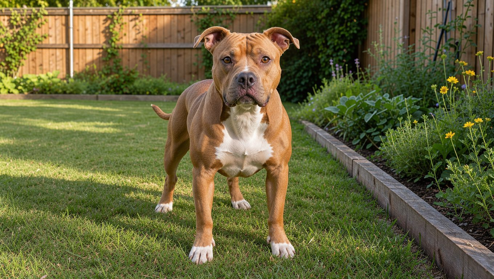

**2026년 11월 3일 기준** — 맹견 관련 법령과 제도는 이 날짜를 기준으로 확인했습니다.

## 빠른 답

- **성격 한 줄**: 핏불테리어는 사람과의 유대가 강하고 에너지가 넘치는 견종입니다. 고집이 있는 편이라 어린 시기부터 사회화와 기본 훈련이 뒷받침되어야 합니다.
- **아파트에서 키울 수 있나요?**: 사육허가와 외출 안전조치를 갖추면 제도 안에서 키울 수 있습니다. 다만 운동량과 사회화 시간, 공용공간 동선까지 고려해야 합니다.
- **처음 키우는 사람에게 맞나요?**: 힘과 에너지가 큰 견종이라 경험이 있는 보호자에게 더 적합합니다.

## 한국에서 키울 때

**맹견으로 지정된 견종입니다.** 「동물보호법 시행규칙」 제2조는 맹견의 범위를 다섯 가지로 정하고, 여기에 핏불테리어(아메리칸 핏불테리어를 포함합니다)와 그 잡종이 들어갑니다. 나머지 네 가지 견종은 도사견, 아메리칸 스태퍼드셔 테리어, 스태퍼드셔 불 테리어, 로트와일러이며, 이들의 잡종도 맹견에 포함됩니다.

**외출할 때는 목줄과 입마개가 필요합니다.** 「동물보호법」 제21조는 생후 3개월이 지난 맹견을 동반하고 외출할 때 목줄과 입마개 등 안전장치를 하거나 탈출을 막을 수 있는 이동장치를 쓰도록 정합니다. 이를 위반하면 300만 원 이하의 과태료가 부과될 수 있습니다.

**사육허가와 정기 교육도 따라옵니다.** 맹견은 동물보호법상 사육허가를 받아야 하고, 허가를 받은 뒤에도 정기 교육을 이수해야 합니다. 사육허가 요건과 신청 절차, 준비 서류는 [입마개 가이드](/guides/dog-muzzle/)에서 확인할 수 있습니다.

**아파트에서는 동선 관리가 관건입니다.** 사육허가를 받더라도 공동주택에서 생활하려면 별도의 주의와 관리가 필요합니다. 엘리베이터와 공용 복도에서 다른 주민과 마주치는 시간을 줄이고, 이동장치나 짧은 목줄을 활용하는 것이 좋습니다. 지자체 조례와 공동주택 관리규약에 따라 사육이나 공용시설 출입에 제한이 있을 수 있으므로 입주 전에 확인해 주세요.

**딱지허브 평가**: 제도적으로 사육허가를 받으면 기를 수 있지만, 한국의 아파트에서는 이웃과 마주치는 상황까지 세심하게 관리해야 합니다. 운동량과 사회화 시간을 매일 확보할 수 있는 주거 환경인지가 실제 선택의 기준이 됩니다.

**여름과 건강 관리도 필요합니다.** 단모라 털은 짧지만 더위에는 주의가 필요합니다. 한낮 산책을 피하고 물을 자주 마시게 해 주세요. PetMD에 따르면 이 견종에게는 알레르기, 고관절 이형성증, 백내장, 비만 등의 건강 문제가 나타날 수 있습니다. 정기 검진에서 피부와 관절, 눈 상태를 함께 확인하는 것이 좋습니다.

## 품종 개요

핏불테리어는 19세기 영국과 아일랜드에서 불독과 테리어를 교배해 만든 견종에서 유래했습니다. 미국으로 건너간 뒤 1898년 UKC에 아메리칸 핏불 테리어라는 이름으로 등록되었습니다. AKC는 같은 뿌리를 가진 개를 1936년 스태퍼드셔 테리어로 인정했으며, 1972년 아메리칸 스태퍼드셔 테리어로 명칭을 변경했습니다. 한국에서 흔히 '핏불'이라고 부르는 개는 대부분 아메리칸 핏불 테리어를 가리킵니다.

몸은 근육질이고 가슴이 넓으며 다리가 튼튼합니다. 털은 짧고 촘촘하며, 모색은 한 가지로 고정되지 않습니다. 같은 계열에 속하는 다른 견종과 비교하려면 [불테리어 계열 견종 비교](/breeds/bull-terrier-derived-breeds/)를 참고해 주세요.

<dl>
<dt>크기</dt><dd>체고 43~53cm</dd>
<dt>체중</dt><dd>14~32kg</dd>
<dt>운동량</dt><dd>하루 45분~1시간</dd>
<dt>털 관리</dt><dd>1~2주에 1회 빗질</dd>
<dt>초보 적합도</dt><dd>경험 있는 보호자 권장</dd>
</dl>

## 성격과 기질

PetMD는 핏불테리어를 친절하고 사교적인 견종으로 설명합니다. 사람과 가까이 지내는 것을 좋아하며 보호자와 강한 유대감을 형성하고 충성심도 강한 편입니다. 다만 고집이 있는 편이라 자신의 판단대로 행동하려는 성향도 보입니다.

에너지가 넘치는 편이라 매일 운동과 놀이가 필요합니다. 운동이 부족하면 짖음이나 파괴 행동으로 이어질 수 있습니다. 혼자 있는 시간이 길어지면 분리 불안이 나타날 수 있으므로, 어릴 때부터 혼자 있는 상황에 점진적으로 익숙해지도록 훈련하는 것이 좋습니다.

모든 개와 잘 어울리는 견종은 아닙니다. 다른 개와 어울리는 정도는 개체마다 차이가 있으므로, 어린 시기부터 다양한 사람과 개를 안전하게 접할 기회를 마련해 주세요. 산책 중 마주치는 개를 억지로 접촉시키는 것은 피하는 편이 좋습니다.

힘이 세므로 목줄을 당기는 습관이 들면 보호자가 제어하기 어려워집니다. 보상 중심의 훈련으로 느슨한 목줄 보행을 익히는 것이 중요합니다.

## 털무늬·색상 변형

핏불테리어의 털색은 검정, 파운(황갈색), 블루, 레드, 브린들 등으로 다양하며, 가슴이나 발에 흰색 무늬가 나타나기도 합니다. 같은 배에서 태어난 개도 색이 다를 수 있습니다. 블루는 검정색이 희석되어 푸른빛을 띠는 색이며, 브린들은 털에 줄무늬가 나타나는 무늬를 말합니다. 털색은 관리 난이도를 크게 바꾸지 않습니다.

## 관리법

**운동**: PetMD는 하루 최소 45분에서 1시간 정도 운동할 것을 권장합니다. 산책만으로는 부족할 수 있으니 공놀이, 노즈워크, 기본 훈련을 번갈아 하는 것이 좋습니다. 운동량이 부족하면 스트레스가 쌓일 수 있습니다.

**털과 위생**: 짧은 털은 1~2주에 한 번 정도 빗질해 주면 충분합니다. 털갈이 시기에는 횟수를 늘려 주세요. 귀와 발톱, 치아 상태도 정기적으로 확인하고 관리해 주세요.

**체중과 훈련**: 체중이 늘지 않도록 간식 양을 조절하고 몸무게를 정기적으로 확인합니다. 입마개는 외출할 때 갑자기 착용하면 거부감을 보일 수 있으므로, 집에서 짧은 시간부터 연습하며 점차 익숙해지도록 해 주세요.

## 자주 묻는 질문

### 핏불테리어는 한국에서 어떤 규제를 받나요?

맹견으로 지정되어 있어 사육허가를 받아야 하며, 외출할 때는 목줄과 입마개 등 안전조치를 갖춰야 합니다. 허가를 받은 뒤에도 정기 교육을 이수해야 합니다. 자세한 절차는 본문의 '한국에서 키울 때'와 [입마개 가이드](/guides/dog-muzzle/)에서 확인할 수 있습니다.

### 핏불테리어와 아메리칸 스태퍼드셔 테리어는 같은 견종인가요?

뿌리는 같지만 등록 기준과 이름이 다릅니다. AKC는 아메리칸 스태퍼드셔 테리어를 등록하고, UKC는 아메리칸 핏불 테리어를 등록합니다. 한국에서는 두 견종 모두 맹견으로 지정되어 있습니다.

### 핏불테리어는 아파트에서 키울 수 있나요?

사육허가와 안전조치를 갖추면 제도상 가능합니다. 다만 운동량과 사회화 시간이 넉넉해야 하고, 엘리베이터와 공용공간 동선을 관리해야 합니다. 지자체 조례와 관리규약을 미리 확인해 주세요.

### 초보 보호자가 키울 때 가장 어려운 점은 무엇인가요?

힘이 세고 에너지가 넘치며 고집도 있는 편이라 훈련과 사회화에 꾸준히 시간을 투자해야 합니다. 운동이 부족하면 스트레스가 쌓일 수 있으므로 보호자의 생활 리듬이 안정되어 있어야 합니다.

### 털 관리는 어렵나요?

짧은 단모라 빗질과 목욕 부담이 크지 않습니다. 털갈이 시기에 빗질 횟수를 늘려 주세요.

## 출처

- [American Pit Bull Terrier](https://www.petmd.com/dog/breeds/american-pit-bull-terrier) (체고·체중·운동량·털 관리·건강 문제)
- [동물보호법 시행규칙 제2조(맹견의 범위)](https://law.go.kr/LSW/lsInfoP.do?lsiSeq=204665) (맹견 5종과 핏불테리어 포함)
- [동물보호법 제21조(맹견의 관리)](https://www.law.go.kr/법령/동물보호법/제21조) (외출 안전조치와 과태료, 정기 교육)

이 글의 표지 이미지는 AI로 생성한 이미지입니다.
