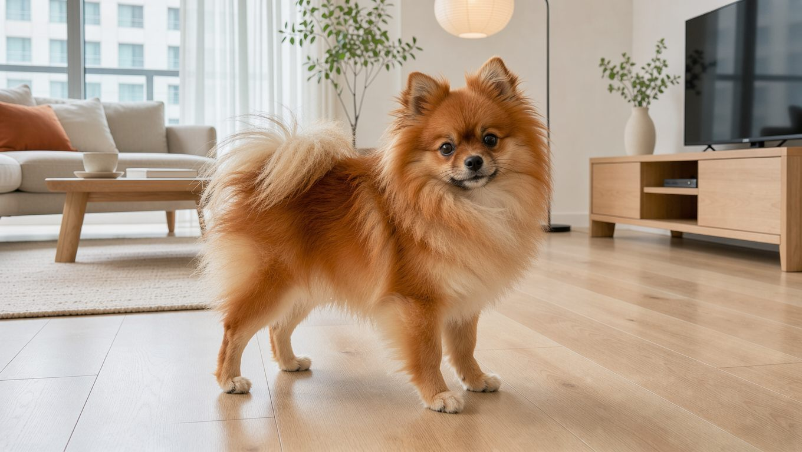
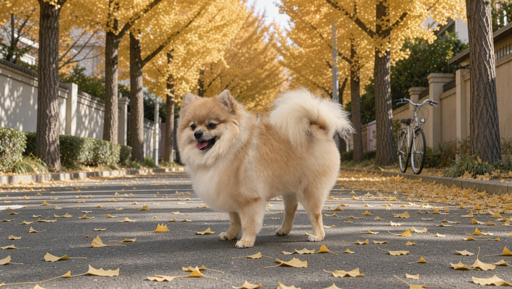
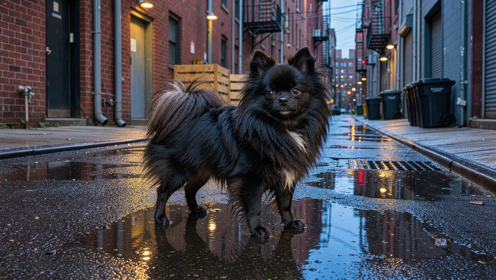
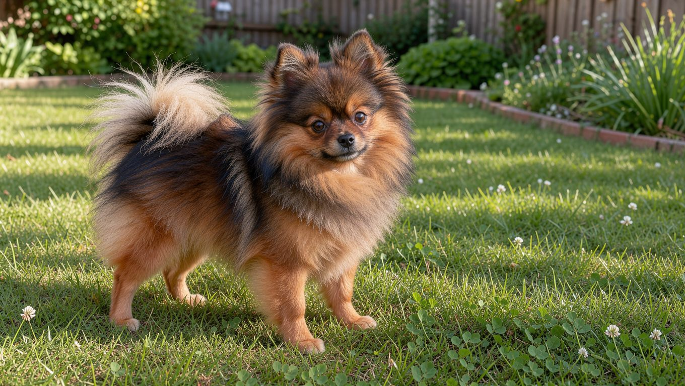
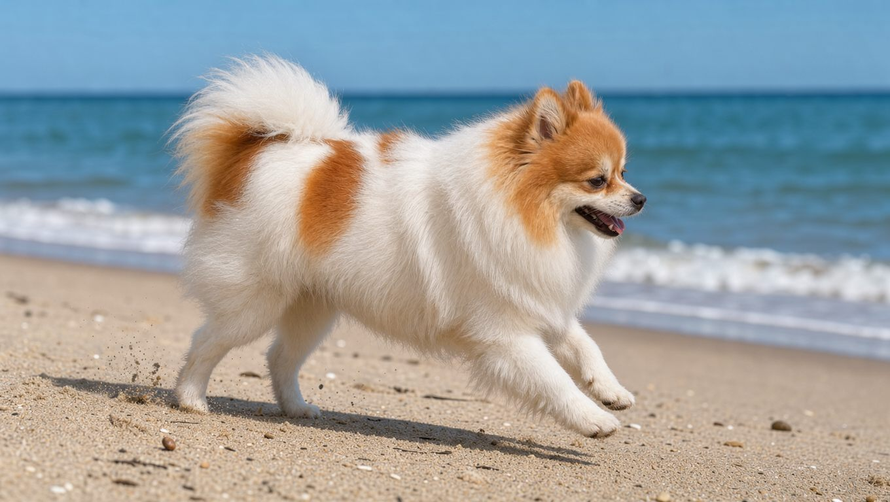

**2026년 10월 17일 기준**

## 빠른 답

**포메라니안은 어떤 색이 있나요?**
미국 켄넬클럽(AKC) 표준은 포메라니안의 모든 색과 무늬를 허용하며, 어느 색이 더 낫다고 정하지 않습니다. 레드·오렌지·크림·세이블 계열이 대표적이고, 블랙·브라운·블루·블랙탄·파티·브린들·비버·메를·화이트도 표준 안에 들어갑니다.

## 색상에는 우열이 없습니다 — AKC가 허용하는 색과 무늬

미국 포메라니안 클럽이 소개하는 AKC 품종 표준의 핵심 원칙은 간단합니다. 모든 색과 무늬 및 그 변형을 허용하며, 색상에 따른 차별 없이 심사한다는 것입니다. 전시회에서는 심사의 편의를 위해 색을 세 가지 그룹으로 나눕니다.

<dl>
<dt>레드·오렌지·크림·세이블(ROCS)</dt>
<dd>레드 세이블, 오렌지 세이블, 크림 세이블, 세이블, 울프 세이블까지 이 묶음에 들어갑니다.</dd>
<dt>블랙·브라운·블루(BBB)</dt>
<dd>검정·갈색·청회색 계열의 색상이 포함됩니다.</dd>
<dt>그 밖의 허용 색(AOAC)</dt>
<dd>비버, 브린들, 메를, 파티, 탄 포인트, 화이트가 포함됩니다.</dd>
</dl>

이 구분은 전시 편의를 위한 것일 뿐, 색 자체에 우열을 매기는 장치가 아닙니다. 어떤 색이든 체형과 털량, 얼굴 생김새 같은 다른 표준 요건과 함께 심사됩니다.

## 대표 색상 도감

같은 견종이라도 털색에 따라 인상이 크게 달라집니다. 국내 분양 목록에서 자주 볼 수 있는 색상을 중심으로, 표준상 분류와 관리 요령을 함께 살펴봅니다.

### 레드·오렌지 — 포메라니안의 얼굴

붉은 갈색부터 선명한 오렌지색까지 다양한 색조를 띱니다. 햇빛 아래에서는 붉은빛이 더욱 도드라지며, 털의 양과 상태에 따라서도 색감이 다르게 느껴집니다. 전시 분류에서는 ROCS에 포함되며, 털빛의 균일성도 외모를 평가할 때 고려됩니다.

### 크림·화이트 — 밝고 부드러운 인상

크림은 아이보리부터 연한 살구빛까지 다양한 색조를 보이며, 화이트는 털 전체가 흰색인 것이 특징입니다. 크림은 ROCS, 화이트는 AOAC에 포함됩니다. 밝은 색은 눈물자국이나 산책 때 묻은 흙이 눈에 잘 띄므로, 부분 세척과 빗질을 조금 더 자주 해 주는 편이 좋습니다.

### 블랙·블랙탄 — 광택이 인상을 결정합니다

블랙은 털 전체가 짙은 검정색인 유형이고, 블랙탄은 검은 바탕에 황갈색 무늬가 나타나는 유형입니다. 탄 포인트는 눈 위, 귀 안쪽, 주둥이와 목, 앞가슴, 다리 아래와 발, 꼬리 밑과 스커트에 나타납니다. 미국 포메라니안 클럽은 탄 무늬가 또렷하고 탄색이 진할수록 좋게 본다고 설명합니다. 검은 털은 빛을 받는 각도에 따라 갈색 기운이 비치기도 합니다. 털의 윤기를 유지하려면 손상을 줄이는 빗질과 적절한 목욕 관리가 중요합니다.

### 세이블 — 털끝이 만드는 그라데이션

세이블은 바탕 털의 끝부분에 검은색이 섞여 나타나는 무늬입니다. 회색 기가 도는 울프 세이블, 오렌지 바탕의 오렌지 세이블 등 변형이 많고, 같은 세이블이라도 검은 털끝의 양에 따라 밝기가 달라집니다. 어린 시기에는 검게 보이다가 성견 털로 갈아입으면서 밝아지는 경우가 있어, 분양 시점의 색만으로 성견 색을 단정하기 어렵습니다.

### 파티 — 흰 바탕 위에 그려진 색

파티는 흰색 바탕에 다른 색의 반점이나 무늬가 나타나는 유형입니다. 미국 포메라니안 클럽은 머리의 흰 블레이즈를 선호하고, 티킹(흰 부위에 점 같은 색이 섞이는 것)은 바람직하지 않다고 설명합니다. 흰색이 차지하는 비율과 무늬의 형태에 따라 익스트림 파이볼드, 파이볼드, 아이리시 등으로 구분하며, 같은 파티라도 반점의 위치와 크기에 따라 인상이 크게 달라집니다.

### 그 밖의 변형 — 브린들·비버·블루·메를

브린들은 바탕색 위에 어두운 줄무늬가 나타나는 무늬입니다. 비버는 회갈색 기가 도는 색, 블루는 검정이 희석되어 청회색으로 보이는 색입니다. 브린들·비버·메를은 AOAC에, 블루는 BBB에 포함됩니다. 메를은 유전 방식과 건강 문제가 따로 있어 아래에서 더 자세히 다룹니다.

## 새끼 색은 자라면서 달라질 수 있습니다

포메라니안은 성견 털이 자라나는 과정에서 털색이 달라지는 경우가 많습니다. 레드·오렌지 새끼는 밝아지거나 짙어지고, 세이블은 검은 털끝의 분포가 달라지며, 크림은 살구빛이 연해지기도 합니다. 반대로 블랙은 비교적 일정하게 유지되는 편입니다. 개체 차이가 커서 새끼 사진만으로 성견 색을 확정하기는 어렵습니다. 분양 전에는 부모견의 성견 털색을 확인하는 것이 참고가 됩니다.

## 메를 — 표준에 들어간 색, 교배는 별개 문제

미국 포메라니안 클럽은 메를을 AOAC에 포함되는 허용 색으로 소개하며, AKC 역시 메를 무늬가 나타나는 견종 목록에 포메라니안을 포함하고 있습니다. 다만 메를 무늬와 관련해서는 유전 방식과 교배에 따른 건강 위험을 함께 살펴볼 필요가 있습니다.

AKC 설명에 따르면 메를은 SILV/PMEL17 유전자의 변화로 생기며, 메를 유전자 한 개(Mm)를 가진 개체에서 무늬가 나타납니다. 두 개(MM)를 가진 개체는 '더블 메를'이라 부르며, 흰 부분이 훨씬 많고 색 반점이 작아집니다. AKC가 소개한 연구에서는 더블 메를의 양측 난청 비율이 견종에 따라 다르게 나타났습니다. 캐터훌라는 약 10%, 호주 셰퍼드는 약 56%, 그 밖의 연구 대상견은 약 85%였습니다. 반면 메를 유전자를 한 개 가진 개체의 양측 난청 발생률은 1% 미만으로 보고됩니다. 작은 눈(소안구증)과 동공 이상도 더블 메를에서 함께 나타날 수 있습니다.

이러한 건강 위험 때문에 AKC는 메를 유전자를 가진 개체끼리 교배하는 것을 권장하지 않습니다. 겉으로 메를이 아닌 것처럼 보이는 크립틱 메를도 있어, 메를 계열 견종의 교배 전에는 유전자 검사가 필요하다고 안내합니다.

## 한국에서 색을 고를 때

털색에 따른 분양가 차이는 시기와 지역, 혈통 등에 따라 달라 일정한 기준으로 정리하기 어렵습니다. 같은 레드 계열이라도 골격과 털량, 부모견의 건강 검사 이력 등에 따라 평가가 달라질 수 있습니다. 색은 첫인상을 정하지만, 함께 사는 시간을 좌우하는 것은 건강과 성격입니다. 포메라니안의 기본 정보와 다른 소형견과의 비교는 [소형견 도감](/guides/small-dog-types/)에서 확인하실 수 있습니다.

털 관리 도구는 털색보다 모질과 털 상태를 고려해 선택하는 것이 좋습니다. 이중모를 가진 포메라니안에게는 언더코트를 풀어 주는 빗이 필요하고, 어떤 색이든 털갈이철에는 같은 방식으로 관리합니다. [강아지 빗 비교](/guides/dog-brush-comparison/)에서 도구별 역할을 살펴보실 수 있습니다.

## 자주 묻는 질문

### 포메라니안 색상은 몇 가지인가요?

AKC 표준은 색의 개수를 정해 두지 않고 모든 색과 무늬를 허용합니다. 전시 분류로는 레드·오렌지·크림·세이블, 블랙·브라운·블루, 그 밖의 허용 색 세 무리로 나눠 봅니다.

### 가장 흔한 색은 무엇인가요?

포메라니안 하면 흔히 레드·오렌지 계열의 털색을 떠올립니다. 다만 선호 색은 시장과 개인 취향에 따라 달라지며, 다른 색이 더 귀하거나 건강하다는 근거는 없습니다.

### 화이트 포메라니안도 표준 색인가요?

네, 흰색은 AOAC에 포함된 허용 색입니다. 흰색 포메라니안도 다른 색의 개체와 마찬가지로 피부와 털 상태를 꾸준히 살피는 것이 좋습니다.

### 메를 포메라니안은 건강한가요?

메를 유전자 한 개를 가진 개체는 양측 난청 확률이 1% 미만으로 보고됩니다. 반면 두 메를 사이에서 태어난 더블 메를은 연구에 따라 10~85%의 양측 난청이 보고되었습니다. 분양 시 두 메를 사이 교배가 아니었는지, 부모견의 유전자 검사 이력이 있는지 확인하는 것이 안전합니다.

### 새끼 때 색이 자라면 바뀌나요?

네, 바뀔 수 있습니다. 특히 레드·오렌지·크림·세이블은 성견 털이 자라나는 동안 색조가 달라지기도 합니다. 부모견의 성견 색을 기준으로 판단하시길 권합니다.

## 출처

- [Pomeranian Colors — American Pomeranian Club](https://www.ampomclub.org/pomeranian-colors-1) (AKC 표준의 색·무늬 허용 범위, 전시 색 분류, 탄 포인트·파티 기준)
- [What Makes the Merle in Dog Coats? — AKC](https://www.akc.org/expert-advice/dog-breeding/merle-in-dogs/) (메를 유전 원리, 더블 메를 난청 위험 수치, 교배 권고)

표지와 본문 이미지는 AI로 생성했습니다.
