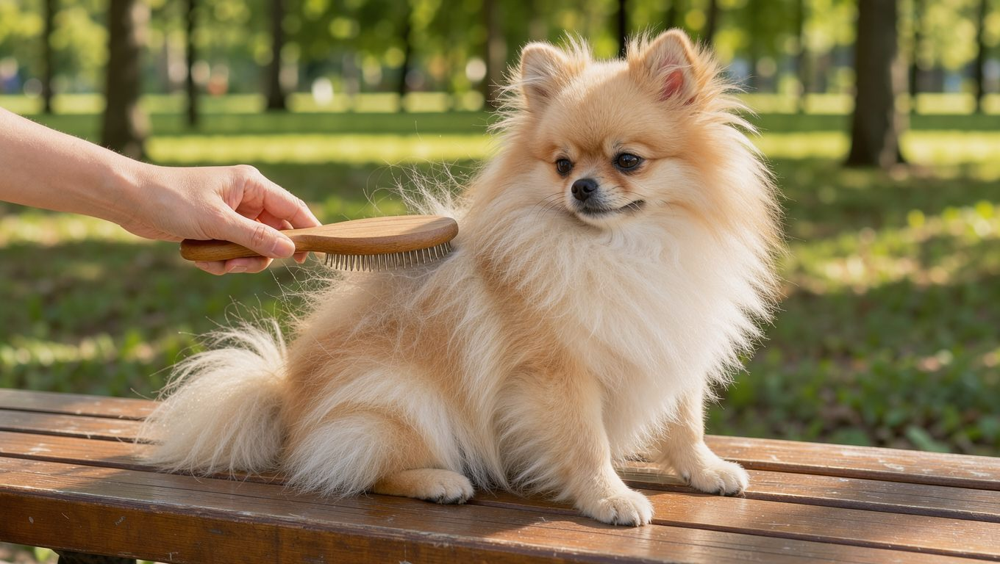

**2026년 10월 15일 기준** — 분양가처럼 변동이 잦은 정보는 이 날짜를 기준으로 확인했다.

## 빠른 답

- **성격 한 줄**: 밝고 당차며 경계심이 강한 소형견이다. 몸집에 비해 자신감이 넘치며, 경계심에서 비롯된 짖음도 잦다.
- **아파트에서 키울 수 있나?**: 크기와 운동량만 보면 아파트에 잘 맞는다. 관건은 짖음이라, 어린 시기부터 사회화와 짖음 관리를 함께 해 두는 것이 좋다.
- **처음 키우는 사람에게 맞나?**: 맞는 편이다. 다만 털이 빠지는 양이 적지 않아 거의 매일 빗질이 필요하고, 정기 미용도 따라온다.

## 품종 개요

포메라니안은 독일과 폴란드 접경의 포메른 지방에서 이름을 얻은 스피츠 계열 견종이다. 원래는 썰매를 끌던 대형 스피츠 계열이었지만, 19세기 영국 왕실에서 작은 개체가 인기를 끌면서 점차 지금과 같은 작은 체구로 개량된 것으로 전해진다. 빅토리아 여왕이 작은 포메라니안을 곁에 두고 편애했다는 일화가 널리 알려져 있다.

지금의 포메라니안은 체구에 비해 존재감이 큰 견종이다. 여우를 닮은 얼굴, 목을 감싸는 풍성한 털, 네모에 가까운 몸통이 특징이다. 미국켄넬클럽(AKC)은 이 견종을 토이 그룹으로 분류한다.

<dl>
<dt>원산지</dt><dd>독일·폴란드 접경 포메른 지방</dd>
<dt>체고</dt><dd>15~18cm(6~7인치)</dd>
<dt>체중</dt><dd>1.4~3.2kg(3~7파운드)</dd>
<dt>수명</dt><dd>12~16년</dd>
<dt>모질</dt><dd>이중모 — 길고 곧은 겉털과 빽빽한 솜털</dd>
<dt>운동량</dt><dd>짧은 산책과 실내 활동으로 채워지는 편</dd>
</dl>

## 성격과 기질

포메라니안은 밝고 외향적인 성격으로 알려져 있다. PetMD는 이 견종이 몸집이 훨씬 큰 개처럼 자신감이 넘치는 편이라고 설명한다. 영리하고 주관이 뚜렷해서, 안겨 다니기보다 자기 발로 걷기를 좋아하는 개체가 많다.

경계심이 강해 낯선 소리와 사람을 알리는 짖음이 잦은 편이다. PetMD는 어린 시기에 사회화가 충분히 이루어지지 않으면 과도한 짖음이나 자극에 대한 민감한 반응, 분리불안으로 이어질 수 있다고 설명한다. 사회화를 충실히 해 두면 다른 반려동물과도 대체로 잘 지낸다.

체구가 작고 연약하기 때문에 어린아이가 있는 가정에서는 어른이 반드시 함께 지켜봐야 한다. 아이가 세게 다루다 개체가 다칠 수 있어서다.

### 운동은 얼마나 필요할까

체구가 작아 실내 놀이와 짧은 동네 산책만으로도 필요한 운동량을 대체로 채울 수 있다. 공놀이, 퍼즐 장난감, 노즈워크처럼 집에서 즐기는 활동이 잘 맞는다. 다만 슬개골이 약한 견종이라 높은 곳에서 뛰어내리는 놀이는 줄이는 것이 좋다.

### 훈련과 짖음 관리

긍정 강화 훈련에 잘 반응한다. 앉아, 기다려 같은 기본 명령은 어린 시기에 시작하는 것이 좋다. 짖음은 타고난 기질과 관련이 있으므로 무조건 짖지 못하게 하기보다, 경고를 위한 짖음과 습관적으로 반복하는 짖음을 구분해 대응하는 편이 낫다. 혼자 있을 때 불안 신호가 보이거나 짖음이 지나치게 잦으면 훈련 전문가와 상의하는 것이 좋다.

## 이중모와 색상

포메라니안의 트레이드마크는 풍성한 이중모다. 부드러운 솜털 위에 길고 곧은 겉털이 덮여 부피가 크게 보이고, 목둘레 털이 특히 풍성하다.

색상은 제한이 거의 없다. 레드, 오렌지, 크림, 세이블, 블랙, 브라운, 화이트, 파티컬러, 브린들 등 다양한 색과 무늬가 인정된다. 성장하면서 털색이 달라지는 개체도 적지 않다. 색상별 표준 분류와 관리 포인트는 [포메라니안 색상 도감](/breeds/pomeranian-colors/)에서 자세히 다룬다.

### 털갈이

이중모를 가진 견종답게 봄과 가을에 털갈이가 집중된다. 체구는 작지만 털 빠짐이 적지 않아 털 관리에 신경 써야 한다. 실내에서 주로 지내는 개체는 계절 구분이 흐려져 연중 고르게 빠지기도 한다.

### 빗질과 목욕

PetMD는 평소 주 2~3회 빗질을, 털갈이 시기에는 매일 빗질을 권한다. 솜털이 엉키기 전에 미리 걷어내는 것이 핵심이다. 털 종류에 맞는 도구를 고르는 기준은 [빗 비교 가이드](/guides/dog-brush-comparison/)에 정리해 두었다.

목욕은 피부 질환이 없는 개체라면 한두 달에 한 번이면 충분하다. 밝은 색 개체는 눈물자국 관리가 따로 필요하고, 눈 주변 털 정리와 귀 세정도 정기적으로 해 주는 것이 좋다. 양치는 다른 견종보다 더 부지런히 해야 한다. 치아가 빽빽하게 들어차 있어 치석이 잘 끼기 때문이다.

## 한국에서 키울 때

### 분양가와 미니·티컵 표기 주의

국내 포메라니안의 평균 분양가는 공식적으로 집계된 자료를 확인하기 어렵다. 2026년 10월 국내 지식답변에서는 외형에 따라 "대략 50만~500만원대"라는 답변이 올라와 있다. 같은 포메라니안이라도 색상과 크기, 혈통에 따라 분양가 차이가 크게 날 수 있기 때문이다. 소형견 가운데서도 가격대가 높은 편에 속한다는 설명이다.

'미니 포메', '티컵 포메' 같은 표기가 자주 눈에 띄는데, 공인된 체급 이름이 아니다. PetMD는 더 작은 개체를 만들기 위한 번식이 건강 문제를 키운다고 짚으며 티컵 포메라니안을 권하지 않는다. 분양 전에는 체급 이름보다 부모견의 유전 검사 이력(고관절, 무릎, 심장, 갑상선, 눈)을 확인하는 것이 낫다.

### 아파트에서 키우기

체구와 운동량을 보면 아파트에 잘 맞는 견종이다. 체구가 작고 필요한 운동량이 비교적 적어 실내에서도 충분히 활동할 수 있다. 다만 짖음이 잦은 편이라, 이웃과의 문제로 번지지 않게 관리가 필요하다. 층간소음 기준과 짖음 대처법은 [아파트 가이드](/guides/dog-apartment-guide/)에 정리해 두었다.

### 여름나기

이중모라 더위에 약한 편이다. 한국의 습하고 더운 여름에는 산책을 이른 아침이나 해가 진 뒤로 조정하고, 실내 온도도 적절하게 유지하는 것이 좋다. 아스팔트가 뜨거운 낮 시간 산책은 피한다.

여름마다 털을 짧게 밀어 버리는 미용이 흔하지만, 이중모 견종은 삭모 뒤 털이 제대로 자라지 않거나 피부 문제로 이어질 수 있어 수의사와 상의하는 것이 좋다.

반면 추위에는 비교적 강한 편이지만, 한겨울 산책도 기온과 개체의 상태에 맞춰 시간과 강도를 조절하는 것이 좋다.

### 흔한 유전병

<ul>
<li><strong>슬개골 탈구</strong> — 소형견에서 흔히 나타나는 질환으로, 포메라니안도 발생 위험이 높은 견종에 속한다. 간헐적으로 다리를 절거나 깡총거리는 걸음이 초기 신호다. 미끄럼 방지 매트와 점프 제한, 적정 체중 유지가 기본 관리다.</li>
<li><strong>기관허탈</strong> — 기관을 지지하는 연골이 약해져 기관이 좁아지면서 기침 등의 호흡기 증상이 나타나는 질환이다. 거위 울음소리 같은 기침이 특징이라, 목줄보다 하네스를 쓰는 이유가 여기에 있다. 흥분과 연기 같은 자극을 줄여 주는 것이 좋다.</li>
<li><strong>치주질환</strong> — 작은 입에 치아가 빽빽하게 들어차 있어 치석이 잘 낀다. 매일 양치가 가장 확실한 예방이다.</li>
<li><strong>알로페시아 X</strong> — 몸통과 넓적다리를 중심으로 대칭적으로 털이 빠지고 피부 색이 짙어지는 탈모 질환이다. 가려움은 보통 없다. 원인이 뚜렷하지 않아 갑상선 질환이나 쿠싱 증후군을 먼저 감별한다.</li>
<li><strong>레그-페르테스병</strong> — 대퇴골두에 혈액 공급이 제대로 이루어지지 않아 뼈 조직이 손상되는 질환으로, 포메라니안과 같은 소형견에서 나타날 수 있다. 어린 개체가 뒷다리를 절뚝이면 검사를 받아 보는 것이 좋다.</li>
</ul>

슬개골 탈구의 등급과 수술 기준, 가정 관리 루틴은 [슬개골 탈구 가이드](/guides/dog-patellar-luxation/)에 자세히 정리해 두었다.

## 자주 묻는 질문

### 포메라니안은 털이 많이 빠지나요?

많이 빠지는 편입니다. 이중모라 봄과 가을에 털갈이가 집중되고, 실내에서 지내는 개체는 연중 고르게 빠지기도 합니다. 평소에는 주 2~3회, 털갈이 시기에는 매일 빗질해 솜털을 미리 걷어내는 것이 좋습니다.

### 포메라니안이 자꾸 짖는데 어떻게 해야 하나요?

경계심에서 나오는 짖음이 많은 견종입니다. 어린 시기 사회화로 낯선 자극에 익숙해지게 하고, 보호자의 반응이 매번 달라지지 않게 일관되게 대하는 것이 기본입니다. 짖음이 지나치거나 혼자 있을 때 불안해한다면 훈련 전문가나 수의사와 상의하는 것이 좋습니다.

### 미니 포메, 티컵 포메는 다른 품종인가요?

아닙니다. 공인된 체급 구분이 아니라 마케팅 표기입니다. PetMD는 더 작은 개체를 만들기 위한 번식이 건강 문제 위험을 키운다며 티컵 포메라니안을 권하지 않습니다. 분양 시에는 체급 이름보다 부모견의 건강 검사 이력을 확인하는 것이 낫습니다.

### 포메라니안 수명은 얼마나 되나요?

12~16년으로, 소형견 가운데서도 장수하는 편입니다. 슬개골과 기관, 치아를 어린 시기부터 관리해 주면 건강하게 지낼 가능성이 높아집니다.

### 처음 키우는 사람에게 맞나요?

기본적인 관리를 꾸준히 실천할 수 있다면 처음 반려견을 양육하는 보호자도 비교적 수월하게 시작할 수 있는 견종입니다. 빗질과 미용이 일상에 들어온다는 점, 짖음 관리가 필요하다는 점은 미리 알고 있어야 합니다. 어린아이가 있는 가정은 작은 체구를 감안해 어른의 감독이 필요합니다.

## 출처

- [Pomeranian — PetMD](https://www.petmd.com/dog/breeds/pomeranian) (체고·체중·수명·모질, 성격과 사회화, 빗질·목욕 주기, 유전병 8종, 티컵 번식 경고)
- [앙증맞은 포메라니안, 작은 몸의 큰 위험! 슬개골 탈구 예방과 건강관리 — 더뉴스메디칼](https://thenewsmedical.co.kr/%ec%95%99%ec%a6%9d%eb%a7%9e%ec%9d%80-%ed%8f%ac%eb%a9%94%eb%9d%bc%eb%8b%88%ec%95%88/) (포메라니안의 높은 슬개골 탈구 발병률과 관리법, 기관지 협착·치아·알로페시아 X 취약)
- [포메라니안 가격 — 궁금하넷](https://ggha.net/content/view.php?id=40592) (2026년 10월 기준 분양가 참고치 50만~500만원대, 외형에 따른 편차)

표지와 본문 이미지는 AI로 생성했습니다.
