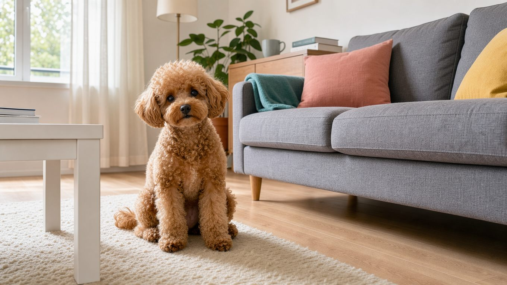

푸들이라고 하면 작고 앙증맞은 개를 떠올리기 쉽습니다. 하지만 푸들은 하나의 이름 아래 여러 체급으로 나뉘는 견종입니다. 같은 푸들이라도 어깨높이가 25cm에 그치는 개체와 60cm에 가까운 개체가 함께 있습니다. 성견 크기를 가늠할 때 체급 이름만으로 판단하면 실제 크기와 차이가 생길 수 있습니다. 푸들의 성격과 국내 분양가 같은 큰 그림은 [푸들 허브](/breeds/poodle/)에서 다루고, 이 글은 크기 하나에 집중합니다.

## 빠른 답

**푸들 성견 크기는 얼마나 되나요?**

어깨높이 기준으로 토이는 약 25cm 이하, 미니어처는 약 25~38cm, 스탠다드는 약 38cm를 넘습니다. 통상 몸무게는 토이 2kg 안팎, 미니어처 4.5~7kg, 스탠다드 18~32kg 범위로 알려져 있습니다.

## 협회마다 체급을 나누는 방식이 다릅니다

푸들의 크기를 이해하려면 먼저 협회마다 체급을 구분하는 기준이 다르다는 점을 알아둘 필요가 있습니다. 미국애견협회(AKC)는 푸들을 세 체급으로 나누고, 국제애견연맹(FCI)은 네 체급으로 나눕니다.

- **AKC 3체급** — 스탠다드는 어깨높이 15인치(약 38cm) 초과, 미니어처는 10~15인치(약 25~38cm), 토이는 10인치(약 25cm) 이하입니다(PetMD).
- **FCI 4체급** — 스탠다드(그랑) 45~60cm, 미디엄 35~45cm, 미니어처 28~35cm, 토이 24~28cm입니다(위키백과).

같은 '미니어처'라는 명칭을 사용하더라도 AKC는 25~38cm, FCI는 28~35cm로 서로 다른 체고 범위를 적용합니다. 국내 분양 현장에서 사용하는 체급 명칭이 국제 협회의 공식 기준과 정확히 일치하지 않는 경우도 있습니다. 따라서 예상 크기를 분양 계약 조건으로 삼을 때는 체급 명칭보다 실제 체고를 수치로 확인하는 것이 좋습니다. FCI의 네 체급 체계 자체는 푸들 허브에서 더 자세히 다룹니다.

## 몸무게는 표준이 아니라 통상 범위입니다

푸들은 품종 표준에서 체중이 아닌 어깨높이를 기준으로 체급을 구분합니다. 따라서 몸무게는 공식적인 체급 기준이 아니라 일반적으로 알려진 범위로 참고하는 것이 좋습니다. 체급별 통상 몸무게는 다음과 같습니다(PetMD).

- **스탠다드** — 40~70파운드, 약 18~32kg입니다.
- **미니어처** — 10~15파운드, 약 4.5~7kg입니다.
- **토이** — 4~6파운드, 약 2kg 안팎입니다.

같은 체급 안에서도 개체차가 작지 않습니다. 제시된 범위를 절대적인 기준으로 받아들이기보다는 대략적인 체중을 가늠하는 참고 자료로 활용하는 것이 좋습니다.

## 성장은 체고부터 멈춥니다

푸들이 성견 크기에 도달하는 시기는 체급에 따라 차이가 있습니다. AKC는 소형견의 성장이 생후 6~8개월에 끝나고, 중형견은 12개월 전후, 대형견은 12~18개월에 끝난다고 설명합니다. 초대형견은 24개월까지 자라는 경우도 있습니다(AKC).

이 기준을 푸들의 체급에 적용하면 토이는 생후 6~8개월, 미니어처는 1년 전후, 스탠다드는 1~1년 6개월 무렵에 체고 성장이 대부분 마무리되는 것으로 볼 수 있습니다. 체구가 큰 스탠다드 수컷은 성장 과정이 길어져 생후 2년 가까이까지 발달하기도 합니다. 키 성장이 끝난 뒤에도 근육과 체중은 더 붙기 때문에, 몸무게는 체고보다 늦게 안정됩니다(AKC).

성장 중인 강아지의 갈비뼈 주변을 손으로 만졌을 때 도드라지는 부분이 느껴진다면, 아직 성장 과정에 있다는 신호일 수 있습니다(AKC). 생후 몇 개월 몸무게로 성견 체중을 추정하는 표도 유통되지만, 개체차가 커서 참고 수준으로만 보는 것이 좋습니다. 성견이 되었을 때의 크기를 예상하는 데 가장 현실적인 참고 자료는 부모견의 체급입니다.

## 포켓·티컵은 공인 체급이 아닙니다

로열 스탠다드·티컵·타이니 티컵 등의 명칭은 공식적인 체급이 아니며, 애견협회에서 인정하는 별도의 품종 구분도 아닙니다(위키백과). '포켓 푸들'도 마찬가지로 표준 체급표에 없는 이름입니다. 일반적인 체급보다 작은 크기를 강조하기 위해 사용하는 마케팅 명칭으로, 공식적으로 인정된 별도 체급은 아닙니다.

이러한 명칭만으로는 성견이 되었을 때의 크기를 계약 조건으로 명확하게 정하기 어렵습니다. 분양받을 때는 체급 명칭에만 의존하지 말고 부모견의 체고와 체중을 확인하는 것이 좋습니다. 또한 자견의 현재 체고도 직접 측정해 두면 성장 과정을 비교하는 데 도움이 됩니다.

## 크기에 따라 생활이 달라집니다

푸들의 체급은 필요한 운동량뿐 아니라 주거 환경과 일상적인 관리 방식에도 영향을 줍니다. 체급별 하루 운동량은 스탠다드 1~2시간, 미니어처 30~60분, 토이 30~45분입니다. 짖는 빈도도 달라서 스탠다드는 드물게 짖는 편이고, 미니어처와 토이는 자주 짖는 편입니다(PetMD).

스탠다드 푸들도 아파트에서 충분히 생활할 수 있습니다. 다만 실내 공간과 별개로 하루 1~2시간 정도의 운동량을 꾸준히 확보할 수 있는지가 중요합니다. 미니어처와 토이는 상대적으로 적은 운동량으로도 일상적인 활동을 충족하기 쉬워 아파트 생활에 적응하기 좋은 편입니다. 크기별 미용 주기와 비용은 [푸들 미용·털 관리](/breeds/poodle-grooming/)에서 따로 다룹니다.

**딱지허브 평가**: 하루 1~2시간은 스탠다드 푸들의 운동량을 가늠하는 참고 기준입니다(PetMD). 아파트 생활에서는 평일에 40분~1시간 정도 산책하고 주말에는 공원에서 활동량을 늘리는 방식으로 운동을 분배할 수 있습니다. 산책이 부족한 날에는 실내 놀이를 통해 활동량을 보충해 주는 것도 좋습니다.

## 자주 묻는 질문

### 푸들 성견의 체고는 몇 cm인가요?

협회에서 정한 기준에 따라 다릅니다. AKC 기준으로 토이는 약 25cm 이하, 미니어처는 약 25~38cm, 스탠다드는 약 38cm 초과입니다. 체고는 등 중앙이 아닌 어깨 위쪽의 기갑부터 바닥까지의 수직 높이를 측정해야 합니다.

### 미니어처 푸들과 토이 푸드는 어떤 차이가 있나요?

가장 큰 차이는 체급을 구분하는 어깨높이 기준입니다. AKC는 25cm(10인치)를 경계로 토이와 미니어처를 나누고, FCI는 토이를 24~28cm, 미니어처를 28~35cm로 구분합니다(위키백과). 체급 명칭만으로는 어떤 협회 기준을 적용했는지 알기 어려우므로, 실제 체고를 함께 확인하는 것이 좋습니다.

### 생후 3개월 된 강아지의 성견 크기를 미리 알 수 있나요?

정확히 예측하기는 어렵습니다. 키는 토이 6~8개월, 미니어처 1년 전후, 스탠다드 1년~1년 반에 거의 결정됩니다(AKC). 성장 과정에서는 몸무게 추정표 등을 참고할 수 있으며, 부모견의 체급도 성견 크기를 예상하는 데 도움이 되는 중요한 단서입니다.

### 스탠다드 푸들도 아파트에서 키울 수 있나요?

가능합니다. 다만 하루 1~2시간 정도의 운동량을 평일과 주말에 적절히 나누어 꾸준히 확보해 주어야 합니다. 일반적으로 짖는 빈도가 낮은 편이지만, 개체별 성향과 생활 환경에 따라 차이가 있을 수 있습니다.

### 포켓 푸들이나 티컵 푸들도 공식 체급에 포함되나요?

아닙니다. 티컵·타이니 티컵 등의 명칭은 공식적인 체급 구분이 아니며, 애견협회에서도 별도 체급으로 인정하지 않습니다(위키백과). 포켓 푸들 역시 공식 체급표에 없는 명칭입니다. 따라서 특정 크기를 약속받았다면 부모견의 체고와 현재 자견의 성장 상태를 함께 확인하는 것이 좋습니다.

## 출처

- [The 3 Types of Poodles and How They Compare](https://www.petmd.com/dog/general-health/types-of-poodles) (체급별 체고, 체중, 운동량, 짖음 빈도)
- [Puppy Growth Chart: When Does My Puppy Finish Growing?](https://www.akc.org/expert-advice/health/when-does-my-puppy-finish-growing/) (체급별 성장 완료 시기, 갈비뼈 성장판 확인법)
- [푸들 — 위키백과](https://ko.wikipedia.org/wiki/푸들) (FCI 4체급 체고 표, 비공인 명칭)

표지 이미지는 AI로 생성했습니다.
