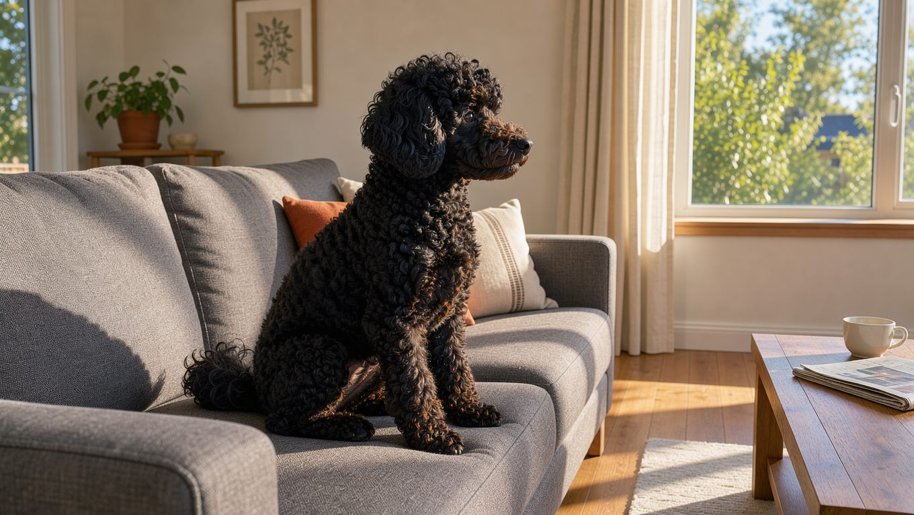
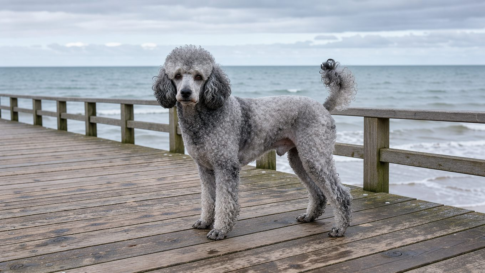
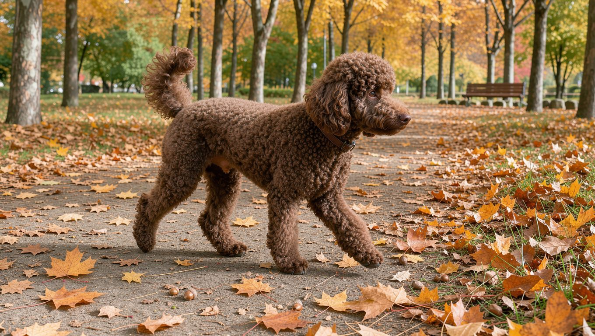
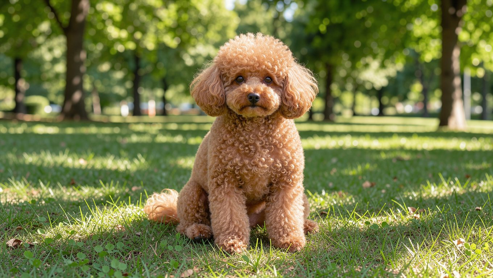
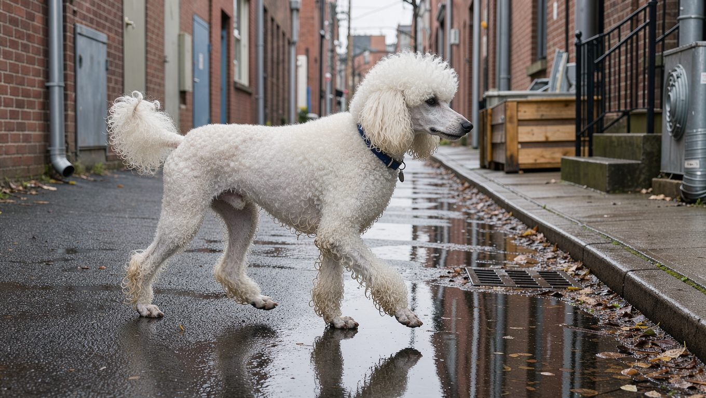
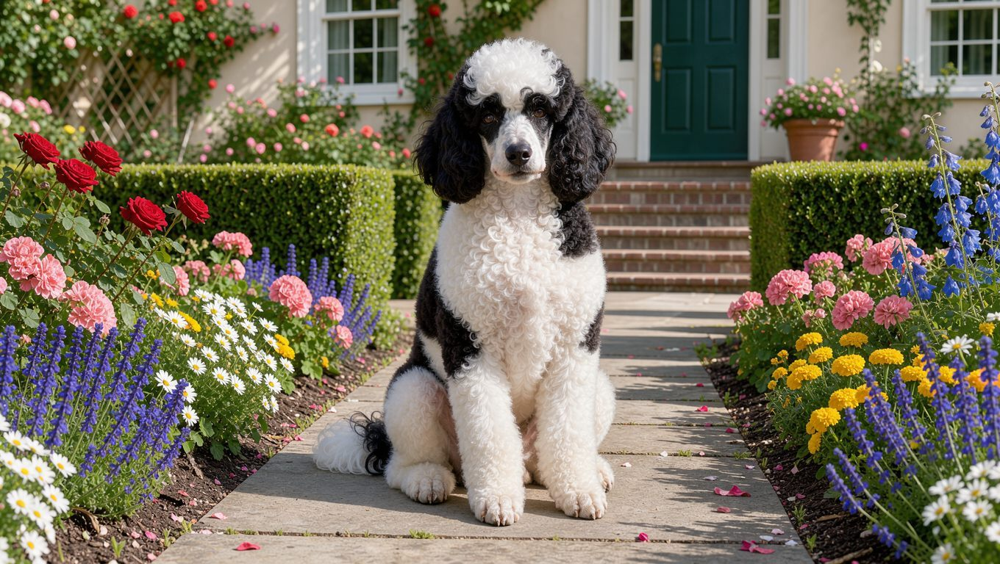

푸들은 한 견종 안에서도 털색이 매우 다양합니다. 잉크처럼 짙은 검은색부터 살구색, 은회색까지 모두 같은 푸들이며, 흰 바탕에 다른 색 반점이 들어간 무늬도 있습니다.

색이 다양한 만큼 헷갈리는 지점도 있습니다. 이름이 비슷한 모색이 많고, 성장하면서 털색이 밝아지는 계열도 있기 때문입니다. 검은색에 가깝게 태어난 푸들이 성장하면서 은회색 실버로 변하는 경우가 대표적입니다. 이 글에서는 미국 애견 협회(AKC) 기준으로 소개되는 단색 10종을 계열별로 살펴보고, 무늬 종류와 기관별 인정 기준의 차이, 모색을 선택할 때 확인할 사항까지 다룹니다.

## 빠른 답

**푸들은 어떤 색이 있나요?** 미국 애견 협회(AKC) 기준으로 소개되는 단색은 화이트, 크림, 애프리콧, 레드, 브라운(초콜릿), 실버베이지, 카페오레, 실버, 블루, 블랙 10가지입니다. 여기에 흰 바탕에 반점이 들어가는 파티, 단색 바탕에 두 번째 색 무늬가 얹히는 팬텀 같은 계열이 더해집니다.

**새끼 색이 그대로 자라나요?** 그렇지 않은 경우가 많습니다. 실버, 블루, 카페오레, 실버베이지는 자라면서 색이 밝아지는 계열이라 어린 시기와 성견 시기의 색이 달라질 수 있습니다.

## 모색을 구분하는 첫 단서, 코와 눈 색

푸들의 모색을 구분할 때 털보다 먼저 확인할 곳은 코, 눈, 눈가, 발톱처럼 색소가 드러나는 부위입니다. 이러한 부위를 포인트(points)라고 부릅니다.

- **검은 포인트** — 블랙, 화이트, 크림, 레드, 블루, 실버가 가집니다. 실버와 블루는 털이 밝아져도 포인트는 검은색을 유지합니다.
- **갈색 포인트** — 브라운(초콜릿), 카페오레, 실버베이지가 가집니다. 코와 눈가, 입술, 발톱이 갈색이고 눈동자는 짙은 호박색으로 나타납니다.
- **애프리콧의 포인트** — 검은 포인트가 바람직하다고 보지만 갈색 포인트도 허용됩니다.

## 표준 단색 10종 도감

단색 10종은 색 계열로 묶으면 네 갈래가 됩니다. 같은 계열에 속하더라도 색의 농도와 성장에 따른 변색 양상은 다를 수 있습니다. 푸들의 기원이나 성격, 관리 전반은 [푸들 견종 소개](/breeds/poodle/)에서 다룹니다.

### 블랙 계열 — 블랙, 블루, 실버

- **블랙** — 잉크처럼 짙고 고른 검은색입니다. 흰 보호모가 거의 섞이지 않은 개체를 좋게 봅니다. 포인트는 검은색입니다.
- **블루** — 검은색 털이 성장하면서 밝아져 청회색 계열로 변하는 모색입니다. 강철빛 청회색부터 거의 검정에 가까운 짙은 색까지 폭이 넓습니다. 완전히 검은 털로 태어나 자라면서 밝아지고, 털을 짧게 깎으면 속털에 여러 색이 섞여 있는 것이 보이기도 합니다.
- **실버** — 성장하면서 털색이 은회색 계열로 밝아지는 모색입니다. 자라면서 은회색에서 백금빛에 가까운 색까지 밝아집니다. 최종 모색에 가까워지기까지 1~2년이 걸리는 경우가 많으며, 얼굴과 발의 털이 몸통보다 먼저 밝아지기도 합니다.

### 갈색 계열 — 브라운(초콜릿), 카페오레, 실버베이지

- **브라운(초콜릿)** — 진하고 따뜻한 갈색입니다. 코와 눈가, 입술, 발톱이 모두 갈색이고 눈동자는 짙은 호박색입니다. 나이가 들면서 조금 옅어질 수 있습니다.
- **카페오레** — 브라운이 그레이잉 유전을 한 개 받아 밝아진 모색입니다. 진한 갈색으로 태어나 밀크커피 같은 밝은 갈색으로 변합니다.
- **실버베이지** — 성장하면서 털색이 더 밝은 회갈색 계열로 변하는 모색입니다. 옅은 황갈색에 은빛이 감도는 색으로, 어릴 때는 갈색에 가깝다가 성견이 되면서 밝은 회갈색으로 변할 수 있습니다. 얼굴과 다리 색이 몸통보다 밝게 나타납니다.

### 애프리콧 계열 — 애프리콧, 레드

- **애프리콧** — 살구색에 가까운 밝은 색입니다. 연한 크림빛 주황부터 짙은 살구색까지 폭이 있고, 귀 털이 몸통보다 짙게 나타나는 경우가 많습니다.
- **레드** — 진한 적갈색에서 마호가니에 가까운 짙은 색까지 폭이 있습니다. 나이가 들며 조금 옅어질 수 있습니다.

### 밝은 계열 — 화이트, 크림

- **화이트** — 성견이 되면서 순백에 가까워지는 모색입니다. 어린 시기에는 귀와 꼬리, 발 주변에 크림빛이 돌 수 있지만 자라면서 옅어집니다.
- **크림** — 애프리콧보다 밝고 붉은 기가 적은 모색입니다. 완전한 흰색은 아니어서 실버베이지나 카페오레와 혼동하기 쉽습니다.

## 무늬 계열 — 파티, 팬텀, 그리고 메를

단색 밖에도 무늬 계열이 있습니다. 미국의 UKC(United Kennel Club)는 무늬 푸들을 '멀티컬러드 푸들'로 정식 인정합니다. 단색 푸들과 같은 품종이지만, 도그쇼에서는 별도 부문으로 평가합니다.

- **파티(parti)** — 털의 50% 이상이 흰색이고 나머지에 다른 단색 반점이 들어가는 무늬입니다. 흰 바탕에 검은 반점, 흰 바탕에 갈색 반점처럼 조합이 다양합니다.
- **팬텀(phantom)** — 단색 바탕에 눈 위와 주둥이 옆, 다리와 발, 가슴, 꼬리 아래 등을 중심으로 두 번째 색의 무늬가 뚜렷하게 나타납니다. 갈색 바탕에 검은 무늬 조합이 흔합니다.
- **추상(abstract)** — 흰색이 50% 미만으로 섞인 무늬입니다. 미국 쇼 현장에서는 '미스마크(mismark)'라고 부르기도 합니다.

무늬 계열 중에서는 메를(merle)을 특히 주의해서 살펴볼 필요가 있습니다. 미국 푸들 협회(United Poodle Association)는 메를이 푸들에서 자연스럽게 나타나는 모색이 아니라고 설명합니다. 이 협회는 메를 무늬를 다른 견종과의 교배 가능성을 보여 주는 신호로 봅니다. 또한 협회 설명에 따르면 UKC에서는 메를 푸들의 등록을 허용하지 않으며, 도그쇼에서도 실격 처리됩니다. 메를 무늬를 푸들의 희귀 모색처럼 내세우는 분양 글이라면 한 번 더 확인하는 편이 좋습니다.

## 기관마다 다른 인정 범위

같은 푸들이라도 어떤 기관의 기준을 적용하느냐에 따라 인정되는 모색이 달라집니다. 국내 자료에서는 미국 애견 협회(AKC)의 목록을 자주 인용합니다.

- **AKC (미국)** — 등록 기준으로 통용되는 단색은 10가지입니다. 표준은 블루, 그레이, 실버, 브라운, 카페오레, 애프리콧, 크림 같은 색에서 같은 색 안의 명암 차이를 인정하고, 파티처럼 두 가지 이상 색이 섞인 무늬는 쇼에서 실격 처리합니다.
- **FCI (국제)** — 인정하는 단색은 블랙, 화이트, 브라운, 그레이, 폰(fawn) 다섯 가지입니다. 폰은 연한 살구색부터 레드에 가까운 주황색까지 아우르는 모색 명칭이며, 베이지와 그보다 옅은 계열의 색은 인정하지 않습니다.
- **UKC (미국)** — 단색 10종에 더해 파티, 팬텀, 추상, 세이블 같은 무늬와 브린들 무늬까지 인정합니다. 무늬 푸들은 단색 푸들과 별도 부문에서 경쟁합니다.

같은 무늬라도 기관에 따라 평가가 갈립니다. 파티 푸들은 미국 UKC에서는 정식으로 분류되지만, AKC 쇼링에서는 실격 처리됩니다.

## 색을 고를 때 확인할 것

성장하면서 모색이 달라지는 계열이 있다는 점은 분양이나 입양을 결정할 때 고려해야 할 사항입니다. 실버, 블루, 카페오레, 실버베이지가 대표적이고, 화이트도 어린 시기의 크림기가 자라며 옅어집니다. 브라운이나 레드는 반대로 나이가 들며 조금 옅어질 수 있습니다.

그레이잉 계열은 최종 색을 예측하기 어렵습니다. 부모견의 모색과 새끼의 포인트 색을 참고하면 성견이 되었을 때의 모색을 어느 정도 가늠할 수 있습니다. 실버와 블루는 털색이 밝아져도 코와 눈가의 색소가 검은색으로 유지됩니다. 따라서 털색이 짙은 어린 푸들을 볼 때는 성장하면서 모색이 달라질 가능성도 고려하는 것이 좋습니다.

색에 따라 관리에서 챙길 것도 조금씩 다릅니다.

- **애프리콧처럼 밝은 모색** — 눈물자국이 두드러질 수 있어 눈가를 자주 닦아 주는 편이 좋습니다.
- **블랙** — 털색이 짙어 피부의 붉어짐이나 색 변화가 눈에 잘 띄지 않을 수 있습니다. 정기 점검이 도움이 됩니다.
- **블루 같은 옅은 계열** — 색 희석 탈모증(color dilution alopecia)이 거론되는 계열입니다. 털이 드문드문 빠지는 변화가 보이면 동물병원 상담을 받는 것이 좋습니다.

푸들은 곱슬털이 계속 자라므로 모색과 관계없이 정기적인 목욕과 빗질로 털을 관리해야 합니다. 구체적인 주기는 [강아지 목욕 주기 가이드](/guides/dog-bath-schedule/)에서 다룹니다.

## 자주 묻는 질문

### 실버 푸들은 태어날 때부터 회색인가요?

아닙니다. 실버 푸들은 검정에 가까운 짙은 색으로 태어나 자라면서 밝아지는 계열입니다. 생후 수개월부터 털색이 은회색으로 변하기 시작하며, 최종 모색에 가까워지기까지 1~2년이 걸리는 경우가 많습니다. 얼굴과 발의 털이 몸통보다 먼저 밝아지기도 합니다. 코와 눈가 색은 검은색을 유지합니다.

### 파티 푸들은 순종이 아닌가요?

아닙니다. 파티는 두 가지 이상 색이 섞인 정식 무늬 분류로, 미국 UKC에서는 '멀티컬러드 푸들'로 인정합니다. 같은 푸들이며 별도 품종이 아닙니다. 다만 AKC 쇼링에서는 파티가 실격 처리된다는 점은 알아 두는 것이 좋습니다.

### 크림 푸들과 애프리콧 푸들은 어떻게 구분하나요?

털에 나타나는 붉은 기의 정도로 구분할 수 있습니다. 애프리콧은 살구색이나 연한 주황빛이 돌고, 크림은 그보다 밝으면서 붉은 기가 없습니다. 귀 털이 몸통보다 짙다면 애프리콧 계열일 가능성을 고려할 수 있습니다.

### 푸들 색깔에 따라 성격이나 건강이 다른가요?

모색이 성격을 좌우한다는 공식 근거는 없습니다. 기질은 개체와 훈련, 사회화 경험에 따라 달라집니다. 건강 쪽에서는 색과 관련된 피부 이슈가 일부 거론됩니다. 블루 같은 옅은 계열의 색 희석 탈모증, 밝은 모색의 눈물자국이 대표적입니다.

### 검은 푸들이 갈색으로 변하기도 하나요?

변색 사례가 있습니다. 검은 푸들의 털은 자외선이나 영양 상태 등의 영향으로 붉은 갈색을 띨 수 있습니다. 이는 성장하면서 모색이 밝아지는 실버나 블루의 변색과는 다른 현상입니다. 털색 변화가 갑자기 넓게 번지면 건강 점검을 받아 보는 것이 좋습니다.

## 출처

- [Poodle Colors (National Purebred Dog Day)](https://nationalpurebreddogday.com/poodle-colors/) (기관별 모색 표준 비교, 파티 실격 규정)
- [Poodle Coat Colors (United Poodle Association)](https://unitedpoodleassociation.org/poodle-info/poodle-coat-colors/) (단색 10종 설명, 그레이잉 유전, 무늬 분류, 메를 경고)
- [푸들 종류, 크기와 털 색깔별로 아주 다양하게 구분한다고 (다음 뉴스)](https://v.daum.net/v/y9flAzRy83) (모색별 포인트 색과 눈 색, 성장에 따른 색 변화)
- [푸들모색 완벽 가이드 — 애프리콧·블랙·실버 차이와 관리법 (멍실장)](https://meongsiljang.com/ko/guide/breed/poodle-coat-colors) (색 변화 시기, 눈물자국과 변색, 그루밍 관리 참고)

표지와 본문 이미지는 AI로 생성한 이미지입니다.
