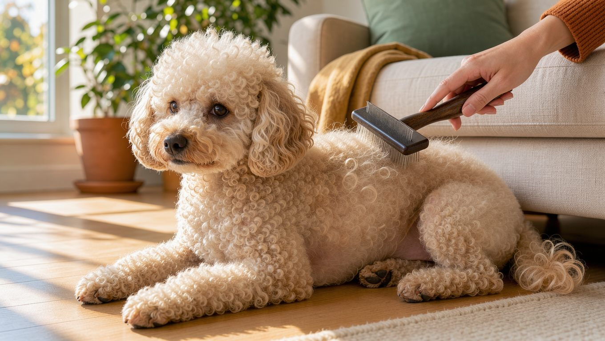

**2026년 10월 17일 기준**

## 빠른 답

**푸들 미용은 얼마나 자주 해야 할까요?**
푸들의 털은 잘 빠지지 않고 계속 자라는 곱슬코트이므로, 일반적으로 4~6주 간격으로 미용실을 방문하는 것이 좋습니다. 미용 사이에는 집에서 매일 10분씩 빗질해 털이 엉키는 것을 예방하면 관리 부담과 미용비를 줄이는 데 도움이 됩니다.

## 푸들 털의 구조 — '털이 안 빠지는 견종'이라는 함정

푸들은 이중모가 아닌 곱슬 단일코트를 가진 견종으로, 털이 계속 자랍니다. AKC 미용 가이드는 푸들의 털이 사람의 머리카락처럼 계속 자란다고 설명하며, 털이 잘 빠지지 않는 점을 주요 장점으로 꼽습니다.

다만 이러한 장점에는 관리가 필요하다는 점이 뒤따릅니다. 빠진 털이 바닥에 잘 떨어지지 않는 대신, 보호자가 털을 자주 빗어 주어야 합니다. AKC도 푸들 관리의 핵심으로 정기적인 미용을 들며, 빗질의 첫 번째 목적을 엉킴 예방으로 설명합니다. 푸들은 털이 잘 빠지지 않아 관리하기 쉽다는 말은 절반만 맞습니다. 집 안에 떨어지는 털은 적지만, 털이 엉키지 않도록 꾸준히 빗질해야 합니다.

푸들의 성격, 분양 시세, 유전병 등 전체 개요는 [푸들 허브](/breeds/poodle/)에서 다룹니다.

## 미용실 미용 주기 — 4~6주가 기본입니다

국내 소형견 미용 시세를 정리한 자료(pettiplab, 2026년 7월)는 털이 계속 자라는 견종의 미용 주기로 일반적으로 4~6주를 권장합니다. AKC 미용 가이드에서도 목욕과 트리밍 주기를 4~8주로 안내합니다.

두 기준을 함께 살펴볼 때 주목할 점은 AKC가 목욕 주기를 빗질 빈도에 따라 조절하도록 안내한다는 것입니다. 즉, 미용 주기는 정해진 간격을 무조건 따르기보다 평소 빗질을 얼마나 꼼꼼하게 하는지에 따라 조절할 수 있습니다. 매일 꼼꼼하게 빗질하면 미용 간격을 6주 이상으로 늘려도 털이 엉키는 것을 줄일 수 있습니다.

미용실 방문 사이에 얼굴과 발, 배변 부위만 다듬는 부분 미용을 추가하는 방법도 있습니다. 전체 미용 간격을 억지로 늘리는 것보다 위생 부위만 빠르게 정리해 주는 편이 낫습니다.

**딱지허브 평가**: 곱슬코트를 가진 푸들은 4~6주 간격으로 미용하는 것을 기본으로 삼는 것이 좋습니다. 매일 10분씩 꼼꼼하게 빗질하면 미용 간격을 6~8주까지 늘릴 수도 있습니다. 다만 빗질을 소홀히 하면 털이 심하게 엉켜 추가 요금이 발생하거나 털을 짧게 밀어야 할 수 있습니다.

## 집에서 하는 매일 빗질 — 도구와 방법

AKC 가이드가 권하는 기본 도구는 슬리커 브러시입니다. 슬리커 브러시는 짧고 뻣뻣한 철사 모가 촘촘하게 박힌 브러시로, 주로 사각형 형태입니다. 털 표면만 빗지 말고, 털을 나누어 안쪽까지 꼼꼼하게 빗어 주는 것이 중요합니다. 피부에 자극이 가지 않도록 힘을 조절하고, 강아지가 편안하게 느끼는 장소에서 빗질합니다.

빗질은 다음 순서로 하면 빠뜨리는 부위가 줄어듭니다.

1. 등과 옆구리 — 결을 따라 위에서 아래로 빗습니다.
2. 목과 귀 뒤 — 엉킴이 가장 잘 생기는 부위라 나눠서 꼼꼼하게 빗습니다.
3. 배와 다리 안쪽, 겨드랑이 — 털을 나눠 피부 가까이까지 꼼꼼하게 빗습니다.
4. 꼬리와 발 — 발가락 사이와 발바닥 털까지 확인합니다.
5. 마지막으로 손으로 전신을 훑어 뭉친 곳이 남았는지 점검합니다.

목욕 전에는 먼저 빗질해 엉킨 털을 풀어 주어야 합니다. 엉킨 털에 물이 닿으면 뭉침이 더 심해질 수 있으므로, 빗질하지 않은 상태에서 바로 목욕시키는 것은 피하는 것이 좋습니다.

빗 종류별 용도와 고르는 기준은 [강아지 빗 비교 가이드](/guides/dog-brush-comparison/)에서 더 자세히 다룹니다.

## 컷 종류 — 테디베어 컷부터 도그쇼 클립까지

푸들은 미용 스타일에 따라 인상이 크게 달라집니다. 국내에서는 디자인컷을 선택하는 경우도 많아 스타일에 따라 비용이 달라질 수 있으므로(pettiplab), 미용실에 방문하기 전에 원하는 스타일을 정해 두면 좋습니다.

<dl>
<dt>테디베어 컷</dt>
<dd>얼굴과 몸의 털을 곰인형처럼 둥글게 다듬는 스타일로, 국내에서 흔히 볼 수 있습니다.</dd>
<dt>폭시 컷</dt>
<dd>얼굴 털을 세워 여우와 비슷한 인상을 연출하는 스타일입니다. 테디베어 컷보다 눈매가 선명해 보이는 것이 특징입니다.</dd>
<dt>램 클립</dt>
<dd>몸통은 짧게 다듬고 다리 털은 길게 남겨, 관리 편의성과 외모를 함께 고려한 스타일입니다.</dd>
<dt>콘티넨탈·잉글리시 새들 클립</dt>
<dd>몸통을 밀고 관절 주변에 털 장식을 남기는 도그쇼용 클립입니다. 관리 난이도가 높아 반려견 미용에는 잘 쓰지 않습니다.</dd>
</dl>

도그쇼에 출전하는 푸들은 어린 시기에 짧고 둥근 퍼피 트림을 하고, 성견이 되면 콘티넨탈이나 잉글리시 새들 클립을 적용합니다(AKC).

## 미용 비용 — 소형견·푸들 시세

아래 금액은 2026년 7월 기준 국내 소형견 미용 시세를 정리한 자료(pettiplab)를 참고했습니다.

<ul>
<li><strong>목욕만</strong> — 2만~4만 원</li>
<li><strong>전체 미용(클리퍼 또는 가위컷)</strong> — 6만~10만 원</li>
<li><strong>토이푸들 평균</strong> — 6만~10만 원. 디자인컷을 선택하면 소형견 미용비 중에서도 높은 편에 속할 수 있습니다.</li>
<li><strong>같은 소형견 참고</strong> — 말티즈 5만~8만 원</li>
<li><strong>같은 소형견 참고</strong> — 비숑프리제 7만~10만 원</li>
</ul>

미용비가 추가되는 주요 원인 중 하나는 털 엉킴입니다. 엉킨 털을 제거하려면 시간이 오래 걸리고 피부가 다치지 않도록 세심하게 작업해야 하므로 추가 요금이 발생하는 경우가 많습니다(pettiplab). 약용 샴푸나 각질 케어도 추가 요금 요인이 됩니다.

미용 비용은 지역과 미용실, 미용사의 숙련도에 따라 차이가 큽니다. 단골 미용실을 정하기 전에는 털 엉킴 제거에 추가 요금이 부과되는 기준도 확인하는 것이 좋습니다. 평소 꾸준히 빗질하면 미용 시간과 비용 부담을 줄이는 데 도움이 됩니다(pettiplab).

## 자주 묻는 질문

### 푸들은 정말 털이 안 빠지나요?

푸들은 털갈이 시기에 속털이 대량으로 빠지는 이중모 견종과 달리 털이 잘 빠지지 않습니다. AKC도 털이 잘 빠지지 않는 점을 푸들의 주요 장점으로 꼽습니다. 다만 빠진 털이 곱슬털 사이에 남기 쉬우며, 털도 계속 자라기 때문에 꾸준한 관리가 필요합니다. 청소 부담은 줄고 빗질 부담은 늘어나는 셈입니다.

### 목욕을 집에서 해도 괜찮은가요?

가능합니다. 다만 두 가지는 지키는 것이 좋습니다. 첫째, 털이 심하게 엉킨 상태에서는 목욕을 피합니다. 물이 닿으면 엉킴이 더 심해질 수 있고, 그대로 말리면 뭉침이 단단해질 수 있습니다. 둘째, 목욕 뒤에는 피부 속까지 충분히 말려 줍니다. 곱슬털은 겉이 말라도 속까지 충분히 건조되지 않을 수 있으며, 이로 인해 피부 문제가 생길 수 있습니다. 주기와 순서는 [강아지 목욕 가이드](/guides/dog-bath-schedule/)에서 털 유형별로 확인할 수 있습니다.

### 미용을 몇 달 미루면 어떻게 되나요?

곱슬코트를 제대로 관리하지 않으면 털이 피부 가까이에서부터 단단하게 뭉칠 수 있습니다. 미용실에서는 피부가 다치지 않도록 주의하면서 엉킨 털을 제거해야 하며(pettiplab), 뭉침이 심한 경우에는 털을 짧게 밀어야 할 수도 있습니다. 미용 시간이 길어져 추가 요금이 붙고, 그 사이 피부가 계속 당겨 트러블로 이어질 수 있습니다.

### 여름에 털을 짧게 밀어도 되나요?

푸들의 털은 계속 자라므로 짧게 밀어도 다시 자랍니다(AKC). 푸들은 곱슬 단일코트를 가진 견종으로, 털을 짧게 밀었을 때 나타나는 변화가 이중모 견종과 다를 수 있습니다. 다만 너무 짧게 밀면 피부가 그대로 노출되어 자극이 생길 수 있으므로, 피부 상태에 맞춰 길이를 정하는 것이 좋습니다.

### 매트가 이미 생겼는데 직접 풀 수 있나요?

작고 느슨하게 엉킨 털은 손가락으로 나눈 뒤 빗으로 조금씩 풀 수 있습니다. 반면 피부 가까이에서 단단하게 뭉친 털은 억지로 당기면 피부가 늘어나거나 손상될 수 있으므로, 미용 전문가에게 맡기는 것이 안전합니다. 매트 아래 피부가 붉어지거나 냄새가 나면 동물병원 진료를 받는 것이 좋습니다.

## 출처

- [How to Groom a Standard Poodle](https://www.akc.org/expert-advice/health/how-to-groom-a-standard-poodle/) — AKC 미용 가이드 (털 구조, 빗질 도구, 목욕·트리밍 주기, 도그쇼 클립)
- [소형견 미용 비용 얼마일까? 말티즈·푸들·비숑 가격 비교](https://pettiplab.glowfly08.com/entry/%EC%86%8C%ED%98%95%EA%B2%AC-%EB%AF%B8%EC%9A%A9-%EB%B9%84%EC%9A%A9-%EC%96%BC%EB%A7%88%EC%9D%BC%EA%B9%8C-%EB%A7%90%ED%8B%B0%EC%A6%88%C2%B7%ED%91%B8%EB%93%A4%C2%B7%EB%B9%84%EC%88%91-%EA%B0%80%EA%B2%A9-%EB%B9%84%EA%B5%90) — 국내 소형견 미용 시세와 주기 (2026년 7월 기준)
- 표지와 본문 이미지는 AI로 생성한 실사 스타일 이미지입니다.
