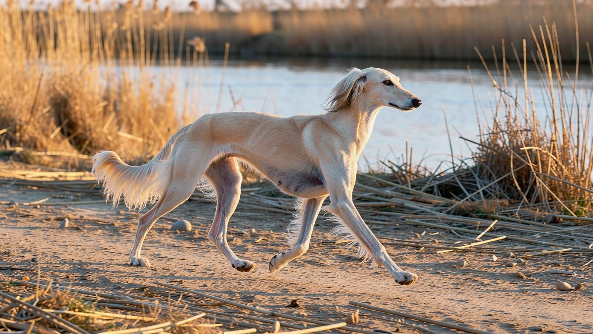

**2026년 10월 15일 기준** — 분양 관련 내용은 시점에 따라 달라질 수 있습니다.

## 빠른 답

- **성격 한 줄**: 낯선 사람에게는 내성적이고 독립적인 편이지만, 가족에게는 충성스러운 모습을 보입니다(로얄캐닌 코리아).
- **아파트에서 키울 수 있나?**: 가능합니다. 다만 하루 두 시간 이상의 활동량을 채워 줄 산책과 달리기 계획이 필요합니다(PetMD).
- **처음 키우는 사람에게 맞나?**: 고집이 세고 훈련이 까다로워, 처음 키우는 분에게는 어려운 견종으로 꼽힙니다(PetMD).

## 품종 개요

살루키는 기원전 329년까지 거슬러 올라가는 세계에서 가장 오래된 견종 가운데 하나입니다(PetMD). 중동의 사막과 초원에서 가젤, 토끼, 여우 등을 쫓던 시각하운드입니다. AKC는 살루키를 "왕들의 사냥개"라고 소개합니다. 이집트 왕실이 살루키를 미라로 남길 만큼 아꼈다는 기록도 있습니다(PetMD).

체고는 최대 71cm(28인치)까지 자라고, 체중은 18~29kg(40~65파운드) 정도입니다(PetMD). 몸통은 날씬하고 가슴은 깊으며 다리는 길어, 전체적으로 우아한 실루엣을 자랑합니다. 모색은 화이트, 크림, 포운, 골드, 레드, 그리즐, 블랙앤탄, 트라이컬러까지 폭이 넓습니다.

털은 두 가지 타입으로 나뉩니다. 귀와 다리, 꼬리에 장식털이 길게 발달한 페더링 타입과, 털이 짧고 매끈한 스무스 타입입니다(PetMD). 같은 살루키라도 털 타입에 따라 외모가 상당히 달라 보입니다.

같은 시각하운드 계열로는 그레이하운드와 휘핏, 보르조이 등이 있습니다. [하운드 종류 가이드](/guides/hound-types/)에서 계열별 차이를 비교해 볼 수 있습니다.

<dl>
<dt>크기</dt>
<dd>중형(로얄캐닌 코리아 분류), 체고는 최대 71cm</dd>
<dt>체중</dt>
<dd>18~29kg</dd>
<dt>수명</dt>
<dd>평균 12~14년(로얄캐닌 코리아). 최대 17년까지 산 사례도 보고됩니다(PetMD)</dd>
<dt>운동량</dt>
<dd>하루 2시간 이상(PetMD)</dd>
<dt>털 관리</dt>
<dd>쉬운 편입니다. 주 1~2회 빗질이면 충분합니다(PetMD)</dd>
<dt>초보 적합도</dt>
<dd>낮습니다. 고집이 세고 훈련이 까다로운 편입니다(PetMD)</dd>
</dl>

## 성격과 기질

로얄캐닌 코리아는 살루키의 키워드로 내성적, 총명함, 독립심, 자신감을 꼽습니다. 낯선 사람에게 먼저 다가가지 않는 신중한 태도는 고양이에 비유되기도 합니다. 반면 가족에게는 매우 충성스러운 견종입니다. 같은 시각하운드라도 [이탈리안 그레이하운드](/breeds/italian-greyhound/)처럼 사람에게 애착이 강한 견종도 있어, 계열 안에서도 성격 차이가 큽니다.

AKC는 살루키를 온화하고 위엄 있는 반려견으로 소개합니다. 또한 빠르고 민첩하게 달리며 무언가를 쫓는 것을 즐기는 견종이라고 설명합니다. 자기만의 방식으로 놀이를 즐기는 성향이 있어(PetMD), 보호자가 원할 때 하는 스킨십이나 놀이를 부담스러워할 수 있습니다.

사냥 본능은 여전히 강합니다. 작은 동물을 보면 쫓고 싶어 하는 본능이 살아 있어(PetMD), 고양이나 소동물과 함께 키울 때는 합사 여부를 신중하게 결정해야 합니다. 아이와 지낼 때도 어린아이보다는 큰아이, 또는 어른만 있는 가정이 더 잘 맞습니다(PetMD).

훈련에서는 고집이 세고 자기 주장이 뚜렷해, PetMD는 살루키를 훈련이 매우 까다로운 견종으로 꼽습니다. 혼자 있는 시간이 길어지면 분리불안이 나타날 수 있으므로, 어릴 때부터 짧은 시간 혼자 있는 연습을 시작해 점차 시간을 늘려 주는 것이 좋습니다(PetMD).

## 한국에서 키울 때

### 분양과 입양, 확인할 것

살루키는 국내 분양 정보가 많지 않은 견종입니다. 시세를 집계한 공개 자료도 찾기 어렵습니다. 참고로 미국 기준 퍼피 가격은 400~5,000달러로 편차가 크게 보고됩니다(PetMD). 국내에서 분양이나 입양을 알아본다면 부모견의 건강검진 결과와 유전 질환 관련 기록을 확인하고, 브리더의 이력도 살펴보는 것이 좋습니다.

로얄캐닌 코리아는 살루키가 어떤 가정 환경에도 잘 적응한다고 소개합니다. 아파트에서도 키울 수 있지만, 하루 두 시간 이상의 활동(PetMD)을 충분히 제공하지 못하면 스트레스가 쌓일 수 있습니다. 산책과 달리기 계획을 먼저 세워 두고 시작하는 것이 좋습니다. 산책할 때는 동물보호법상 목줄 착용이 의무이고, 사냥 본능이 강한 견종인 만큼 목줄을 놓아서는 안 됩니다. 나이별 산책 기준과 여름철 주의 사항은 [강아지 산책 가이드](/guides/dog-walking/)에 정리되어 있습니다.

### 살루키가 주의해야 할 질환

살루키는 대체로 건강한 견종으로 소개되지만(PetMD), 다음과 같은 질환이 보고됩니다.

- **치과 질환** — 대부분의 견종보다 이른 나이에 시작될 수 있습니다.
- **확장성 심근병증(DCM)** — 심장 근육이 약해지는 질환입니다.
- **위염전(GDV)** — 위가 가스로 팽창하며 비틀리는 응급 질환으로, 즉시 수술하지 않으면 위험합니다.
- **신경세포성 세로이드 리포푸신증** — 살루키에서 보고되는 유전성 신경 질환으로, 대개 1~2세에 증상이 나타나고 알려진 치료법이 없습니다.
- **고관절 이형성**
- **암** — 림프종, 혈관육종, 골육종, 유선암 등이 보고됩니다.
- **비만** — 살루키도 비만 위험이 언급되는 견종입니다.

특히 신경세포성 세로이드 리포푸신증은 어린 나이에 발병할 수 있고 알려진 치료법도 없어, 입양 전 부모견의 검사 이력을 확인하는 것이 중요합니다. 평소에는 치과 검진과 정기 건강검진을 꾸준히 받는 것이 좋습니다.

## 관리법

**운동** — 하루 두 시간 이상의 활동이 필요합니다(PetMD). 산책만으로는 부족할 수 있어, 달리기나 루어코싱, 플라이볼, 어질리티처럼 달리는 활동을 섞어 주는 것이 좋습니다(PetMD). 자유롭게 뛰게 하려면 울타리가 설치된 공간을 이용하는 것이 좋으며, 공용 운동장에서도 안전을 위해 목줄을 풀지 않는 것이 좋습니다. 위염전 위험이 보고되는 견종이므로 식사 직후 격한 운동은 피하는 것이 좋습니다.

**털 관리** — 털 빠짐이 적은 편이라 부담이 크지 않습니다. 주 1~2회 부드러운 브러시로 빗질하면 되고, 귀와 다리, 꼬리의 긴 장식털은 엉킴이 생기지 않았는지 자주 살펴보는 것이 좋습니다(PetMD). 목욕은 더러워졌을 때만 해도 충분합니다. 눈 주변 분비물을 닦아 주지 않으면 눈물 자국이 생길 수 있어(PetMD), 따뜻한 물에 적신 천으로 가끔 닦아 주는 것이 좋습니다. 목욕 후에는 귀 안에 물기가 남지 않도록 관리하고, 필요에 따라 귀 클리너를 사용하면 외이염 예방에 도움이 됩니다(PetMD). 체격이 마른 편이라 한겨울 장시간 야외 활동에는 보온을 챙기는 것이 좋습니다.

**훈련과 식사** — 조기 사회화가 중요합니다(PetMD). 훈련은 한 번에 길게 하기보다 짧게 나눠 자주, 칭찬과 간식 중심으로 진행하는 것이 좋습니다. 다른 개와 함께 먹이면 서로 밥을 빼앗을 수 있어 따로 급여하는 편이 안전합니다(PetMD). 크레이트에 미리 익숙해지도록 하면 혼자 있는 시간에 안정감을 느끼고 집 안에서 발생할 수 있는 사고를 줄이는 데 도움이 됩니다(PetMD).

## 자주 묻는 질문

### 살루키는 털이 많이 빠지나요?

많이 빠지는 편은 아닙니다. 주 1~2회 빗질로 관리할 수 있고, 장식털 타입은 귀와 다리, 꼬리 주변 엉킴만 살펴 주면 됩니다(PetMD). 목욕도 자주 할 필요가 없어 털 관리 부담은 낮은 편입니다.

### 살루키는 아이와 함께 키울 수 있나요?

아이가 큰 가정이나 어른만 있는 가정이 더 잘 맞습니다. PetMD는 살루키가 어린아이보다 큰아이와 잘 지낸다고 설명합니다. 작은 동물을 쫓는 본능이 강하므로 고양이나 소동물과의 합사는 신중하게 결정하는 것이 좋습니다.

### 살루키는 혼자 오래 둬도 괜찮나요?

혼자 있는 시간이 길어지면 분리불안이 나타날 수 있습니다(PetMD). 하루 종일 혼자 두는 일이 반복되지 않도록 하고, 어릴 때부터 짧은 외출로 혼자 있는 연습을 시작해 점차 시간을 늘리는 것이 좋습니다.

### 살루키 수명은 얼마나 되나요?

평균 기대 수명은 12~14년으로 소개되며(로얄캐닌 코리아), 17년까지 산 사례도 보고됩니다(PetMD). 대체로 건강한 편이지만 치과 질환과 심장 질환, 특정 암이 보고되는 견종이라 정기 검진을 꾸준히 받는 것이 좋습니다.

### 살루키는 얼마나 빠른가요?

시속 69km(43마일)까지 낼 수 있는 단거리 주자입니다(PetMD). 다만 목줄 없이 놓으면 사냥 본능을 따라 달아날 수 있으므로, 속도를 제대로 내게 하려면 울타리가 있는 공간이나 루어코싱 같은 견종 스포츠를 이용하는 것이 안전합니다.

## 출처

- [Saluki — PetMD](https://www.petmd.com/dog/breeds/saluki) — 체고·체중·수명·운동량·속도·건강 문제·기질·가격
- [살루키 — 로얄캐닌 코리아](https://www.royalcanin.com/kr/dogs/breeds/saluki) — 원산지·평균 수명 12~14년·성격·크기 분류
- [Saluki — AKC](https://www.akc.org/dog-breeds/saluki/) — 품종 소개·기질
- 표지 이미지는 AI로 생성한 이미지입니다.
