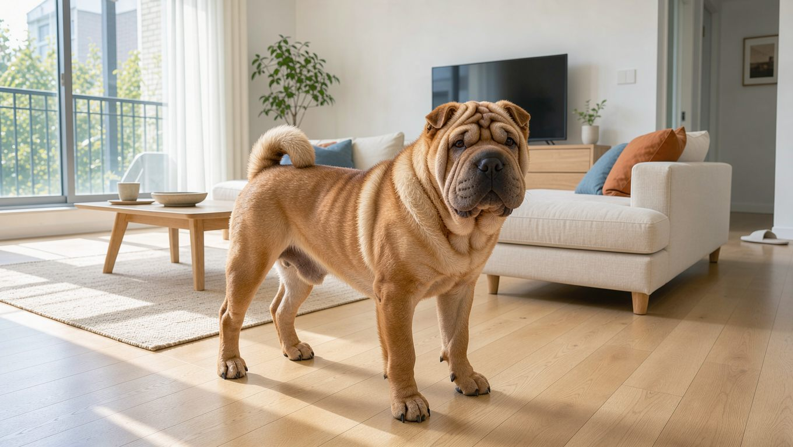
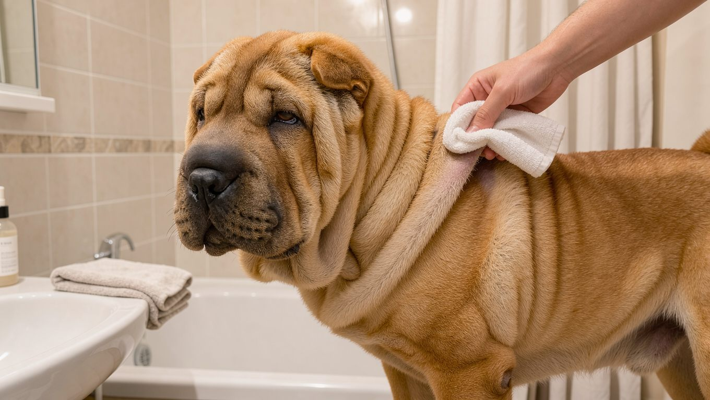

## 빠른 답

- **성격 한 줄**: 가족에게는 충실하고 다정하지만, 낯선 사람에게는 경계심을 보이는 편입니다.
- **아파트에서 키울 수 있나?**: 가능합니다. 다만 여름철 주름 청결과 경계 짖음 관리를 함께 준비해야 합니다.
- **처음 키우는 사람에게 맞나?**: 주름 피부와 샤페이 열병 같은 건강 관리 부담이 있어, 첫 반려견으로는 신중하게 판단하는 것이 좋습니다.

## 품종 개요

샤페이는 중국 광둥성 일대에서 시작된 중형견입니다. 이름은 광둥어로 '모래 피부'를 뜻하며, 까끌까끌한 털의 질감이 사포처럼 느껴지는 데서 유래했습니다. 사냥과 가축 지키기, 싸움에 두루 쓰였다는 기록이 남아 있지만, 오늘날에는 가족견으로 자리 잡았습니다.

1970년대에 샤페이는 멸종 위기에 처할 정도로 개체 수가 줄었습니다. 홍콩의 브리더들이 남은 개체를 모아 미국으로 보내면서 복원되었고, 미국 켄넬클럽은 1992년에 샤페이를 공식 견종으로 인정했습니다.

가장 눈에 띄는 특징은 머리와 목, 어깨를 덮는 깊은 주름입니다. 어린 시기에는 전신이 주름으로 덮이지만, 자라면서 피부가 늘어나 주름은 상당 부분 줄어듭니다. 몸통과 다리는 짧고 넓으며, 주둥이는 하마처럼 편평합니다. 귀는 작은 삼각형이고, 혀와 잇몸이 청흑색인 점도 샤페이의 표식입니다. 털은 1인치가 채 안 되는 호스 코트와 그보다 조금 긴 브러시 코트로 나뉩니다. 색상은 블랙, 블루, 파운, 크림, 레드, 애프리콧, 초콜릿, 세이블 등이 있습니다. 표준보다 길고 부드러운 베어 코트는 인정되는 모질이 아닙니다.

<dl>
<dt>체고</dt>
<dd>46~51cm</dd>
<dt>체중</dt>
<dd>20~27kg</dd>
<dt>수명</dt>
<dd>8~12년</dd>
<dt>운동량</dt>
<dd>하루 30분 안팎의 짧은 산책</dd>
<dt>털 관리</dt>
<dd>빗질은 적게 해도 되지만 주름 청결 점검이 필요합니다</dd>
<dt>그룹</dt>
<dd>미국 켄넬클럽 논스포팅</dd>
</dl>

## 성격과 기질

샤페이는 가족에게 충실하고 다정합니다. 집에서는 대체로 차분하고 활동량이 많지 않으며, 보호자를 가까이 따릅니다. 반면 낯선 사람과 낯선 장소에는 거리를 두는 편입니다. PetMD는 샤페이가 보호자에게는 다정하지만 낯선 사람에게는 경계심을 보이며, 사회화가 부족하면 불안해할 수 있다고 설명합니다.

고집이 세어 훈련에 시간이 걸릴 수 있습니다. 어린 시기부터 사람과 환경에 익숙해지도록 사회화를 시작하는 것이 좋습니다. 단호하되 거칠지 않은 방식이 잘 맞습니다.

## 한국에서 키울 때

**법적 지위** — 샤페이는 한국의 법정 맹견 5종에 해당하지 않습니다. 대상은 도사견, 아메리칸 핏불테리어, 아메리칸 스태퍼드셔 테리어, 스태퍼드셔 불 테리어, 로트와일러와 그 잡종입니다. 샤페이는 목줄과 인식표 같은 일반 반려견 의무만 지키면 됩니다.

**분양 시세** — 국내 샤페이 분양 시세를 집계한 공개 자료는 찾기 어렵습니다. 업체와 브리더마다 호가 차이가 크므로, 가격만 비교하기보다 부모견의 건강 검사 이력을 먼저 확인하는 편이 안전합니다.

**아파트** — 샤페이는 실내 생활에도 비교적 잘 적응합니다. PetMD는 아파트나 작은 집에서도 편안해한다고 설명합니다. 다만 경계심이 강해 복도에서 나는 소리에 짖을 수 있으며, 장마철의 높은 습도는 주름 피부에 부담을 줄 수 있습니다. 층간소음과 주름 관리 두 가지를 함께 준비하는 것이 좋습니다. 아파트 생활의 기본 규칙은 [아파트에서 강아지 키우기](/guides/dog-apartment-guide/)에서 확인할 수 있습니다.

**여름과 습도** — 한국의 여름철 고온다습한 환경에서는 주름 사이에 습기가 쉽게 차기 쉽습니다. 압구정 7500 동물병원 칼럼은 주름 피부염이 눈물과 피지, 침 같은 분비물에 젖은 피부에서 생긴다고 설명합니다. 습기가 오래 남아 있으면 세균이 번식해 냄새가 나거나 피부가 붉어질 수 있습니다. PetMD는 주름 상태를 일주일에 1~2회 확인하도록 권장합니다.

**딱지허브 평가**: PetMD가 권하는 주 1~2회 주름 점검만으로는 한국의 장마철에 충분하지 않을 수 있습니다. 한국 장마철에는 산책 후와 목욕 후 주름을 반드시 말리고, 습한 날에는 매일 상태를 확인하는 편이 안전합니다.

**유전병** — 샤페이 열병은 유전적 요인으로 발생하는 자가염증성 질환입니다. 고열과 발목 부종, 식욕 저하가 반복되고, 심해지면 신장 기능 저하로 이어질 수 있습니다. PetMD는 39.4~41.7℃의 고열과 발목 부종을 대표적인 증상으로 소개하며, 유전자 검사로 관련 유전 변이의 보유 여부를 확인할 수 있다고 설명합니다. 해당 유전 변이를 가진 개는 교배에 이용하지 않는 것이 권장됩니다. 안검내반은 눈꺼풀이 안쪽으로 말려 각막을 자극하는 질환으로, 대개 1세 이전에 진단되고 수술로 교정합니다. 분양 전에 부모견의 검사 이력을 확인하는 것이 좋습니다.

## 관리법

**주름 청결** — 주름은 매주 살피고, 습기와 발적, 냄새를 확인합니다. 피부염이 생긴 경우 목욕 주기를 1~2주 간격으로 조정하라는 안내도 있습니다. 목욕 뒤에는 주름마다 물기를 완전히 말려야 합니다. 목욕 주기의 일반 기준은 [강아지 목욕 주기](/guides/dog-bath-schedule/)에서 확인할 수 있습니다.

**털과 체중** — 짧은 단모라 빗질은 주 1회 정도로 충분합니다. 다만 체중이 늘면 피부가 접히는 부위에 부담이 커져 피부염 위험이 높아질 수 있습니다. 압구정 7500 동물병원 칼럼도 비만이 원인인 경우 체중 감량이 필요하다고 설명합니다.

**운동과 훈련** — 운동은 과하지 않게 유지합니다. 하루 두 번 짧게 나누어 산책하면 충분한 편이며, 더위가 심한 시간대는 피하는 것이 좋습니다. 훈련은 어린 시기 사회화와 함께 시작하고, 같은 명령을 짧게 반복하는 방식이 효과적입니다.

**검진** — 샤페이 열병 관련 유전자 검사 결과와 눈 건강 상태는 분양 전이나 입양 직후에 확인해야 합니다. 주름 피부염이 반복되면 약물 치료를 고려하고, 필요한 경우 주름을 제거하는 수술에 대해서도 수의사와 상담할 수 있습니다.

## 자주 묻는 질문

### 샤페이 열병은 어떤 병인가요?

샤페이 열병은 유전성 자가염증 질환입니다. 고열과 발목 부종이 반복되고, 드물게 신장 기능 저하로 이어질 수 있습니다. 유전자 검사로 보인자 여부를 확인할 수 있으니, 분양 전에 부모견의 검사 이력을 물어보는 것이 좋습니다.

### 샤페이 주름은 크면 없어지나요?

어린 시기에는 전신이 주름으로 덮이지만, 자라면서 피부가 늘어나 주름은 줄어듭니다. 다만 머리와 목의 주름은 성견이 되어도 남습니다.

### 샤페이는 초보자가 키우기 어려운가요?

주름 피부 관리와 샤페이 열병 같은 유전 질환 점검 부담이 있어, 처음 반려견을 키우는 보호자에게는 쉽지 않은 견종입니다. 고집이 있는 편이라 훈련에 시간이 걸릴 수 있습니다. 다만 사회화를 일찍 시작하고 주름 관리를 습관으로 들이면 충분히 함께 지낼 수 있습니다.

### 샤페이와 차우차우는 어떻게 다른가요?

두 견종 모두 청흑색 혀를 가진 것으로 유명합니다. 샤페이는 깊은 주름과 중형 체구, 짧은 털이 특징이며, 차우차우는 사자갈기처럼 풍성한 이중모와 곧게 뻗은 다리가 특징입니다.

### 분양 전에 무엇을 확인해야 하나요?

부모견의 샤페이 열병 유전자 검사 여부, 안검내반 수술 이력, 주름 피부 상태를 확인하는 것이 좋습니다. 국내 분양 시세 자료가 많지 않으니, 가격만 비교하기보다 건강 이력을 먼저 보는 편이 안전합니다.

## 출처

- [Chinese Shar-Pei Dog Breed Health and Care](https://www.petmd.com/dog/breeds/shar-pei) — 체고·체중·수명·운동량, 샤페이 열병과 안검내반, 주름 점검 기준
- [피부주름 피부염](https://7500clinic.com/bbs/board.php?bo_table=column&wr_id=1432) — 주름 피부염의 원인과 재발 관리 (압구정 7500 동물병원 칼럼)
- 표지와 본문 이미지는 AI로 생성했습니다.
