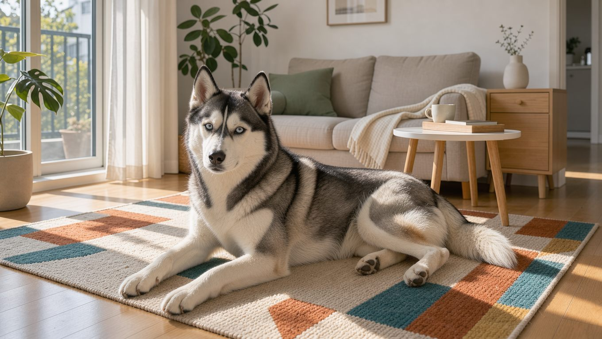

**2026년 11월 14일 기준** — 분양 시세처럼 변동되는 정보를 다룰 때마다 날짜를 갱신합니다.

## 빠른 답

- **성격 한 줄**: 낯가림이 적고 장난기가 많으며 독립적인 성향을 가진 견종입니다. 명령에 따르기보다 스스로 판단하려는 경향이 있습니다.
- **아파트에서 키울 수 있나요?**: 가능합니다. 다만 하루 운동량과 하울링, 봄과 가을의 털갈이라는 세 가지를 감당할 수 있어야 합니다.
- **처음 키우는 사람에게 맞나요?**: 활동량이 많고 훈련 경험이 있는 보호자에게 적합한 견종으로 분류됩니다(PetMD).

## 성격과 기질

시베리안 허스키의 기질은 친화력과 독립심이 함께 있는 것이 특징입니다. 사람을 좋아하고 낯선 사람에게도 비교적 친근하게 다가가며, 아이를 포함한 가족과도 잘 어울리는 편입니다. 무리 지어 일하도록 개량된 썰매견이라 다른 개와의 사회성도 좋은 편입니다(AKC).

반면 복종심은 자율성 쪽으로 기울어 있습니다. 영리하지만 명령을 그대로 따르기보다 스스로 판단하려는 성향이 강합니다(PetMD). 훈련은 어린 시기에 시작하고, 한 번에 길게 하기보다 짧게 자주 반복하는 편이 효과적입니다.

지루함에는 특히 약합니다. 운동량이 부족하거나 혼자 있는 시간이 길어지면 물건을 물어뜯고 땅을 파는 등의 행동을 보일 수 있으며, 담장을 넘어 탈출하려는 시도로 이어지기도 합니다(PetMD). 하울링과 짖음이 잦은 것도 이 견종의 대표적인 특징입니다.

## 품종 개요

시베리안 허스키는 시베리아 동북부 추코트카 지역에서 축치인이 길러 온 썰매견입니다. 가벼운 짐을 싣고 일정한 속도로 장거리를 달리는 데 적합하도록 개량되었습니다. 미국견애협회(AKC)에는 1930년 워킹 그룹으로 등록되었습니다(AKC).

20세기 초 알래스카 골드러시 시기에 북미로 건너가 썰매견으로 활약했습니다(위키백과). 1925년 알래스카 노움에 혈청을 나르던 원정 이야기로 대중에게 널리 알려졌습니다.

<dl>
<dt>체고</dt><dd>수컷 53~60cm, 암컷 51~56cm(AKC)</dd>
<dt>체중</dt><dd>수컷 20~27kg, 암컷 16~23kg(AKC)</dd>
<dt>수명</dt><dd>12~14년(PetMD), 12~15년(AKC)으로 자료마다 조금 다릅니다</dd>
<dt>운동량</dt><dd>하루 40분 이상에 정신적 자극 병행</dd>
<dt>털 관리</dt><dd>이중모로 1년에 두 번 집중적으로 빠짐</dd>
<dt>초보 적합도</dt><dd>활동적이고 경험 있는 보호자에게 적합</dd>
</dl>

## 털과 색상

시베리안 허스키의 털은 부드러운 겉털과 촘촘한 속털로 이루어진 이중모입니다(위키백과). 추위에 맞서 발달한 구조라 보온성은 뛰어나지만, 그만큼 털이 많이 빠집니다. 속털은 1년에 두 번 정도 집중적으로 빠지며, 이 시기에는 빗질을 자주 해 주는 것이 좋습니다(PetMD).

색상은 검정과 흰색, 회색과 흰색, 구리빛 붉은색과 흰색, 전체 흰색이 대표적입니다. 여기에 얼굴의 흰 무늬와 흰 발, 낫 모양으로 말린 꼬리가 더해져 개체마다 인상이 달라집니다(위키백과). 같은 색 조합이라도 얼굴의 무늬에 따라 인상이 크게 달라지는 것이 이 견종의 특징입니다.

## 한국에서 키울 때

### 분양 시세

국내 분양 장터인 도그시장에는 2026년 3월 기준 3개월령 허스키 70만 원 매물이 올라와 있었습니다(도그시장). 펫숍이나 개인 직거래 분양은 수십만 원대에서 형성되는 경우가 많으며, 혈통서가 있는 브리더 분양은 이보다 높은 가격에 거래되기도 합니다. 가격만 보고 고르기보다 부모견의 건강 검사 이력을 함께 확인하는 것이 좋습니다.

### 아파트 생활

아파트에서도 시베리안 허스키를 키우는 가정이 적지 않습니다. 관건은 넓은 공간이 아니라 꾸준히 운동할 시간입니다. 충분한 운동량을 확보하면 실내에서도 차분하게 지낼 수 있으며, 짖음이나 하울링으로 이웃과 갈등을 겪을 가능성도 줄어듭니다. 엘리베이터에서 다른 개를 마주칠 때를 대비해 어린 시기부터 사회화를 해 두면 도움이 됩니다.

### 여름나기

이중모 견종이라 한국의 덥고 습한 여름에는 더위에 부담을 느끼기 쉽습니다. 낮 시간 산책을 피하고 이른 아침이나 해가 진 뒤로 시간을 옮기는 것이 좋습니다. 실내에서는 냉방과 물을 넉넉히 준비하고, 속털을 짧게 밀어내는 삭모는 털이 가진 체온 조절 기능을 저해할 수 있어 권장하지 않습니다.

### 건강 리스크

시베리안 허스키에게 비교적 흔한 문제로 백내장, 진행성 망막위축, 각막 디스트로피, 갑상선 기능 저하증, 고관절 이형성증이 꼽힙니다. 갑상선 기능 저하증은 체중 증가와 털 빠짐, 무기력으로 나타나고 피부와 귀의 만성 염증과 겹치기도 합니다(PetMD). 분양 전에는 부모견의 건강 검사 이력을 확인하고, 성견이 된 후에는 정기 건강검진을 통해 관련 질환을 살펴보는 것이 좋습니다.

## 관리법

### 운동

운동은 하루 최소 40분에 정신적 자극을 더하는 수준을 기준으로 잡습니다(PetMD). 다만 썰매견으로 개량된 견종인 만큼 하루 40분의 운동은 최소한의 기준에 가깝습니다. AKC는 이 견종이 상당한 운동량을 필요로 한다고 설명합니다.

**딱지허브 평가**: 하루 40분은 최소 운동량을 가늠하는 기준으로 보는 것이 적절합니다(PetMD). 한국의 아파트 생활에서는 평일 아침 30분, 저녁 40분 정도 산책하고 주말에는 공원에서 여유롭게 장시간 산책하는 방식으로 운동량을 확보하는 것이 현실적입니다. 운동량이 부족하면 하울링이나 물건을 파괴하는 행동으로 이어질 수 있으므로, 비 오는 날에는 실내 노즈워크나 공놀이 등으로 활동량을 보충해 주세요.

달리는 본능이 강해 울타리가 없는 곳에서 목줄을 놓으면 그대로 달아나기 쉽습니다. 산책은 목줄과 하네스를 기본으로 하고, 자유롭게 뛰는 시간은 울타리가 있는 공간에서만 주는 것이 안전합니다(AKC). 나이와 체형에 따른 기준은 [강아지 하루 운동량](/guides/dog-exercise-amount/) 가이드에 정리해 두었습니다.

### 털 관리

속털이 집중적으로 빠지는 시기에는 언더코트 레이크와 같은 전용 도구를 사용해 매일 빗질해 주는 것이 좋습니다(PetMD). 평소에는 주 2~3회 빗질로 털을 관리하고, 털갈이가 집중되는 시기에는 빗질 횟수와 실내 청소 빈도를 함께 늘리는 것이 좋습니다. 도구별 쓰임은 [강아지 빗·브러시 비교](/guides/dog-brush-comparison/)에 정리해 두었습니다. 목욕은 필요할 때 해 주고, 눈과 귀, 치아도 정기적으로 관리해 주세요(PetMD).

### 훈련

어린 시기부터 규칙을 일관되게 지키는 것이 중요합니다. 독립심이 강한 만큼 명령을 강요하기보다 보상으로 이끄는 훈련이 잘 맞습니다. 목줄에 익숙해지는 연습도 일찍 시작하는 것이 좋습니다(PetMD).

## 자주 묻는 질문

### 시베리안 허스키는 초보가 키우기 어려운가요?

쉬운 견종은 아닙니다. 활동량이 많고 독립심이 강해 운동과 훈련에 시간을 꾸준히 낼 수 있는 보호자에게 맞습니다(PetMD). 함께할 시간이 충분하고 기본적인 훈련 방법을 미리 익혀 둔다면 초보 보호자도 키우는 데 도전할 수 있습니다.

### 허스키가 짖기보다 우는 경우가 많은 이유는 무엇인가요?

허스키는 하울링과 긴 울음소리로 유명합니다. 사람에게 말을 거는 듯한 다양한 소리를 내는 습성이 있어, 일반적인 짖음보다 하울링이 두드러지는 개체가 많습니다(PetMD). 소리가 신경 쓰인다면 어린 시기부터 하울링이 나오는 상황을 살펴보고, 지루함을 줄여 주는 것이 도움이 됩니다.

### 한국 여름에도 키울 수 있나요?

가능하지만 관리가 필요합니다. 이중모라 더위에 부담을 느끼기 쉬우므로 낮 산책을 피하고 냉방과 물을 준비해야 합니다. 털을 밀어 버리는 삭모보다 빗질로 속털을 정리하는 편이 좋습니다.

### 털갈이는 얼마나 심한 편인가요?

속털이 1년에 두 번 정도 집중적으로 빠집니다(PetMD). 이 시기에는 집 안 곳곳에 털이 많이 빠지므로 매일 빗질과 청소를 해 주는 것이 좋습니다. 평소 빗질을 꾸준히 해 두면 대털갈이 시기의 부담이 줄어듭니다.

### 목줄을 풀어 놓아도 되나요?

권장되지 않습니다. 달리는 본능이 강하고 부름에 대한 반응이 일정하지 않아, 목줄을 놓치면 그대로 달아나는 경우가 있습니다. 산책은 목줄과 하네스를 기본으로 하고, 울타리가 있는 공간에서만 자유롭게 뛰게 해 주세요(AKC).

## 출처

- [Siberian Husky — American Kennel Club](https://www.akc.org/dog-breeds/siberian-husky/) (표준·성격·운동 요구·1930년 등록)
- [Siberian Husky — PetMD](https://www.petmd.com/dog/breeds/siberian-husky) (수명·하루 40분 운동·털갈이·건강 문제·기질)
- [시베리안 허스키 — 위키백과](https://ko.wikipedia.org/wiki/시베리안_허스키) (축치인 기원·이중모 구조·모색)
- [도그시장 강아지 직거래 매물](http://www.dogsijang.co.kr/board_dog/view.php?tb=board_sale&pagenum=1&search_live=&search_dog=&no=394210&ckattempt=1) (2026년 3월 부산 매물 70만 원 — 국내 분양 시세 참고치)
- 표지는 AI로 생성한 이미지입니다.
