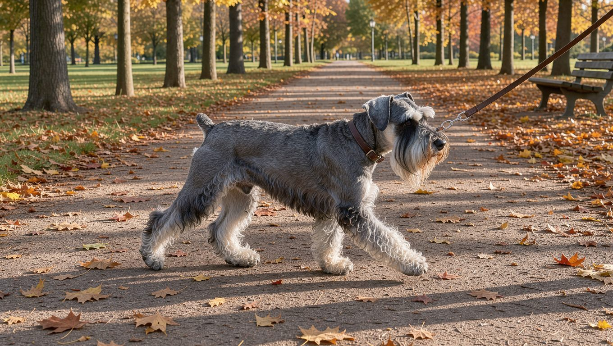

**2026년 11월 11일 기준** — 월 유지비처럼 변동될 수 있는 수치는 확인 가능한 자료를 바탕으로 정리했습니다.

## 빠른 답

- **성격 한 줄**: 영리하고 경계심이 강한 중형 작업견입니다. 장난기와 고집이 함께 있어 꾸준한 훈련이 필요합니다.
- **아파트에서 키울 수 있나?**: 조건부로 가능합니다. 짖음과 분리 불안을 줄이는 훈련을 먼저 해 두어야 합니다.
- **처음 키우는 사람에게 맞나?**: 훈련과 미용에 시간을 꾸준히 낼 수 있다면 시작해 볼 만합니다. 관리 부담이 적은 편은 아닙니다.

## 품종 개요

스탠다드 슈나우저는 독일이 원산지인 중형 작업견입니다. 세 가지 슈나우저 품종 가운데 중간 크기에 해당하며, 과거 농장에서 경비와 쥐를 잡는 역할을 맡았던 견종으로 알려져 있습니다. 오늘날에는 가족과 함께 지내는 반려견으로 자리 잡았습니다.

외형에서 가장 눈에 띄는 특징은 눈썹과 수염처럼 자란 빳빳한 털입니다. 털은 거칠고 탄력이 있으며, 소금과 후추를 섞은 듯 회색과 검은색이 어우러진 솔트앤페퍼 무늬가 대표적입니다. 블랙 개체도 있습니다.

체격과 생활 정보는 다음과 같습니다.

<dl>
<dt>크기</dt>
<dd>중형견입니다. 국립축산과학원이 안내하는 중형견 기준(체중 10~25kg)에 해당하며, 다른 중형견과의 비교는 <a href="/guides/medium-dog-types/">중형견 10종 비교</a>에서 확인할 수 있습니다.</dd>
<dt>체중</dt>
<dd>14~23kg입니다. 수컷은 16~23kg, 암컷은 14~20kg입니다 (Chewy).</dd>
<dt>체고</dt>
<dd>수컷 47~50cm, 암컷 44~47cm입니다 (Chewy).</dd>
<dt>수명</dt>
<dd>13~16년입니다 (Chewy).</dd>
<dt>운동량</dt>
<dd>하루 한 시간 정도의 활발한 활동이 권장됩니다 (Chewy).</dd>
<dt>털 관리</dt>
<dd>6~8주마다 전체 미용이 필요합니다. 한 번에 한 시간 반에서 두 시간이 걸립니다 (Chewy).</dd>
<dt>초보 적합도</dt>
<dd>보통입니다. 짖음 훈련과 정기 미용에 시간을 내야 합니다.</dd>
</dl>

## 성격과 기질

스탠다드 슈나우저는 대담하고 기운이 넘치는 성격으로 소개됩니다. 미국 애견협회(AKC)는 이 견종을 때로는 고집이 있지만 언제나 믿을 수 있는 반려견으로 소개합니다. 스스로 문제를 해결하는 능력이 뛰어나며 에너지가 넘치는 견종이라는 평가도 있습니다 (미국 반려동물 정보 사이트 Chewy).

낯선 사람이나 주변 소리에 경계심을 보이는 기질이 있습니다. 현관 초인종이나 복도에서 들리는 발소리에도 짖을 수 있습니다. 가족에게는 애정이 깊지만, 혼자 있는 시간이 길어지면 불안 증상을 보이는 개체도 있습니다 (국내 반려동물 정보 사이트 펫집).

아이와 함께 지낼 수 있지만 경계심이 강한 편이므로, 반려견과 아이만 단둘이 두는 상황은 피해야 합니다. 보호자가 곁에서 지켜보며 서로에게 익숙해질 시간을 충분히 주는 것이 좋습니다. 머리가 좋은 편이라 심심한 시간이 길면 장난이 과해질 수 있습니다.

## 미니어처·자이언트 슈나우저와 다른 점

슈나우저는 크기에 따라 미니어처, 스탠다드, 자이언트 세 종류로 나뉩니다. 스탠다드 슈나우저는 이 가운데 중간 크기에 해당합니다. 기본적인 기질은 비슷하지만, 크기에 따라 필요한 활동 공간과 운동량에는 차이가 있습니다.

국내에서는 슈나우저라고 하면 미니어처 슈나우저를 먼저 떠올리는 경우가 많습니다. 실제 분양 시장에서도 미니어처는 비교적 흔하지만 스탠다드는 찾아보기 어려운 편입니다. 스탠다드 슈나우저를 찾는다면 일반 분양 목록보다 전문 브리더를 통하는 편이 낫습니다.

## 한국에서 키울 때

한국에서 스탠다드 슈나우저를 키울 때는 중형견이라는 특성을 고려해 생활 환경을 마련해야 합니다. 아파트에서 키운다면 하루 한 시간 정도 산책하는 것을 기본으로 하고, 짖음이 반복되는 상황이나 시간대를 파악해 훈련으로 개선해 나가는 것이 좋습니다. 좁은 복도나 엘리베이터에서 낯선 사람을 마주치면 짖을 수 있으므로, 어린 시기부터 다양한 환경과 상황에 익숙해지도록 사회화 훈련을 해 주세요.

스탠다드 슈나우저는 국내에서 분양 사례가 드물어 참고할 만한 공개 시세를 찾기 어렵습니다. 미니어처 슈나우저의 분양가를 스탠다드 슈나우저의 시세로 오해하지 않도록 주의해야 합니다. 분양을 결정하기 전에는 부모견의 체격과 건강 검사 이력을 직접 확인하는 것이 좋습니다. 월 유지비는 30만 원 안팎으로 안내하는 자료도 있습니다 (펫집). 다만 여기에 6~8주마다 발생하는 정기 미용 비용까지 고려해 전체 관리 예산을 잡는 것이 좋습니다.

건강 관리 측면에서도 미리 알아두어야 할 사항이 있습니다. 주의해야 할 주요 건강 문제로는 확장성 심근증을 비롯한 심장 질환, 방광 및 신장 결석, 고관절과 팔꿈치 이형성증, 백내장, 진행성 망막 위축증, 갑상선 기능 저하증, 혈우병 A 등이 있습니다 (Chewy). 국내 자료에서는 모낭염과 폐동맥 협착증도 관련 건강 문제로 소개하고 있습니다 (펫집). 분양 전에는 부모견의 고관절과 안과 검사 이력을 확인하는 것이 좋습니다.

여름철에는 더위를 피할 수 있도록 산책 시간을 아침과 저녁으로 나누고, 산책 중에도 충분히 수분을 섭취할 수 있도록 해 주세요.

## 관리법

### 털 관리

빳빳한 털은 계속 자라기 때문에 털의 형태와 상태를 유지하려면 정기적인 미용이 필요합니다. 빗질은 주 1회 정도가 권장되며 (Chewy), 자료에 따라 주 2~3회를 권장하기도 합니다 (펫집). 빗질은 엉킨 털을 풀고 피부 상태를 살피는 시간이 됩니다.

6~8주 간격으로 전체 미용을 하면 눈썹과 수염의 특징적인 형태를 유지하는 데 도움이 됩니다. 죽은 털을 손으로 제거하는 스트리핑이나 미용 기계로 털을 다듬는 클리핑 중에서 털 상태와 관리 목적에 맞는 방법을 선택하면 됩니다. 식사 뒤에는 수염과 입 주변을 닦아 주면 냄새를 줄일 수 있습니다.

### 운동

하루 한 시간 정도의 활동을 기본으로 하되, 산책만으로 활동량이 충분하지 않다면 노즈워크나 훈련 놀이를 추가해 정신적인 자극도 제공해 주세요. 운동이 부족하면 장난이 과해지거나 짖음이 늘어날 수 있습니다.

### 훈련

고집이 있는 편이므로 가족 구성원마다 서로 다른 규칙을 적용하면 혼란을 겪을 수 있습니다. 짖는 원인을 파악하고 불필요한 짖음을 줄이는 훈련을 어린 시기부터 시작하는 것이 좋습니다. 낯선 사람과 다른 개에게 익숙해지는 사회화 훈련도 함께 진행해 주세요.

## 자주 묻는 질문

### 스탠다드 슈나우저는 대형견인가요?

스탠다드 슈나우저는 중형견입니다. 체중은 14~23kg이며, 국립축산과학원이 제시하는 중형견 기준(10~25kg)에 해당합니다. 대형견으로 분류되는 견종보다 몸집이 작습니다.

### 미니어처 슈나우저와는 무엇이 다른가요?

가장 큰 차이는 크기입니다. 스탠다드는 미니어처보다 몸집이 크고 운동량도 더 필요합니다. 국내에서는 미니어처가 흔해 두 가지를 한 견종으로 오해하는 경우도 있습니다.

### 털이 잘 빠지지 않는 견종인가요?

빳빳한 털이라 털 빠짐으로 인한 부담은 적은 편입니다. 대신 털이 계속 자라 6~8주마다 미용을 해야 합니다.

### 아이가 있는 집에서 키울 수 있나요?

가능합니다. 다만 경계심이 강한 편이므로 아이가 갑자기 다가가거나 만지면 놀랄 수 있습니다. 아이가 반려견과 교감할 때는 보호자가 곁에서 지켜보며 올바른 상호작용을 지도해 주세요.

### 처음 키우는 사람도 키울 수 있나요?

처음 키우는 사람도 기를 수 있습니다. 다만 고집이 있는 편이므로 일관된 훈련이 필요하며, 정기적인 미용과 관리에도 시간을 투자해야 합니다. 산책과 훈련에 매일 시간을 쓸 수 있는지 먼저 따져 보는 것이 좋습니다.

## 출처

- [Standard Schnauzer — American Kennel Club](https://www.akc.org/dog-breeds/standard-schnauzer/) (원산과 성격)
- [Standard Schnauzer Breed: Characteristics, Care & Photos — Chewy](https://www.chewy.com/eks/ns/pet-health/pet-health-content-frontend/education/dog-breeds/standard-schnauzer) (체중·체고·수명·운동·미용·건강 문제)
- [스탠다드 슈나우저 — 펫집](https://petjip.com/dog/breeds/standard-schnauzer/) (국내 관리 주기·월 유지비·건강 문제)
- 표지 이미지는 AI로 생성했습니다.
