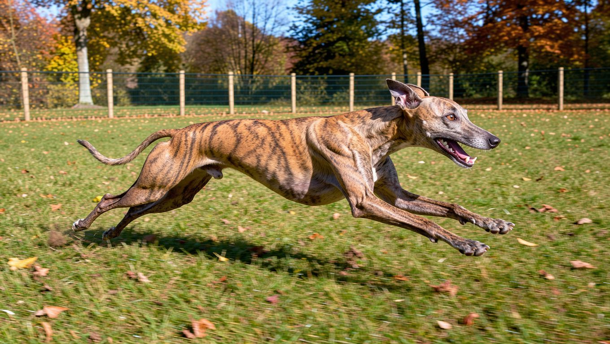

## 빠른 답

- **성격 한 줄**: 온순하고 사람을 잘 따르지만, 움직이는 작은 동물을 보면 추격 본능이 앞서는 시각 하운드입니다.
- **아파트에서 키울 수 있나?**: 실내에서는 조용하고 운동을 마치면 쉬는 시간이 긴 편이라 아파트 생활에 무리가 적습니다. 짧은 거리를 전력으로 달리는 운동을 채워 줄 산책과 공간이 관건입니다.
- **처음 키우는 사람에게 맞나?**: 털 관리와 성격은 다루기 쉬운 축에 듭니다. 다만 목줄을 놓쳤을 때 달아나는 본능과 겨울철 추위 대비는 초보 보호자도 미리 준비해야 합니다.

## 품종 개요

휘핏은 영국 북부에서 노동자들이 즐기던 경주를 통해 발전한 시각 하운드입니다. '가난한 사람의 경주마'라는 별명이 붙을 만큼 단거리 질주에 특화되어 있으며, 1888년 미국 켄넬 클럽(AKC)으로부터 품종으로 인정받았습니다. 후각보다 시각에 의존해 움직이는 대상을 추적하는 사냥 방식은 지금도 휘핏의 기질과 산책 습관에 영향을 미칩니다.

<dl>
<dt>크기</dt>
<dd>중형 — AKC 기준 체고 45.7~55.9cm(18~22인치), FCI 기준 수컷 47~51cm, 암컷 44~47cm</dd>
<dt>체중</dt>
<dd>약 11~18kg</dd>
<dt>수명</dt>
<dd>12~15년</dd>
<dt>운동량</dt>
<dd>하루 1시간 안팎의 산책에 짧은 질주를 곁들이는 정도</dd>
<dt>털 관리 난이도</dt>
<dd>낮은 편 — 단모라 빗질과 목욕에 드는 시간이 적습니다</dd>
<dt>초보 적합도</dt>
<dd>중간 — 성격과 털은 쉽지만 산책 통제와 추위 대비가 관건입니다</dd>
</dl>

같은 시각 하운드 안에서도 체격과 사냥 방식이 다릅니다. 그레이하운드와 이탈리안 그레이하운드, 살루키, 보르조이를 함께 비교한 [하운드 종류 가이드](/guides/hound-types/)에서 계열별 차이를 확인할 수 있습니다.

## 성격과 기질

휘핏은 사람에게 애정이 많고 보호자를 따라다니는 편입니다. 낯선 사람과 어린이, 다른 개에게도 비교적 무던하게 대하는 사례가 많습니다. 경계심은 있지만 쉽게 짖지 않아 실내에서 조용한 견종으로 꼽힙니다.

장난기가 있고 활동적인 편이지만, 하루 종일 에너지를 쏟아내는 견종과는 성향이 다릅니다. 충분히 움직인 뒤에는 실내에서 잠을 자거나 보호자 곁에 붙어 쉬는 시간이 깁니다. 그래서 좁은 집에서도 생활 리듬을 잡기 쉬운 축에 듭니다.

주의할 지점은 추격 본능입니다. 산책 중 고양이나 다람쥐가 시야에 들어오면 갑자기 달려들 수 있어, 목줄을 느슨하게 잡고 있다가 놓치는 사고가 생기기 쉽습니다. 혼자 있는 시간이 길어지면 분리불안이 나타날 수 있다는 점도 유의해야 합니다.

## 모색과 털

휘핏의 털은 짧고 매끄러우며 몸에 단단히 붙는 단모입니다. AKC 표준은 이와 다른 코트를 결격으로 봅니다. 모색은 사실상 제한이 없어 블랙, 블루, 브린들, 폰, 레드, 화이트, 파티 컬러 등이 모두 나타납니다. 같은 배에서 태어난 형제라도 색 조합이 크게 다를 수 있습니다.

단모라 털갈이와 빗질 부담은 적습니다. 다만 피부가 얇고 체지방이 적어 긁힘이나 찰과상에 취약한 편입니다. 알레르기나 아토피와 같은 피부 질환에도 주의가 필요합니다. 야외 활동 뒤에는 발바닥과 배 쪽 피부에 상처가 없는지 확인하는 습관이 도움이 됩니다.

## 한국에서 키울 때

휘핏의 국내 분양가는 공개된 시세 집계가 없어 수치를 싣지 않습니다. 대신 분양 전에 부모견의 건강검진 이력을 확인하는 편이 안전합니다. 미국 휘핏 헬스 재단(Whippet Health Foundation)은 심장초음파는 2년마다, 안과 검사(CAER)는 매년, 청각 검사(BAER)는 한 차례 받을 것을 권장합니다. 갑상선 검사는 2년마다, 미오스타틴 검사와 고관절 검사는 1회씩 권장 항목에 들어 있습니다.

한국의 겨울은 휘핏에게 만만치 않습니다. 체지방이 적은 단모종이라 15℃ 아래에서 추위를 느낄 수 있다는 안내가 있습니다. 한파에는 보온복을 입히고 산책 시간을 짧게 나눠 다녀오는 편이 좋습니다. 여름에는 비교적 더위를 잘 견디는 편이지만, 아스팔트가 뜨거워지는 낮 시간대에는 산책을 피하는 것이 안전합니다.

아파트 적합성은 나쁘지 않습니다. 실내에서 조용하고 짖음이 적으며, 운동 후 휴식 시간이 길어 층간소음 걱정을 덜 수 있습니다. 다만 충분한 운동을 할 수 있는 공간을 확보하는 것이 중요합니다. 휘핏은 짧은 거리를 전력으로 달리는 운동이 필요한 견종이지만, 아파트 단지 안에서 목줄 없이 안전하게 달릴 수 있는 공간을 매일 확보하기는 어렵습니다.

## 관리법

산책은 하루 1시간 안팎을 기준으로 하되, 가능하다면 중간에 짧게 질주할 기회도 한두 번 마련해 줍니다. 목줄 산책만으로는 부족할 수 있으므로 주말에는 울타리가 있는 반려견 놀이터나 운동장을 찾는 방식이 현실적입니다.

**딱지허브 평가**: '안전한 울타리 안에서 마음껏 뛰게 해 주세요'라는 안내는 원칙으로는 맞습니다. 다만 한국 아파트 생활에서 그런 공간을 매일 구하기는 어려우므로, 평일에는 1시간 산책과 실내 놀이로 채우고 주말에 넓은 공간을 몰아서 이용하는 편이 지속 가능합니다.

털 관리는 비교적 간단한 편입니다. 단모종이라 목욕과 빗질에 많은 시간을 들일 필요는 없지만, 피부가 얇아 상처가 생기기 쉬우므로 발견 즉시 씻고 상태를 확인해야 합니다. 마취에 주의가 필요한 견종이므로, 중성화 수술이나 치과 치료를 받기 전에는 휘핏의 품종 특성을 수의사에게 미리 알리는 것이 좋습니다.

추위 대비는 겨울철 관리의 핵심입니다. 실내 바닥이 차갑지 않도록 쿠션이나 매트를 두고, 산책 후에는 몸을 잘 닦은 뒤 보온해 줍니다. [강아지 겨울 산책 가이드](/guides/dog-winter-walk/)에 한파 기준과 발 씻기 순서가 정리되어 있습니다.

## 자주 묻는 질문

### 휘핏과 이탈리안 그레이하운드는 무엇이 다른가요?

둘 다 시각 하운드지만 체격 차이가 큽니다. 휘핏은 체중 11~18kg의 중형견이고, 이탈리안 그레이하운드는 5kg 안팎의 소형견입니다. 털과 성격은 비슷한 결이지만, 운동 공간과 안전 관리 기준은 휘핏 쪽이 더 넉넉해야 합니다.

### 휘핏은 짖음이 많은 편인가요?

아닙니다. 경계심은 있으나 쉽게 짖지 않아 실내에서 조용한 편입니다. 다만 혼자 있는 시간이 길어지면 불안으로 짖거나 물어뜯는 행동이 나타날 수 있어, 어릴 때부터 짧은 분리를 연습해 두는 것이 좋습니다.

### 휘핏을 혼자 오래 두어도 괜찮나요?

권장하기 어렵습니다. 사람에게 붙어 있으려는 성향이 강해 분리불안으로 이어질 가능성이 있습니다. 외출이 잦은 가구라면 하루 중 혼자 있는 시간을 줄이고, 산책과 놀이로 에너지를 풀어 주는 일정을 먼저 짜야 합니다.

### 휘핏과 고양이가 함께 살 수 있나요?

가능하지만 추격 본능을 관리해야 합니다. 어릴 때부터 함께 자란 경우에는 적응하는 사례가 있지만, 성견이 된 뒤에 들인 고양이나 작은 동물은 움직이는 순간 사냥감으로 보일 수 있습니다. 첫 만남은 목줄을 찬 채로 짧게 나누고, 서로 피할 공간을 마련해 주세요.

### 휘핏은 초보자가 키우기 어려운가요?

성격과 털 관리는 어렵지 않은 편입니다. 다만 산책과 운동 관리에는 신경을 써야 합니다. 목줄을 놓치는 순간 달아날 수 있어 리드 줄 사용과 부름 훈련을 꾸준히 해야 하고, 겨울철 보온도 챙겨야 합니다. 이 두 가지를 준비할 수 있다면 초보 보호자도 함께 살아갈 수 있는 견종입니다.

## 출처

- [Whippet — American Kennel Club](https://www.akc.org/dog-breeds/whippet/) (품종 개요·성격·표준 체고·수명)
- [휘핏 키우기 완전가이드 — 페타짓](https://petazit.com/care/guides/dog-whippet-care) (FCI 표준 체고·휘핏 헬스 재단 검사 권장 주기)
- [휘핏 — 비마이펫](https://mypetlife.co.kr/139764/) (체중·수명·운동량·추위 기준·건강 문제)

표지 이미지는 AI로 생성했습니다.
