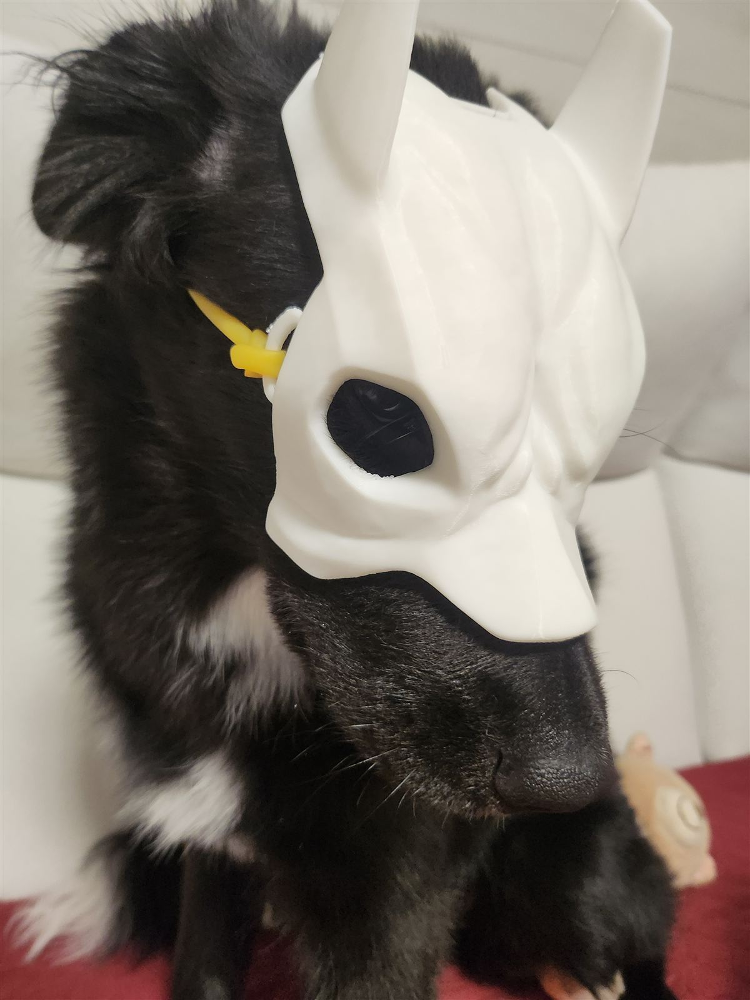
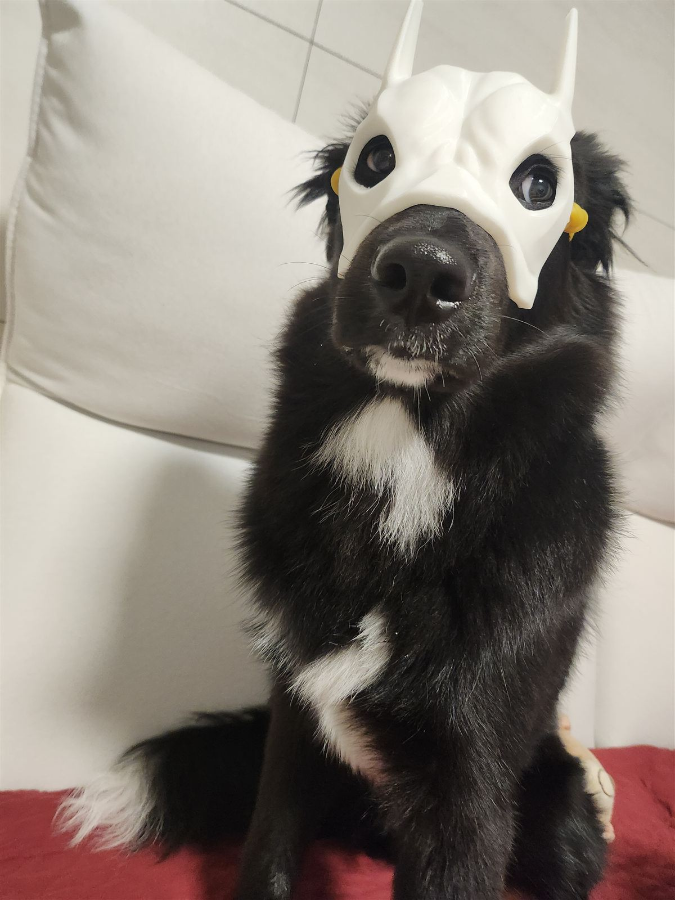
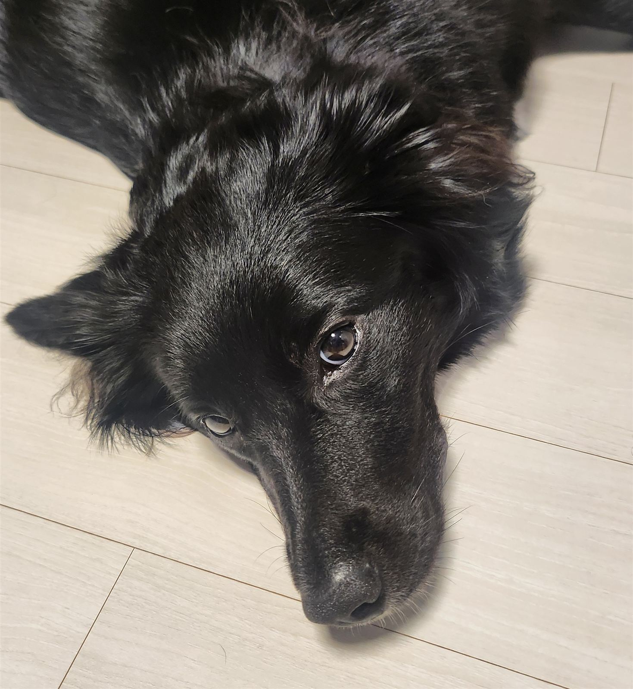

딱지를 아끼는 한 사람이 있습니다. 3D프린터를 다루는데, 어느 날 "딱지 가면 만들어 줬어" 하고 회색 가면 하나를 들고 왔습니다. 눈 부분에 구멍을 내고 딱지의 얼굴 크기에 맞춰 정성껏 출력한 가면이었습니다. 선물을 받는 입장에서는 감동할 만한 일이죠.

문제는 이야기의 다른 주인공이 개라는 점이었습니다.

첫 반응은 거부였습니다. 가면을 얼굴에 대 주자 딱지는 고개를 비스듬히 돌리고 시선을 피했습니다. 한 손으로 딱지를 쓰다듬으며 "잠깐만, 잠깐만" 달래는 모습이 담긴 사진입니다. 웃기지만 완전히 웃을 수는 없는 표정이에요. 개 입장에서는 왜 이런 상황을 참고 있어야 하는지 의아했을 법합니다.

그래도 한 번은 가면을 씌워 봤습니다. 착용 순간 딱지는 온몸이 굳었습니다. 앉은 채 꼼짝하지 않고, 어디를 바라봐야 할지 모르겠다는 표정으로 카메라를 쳐다봤습니다. "뻘쭘하다"는 표현은 사람에게만 쓰는 줄 알았는데, 딱지의 표정을 보니 개도 어색해 보일 때가 있다는 걸 처음 알았습니다.

그리고 이 얼굴입니다. 사진을 정리하다 이 장면의 파일 이름을 정하려고 한참 고민했습니다. 결국 떠오른 말은 "이걸 아름답다고 해야 하나"였습니다. 가면을 만들어 준 사람의 정성은 눈물 나게 고마웠고, 가면 자체도 잘 만들어졌습니다. 다만 가면을 쓴 모델의 표정은 결과물의 완성도와는 별개였습니다.

## 짧지만 배운 것

개는 사람이 즐기는 코스프레의 의미를 이해하지 못합니다. 얼굴에 낯선 물건을 얹는 일이 개에게는 즐거운 경험이 아닐 수 있기 때문입니다. 그래서 이날 촬영은 몇 분 만에 끝냈습니다. 지킨 원칙은 세 가지였습니다.

- **강요하지 않기** — 고개를 돌리면 잠시 쉬고, 싫어하면 그 장면은 넘어갔습니다
- **짧게 끝내기** — 가면을 좋아하는지 시험하는 것이 아니라 기념사진 한두 장만 찍는 데 그쳤습니다
- **벗긴 뒤 간식과 칭찬** — 가면을 쓴 경험보다 간식과 칭찬을 더 긍정적으로 기억할 수 있도록 마무리했습니다

가면을 만들어 준 마음은 소중하고, 쓰기를 거부한 딱지도 잘못이 없습니다. 민첩하고 영리한 보더콜리지만, 이날의 딱지는 얼굴에 낯선 물건이 다가오는 상황을 견디고 있던 평범한 강아지였습니다. 딱지가 어떤 아이인지는 [보더콜리 품종 가이드 — 딱지 이야기](/breeds/border-collie/)에 있습니다.

가면은 지금 잘 보관 중입니다. 언젠가 딱지가 마음을 바꿀지도 모르니까요. 물론 그럴 것 같지는 않지만요.
