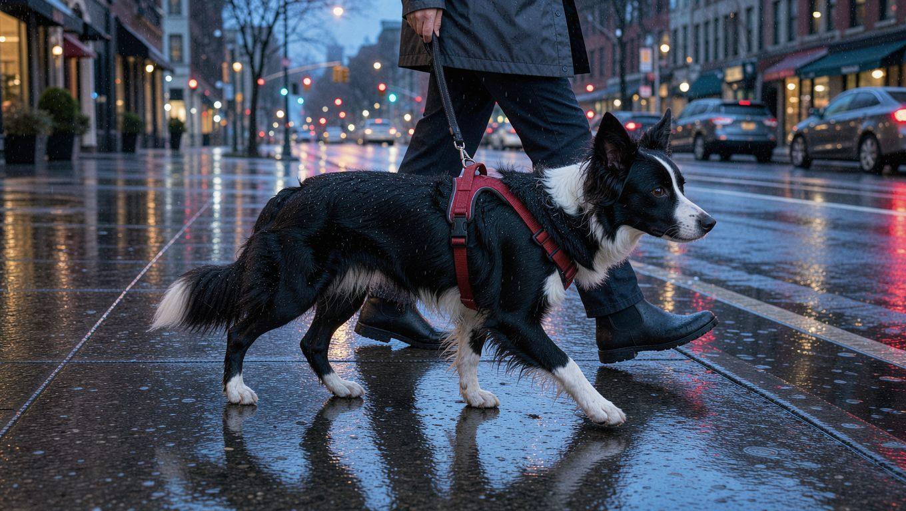
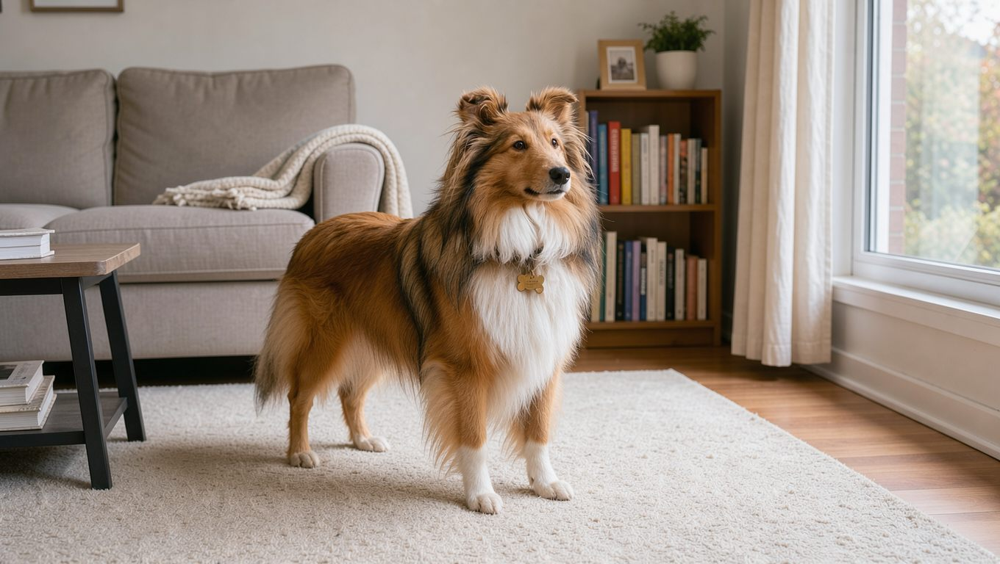

**2026년 11월 5일 기준**

보더콜리와 셰틀랜드 쉽독은 모두 양 떼를 몰던 목양견입니다. 생김새가 닮아 '큰 콜리와 작은 콜리'처럼 보이지만, 체격과 운동량, 짖는 습관에는 뚜렷한 차이가 있습니다. 이 글에서는 두 견종의 크기와 성격, 운동량, 털 관리, 건강상 주의점을 공개된 품종 자료를 바탕으로 비교합니다. 각 견종의 기본 정보는 [보더콜리 품종 가이드](/breeds/border-collie/)와 [셰틀랜드 쉽독 품종 가이드](/breeds/shetland-sheepdog/)에서 자세히 확인할 수 있습니다.

## 빠른 답

- **어느 쪽이 더 큰가요?** — 보더콜리가 한 체급 위입니다. 보더콜리는 체고 46~56cm, 체중 14~25kg이고 셰틀랜드 쉽독은 체고 33~41cm, 체중 7~11kg입니다.
- **운동량은 얼마나 다른가요?** — 보더콜리는 하루 1~2시간의 신체 활동과 두뇌 자극이 필요한 반면, 셰틀랜드 쉽독도 매일 꾸준한 운동과 훈련이 필요하지만 활동량은 상대적으로 적은 편입니다.
- **아파트에서는 어느 쪽이 더 무난한가요?** — 체구와 운동 부담은 셰틀랜드 쉽독이 낮습니다. 다만 짖음이 잦은 편이라 층간소음 대책을 함께 준비해야 합니다.

## 크기와 체격

<dl>
<dt>체고</dt>
<dd>보더콜리 46~56cm, 셰틀랜드 쉽독 33~41cm</dd>
<dt>체중</dt>
<dd>보더콜리 14~25kg, 셰틀랜드 쉽독 7~11kg</dd>
<dt>평균 수명</dt>
<dd>보더콜리 12~15년, 셰틀랜드 쉽독 12~14년</dd>
</dl>

위 수치는 품종 프로필에 제시된 인치와 파운드 단위를 센티미터와 킬로그램으로 환산한 값입니다. 실제 체고와 체중은 개체에 따라 차이가 있을 수 있습니다(PetMD).

체중을 기준으로 보면 보더콜리는 셰틀랜드 쉽독의 약 두 배입니다. 이러한 체격 차이는 실내에서 차지하는 공간부터 산책 중 목줄을 잡을 때의 힘, 병원으로 이동할 때까지 일상생활 곳곳에서 체감할 수 있습니다. 보더콜리는 잉글랜드와 스코틀랜드의 국경 지역에서 양을 몰던 견종입니다. 셰틀랜드 쉽독은 스코틀랜드의 셰틀랜드 제도에서 발달한 소형 목양견으로, 러프 콜리를 닮은 외모가 특징입니다(AKC).

## 성격과 기질

보더콜리는 에너지가 넘치고 영리한 목양견입니다. 낯선 사람을 경계할 수 있고, 어린이나 다른 반려동물을 몰려는 행동이 나타날 수 있습니다. 어린 시기부터 사회화와 훈련을 시작하는 것이 좋습니다(PetMD). AKC는 보더콜리를 '유난히 영리한 일 중독자'라고 소개하며, 활동을 마친 뒤에는 보호자 곁에서 쉬는 모습도 보인다고 설명합니다(AKC).

셰틀랜드 쉽독은 밝고 협조적이며 가족에게 애정이 깊은 견종입니다. 낯선 사람에게는 거리를 두는 편이고, 활발하게 짖으며 움직이는 물체를 쫓는 경향이 있습니다(PetMD). AKC에서도 셰틀랜드 쉽독을 매우 영리하고 민첩하며 순종적인 견종으로 소개합니다(AKC).

두 견종 모두 목양 본능이 남아 있어 입질이나 추격 행동이 나타날 수 있습니다. 보더콜리는 일과 활동이 부족할 때 불만이 행동으로 드러나기 쉽고, 셰틀랜드 쉽독은 짖음과 경계 행동으로 드러나기 쉽습니다. 따라서 보더콜리는 충분한 활동량을 확보하는 것이 중요하고, 셰틀랜드 쉽독은 짖음과 경계 행동을 관리하는 데 신경 써야 합니다.

## 운동량

보더콜리는 하루 1~2시간 정도의 운동이 필요한 활동적인 견종으로 알려져 있습니다. 산책만으로는 부족할 수 있어 퍼즐, 훈련, 공놀이, 어질리티처럼 두뇌를 쓰는 활동을 함께 구성하는 것이 좋습니다. 다만 노령견이나 신체 활동에 제약이 있는 개체는 건강 상태에 맞춰 운동 시간을 하루 30분 안팎으로 조정할 수 있습니다(PetMD).

셰틀랜드 쉽독 역시 매일 꾸준한 신체 활동과 정신적 자극이 필요한 견종입니다. 다만 분량을 시간으로 규정한 기준은 공개 자료에서 확인되지 않습니다. 복종 훈련과 어질리티, 트래킹, 공놀이처럼 몸과 머리를 함께 사용하는 활동이 잘 맞습니다. 목양 본능과 추격 습관이 남아 있으므로 안전한 울타리와 목줄 관리에도 신경 써야 합니다(PetMD).

**딱지허브 평가**: 하루 1~2시간의 운동 시간을 확보하는 것이 바람직하지만, 직장 생활을 하거나 아파트에 거주하는 보호자에게는 매일 실천하기 어려울 수 있습니다. 평일에는 30~60분 정도 산책하고 실내에서 두뇌 활동을 병행하며, 주말에는 공원이나 산책로에서 활동 시간을 늘리는 방법을 고려할 수 있습니다. 운동량이 부족해지면 짖음이나 물건을 망가뜨리는 행동이 나타날 수 있으므로 두 견종 모두 충분한 활동 시간을 확보해야 합니다.

## 털 관리

보더콜리는 중간 길이의 이중모입니다. 털은 일 년 내내 조금씩 빠지며 계절에 따라 빠지는 양이 늘어납니다. 빗질은 주 2~3회, 목욕은 한 달에 한 번 정도가 기준입니다. 귀와 눈, 발톱도 정기적으로 확인하는 것이 좋습니다(PetMD).

셰틀랜드 쉽독은 두꺼운 이중모로 털 빠짐이 많은 편입니다. 빗질은 최소 주 2회가 필요하고, 목욕은 자주 하지 않아도 됩니다. 귀 뒤와 다리 안쪽은 털이 엉키기 쉬운 부위이므로 꼼꼼하게 빗질해야 합니다. 필요하면 전문 미용의 도움을 받고, 눈과 귀의 청결도 함께 관리하는 것이 좋습니다(PetMD).

빗질 횟수는 두 견종이 비슷하지만, 셰틀랜드 쉽독은 털이 길고 풍성해 엉킨 부분을 풀고 관리하는 데 더 많은 시간이 걸릴 수 있습니다. 이중모 견종은 털을 밀면 피부와 모질에 무리가 갈 수 있어, 삭모는 피하는 편이 좋습니다.

## 건강 리스크

두 견종 모두 고관절 이형성증과 간질, 콜리 안구 기형(CEA)이 발생할 수 있는 것으로 알려져 있습니다. 보더콜리에서는 MDR1 약물 민감성 변이와 TNS, NCL 등의 유전질환이 추가로 보고됩니다. 셰틀랜드 쉽독에서는 셰틀리 스킨 신드롬(피부근염), 갑상선 기능 저하증, 폰 빌레브란트병 등이 나타날 수 있습니다(PetMD).

입양 전에는 부모견의 눈 검사와 고관절 검사, DNA 검사 이력을 확인하는 것이 좋습니다. MDR1 변이는 일부 구충제와 약물에 대한 민감도에 영향을 줄 수 있으므로, 입양 전 검사 결과를 확인하고 진료 시 수의사에게 알리는 것이 좋습니다.

## 한국 생활에서 고르는 기준

체구가 작은 셰틀랜드 쉽독은 보더콜리보다 아파트에서 생활하기에 공간적인 부담이 적은 편입니다. 다만 짖음이 잦은 편이라 층간소음 대책을 함께 마련해야 합니다. 보더콜리는 체격이 크고 활동량이 많아 실내에서 보내는 시간이 길어지면 스트레스를 받을 수 있습니다. 이때 짖음이나 물건을 망가뜨리는 행동으로 이어질 수 있습니다.

가족 구성도 기준이 됩니다. 어린 자녀가 있는 가정에서는 두 견종 모두에게 나타날 수 있는 목양 본능에 따른 몰이 행동을 적절한 훈련으로 관리해야 합니다. 산책 중 다른 개나 움직이는 물체를 쫓는 습관도 함께 관리해야 합니다.

유지 비용에도 두 견종의 체격 차이가 영향을 미칩니다. 사료량과 약 용량은 체중에 비례하는 경향이 있어, 체구가 작은 셰틀랜드 쉽독 쪽이 상대적으로 부담이 적은 편입니다.

결국 두 견종 중 어느 쪽을 선택할지는 체격보다 보호자가 매일 할애할 수 있는 시간과 소음 관리 여건에 달려 있습니다. 매일 충분한 산책과 활동적인 놀이를 함께할 수 있다면 보더콜리가 적합할 수 있습니다. 반면 상대적으로 작은 체구의 반려견을 원하고 산책과 실내 놀이를 나누어 진행하는 생활 방식이 편하다면 셰틀랜드 쉽독을 고려할 수 있습니다.

## 자주 묻는 질문

### 보더콜리와 셰틀랜드 쉽독은 같은 품종인가요?

아닙니다. 두 견종은 모두 목양견이지만 서로 다른 품종입니다. 외모가 비슷해 보일 수 있지만 체격과 기질, 활동 요구량 등에서 차이가 있습니다. 셰틀랜드 쉽독은 작은 체구와 풍성한 털이 특징인 목양견입니다.

### 초보 보호자에게는 어느 쪽이 더 맞나요?

운동 요구량이 상대적으로 적은 셰틀랜드 쉽독이 초보 보호자에게 조금 더 적합할 수 있습니다. 다만 두 견종 모두 목양견 특유의 기질이 있어 기본 훈련과 사회화가 중요합니다. 셰틀랜드 쉽독은 짖음 관리에, 보더콜리는 충분한 운동과 두뇌 자극에 꾸준히 신경 써야 합니다.

### 아파트에서 키울 때 더 신경 써야 할 점은?

셰틀랜드 쉽독은 짖음으로 인한 소음에, 보더콜리는 운동 부족으로 나타날 수 있는 문제 행동에 특히 주의해야 합니다. 산책 횟수를 나누고 실내 놀이를 병행하면 두 견종 모두 아파트 생활이 가능합니다.

### 수명 차이는 큰가요?

보더콜리 12~15년, 셰틀랜드 쉽독 12~14년으로 1년 안팎 차이입니다. 개체의 건강 상태와 관리에 따라 실제 수명은 달라질 수 있습니다.

### 털 관리는 어느 쪽이 손이 더 가나요?

빗질 횟수는 두 견종이 비슷하지만, 셰틀랜드 쉽독은 털이 길고 풍성해 엉킴을 관리하는 데 더 많은 시간이 필요할 수 있습니다. 보더콜리 역시 정기적인 빗질과 귀, 눈 상태 확인이 중요합니다. 보더콜리는 목욕과 귀, 눈 점검을 정기적으로 챙기는 쪽이 관건입니다.

## 출처

- [Border Collie Breed Profile — PetMD](https://www.petmd.com/dog/breeds/border-collie) (체고·체중·수명, 운동량, 털 관리, 유전병)
- [Shetland Sheepdog Breed Profile — PetMD](https://www.petmd.com/dog/breeds/shetland-sheepdog) (체고·체중·수명, 운동량, 털 관리, 유전병)
- [Border Collie — American Kennel Club](https://www.akc.org/dog-breeds/border-collie/) (기질 소개)
- [Shetland Sheepdog — American Kennel Club](https://www.akc.org/dog-breeds/shetland-sheepdog/) (기원과 기질 소개)

표지 이미지는 AI로 생성했습니다.
