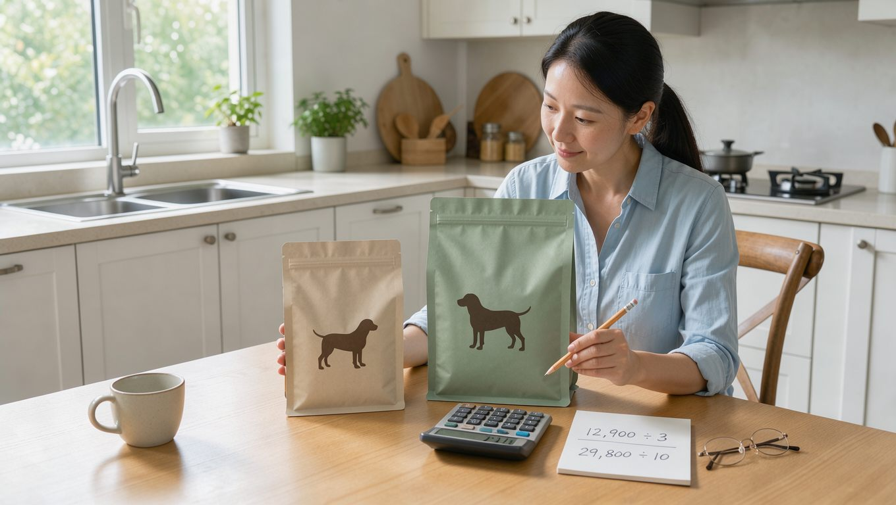
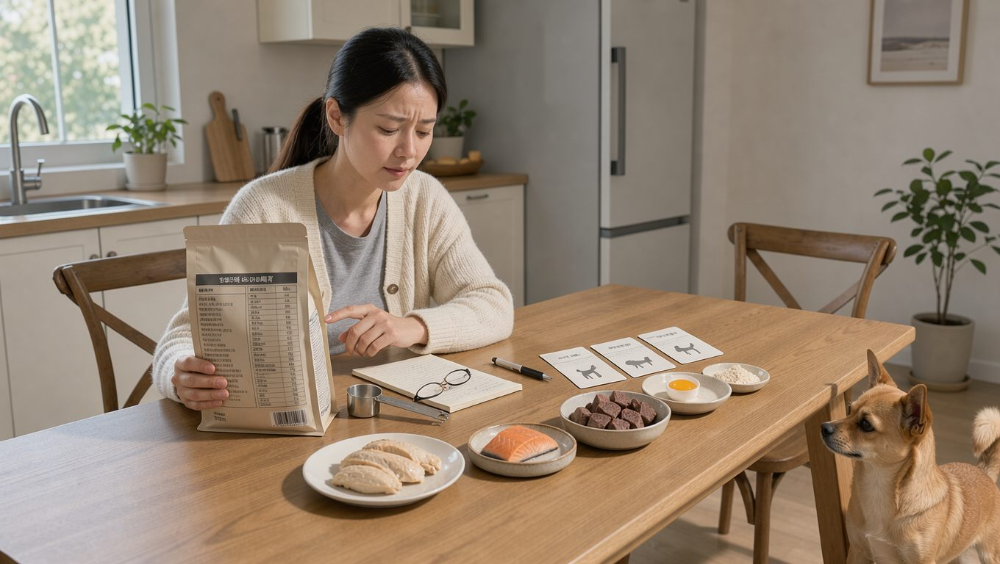
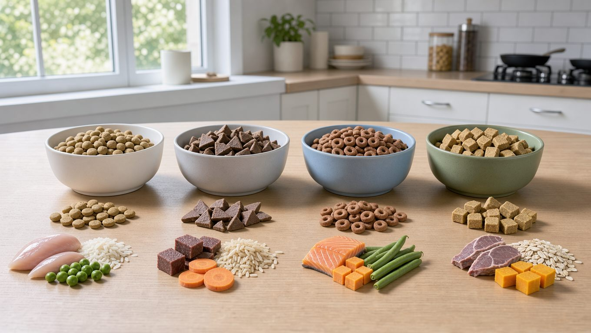
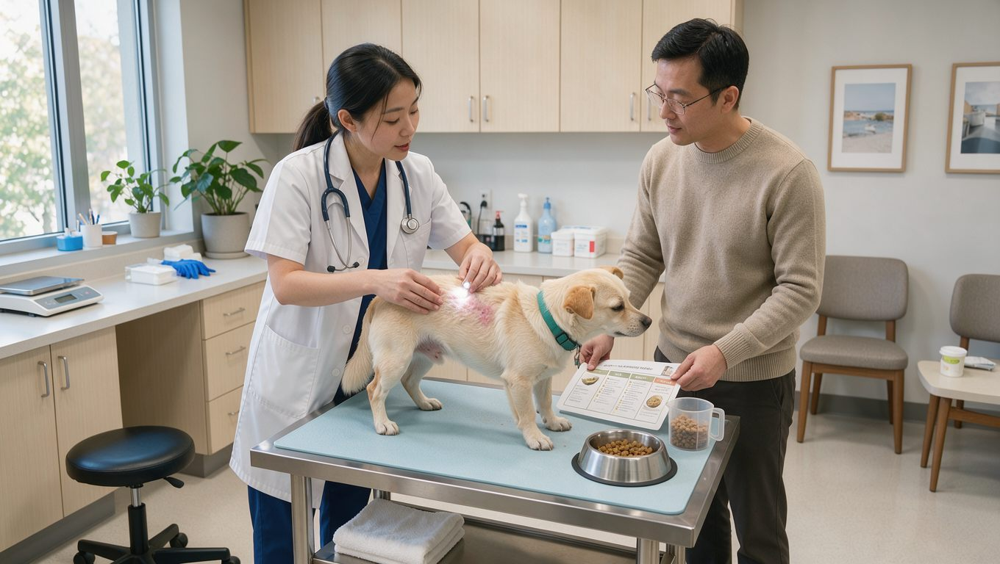
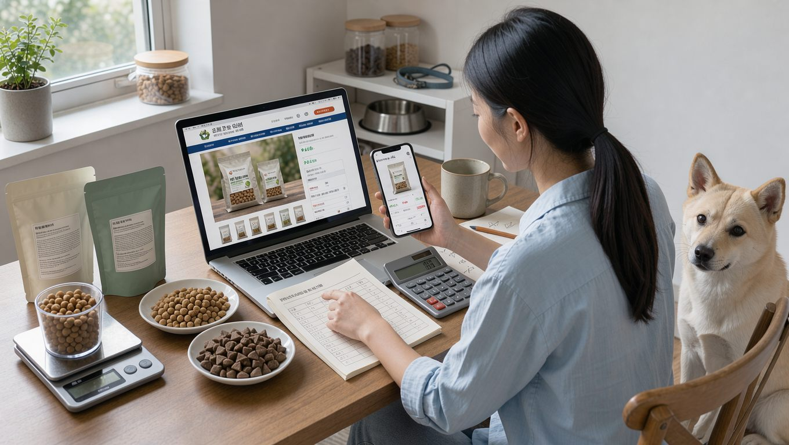
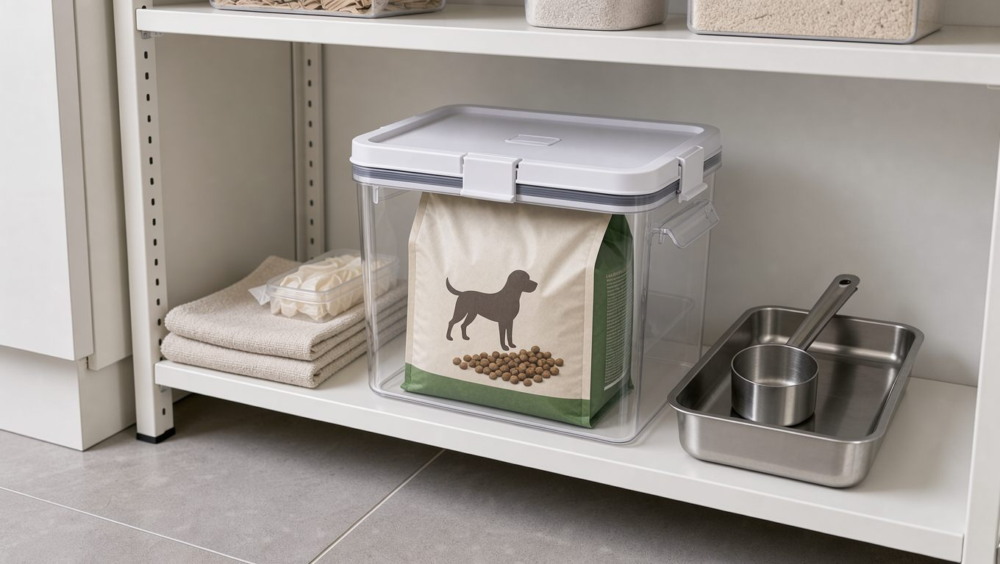

**2026년 11월 18일 기준**

## 빠른 답

**강아지 알레르기 사료, 성분만 보고 고르면 될까요?**
성분만으로는 부족합니다. 강아지에게 맞는 원료인지 확인하는 일과 함께, 장기간 부담 없이 급여할 수 있는 가격인지도 살펴야 합니다.

강아지를 키우다 보면 사료를 선택하는 일이 생각보다 쉽지 않다는 것을 느끼게 됩니다. 처음에는 기호성과 영양 성분, 가격 정도만 비교하면 된다고 생각하지만, 피부 가려움이나 소화 문제처럼 건강과 관련된 증상이 나타나면 사료를 고르는 기준 자체가 달라집니다.

특히 알레르기가 있는 강아지라면 더욱 그렇습니다. 알레르기 검사 결과를 확인하고, 기존에 먹던 사료의 원료를 살펴보며, 강아지에게 맞지 않을 수 있는 성분을 피하려다 보면 선택할 수 있는 사료가 점점 줄어듭니다.

문제는 이렇게 조건을 따져 사료를 찾다 보면 가격 부담도 함께 커진다는 점입니다.

우리 집 보더콜리 딱지도 이러한 고민을 하게 만든 계기가 있었습니다.

딱지는 양쪽 볼 주변이 가려운지 바닥이나 주변 물건에 얼굴을 비비는 일이 종종 있습니다. 반복해서 얼굴을 문지르는 모습을 보면 피부에 문제가 있는 것은 아닌지 걱정이 됩니다.

물론 얼굴을 비빈다는 이유만으로 사료 알레르기라고 단정할 수는 없습니다. 피부염이나 귀 질환, 눈 주변의 자극, 환경성 알레르기 등 다른 원인도 있을 수 있습니다.

이후 딱지의 알레르기 검사 결과를 살펴보고 현재 먹이고 있는 사료의 성분을 다시 확인하기 시작했습니다. 그 과정에서 가장 크게 느낀 것은 사료 선택이 생각보다 어렵다는 점이었습니다. 장기간 급여해야 하는 사료의 가격도 만만치 않았습니다.

## 1. 알레르기를 고려하자 사료 가격부터 부담스러워졌다

현재 딱지가 먹고 있는 사료는 닭고기를 주원료로 하는 제품입니다.

기존에 구매하던 제품은 13.6kg 한 포대 기준으로 약 14만~16만 원 정도였습니다.

중형견인 딱지가 매일 먹는 사료라는 점을 생각하면 적은 비용은 아닙니다. 그래도 대용량으로 구매할 수 있어 어느 정도 감당할 수 있는 수준이었습니다.

그런데 알레르기를 고려해 다른 사료를 알아보기 시작하니 상황이 달라졌습니다.

단순히 기호성이나 가격만 비교할 수 없었습니다. 알레르기 검사 결과와 원재료를 함께 확인해야 했고, 특정 단백질을 피하거나 다른 원료를 사용하는 제품을 찾아야 했습니다.

이렇게 조건을 하나씩 적용하다 보니 선택할 수 있는 제품은 줄어들고 가격은 더욱 부담스럽게 느껴졌습니다.

특히 소용량 기능성 사료나 동물병원 처방식은 일반 사료보다 가격이 높은 경우가 있어 장기간 급여해야 한다는 점을 생각하면 고민이 커집니다.

그러던 중 기존에 먹이던 사료와 다른 단백질을 주원료로 사용하는 제품을 발견했습니다. 가격도 비교적 부담이 적어 우선 소용량으로 구매해 보기로 했습니다.

이번에 구매한 제품의 가격은 다음과 같습니다.

<dl>
<dt>구매 용량</dt><dd>4kg</dd>
<dt>정상 판매 가격</dt><dd>49,000원</dd>
<dt>할인 구매 가격</dt><dd>39,000원</dd>
<dt>할인 가격 기준 1kg당</dt><dd>9,750원</dd>
<dt>정상 가격 기준 1kg당</dt><dd>12,250원</dd>
</dl>

정상 가격은 49,000원이지만 할인 행사 중이어서 39,000원에 구매할 수 있었습니다.

처음부터 대용량을 구매하지 않고 4kg만 주문한 이유도 있습니다. 새로운 사료가 딱지에게 잘 맞는지 아직 확인되지 않았기 때문입니다.

가격이 저렴하다고 처음부터 많은 양을 구매했다가 기호성이 떨어지거나 소화 문제가 생기면 오히려 낭비가 될 수 있습니다.

기존에 먹이던 사료와 이번에 새로 구매한 사료의 가격을 비교하면 다음과 같습니다.

<ul>
<li><strong>용량</strong>: 기존 사료는 13.6kg, 새로 알아본 사료는 4kg입니다.</li>
<li><strong>정상 가격</strong>: 기존 사료는 한 포대에 약 14만~16만 원, 새로 알아본 사료는 49,000원입니다.</li>
<li><strong>실제 구매 가격</strong>: 기존 사료는 약 14만~16만 원, 새로 알아본 사료는 할인가 39,000원입니다.</li>
<li><strong>1kg당 가격</strong>: 기존 사료는 약 10,300~11,800원, 새로 알아본 사료는 정상가 기준 12,250원, 할인가 기준 9,750원입니다.</li>
</ul>

단순히 1kg당 가격만 비교하면 할인 기간에는 새로 구매한 사료가 기존 사료보다 저렴합니다.

다만 할인 가격은 행사 기간에만 적용될 수 있으므로 정상 가격과 구분해서 생각해야 합니다.

또한 가격이 저렴하다는 이유만으로 더 좋은 사료라고 판단할 수는 없습니다. 실제 원재료 구성과 영양 성분, 기호성, 소화 상태 등을 함께 확인해야 합니다.

사료는 한 번 구매하고 끝나는 제품이 아닙니다. 매일 먹어야 하고, 건강상의 이유로 특정 사료를 계속 먹여야 한다면 그 비용은 장기간 누적됩니다.

결국 보호자에게 중요한 것은 강아지에게 적합한 성분을 갖추면서도 장기간 부담 없이 구매할 수 있는 사료를 찾는 일입니다.

## 2. 강아지 알레르기 사료, 어떤 성분을 확인해야 할까?

강아지의 식이 알레르기를 이야기할 때 가장 먼저 확인해야 하는 것은 단백질 원료입니다.

강아지의 식이 알레르기는 특정 식품에 포함된 단백질에 면역계가 반응하면서 나타나는 문제입니다. 따라서 알레르기가 의심되는 경우에는 사료에 포함된 동물성 단백질의 종류와 과거 급여 이력을 확인하는 것이 중요합니다 (PetMD).

대표적으로 확인할 수 있는 원료는 다음과 같습니다.

<ul>
<li><strong>닭고기</strong>: 닭고기, 닭고기분, 가금류 단백질</li>
<li><strong>소고기</strong>: 소고기, 소고기분, 소 유래 단백질</li>
<li><strong>유제품</strong>: 우유 단백질, 유청, 카제인</li>
<li><strong>계란</strong>: 전란분, 난백, 계란 단백질</li>
<li><strong>생선</strong>: 연어, 흰살생선, 어분</li>
<li><strong>대두</strong>: 대두 단백질, 콩 단백질</li>
<li><strong>밀</strong>: 밀 글루텐, 밀 단백질</li>
</ul>

여기서 중요한 것은 특정 원료가 모든 강아지에게 알레르기를 일으키는 것은 아니라는 점입니다.

닭고기가 알레르기 원인으로 자주 언급된다고 해서 모든 강아지가 닭고기를 피해야 하는 것은 아닙니다. 반대로 연어나 오리처럼 상대적으로 낯설게 느껴지는 단백질도 특정 강아지에게는 알레르기 원인이 될 수 있습니다 (AKC).

따라서 단순히 알레르기 유발 가능성이 높은 원료를 피하기보다는 해당 강아지가 과거에 어떤 사료와 간식을 먹었는지부터 확인하는 것이 중요합니다.

### 딱지의 알레르기 검사 결과는 어땠을까?

딱지는 2026년 알레르기 검사를 진행했습니다.

검사 결과에서 눈에 띄었던 항목은 다음과 같습니다.

<dl>
<dt>소고기</dt><dd>즉시형 Class 3, 매우 높음</dd>
<dt>양고기</dt><dd>즉시형 Class 3, 매우 높음</dd>
<dt>우유 관련 단백질</dt><dd>즉시형 Class 2, 높음</dd>
<dt>사슴고기</dt><dd>즉시형 Class 2, 높음</dd>
<dt>닭고기</dt><dd>음성</dd>
<dt>오리고기</dt><dd>음성</dd>
<dt>연어 등 생선</dt><dd>음성</dd>
<dt>달걀</dt><dd>음성</dd>
</dl>

이 결과를 참고해 기존 사료의 원료를 다시 살펴보게 됐습니다.

현재 먹이고 있는 닭고기 사료는 검사 결과에서 닭고기가 음성으로 확인됐습니다. 새롭게 알아본 사료도 오리고기와 연어가 음성으로 나온 원료를 사용하고 있어 관심을 갖게 됐습니다.

다만 여기서 주의할 점이 있습니다.

혈액을 이용한 IgE 또는 IgG 검사 결과만으로 실제 식이 알레르기를 확진할 수 있는 것은 아닙니다. 검사에서 양성이 나왔다고 반드시 해당 음식을 먹었을 때 증상이 발생하는 것도 아니며, 음성이라고 해서 알레르기 가능성이 완전히 배제되는 것도 아닙니다. 따라서 검사 결과는 사료 원료를 살펴보는 참고 자료로 활용하고, 실제 식이 알레르기 여부는 수의사의 지도에 따른 식이 제거 시험으로 확인하는 것이 중요합니다 (일리노이 대학 수의대).

### 주원료만 확인하면 충분할까?

사료를 구매할 때 제품 앞면에 표시된 주원료만 확인하는 경우가 많습니다.

예를 들어 연어 사료라고 표시되어 있다면 연어를 주요 단백질로 사용했다고 생각하기 쉽습니다.

하지만 실제 원재료 목록에는 닭고기 지방, 가금류 부산물, 계란, 유청 등 다른 원료가 함께 들어 있을 수 있습니다.

다만 닭고기 지방처럼 정제된 지방 원료는 단백질이 거의 제거되어 있을 수 있으므로, 원료명이 있다는 이유만으로 알레르기 단백질이 반드시 포함되어 있다고 판단해서도 안 됩니다.

따라서 제품명이나 대표 원료만 보고 판단해서는 안 됩니다.

사료를 비교할 때는 다음 항목을 함께 확인하는 것이 좋습니다.

1. 동물성 단백질의 종류
2. 육류 및 어류 부산물 포함 여부
3. 가금류 단백질이나 동물성 단백질의 포괄적인 표기 여부
4. 계란 및 유제품 포함 여부
5. 식물성 단백질 원료
6. 제조사에서 공개하는 상세 원료 정보

특히 원재료에 단순히 동물성 단백질 또는 동물성 지방이라고 표시되어 있다면 구체적으로 어떤 동물에서 유래했는지 확인할 필요가 있습니다.

제조사에 문의해 원료의 출처와 제조 과정에서 다른 단백질이 혼입될 가능성까지 확인하는 것도 좋은 방법입니다. 사료 봉투 표기를 처음부터 읽어 보는 순서는 [강아지 사료 고르기](/guides/choosing-dog-food/) 가이드에서 확인할 수 있습니다.

## 3. 그레인프리와 저알레르기 사료는 같은 의미가 아니다

사료를 검색하다 보면 그레인프리(Grain Free)라는 표현을 자주 접하게 됩니다.

곡물을 사용하지 않았다는 의미이기 때문에 알레르기에도 좋을 것이라고 생각하기 쉽습니다.

하지만 그레인프리와 저알레르기 사료는 서로 다른 개념입니다 (AKC).

그레인프리는 밀, 옥수수, 쌀 등의 곡물을 사용하지 않았거나 제한했다는 의미입니다. 그렇다고 해서 닭고기나 소고기 등 동물성 단백질이 제거된 것은 아닙니다.

반대로 곡물이 포함되어 있더라도 특정 단백질을 피하도록 설계된 사료가 있을 수 있습니다.

따라서 다음 표현들을 구분해서 이해할 필요가 있습니다.

<dl>
<dt><strong>그레인프리(Grain Free)</strong></dt>
<dd>곡물을 사용하지 않거나 제한한 사료입니다. 특정 곡물에 대한 알레르기가 확인된 강아지라면 고려할 수 있지만, 이것만으로 식이 알레르기 대응 사료라고 볼 수는 없습니다.</dd>
<dt><strong>리미티드 인그리디언트(Limited Ingredient)</strong></dt>
<dd>사용하는 원료의 종류를 제한한 사료입니다. 단백질과 탄수화물 원료를 비교적 단순하게 구성해 특정 원료를 피하는 데 도움을 줄 수 있습니다. 다만 일반 판매 제품은 제조 과정에서 다른 단백질이 혼입될 가능성까지 완전히 배제한다고 볼 수 없습니다 (PetMD).</dd>
<dt><strong>노벨 프로틴(Novel Protein)</strong></dt>
<dd>강아지가 과거에 먹어본 적이 없는 새로운 단백질을 사용하는 방식입니다. 예를 들어 기존에 닭고기와 소고기가 포함된 사료를 오랫동안 먹었다면, 과거 급여 이력을 확인한 뒤 새로운 단백질을 고려할 수 있습니다. 단, 새로운 단백질이라고 해서 무조건 알레르기 반응이 없는 것은 아닙니다. 과거에 먹어본 적이 있는지 확인하는 것이 중요합니다.</dd>
<dt><strong>가수분해 단백질(Hydrolyzed Protein)</strong></dt>
<dd>단백질을 작은 펩타이드 조각으로 분해해 면역계가 해당 단백질에 반응할 가능성을 낮추도록 설계한 사료입니다. 식이 알레르기가 의심되는 강아지의 진단 과정에서 수의사가 선택하는 대표적인 식이 관리 방법입니다. 다만 가수분해 정도와 사용한 원료에 따라 차이가 있으므로 모든 가수분해 사료가 동일한 효과를 보장하는 것은 아닙니다 (일리노이 대학 수의대).</dd>
</dl>

## 4. 사료 알레르기는 어떻게 확인해야 할까?

강아지가 가렵다고 해서 무조건 사료를 바꾸는 것이 정답은 아닙니다.

피부 가려움은 식이 알레르기 외에도 환경 알레르기, 벼룩이나 진드기, 세균성 피부염, 곰팡이성 질환, 귀 질환 등 다양한 원인으로 나타날 수 있습니다.

특히 딱지처럼 양쪽 볼이나 얼굴 주변을 반복해서 비빈다면 피부뿐 아니라 귀와 눈 주변의 상태도 확인해야 합니다.

식이 알레르기가 의심된다면 수의사와 상담하고 식이 제거 시험을 진행하는 것이 가장 신뢰할 수 있는 방법입니다.

### 식이 제거 시험이란?

식이 제거 시험은 기존에 먹던 사료를 중단하고, 과거에 먹어본 적이 없는 단백질을 사용한 식단이나 가수분해 처방식을 일정 기간 급여하면서 증상 변화를 관찰하는 방법입니다.

피부 증상이 있는 강아지의 경우 일반적으로 최소 8주 정도 진행하며, 증상과 반응에 따라 12주까지 진행하기도 합니다 (일리노이 대학 수의대).

이 기간에는 선택한 사료만 급여해야 합니다.

주의해야 할 것은 사료만 바꾸면 되는 것이 아니라는 점입니다.

- 기존에 먹던 간식
- 육포와 개껌
- 사람이 먹는 음식
- 다른 단백질이 포함된 영양제
- 향이나 단백질 성분이 포함된 약과 보조제

이러한 것들도 식이 제거 시험 결과에 영향을 줄 수 있습니다.

실제로 식이 제거 시험을 진행할 때 어려운 부분 중 하나는 간식이나 사람이 먹는 음식을 함께 통제하는 일입니다. 시험을 시작하기 전에 가족 모두에게 급여 규칙을 공유하고, 사료와 간식 급여 여부를 기록해 두면 도움이 됩니다.

또한 새로운 사료를 먹이고 증상이 좋아졌다고 해서 곧바로 알레르기 원인이 확인된 것은 아닙니다.

기존 사료를 다시 급여했을 때 증상이 재발하는지 확인하는 식이 유발 시험까지 거쳐야 식이 알레르기를 보다 확실하게 판단할 수 있습니다.

앞서 살펴본 혈액검사나 털, 침 등을 이용한 검사는 식이 알레르기를 확진하는 방법으로 충분히 검증되지 않았습니다.

결국 무작정 여러 사료를 구매해 바꿔 먹이는 것보다 수의사와 함께 원인을 좁혀가는 편이 시간과 비용을 절약할 수 있습니다.

## 5. 저렴하면서 성분이 괜찮은 사료는 어디서 찾아야 할까?

사료를 알아보면서 개인적으로 가장 답답하게 느꼈던 부분입니다.

알레르기를 고려해 사료를 찾다 보면 비싼 제품이 먼저 눈에 들어옵니다. 그렇다고 무조건 비싼 사료만 선택해야 하는 것은 아닐 것입니다.

국내에서 판매되는 사료 외에도 해외에는 다양한 리미티드 인그리디언트 제품과 노벨 프로틴 제품이 있습니다.

문제는 제품을 발견하는 것과 실제로 구매하는 것이 다르다는 점입니다.

해외 제조사 홈페이지에서 성분을 확인하고 마음에 드는 제품을 발견해도 국내 판매처가 없거나 해외 직구를 이용해야 하는 경우가 있습니다.

또한 국내 판매 제품이라고 해도 제조사에서 제공하는 상세 원료 정보가 충분하지 않으면 비교하기가 쉽지 않습니다.

이러한 상황에서 활용할 수 있는 구매 경로를 살펴보겠습니다.

### ① 국내 공식 수입사 및 브랜드 공식 판매처

가장 먼저 확인할 곳입니다.

해외 브랜드의 국내 공식 수입사가 있다면 제품의 원료 구성과 국내 판매 제품의 정보를 확인하기 쉽습니다.

공식 수입사에 문의할 때는 단순히 알레르기 사료가 있는지 묻기보다 다음 내용을 구체적으로 확인하는 것이 좋습니다.

- 전체 원재료 목록
- 단백질의 구체적인 출처
- 다른 동물성 단백질의 혼입 가능성
- 국내 판매 제품과 해외 제품의 성분 차이
- 대용량 제품의 판매 여부

특히 알레르기 관리를 목적으로 구매한다면 제조 과정에서 다른 단백질이 혼입될 가능성이 있는지도 문의할 필요가 있습니다.

### ② 쿠팡과 네이버쇼핑

국내에서 사료를 비교하고 구매하기 편리한 경로입니다.

검색할 때는 단순히 강아지 알레르기 사료라고 검색하는 것보다 다음과 같이 구체적인 검색어를 활용하는 것이 좋습니다.

- 강아지 리미티드 인그리디언트 사료
- 강아지 가수분해 단백질 사료
- 강아지 노벨 프로틴 사료
- 강아지 단일 단백질 사료
- 강아지 연어 단일 단백질 사료
- 강아지 토끼고기 사료
- 강아지 캥거루 단백질 사료

검색 결과에서 가격만 비교하지 말고 판매처와 원산지, 원재료 표시, 유통기한, 정식 수입 여부를 함께 확인해야 합니다.

특히 해외 직구 상품은 국내 공식 수입 제품과 원료 구성이나 표시 사항이 다를 수 있으므로 동일한 제품명이라는 이유만으로 같은 사료라고 판단하지 않는 것이 좋습니다.

### ③ 해외 공식 홈페이지와 해외 판매처

국내에서 구하기 어려운 사료를 찾을 때 활용할 수 있습니다.

해외 브랜드 홈페이지에서는 국내 판매처보다 다양한 제품군을 확인할 수 있고, 상세한 원료 정보와 영양 성분을 제공하는 경우도 있습니다.

다만 해외 홈페이지에서 판매한다고 해서 국내로 바로 배송할 수 있는 것은 아닙니다.

구매 전에 다음 사항을 확인해야 합니다.

- 한국 배송 가능 여부
- 국내 수입 및 통관 가능 여부
- 배송비와 관세 등 추가 비용
- 제품의 유통기한과 보관 상태
- 제조사 또는 판매처의 신뢰도
- 국내에서 지속적으로 재구매할 수 있는지

특히 한 번 먹여보고 잘 맞았더라도 다음 구매가 어려운 제품이라면 장기적인 식단으로 선택하기 어렵습니다.

### ④ 동물병원 처방식

식이 알레르기를 정확하게 확인하기 위한 제거 시험을 진행한다면 동물병원에서 권하는 처방식을 고려할 수 있습니다.

수의사가 권하는 알레르기 진단용 처방식은 원료뿐 아니라 제조 과정에서 다른 단백질이 혼입될 가능성까지 고려해 선택하는 것이 중요합니다.

일반 판매용 리미티드 인그리디언트 사료는 제조 방식에 따라 교차 혼입 가능성이 다를 수 있습니다.

가격은 부담스러울 수 있지만, 알레르기 진단을 위한 식이 제거 시험에서는 일반 판매용 사료보다 적합한 선택이 될 수 있습니다.

무조건 저렴한 사료를 찾기보다는 진단 단계와 장기 관리 단계를 구분하는 것이 현실적입니다.

## 6. 사료 가격은 어떻게 비교해야 할까?

사료를 구매할 때는 포대 가격만 비교해서는 안 됩니다.

같은 2kg 제품이라도 하루 급여량이 다르면 실제 한 달 사료 비용이 달라집니다.

예를 들어 A 제품은 2kg에 6만 원이고 B 제품은 2kg에 5만 원이라고 가정해 보겠습니다.

B 제품이 저렴해 보이지만 하루 급여량이 더 많다면 실제 비용 차이는 생각보다 작을 수 있습니다.

따라서 다음 세 가지를 함께 확인하는 것이 좋습니다.

1. 1kg당 가격
2. 강아지 체중과 활동량에 따른 하루 권장 급여량
3. 하루 급여량을 기준으로 계산한 실제 하루 사료 비용

계산 방법은 간단합니다.

**하루 사료 비용 = 사료 1kg당 가격 × 하루 급여량(g) ÷ 1,000**

예를 들어 1kg당 30,000원인 사료를 하루 250g 급여한다면 하루 사료 비용은 7,500원입니다. 한 달이면 약 225,000원입니다.

이번에 구매한 사료도 같은 방법으로 계산할 수 있습니다. 할인 구매 가격인 1kg당 9,750원을 기준으로 하루 250g을 급여한다고 가정하면 하루 사료 비용은 약 2,438원입니다.

다만 실제 급여량은 제품의 열량과 딱지의 체중, 활동량, 체형에 따라 달라지므로 단순 계산을 실제 급여 비용으로 확정해서는 안 됩니다.

이처럼 실제 급여량을 기준으로 계산하면 사료를 선택할 때 훨씬 현실적인 비교가 가능합니다. 체중과 활동량을 넣어 하루 급여량을 g 단위로 계산하려면 [사료량 계산기](/tools/dog-food-amount/)를 활용할 수 있습니다.

또한 할인 가격만으로 장기적인 사료 비용을 계산하지 않는 것도 중요합니다. 행사가 끝나면 정상 가격으로 구매해야 할 수 있기 때문입니다.

결국 사료를 비교할 때는 정상 가격과 할인 가격을 구분하고, 지속적으로 구매할 수 있는 가격인지 확인해야 합니다.

## 7. 대용량 사료가 항상 좋은 선택은 아닐까?

중형견이나 대형견을 키우는 보호자에게 대용량 사료는 상당히 매력적입니다.

같은 제품이라도 소용량보다 대용량의 1kg당 가격이 저렴한 경우가 많기 때문입니다.

하지만 알레르기가 의심되는 강아지라면 처음부터 대용량을 구매하는 것은 신중해야 합니다.

새로운 사료가 강아지에게 맞는지 확인되지 않은 상태에서 대량으로 구매하면 문제가 생길 수 있습니다.

이번에 새로운 사료를 4kg만 구매한 것도 같은 이유입니다.

가격이 괜찮다고 처음부터 대용량을 구매하기보다는 우선 소용량으로 시작해 딱지의 반응을 살펴보는 편이 합리적이라고 판단했습니다.

다만 새로운 사료를 급여하기 전에는 전체 원재료와 영양 성분을 확인할 필요가 있습니다.

특히 식이 제거 시험을 진행하려는 경우라면 일반 판매용 사료를 임의로 선택하기보다는 수의사와 먼저 상의해야 합니다.

또한 사료를 개봉한 뒤에는 보관 상태도 중요합니다.

고온다습한 환경이나 공기에 오래 노출되는 장소에 보관하면 품질이 저하될 수 있습니다.

구매할 때는 다음과 같은 방법을 고려할 수 있습니다.

- 처음에는 소용량으로 구매해 기호성과 소화 상태를 확인하기
- 문제가 없고 수의사가 권한 식단 관리에 적합하다면 지속 급여 여부 판단하기
- 대용량 제품은 실제로 잘 맞는다는 것을 확인한 뒤 구매하기
- 개봉 후에는 원래 포장 상태를 유지하면서 공기와 습기를 차단하기
- 직사광선을 피하고 서늘하고 건조한 곳에 보관하기
- 유통기한과 제조일자를 확인하기

다만 식이 제거 시험 중이라면 단순한 기호성 확인을 위해 여러 제품을 번갈아 먹이지 말고, 선택한 식단을 일관되게 유지해야 합니다.

## 8. 결국 필요한 것은 비싼 사료가 아니라 지속 가능한 사료

반려견을 키우는 보호자라면 누구나 건강에 좋은 것을 먹이고 싶을 것입니다.

특히 피부 질환이나 알레르기가 의심되는 경우에는 조금이라도 더 적합한 사료를 찾아보게 됩니다.

하지만 건강을 위해 선택해야 하는 사료가 지나치게 비싸다면 장기간 유지하기 어렵습니다.

2kg에 6만~7만 원인 사료를 구매하는 것은 한두 번이라면 가능할 수 있습니다. 하지만 중형견이 매달 소비하는 양을 생각하면 단순한 사료 교체가 아니라 생활비 전체에 영향을 주는 문제가 됩니다.

그렇다고 가격이 저렴하다는 이유만으로 성분이 불분명한 제품을 선택할 수도 없습니다.

보호자에게 필요한 것은 다음과 같은 조건을 만족하는 사료입니다.

- 강아지가 피해야 할 원료가 명확하게 확인될 것
- 제조사에서 상세한 원료 정보를 공개할 것
- 제조 과정의 교차 혼입 가능성을 확인할 수 있을 것
- 영양적으로 균형 잡힌 완전사료일 것
- 국내에서 안정적으로 재구매할 수 있을 것
- 중형견도 장기간 급여할 수 있는 가격일 것

특히 알레르기 진단을 위한 식이 제거 시험과 진단 이후의 장기적인 식단 관리는 구분할 필요가 있습니다.

처음에는 수의사의 도움을 받아 정확한 원인을 확인하고, 이후에는 확인된 원료를 피하면서 영양과 가격을 모두 고려한 사료를 찾는 것이 바람직합니다.

## 마무리: 강아지 사료 선택, 가격과 건강 사이에서

딱지의 양쪽 볼 주변 가려움이 정말 사료 때문인지는 아직 확인되지 않았습니다.

다만 이번 일을 계기로 알레르기 검사 결과와 사료의 원료, 식이 관리 방법을 다시 살펴보게 됐습니다.

현재 딱지는 닭고기를 주원료로 하는 사료를 먹고 있습니다. 이번에는 다른 선택지를 알아보던 중 오리고기와 연어를 주원료로 하는 사료를 4kg 구매했습니다.

검사 결과에서 오리고기와 연어가 음성으로 확인된 점을 참고했지만, 실제로 딱지에게 잘 맞을지는 아직 알 수 없습니다.

사료를 찾아보면서 느낀 것은 생각보다 많은 보호자가 비슷한 고민을 할 수 있겠다는 점입니다.

강아지에게 맞는 사료를 찾는 일은 단순히 좋은 제품을 하나 구매하는 것으로 끝나지 않습니다. 성분을 확인하고, 원료를 비교하고, 실제로 구매할 수 있는 판매처를 찾고, 장기간 급여할 수 있는 비용까지 계산해야 합니다.

특히 중형견이나 대형견을 키우는 보호자라면 소용량 고가 제품만으로는 현실적인 대안을 찾기 어렵습니다.

저 역시 딱지에게 맞는 사료를 찾는 과정에서 성분만큼이나 가격과 구매의 지속 가능성이 중요하다는 것을 느꼈습니다.

알레르기가 있는 강아지를 키우고 있다면 어떤 사료를 먹이고 있는지뿐 아니라 해당 사료의 원료가 무엇인지, 제조사가 얼마나 구체적인 정보를 제공하는지, 그리고 장기간 부담 없이 구매할 수 있는지도 함께 살펴보시면 좋겠습니다.

**강아지에게 좋은 사료란 단순히 가격이 비싼 사료가 아니라, 건강에 적합하면서도 보호자가 꾸준히 급여할 수 있는 사료가 아닐까요?**

## 자주 묻는 질문

### 강아지 알레르기 사료는 처방식이어야 하나요?

진단을 위한 식이 제거 시험 단계에서는 수의사가 권하는 처방식이 적합할 수 있습니다. 진단이 끝난 뒤에는 확인된 원료를 피하면서 영양과 가격을 함께 고려한 일반 사료로 관리하는 방법도 있습니다.

### 그레인프리 사료로 바꾸면 알레르기가 좋아지나요?

그레인프리는 곡물을 사용하지 않았거나 제한한 사료일 뿐, 알레르기 대응 사료와 같은 뜻이 아닙니다. 강아지에게 문제가 되는 원료가 동물성 단백질이라면 그레인프리 제품만으로는 해결되지 않습니다.

### 사료 가격은 무엇을 기준으로 비교해야 하나요?

포대 가격보다 1kg당 가격과 실제 하루 급여량을 기준으로 비교하는 것이 좋습니다. 할인 가격은 행사가 끝나면 사라질 수 있으므로 정상 가격으로도 계속 구매할 수 있는지 확인해야 합니다.

### 알레르기 검사에서 양성이 나온 원료는 무조건 피해야 하나요?

검사 결과는 참고 자료입니다. 양성이라고 해서 반드시 증상이 나타나는 것은 아니며, 실제 식이 알레르기 여부는 수의사의 지도에 따른 식이 제거 시험으로 확인해야 합니다.

## 출처

- [Cooking Up a Food Allergy: Conducting a Diagnostic Food Trial](https://vetmed.illinois.edu/2026/01/22/diagnostic-food-trial-guidelines/) (일리노이 대학 수의대 — 식이 제거 시험 기간·검사 신뢰도·가수분해 단백질)
- [What Is a Limited Ingredient Dog Food?](https://www.petmd.com/dog/nutrition/limited-ingredient-dog-food-it-right-your-dog) (PetMD — 리미티드 인그리디언트의 정의와 교차 혼입 주의)
- [Can Dogs Eat Wheat and Other Grains?](https://www.akc.org/expert-advice/nutrition/can-dogs-eat-wheat/) (AKC — 흔한 알레르기 원료와 그레인프리 통념)

표지와 본문 이미지는 AI로 생성했습니다.
