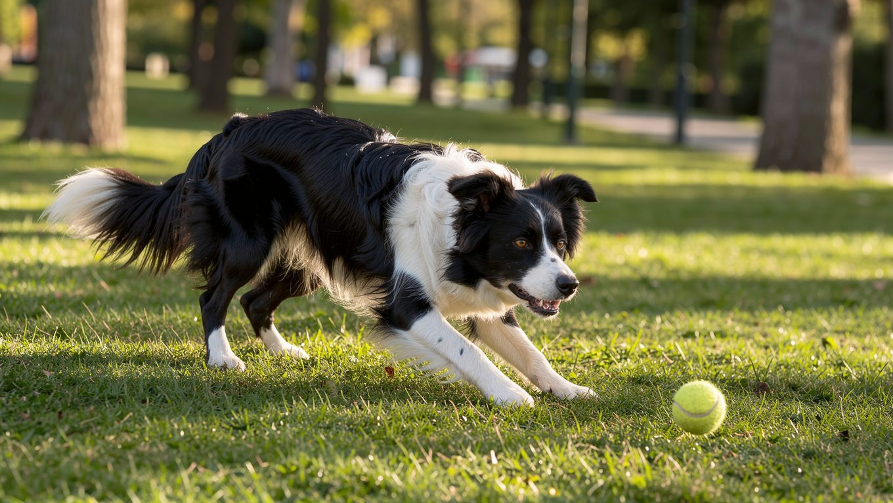
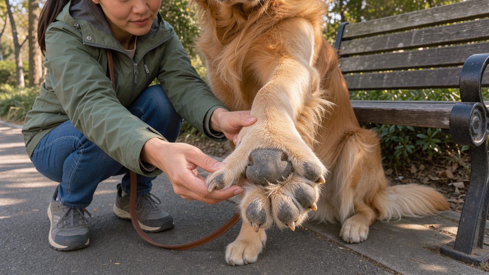
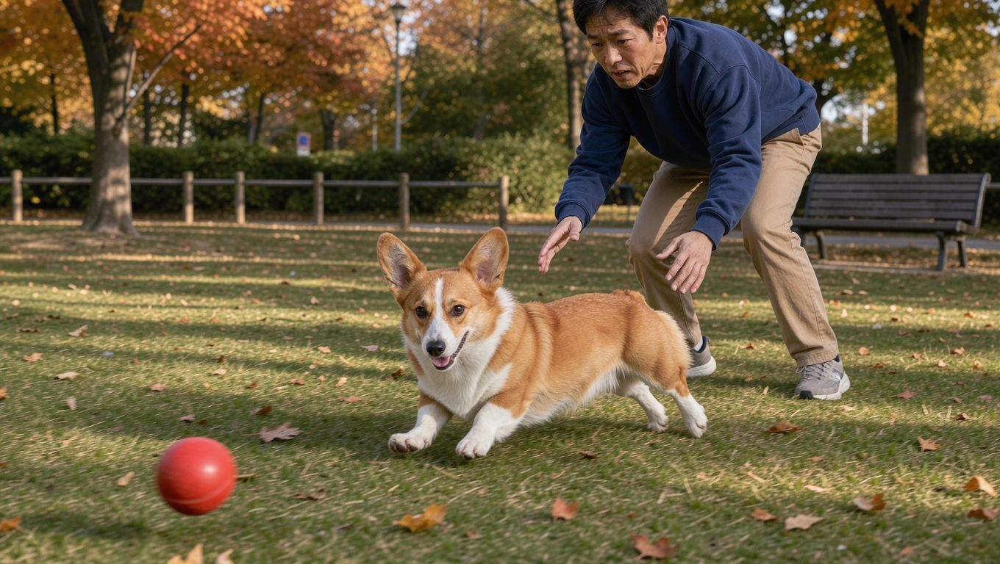
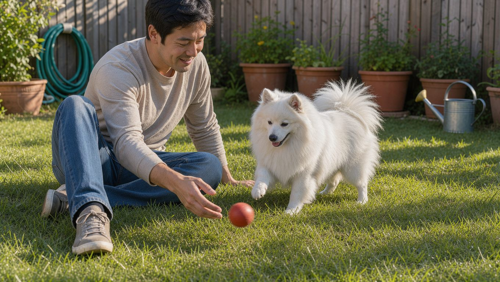
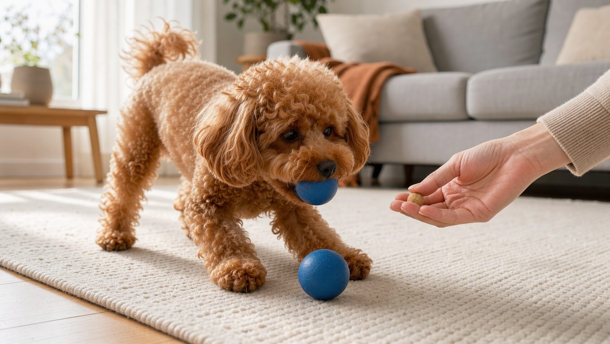
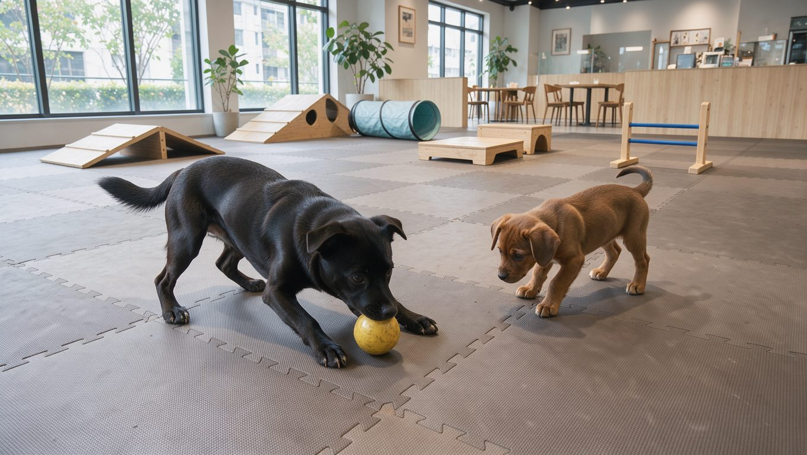
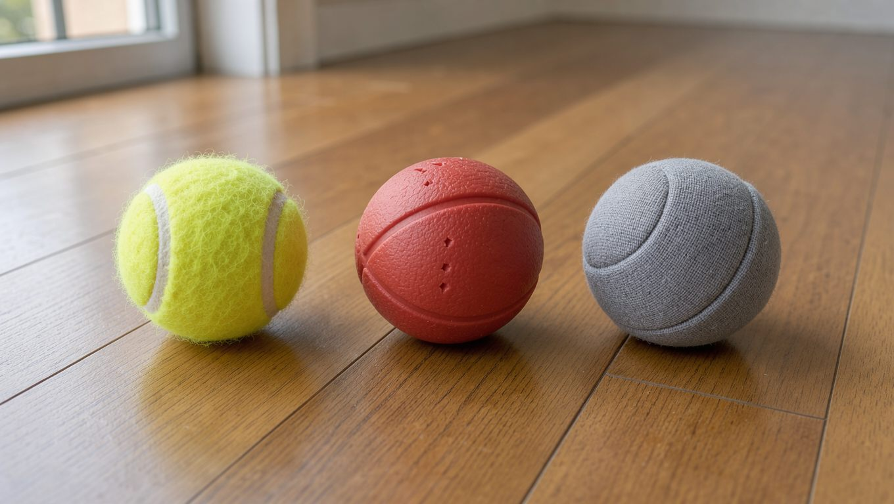

강아지에게 공놀이는 단순한 신체 활동을 넘어 보호자와 교감하고 즐거움을 느낄 수 있는 놀이입니다. 공을 던지면 빠르게 달려가 물어오는 모습은 많은 보호자가 좋아하는 장면이기도 합니다.

하지만 공놀이를 좋아한다고 해서 무조건 오래, 많이 뛰게 하는 것이 좋은 것은 아닙니다. 공을 쫓는 데 지나치게 집중하면 발바닥에 상처가 생기거나 무리하게 방향을 바꾸면서 관절과 근육에 부담을 줄 수 있습니다.

특히 공을 잡기 위해 급하게 달리고 방향을 바꾸는 행동은 보호자가 유심히 살펴봐야 합니다. 강아지가 통증을 바로 표현하지 않거나 다친 상태에서도 놀이를 계속하려는 경우가 있기 때문입니다.

이 글에서는 안전한 공놀이 방법부터 공 선택, 물어오기 훈련, 여러 강아지가 함께 있는 공간에서 공놀이할 때 주의할 점까지 살펴보겠습니다.

## 1. 강아지가 공놀이를 좋아하는 이유

공을 쫓고 물어오는 행동은 강아지의 추적 본능과 놀이 욕구를 자극합니다. 움직이는 공을 발견하면 달려가고, 입으로 물어오는 과정에서 성취감을 느끼기도 합니다.

특히 [보더콜리](/breeds/border-collie/)처럼 활동량이 많은 견종이나 움직이는 물체에 관심이 많은 강아지는 공놀이에 강한 흥미를 보일 수 있습니다.

딱지도 생후 3개월 무렵부터 공놀이를 좋아했습니다. 그때의 영상입니다.



[유튜브에서 보기](https://www.youtube.com/shorts/KctS2eKImCk)

다만 모든 강아지가 공놀이를 좋아하는 것은 아닙니다. 공에 관심이 없거나 쫓아가는 활동보다 냄새를 맡고 주변을 탐색하는 것을 더 좋아하는 강아지도 있습니다.

공놀이를 좋아하더라도 흥분한 상태에서 무리하게 뛰지 않도록 조절하는 것이 중요합니다.

## 2. 공놀이 중 발생할 수 있는 부상과 주의사항

공놀이는 짧은 시간에도 강아지에게 상당한 운동량을 요구합니다. 특히 공을 향해 빠르게 달려가거나 갑자기 멈추고 방향을 바꾸는 동작이 반복되면 발바닥과 다리에 부담이 생길 수 있습니다.

### 발바닥 패드 손상

강아지의 발바닥 패드는 달리거나 걷는 동안 지면과 직접 접촉하는 부위입니다. 거친 바닥이나 마찰이 큰 환경에서 반복적으로 달리면 패드가 벗겨지거나 상처가 생길 수 있습니다.

실제로 공놀이를 좋아하는 딱지도 발바닥 패드가 손상된 경험이 있습니다.

공을 잡기 위해 빠르게 달리고 급하게 방향을 바꾸는 행동을 반복하다 보니 네 발 중 세 발의 패드가 벗겨졌습니다. 더 주의해야 했던 점은 딱지가 이런 상태에서도 공놀이를 계속하려 했다는 것입니다.

처음부터 눈에 띄게 절뚝거리지는 않았기 때문에 유심히 관찰하지 않았다면 상처를 발견하기 어려웠을 수도 있습니다. 다행히 조금이라도 절뚝이는 모습이 보여 바로 발을 확인했고, 그 즉시 공놀이를 중단했습니다.

이 경험 이후에는 공놀이를 할 때 달리는 거리와 방향 전환을 줄이는 방식으로 바꿨습니다.

공을 멀리 던져 무작정 쫓아가게 하는 대신, 강아지가 무리하지 않고 공을 받을 수 있는 가까운 위치로 던져줍니다. 공을 잘 받아오도록 유도하면서 달리는 속도와 움직임을 조절하는 놀이를 하는 것입니다.

공놀이를 마친 뒤에는 발바닥 패드에 벗겨진 부분이나 상처가 없는지 확인하는 습관도 중요합니다.

### 급격한 방향 전환과 무리한 움직임

공을 향해 달려가는 강아지는 공이 움직이는 방향에 맞춰 갑자기 몸을 틀기도 합니다.

특히 빠른 속도로 달리다가 급하게 멈추거나 좌우로 방향을 바꾸는 동작은 관절과 근육에 부담을 줄 수 있습니다.

다음과 같은 행동이 반복된다면 놀이 방식을 조절해야 합니다.

- 달리다가 갑자기 급정거하는 행동
- 공을 잡기 위해 몸을 크게 비트는 행동
- 좌우로 급하게 방향을 바꾸는 행동
- 점프한 뒤 불안정하게 착지하는 행동
- 놀이 도중 절뚝이거나 움직임이 달라지는 모습

공놀이 중에는 강아지의 움직임을 관찰해야 합니다. 평소보다 걸음이 불안정하거나 특정 발을 들고 걷는다면 즉시 놀이를 중단하고 상태를 확인해야 합니다.

발바닥 패드가 벗겨졌거나 출혈이 있는 경우에는 추가적인 운동을 피하고 동물병원에서 진료받는 것이 좋습니다.

## 3. 강아지에게 안전한 공놀이 방법

공놀이를 안전하게 즐기려면 공을 얼마나 멀리 던지는지보다 강아지가 무리하지 않고 놀이를 이어갈 수 있는 환경을 만드는 것이 중요합니다.

### 공을 너무 멀리 던지지 않기

공을 멀리 던지면 강아지는 공을 잡기 위해 빠르게 달려가야 합니다. 공을 향해 달리는 과정에서 급정거나 방향 전환이 반복될 수도 있습니다.

따라서 처음부터 먼 거리를 달리게 하기보다는 가까운 거리에서 공을 주고받는 방식으로 시작하는 것이 좋습니다.

강아지가 공을 안정적으로 받을 수 있는 위치에 던지고, 잘 받아오면 다시 던져주는 방식으로 놀이를 진행할 수 있습니다.

### 미끄럽지 않은 장소 선택하기

공놀이 장소도 중요합니다.

바닥이 지나치게 딱딱하거나 미끄러운 곳에서는 달리거나 방향을 바꿀 때 발이 미끄러질 수 있습니다. 반대로 거친 바닥에서는 발바닥 패드에 마찰이 생길 수 있습니다.

다음과 같은 사항을 확인하는 것이 좋습니다.

- 바닥이 지나치게 미끄럽지 않은지
- 돌이나 날카로운 물체가 없는지
- 바닥 표면이 지나치게 거칠지 않은지
- 강아지가 자유롭게 움직일 공간이 있는지
- 다른 강아지나 장애물과 충돌할 위험은 없는지

### 짧게 나누어 놀기

공놀이에 집중하는 강아지는 피곤하거나 발에 불편함이 있어도 놀이를 계속하려 할 수 있습니다.

따라서 강아지가 스스로 멈추기를 기다리기보다 보호자가 중간에 휴식 시간을 만들어 주는 것이 좋습니다.

놀이 시간은 강아지의 나이와 체력, 건강 상태, 바닥 환경에 따라 조절해야 합니다. 일률적으로 정해진 시간보다 강아지의 움직임과 호흡, 피로 신호를 살펴보는 것이 중요합니다.

견종과 나이에 따른 운동량 기준은 [강아지 하루 운동량 가이드](/guides/dog-exercise-amount/)에 정리되어 있습니다.

## 4. 강아지가 공을 물어오지 않을 때 훈련하는 방법

공을 던져주면 잘 쫓아가지만 물어온 공을 보호자에게 돌려주지 않는 강아지도 있습니다.

공을 물고 다른 곳으로 이동하거나 자신이 원하는 장소에 자리를 잡고 공을 가지고 놀려고 하는 행동입니다.

이런 경우 무조건 공을 빼앗으려 하기보다 공을 돌려주면 다시 놀이가 시작된다는 것을 알려주는 것이 좋습니다.

### 공을 놓는 행동 가르치기

처음에는 공을 짧은 거리로 던지고 강아지가 공을 물어오도록 유도합니다.

공을 가지고 돌아왔을 때 간식이나 다른 보상을 활용해 공을 놓는 행동을 유도할 수 있습니다.

1. 강아지가 공을 물고 돌아오도록 유도합니다.
2. 공을 놓도록 간식이나 다른 보상을 보여줍니다.
3. 공을 놓으면 즉시 칭찬하고 보상합니다.
4. 공을 다시 던져주며 놀이를 이어갑니다.

이 과정을 반복하면 공을 놓는 행동이 놀이를 끝내는 것이 아니라 다시 시작하게 해주는 행동이라는 점을 익힐 수 있습니다.

공을 놓는 행동을 포함한 기본 훈련 전반은 [강아지 기본 훈련 가이드](/guides/dog-basic-training/)에 정리되어 있습니다.

다만 강아지가 공을 놓지 않는다고 억지로 입을 벌려 빼앗는 행동은 피하는 것이 좋습니다.

## 5. 강아지 놀이터나 애견카페에서 공놀이가 위험한 이유

공놀이를 좋아하는 강아지라면 애견카페나 강아지 놀이터에서도 공을 가지고 놀고 싶어 할 수 있습니다.

하지만 여러 강아지가 함께 있는 공간에서는 공놀이를 주의해야 합니다.

가장 큰 이유는 공에 대한 소유욕입니다.

어떤 강아지는 공을 가지고 있으면 다른 강아지가 다가오는 것을 싫어하거나 자신의 물건을 빼앗으려 한다고 생각할 수 있습니다. 반대로 다른 강아지가 가지고 있는 공을 빼앗으려는 강아지도 있습니다.

이런 상황에서는 공을 사이에 두고 으르렁거리거나 공격적인 행동이 나타날 수 있으며, 심하면 강아지들끼리 싸움으로 이어질 수 있습니다.

실제로 애견카페에 가면 공놀이를 하려는 보호자들을 종종 볼 수 있습니다. 하지만 여러 강아지가 함께 있는 공간에서 공을 던져주는 행동은 다른 강아지의 반응을 고려하지 않은 위험한 놀이가 될 수 있습니다.

특히 공에 대한 소유욕이 강한 강아지가 있다면 더욱 주의해야 합니다.

공놀이를 하고 싶다면 다른 강아지들이 접근하지 않는 독립된 공간에서 진행하는 것이 좋습니다. 여러 강아지가 함께 있는 장소에서는 공을 꺼내지 않는 편이 안전합니다.

## 6. 강아지 공 선택 시 확인해야 할 사항

공은 강아지의 입 크기와 씹는 습관에 맞춰 선택해야 합니다.

너무 작은 공은 삼키거나 목에 걸릴 위험이 있고, 지나치게 단단한 공은 치아에 부담을 줄 수 있습니다.

공을 선택할 때는 다음 사항을 확인하는 것이 좋습니다.

<dl>
<dt>크기</dt>
<dd>강아지가 통째로 삼키기 어려운 크기</dd>
<dt>재질</dt>
<dd>지나치게 단단하지 않은 소재</dd>
<dt>표면</dt>
<dd>치아와 잇몸에 부담이 적은 표면</dd>
<dt>내구성</dt>
<dd>쉽게 찢어지거나 부서지지 않는 제품</dd>
<dt>관리</dt>
<dd>세척이 쉽고 손상 여부를 확인하기 쉬운 제품</dd>
</dl>

### 테니스공은 사용해도 될까?

일반 테니스공은 표면의 펠트 소재에 먼지와 모래가 묻을 수 있으며, 반복적으로 씹는 과정에서 치아 표면에 마찰을 일으킬 수 있습니다.

따라서 테니스공을 장시간 씹게 하거나 공을 물고 있는 상태로 방치하는 것은 피하는 것이 좋습니다.

강아지용으로 제작된 공 중에서도 입 크기에 적합하고 지나치게 단단하지 않은 제품을 선택하는 것이 좋습니다.

## 7. 강아지 공놀이 후 확인해야 할 사항

공놀이가 끝났다고 해서 관리가 끝나는 것은 아닙니다.

놀이가 끝난 뒤에는 강아지의 몸 상태를 확인하고 충분히 휴식할 수 있도록 해주세요.

특히 다음 사항을 확인하는 것이 좋습니다.

- 네 발의 발바닥 패드에 상처나 벗겨진 부분이 없는지
- 걸음걸이가 평소와 달라지지 않았는지
- 특정 다리를 들거나 절뚝이지 않는지
- 과도하게 헐떡이거나 회복이 늦어지지 않는지
- 충분히 물을 마시고 쉴 수 있는지

강아지가 놀이를 계속하고 싶어 하더라도 보호자가 중간에 멈춰주는 것이 필요합니다.

절뚝임이나 발바닥 손상이 발견되면 공놀이를 다시 시작하지 말고 상태에 따라 동물병원에서 진료를 받아야 합니다.

## 자주 묻는 질문(FAQ)

### Q. 강아지가 공놀이를 너무 좋아하는데 매일 해도 될까요?

강아지의 건강 상태와 체력에 맞춰 조절한다면 매일 짧게 공놀이를 할 수 있습니다. 다만 매일 같은 강도로 달리게 하기보다는 [산책](/guides/dog-walking/)이나 [냄새 맡기 놀이](/guides/home-nosework/) 등 다양한 활동을 함께 제공하는 것이 좋습니다.

### Q. 공놀이 중 강아지가 절뚝이면 어떻게 해야 하나요?

즉시 놀이를 중단하고 어느 발에 이상이 있는지 확인해야 합니다. 발바닥 패드가 벗겨지거나 상처가 있는지 살펴보고, 절뚝임이 지속되거나 통증이 의심되면 [동물병원](/guides/choosing-animal-hospital/)에서 진료받아야 합니다.

### Q. 강아지가 공을 물고 놓지 않으면 어떻게 해야 하나요?

억지로 빼앗기보다 간식이나 다른 보상을 이용해 공을 놓도록 유도하는 것이 좋습니다. 공을 놓으면 칭찬하고 다시 놀이를 이어가면서 자연스럽게 물건을 돌려주는 행동을 익히게 할 수 있습니다.

### Q. 애견카페에서 공놀이를 해도 될까요?

여러 강아지가 함께 있는 공간에서는 공놀이를 권장하지 않습니다. 공에 대한 소유욕이 있는 강아지와 공을 빼앗으려는 강아지 사이에 갈등이 생길 수 있기 때문입니다. 공놀이는 다른 강아지와 분리된 안전한 공간에서 진행하는 것이 좋습니다.

## 마무리

공놀이는 강아지에게 즐거운 놀이이자 보호자와 교감할 수 있는 좋은 활동입니다. 하지만 공을 좋아한다는 이유만으로 무조건 많이 뛰게 하는 것은 바람직하지 않습니다.

딱지도 공놀이를 무척 좋아하지만, 발바닥 패드가 손상된 상태에서도 공을 잡기 위해 달렸던 경험이 있습니다. 그 일을 겪은 뒤에는 공을 멀리 던지는 대신 가까운 거리에서 안전하게 받을 수 있도록 놀이 방식을 바꿨습니다.

강아지는 놀이에 집중하면 자신의 몸에 생긴 이상을 바로 알아차리지 못할 수도 있습니다. 따라서 보호자가 움직임과 걸음걸이를 세심하게 관찰하고, 필요할 때는 놀이를 중단시켜야 합니다.

공놀이에서 가장 중요한 것은 공을 얼마나 많이 잡았는지가 아닙니다. 강아지가 다치지 않고 즐겁게 놀 수 있도록 보호자가 적절하게 조절해 주는 것입니다.

## 출처

- [How to Teach Your Dog to Fetch — American Kennel Club](https://www.akc.org/expert-advice/training/teach-your-dog-to-fetch/) (물어오기 훈련 단계·공을 놓는 행동의 보상 원칙)
- [Are Tennis Balls Safe for Dogs? — American Kennel Club](https://www.akc.org/expert-advice/advice/are-tennis-balls-safe-for-dogs/) (테니스공의 치아 마모 위험)

본문 영상은 딱지허브 유튜브 채널에 올린 딱지의 영상입니다.
