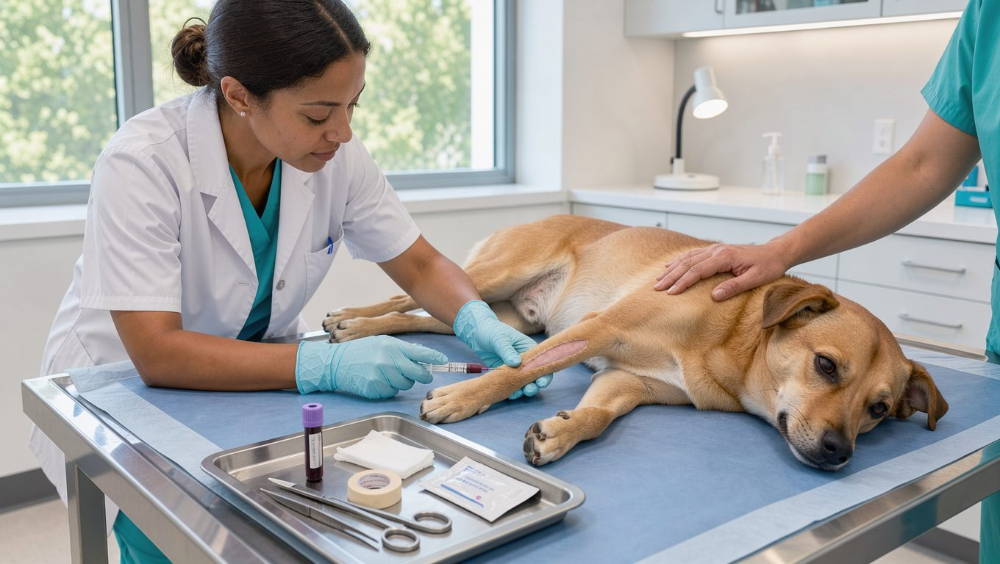

**2026년 10월 19일 기준**

## 빠른 답

**1차 동물병원에서 강아지 피검사(혈액검사)를 받으려면 비용이 얼마나 드나요?**

혈구 검사(CBC)만 받으면 병원 게시 가격 기준으로 3만 5천~5만 5천 원 정도입니다. 혈액화학검사까지 추가하면 검사 항목 수에 따라 비용이 달라집니다. 항목당 1만 2천 원을 받는 병원도 있고, 10~17종을 묶어 9만~13만 원에 제공하는 병원도 있습니다. 지자체 공공진료센터 중에는 전혈구 검사 비용을 1만 6천 원으로 책정하는 등 상대적으로 저렴한 곳도 있습니다.

## 피검사에서 실제로 확인하는 것

혈액검사는 크게 두 가지로 구분됩니다. CBC(전혈구검사)는 적혈구와 백혈구, 혈소판의 수를 측정하는 검사입니다. 빈혈이나 감염, 염증, 출혈 경향 등을 확인할 때 시행합니다. 혈액화학검사는 간과 신장 기능, 혈당, 단백질 등 주요 수치를 확인하는 검사로, 검사 항목 수에 따라 확인할 수 있는 범위가 달라집니다.

여기에 필요에 따라 전해질 및 혈액가스 검사, 췌장염 키트, 심장 표지자(proBNP), 염증 수치(CRP) 검사 등이 추가됩니다. 1차 동물병원에서는 기본 건강검진 시 CBC와 혈액화학검사 10~15종을 조합하는 경우가 많습니다.

## 가격을 가르는 두 가지 방식

- **CBC는 사용하는 장비에 따라 가격이 달라집니다.** 경기동물의료원은 Vet ABC 검사비를 35,000원, Procyte 검사비를 55,000원으로 게시했습니다. 같은 전혈구검사라도 사용하는 장비와 판독 방식에 따라 가격 차이가 발생합니다.
- **혈액화학검사는 항목별로 비용을 책정하는 경우가 많습니다.** 경기동물의료원과 정직한 동물의료센터는 모두 검사 1항목당 12,000원으로 게시했습니다. 10개 항목을 각각 계산하면 총 12만 원입니다.
- **여러 항목을 묶은 검사는 항목당 비용이 낮아집니다.** 정직한 동물의료센터는 CHEM 10을 90,000원, CHEM 15를 120,000원, CHEM 17을 130,000원에 제공하고 있습니다. 항목당 비용으로 환산하면 각각 9,000원, 8,000원, 약 7,600원입니다.
- **추가 검사는 별도 비용이 발생합니다.** 같은 병원 기준으로 췌장염 키트는 50,000원, proBNP는 70,000원, CRP는 35,000원입니다. 추가 검사가 많아질수록 총 검사비도 증가합니다.

## 게시 가격으로 본 실제 금액대

- **경기동물의료원**: CBC Vet ABC 35,000원, Procyte 55,000원. 혈액화학검사 1항목당 12,000원. 전해질과 가스 50,000원. 초진 20,000원, 재진 10,000원.
- **정직한 동물의료센터**: CBC 40,000원. 혈청화학검사 1항목당 12,000원. CHEM 10 90,000원, CHEM 15 120,000원, CHEM 17 130,000원. 진료비 7,000원.
- **김포시 반려동물 공공진료센터**: 김포시민 전혈구 검사와 판독 16,000원. 취약계층은 전혈구 검사 무료, 종합 혈액검사 50,000원. 초진과 재진, 상담료 무료.

진찰료는 검사비와 별도로 부과되는 경우가 많습니다. 정직한 동물의료센터 기준으로 CBC와 CHEM 10, 진료비를 합하면 총 137,000원입니다. 반면 경기동물의료원에서 가장 저렴한 CBC와 혈액화학검사 10개 항목, 초진료를 합하면 총 175,000원입니다. 같은 기본 검사 조합이라도 병원에 따라 총액이 4만 원 가까이 차이 납니다.

**딱지허브 판단**: 게시 가격만으로 병원을 선택하기는 어렵습니다. 같은 CBC라도 사용하는 장비에 따라 비용이 달라지고, 혈액화학검사는 몇 개 항목을 묶는지에 따라 총액 차이가 커집니다. 방문 전에 "CBC와 혈액화학검사 몇 종을 묶어 얼마인가요?"라고 전화로 문의하면 실제 결제 금액에 가까운 견적을 확인할 수 있습니다.

## 1차 병원에서 혈액검사를 하는 경우

- **정기 건강검진**: 나이와 건강 상태에 따라 검사 항목을 조정합니다. 노령견은 간과 신장 수치를 정기적으로 확인하는 것이 좋습니다.
- **수술 전 마취 평가**: 마취 전 주요 장기 기능을 확인해 위험을 줄이기 위해 시행합니다.
- **새 약을 시작하기 전**: 간이나 신장으로 대사되거나 배출되는 약물을 사용하기 전에 관련 기능 수치를 확인합니다.
- **증상의 원인 감별**: 구토, 설사, 식욕 부진, 활력 저하 등의 증상이 지속될 때 탈수나 염증, 장기 이상 여부를 확인하는 데 활용합니다.

한국에서 1차·2차 동물병원은 법적으로 구분된 등급이 아니라 진료 범위에 따라 사용하는 통칭입니다. 각 병원의 역할과 2차 병원으로 옮겨야 하는 기준은 [동물병원 1차·2차 차이](/guides/animal-hospital-primary-secondary/)에서 확인할 수 있습니다.

## 견적을 받을 때 확인할 것

- **검사 종류**: CBC만 포함된 견적인지, 혈액화학검사까지 포함되는지 확인합니다.
- **화학검사 항목 수**: CHEM 10, 15, 17 등 몇 개 항목을 묶어 검사하는지 문의합니다. 항목 수에 따라 총액이 달라집니다.
- **추가 검사 여부**: 전해질, 췌장염 키트, 심장 표지자 검사 등이 필요한지 확인합니다.
- **진찰료와 재진료**: 검사비 외에 별도 비용이 부과되는지 미리 확인합니다.
- **게시판 확인**: 동물병원은 진료비를 게시해야 하므로 대기실 게시판이나 홈페이지에서 검사비를 비교할 수 있습니다. 진료비 게시 제도와 지역별 가격 차이는 [동물병원 잘 고르는 법](/guides/choosing-animal-hospital/)에서 자세히 확인할 수 있습니다.
- **공공진료센터**: 거주 지역에 공공진료센터가 있다면 이용 조건과 검사비를 함께 확인합니다. 이용 대상이 지역 주민이나 취약계층으로 제한되는 경우도 있습니다.

## 자주 묻는 질문

### 혈액검사 전에 금식이 필요한가요?

혈액화학검사는 식사의 영향을 받을 수 있어 병원에서 금식을 안내하기도 합니다. 필요한 금식 시간은 검사 종류와 목적에 따라 다르므로 예약할 때 병원의 안내를 따르는 것이 좋습니다.

### CBC와 혈액화학검사는 무엇이 다른가요?

CBC는 혈구의 수와 비율을 확인하는 검사이고, 혈액화학검사는 주요 장기 기능과 대사 관련 수치를 확인하는 검사입니다. 두 검사를 함께 시행하면 빈혈이나 감염, 장기 이상 등을 폭넓게 살펴볼 수 있습니다.

### 매년 건강검진 때 피검사를 해야 하나요?

검사 필요성은 나이와 건강 상태, 기존 질환에 따라 달라집니다. 성견은 1년에 한 번, 노령견은 더 자주 검진을 상담하기도 하지만, 구체적인 검사 항목과 주기는 수의사와 상의해 결정하는 것이 좋습니다.

### 공공 동물병원은 누구나 이용할 수 있나요?

이용 대상은 지자체마다 다릅니다. 김포시 반려동물 공공진료센터는 김포시민의 전혈구 검사와 판독 비용을 16,000원으로 책정하고, 취약계층에는 무료로 제공합니다. 다른 지역도 이용 대상과 가격이 다르므로 거주지 공공진료센터의 이용 조건을 먼저 확인해야 합니다.

### 검사 결과는 언제 나오나요?

병원에 검사 장비가 있으면 당일에 결과를 확인할 수 있는 경우가 많습니다. 외부 검사 기관에 의뢰하는 항목은 결과가 나오기까지 며칠이 걸릴 수 있으므로 검사 전에 결과 수령 시점을 확인하는 것이 좋습니다.

## 출처

- [경기동물의료원 진료비용 게시](https://www.ggvmc.co.kr/content/ggvmc09.php) (CBC 장비별 가격, 혈액화학 항목당 가격, 전해질과 가스, 초진과 재진 진찰료)
- [정직한 동물의료센터 진료 비용](https://honestamc.co.kr/%ec%a7%84%eb%a3%8c-%eb%b9%84%ec%9a%a9/) (CBC와 CHEM 묶음 검사 가격, 췌장염 키트와 심장 표지자, CRP, 진료비)
- [김포시 반려동물 공공진료센터](https://m.gimpo.go.kr/petcare/contents.do?key=10687) (김포시민 전혈구 검사 가격, 취약계층 종합 혈액검사 가격, 진찰료 면제 조건)

이 글의 표지 이미지는 AI로 생성했습니다.
