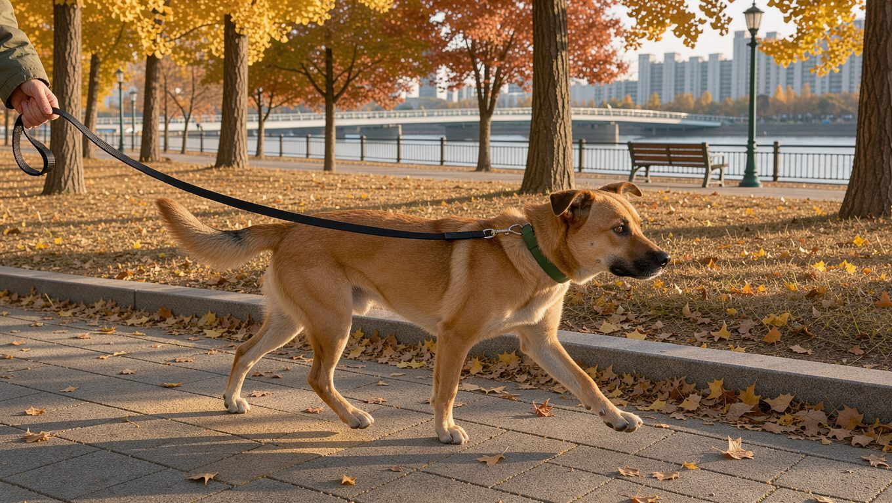

강아지에게 필요한 하루 운동량은 하나의 숫자로 정해지지 않습니다. 같은 견종이라도 나이와 건강 상태, 평소 활동량에 따라 달라집니다. PDSA와 AKC 모두 일률적인 운동 시간보다 개체에 맞춰 운동량을 조절하는 것이 중요하다고 강조합니다.

## 빠른 답

**강아지 하루 운동량은 얼마나 되어야 할까요?** 건강한 성견이라면 하루 1~2회 산책을 기본으로 하되, 견종과 나이에 따라 운동 시간을 조절합니다. 활동량이 많은 견종일수록 더 긴 시간이 필요합니다.

## 견종과 활동량에 따라 기준이 달라집니다

PDSA는 견종에 따라 하루 1~2시간 이상의 운동이 필요할 수 있다고 안내합니다. 작업견은 이보다 훨씬 많은 운동량이 필요할 수 있습니다. 한편 대부분의 개에게는 하루 1~2회 산책이 기본입니다.

AKC는 견종이 필요한 활동량에 큰 영향을 준다고 설명합니다. 활동량이 많은 견종은 적은 견종보다 훨씬 더 많은 운동이 필요합니다. 건강 문제가 있는 개는 수의사와 상의해 운동 강도를 정하는 것이 좋습니다.

**딱지허브 평가**: PDSA가 제시한 하루 1~2시간은 활동량이 많은 견종에 해당하는 기준에 가깝습니다. 한국의 아파트 생활에서는 평일 저녁에 40분~1시간 정도 산책하고, 주말에는 공원이나 산책로에서 산책 시간을 늘리는 방식이 꾸준히 실천하기 좋습니다. 실내 놀이로 부족한 부분을 보완해 주세요.

## 나이에 따라 운동량을 조절합니다

<dl>
<dt>어린 강아지</dt>
<dd>AKC는 강아지가 성견보다 에너지가 많지만, 긴 산책 한 번보다 짧은 산책과 놀이를 여러 번 나누는 편이 안전하다고 설명합니다. PDSA는 예방접종이 끝나기 전에는 실내에서 운동하고, 접종을 마친 뒤에는 하루 두 번 이상 가볍게 산책할 것을 권합니다. 성장기에는 높이 뛰어오르거나 빠르게 달리는 활동을 피하고, 뼈와 관절에 부담이 적은 운동을 해야 합니다. 강아지가 지치기 전에 운동을 멈추고, 잠든 강아지를 깨워 운동시키지 않습니다.</dd>
<dt>성견</dt>
<dd>성견은 견종의 활동량과 건강 상태에 맞춰 꾸준히 움직이는 것이 좋습니다. 운동량을 갑자기 늘리면 관절과 근육에 부담이 될 수 있으므로 조금씩 늘립니다.</dd>
<dt>노령견</dt>
<dd>AKC는 노령견도 규칙적인 운동이 필요하다고 설명합니다. 다만 달리기보다 걷기로 바꾸는 등 신체 능력에 맞춰 강도를 낮춥니다.</dd>
</dl>

## 활동량이 많은 견종과 적은 견종

목양견이나 작업견처럼 움직임이 많은 견종은 같은 시간을 산책해도 필요한 운동량을 채우기 어려울 수 있습니다. PDSA는 작업견이 일반 견종보다 훨씬 많은 운동을 필요로 할 수 있다고 안내합니다. 반대로 체구가 작고 활동량이 적은 견종은 짧은 산책과 실내 놀이를 병행해 하루 운동량을 채울 수 있습니다.

견종만으로 운동량을 정하기는 어렵습니다. 같은 견종 안에서도 개체의 기질과 건강 상태에 차이가 있기 때문입니다. 산책 뒤의 컨디션을 보고 시간을 조절하는 편이 안전합니다.

## 아파트에서 운동량을 채우는 방법

아파트에서는 산책 시간을 넉넉히 내기 어려운 날이 생깁니다. 이때 실내 놀이를 함께 활용할 수 있습니다. AKC는 복종 훈련과 트릭, 냄새 찾기, 퍼즐, 숨바꼭질을 정신적 자극의 예로 듭니다. 집에서 할 수 있는 노즈워크 방법은 [노즈워크 가이드](/guides/home-nosework/)에서 단계별로 소개합니다.

실내에서 공을 던질 때는 미끄러운 바닥에서 급하게 방향을 바꾸지 않도록 러그나 매트를 깔아 주세요. AKC는 실내 계단을 오르내리는 운동을 무리하게 시키지 말라고 당부합니다. 계단은 관절에 부담이 될 수 있어 강아지의 나이와 체형을 살펴야 합니다.

**딱지허브 평가**: 비나 미세먼지로 산책이 어려운 날에는 실내 놀이로 하루 운동 전체를 대신하기보다 짧은 산책과 노즈워크를 나눠 하는 편이 좋습니다. AKC도 정신적 자극만으로 신체 운동을 완전히 대체할 수는 없다고 설명합니다.

## 운동이 부족할 때와 지나칠 때의 신호

PDSA는 에너지가 넘치는 개가 좌절하거나 스트레스를 받는 경우가 있다고 설명합니다. 운동 부족이 모든 문제 행동의 원인인 것은 아닙니다. PDSA는 산책이나 운동만으로 문제 행동을 해결하기 어려울 수 있으며, 스트레스를 받는 개에게는 오히려 상황을 악화시킬 수도 있다고 안내합니다.

AKC는 강아지가 집 안을 거세게 뛰어다니는 행동이 쌓인 에너지를 해소하려는 신호일 수 있다고 설명합니다. 노령견은 컨디션 변화를 관찰하며 운동 강도를 조절합니다. 산책 뒤 다리를 절거나 숨을 오래 가다듬는다면 운동량이 맞지 않을 수 있으므로, 상태가 이어지면 수의사에게 확인하는 것이 좋습니다.

AKC는 보호자가 강아지를 가장 잘 안다고 설명합니다. 다른 강아지의 운동 루틴을 그대로 따라 하기보다 우리 강아지의 반응에 맞춰 운동량을 조절해 주세요.

## 하루 루틴 예시

평일과 주말의 운동 시간을 미리 정해 두면 꾸준히 운동량을 유지하기 쉽습니다. 아래는 활동량이 중간 정도인 성견을 기준으로 한 예시입니다.

<ul>
<li><strong>평일 아침</strong>: 10~20분 정도 짧게 배변 산책을 합니다.</li>
<li><strong>평일 저녁</strong>: 40분~1시간 산책하고, 집에 돌아와 10분 정도 노즈워크를 합니다.</li>
<li><strong>주말</strong>: 공원이나 산책로에서 1~2시간 천천히 걷습니다.</li>
<li><strong>산책이 어려운 날</strong>: 실내 노즈워크와 퍼즐 놀이를 10~15분씩 두 번 나누고, 짧은 산책을 한 번 더합니다.</li>
</ul>

산책 시간은 기온과 미세먼지, 강아지의 컨디션에 따라 줄일 수 있습니다. 여름철 산책 시간대와 아스팔트 온도 확인법, 목줄 착용 및 배변 수거 의무는 [강아지 산책 가이드](/guides/dog-walking/)에서 자세히 소개합니다.

## 자주 묻는 질문

### 월령 × 5분 규칙은 지켜야 하나요?

강아지의 월령에 5분을 곱한 시간만큼 운동시키는 규칙이 널리 알려져 있습니다. 다만 이번에 확인한 AKC와 PDSA 자료에는 이 공식이 나오지 않습니다. 두 기관은 강아지의 나이와 발달 상태를 고려해 짧은 산책을 여러 번 나누어 하고, 피로 신호가 나타나면 운동을 멈추라고 권합니다. 규칙을 절대 기준으로 삼기보다 수의사나 브리더와 상의해 우리 강아지에게 맞는 시간을 찾는 편이 좋습니다.

### 실내 운동만으로 운동량을 채울 수 있나요?

산책이 어려운 날의 보완책으로는 충분하지만, 운동량 전체를 실내에서만 채우기는 어렵습니다. 산책이 가능한 날에는 실내 놀이와 함께 바깥 산책도 하는 것이 좋습니다.

### 산책은 하루에 몇 번 나눠야 하나요?

성견은 하루 두 번을 기본으로 나누고, 강아지는 짧은 산책을 여러 번 하는 편이 좋습니다. 보호자의 일정에 맞춰 아침과 저녁으로 나누어 산책하면 꾸준히 실천하기 쉽습니다.

### 더위나 장마철에는 운동량을 줄여야 하나요?

기온이 높은 날에는 산책 시간을 줄이고 이른 아침이나 해가 진 뒤로 옮기는 것이 좋습니다. 장마철에는 미끄러운 바닥에 주의하고 산책 후 발을 깨끗이 씻겨 주세요. 부족한 운동량은 실내 놀이로 보완할 수 있습니다. 폭염에는 아스팔트 온도가 높아 강아지의 발바닥에 화상을 입힐 수 있으므로, 손바닥을 대어 바닥이 충분히 식었는지 확인해야 합니다.

### 노령견도 매일 운동해야 하나요?

네, 노령견도 매일 조금씩 움직이는 것이 좋습니다. 운동 강도는 신체 능력에 맞춰 낮추고, 회복이 느려지거나 움직이기를 꺼리는 모습을 보이면 수의사와 상의해 주세요.

## 출처

- [How Much Exercise Does a Dog Need Every Day?](https://www.akc.org/expert-advice/health/how-much-exercise-does-dog-need/) (견종과 나이에 따른 운동량, 정신적 자극 설명)
- [Exercise for dogs: our ultimate guide](https://www.pdsa.org.uk/pet-help-and-advice/looking-after-your-pet/puppies-dogs/how-much-exercise-does-your-dog-need) (하루 1~2시간·1~2회 산책 기준, 운동과 문제 행동)
- [Exercising your puppy](https://www.pdsa.org.uk/get-involved/our-campaigns/weigh-up/your-puppy/exercising-your-puppy) (강아지 산책 횟수, 성장기 운동 주의)

표지 이미지는 AI로 생성했습니다.
