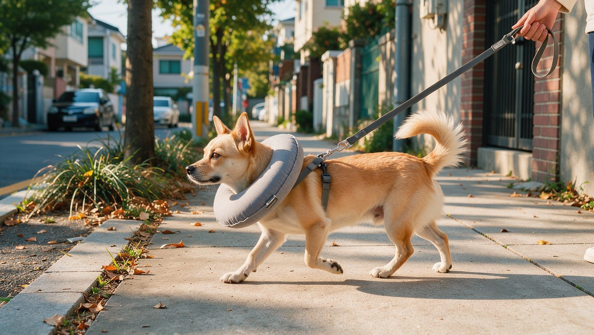

**2026년 10월 30일 기준**

강아지가 가장 자주 겪는 수술 중 하나가 중성화 수술입니다. 다만 막상 수술 시기를 정하고 병원별 견적을 비교하려면 궁금한 점이 많습니다. 이 글은 수의학 자료와 국내 진료비 집계를 바탕으로 시기와 비용, 회복 과정을 정리하고, 복강경 수술을 실제로 겪은 딱지의 경험을 함께 담았습니다.

## 빠른 답

**중성화 수술은 언제 하는 것이 좋을까요?**

생후 6개월 전후가 일반적입니다. 대형견은 골격 성장이 끝날 때까지 미루는 것을 권하기도 하므로, 견종과 체중을 담당 수의사와 상의해 정하는 것이 좋습니다.

**비용은 얼마나 들까요?**

집계 기준으로 수컷 15만~30만 원, 암컷 25만~50만 원이며, 마취와 입원, 검사비를 더하면 총액이 달라집니다. 복강경 수술은 이보다 비쌉니다.

## 중성화 수술로 달라지는 것

중성화 수술의 주요 목적 중 하나는 특정 질환의 발생 위험을 낮추는 것입니다. 암컷은 유선종양과 자궁축농증, 수컷은 고환 질환의 위험을 줄일 수 있습니다. 발정기 관리나 표시 행동, 도주 시도가 줄어드는 경우도 있습니다.

수술 뒤에는 대사량이 줄어 살이 찌기 쉬워질 수 있습니다. 성격이 달라진다기보다는 호르몬 영향으로 나타나던 행동이 줄어드는 변화에 가깝습니다. 마취 위험은 수술 전 검사로 관리할 수 있습니다.

## 시기 — 생후 6개월이 기준선입니다

<ul>
<li><strong>소형견</strong>: 생후 6개월 전후에 수술하는 경우가 많습니다. 암컷은 첫 발정 전에 수술을 권하는 경우도 있습니다.</li>
<li><strong>대형견</strong>: 골격과 관절이 자라는 기간이 길어, 수의사가 더 늦은 시기를 권하는 경우가 있습니다.</li>
<li><strong>성견 이후</strong>: 어른이 된 뒤에도 수술할 수 있습니다. 다만 수술 전 건강 검사가 더 중요해집니다.</li>
</ul>

시기는 견종과 체중, 성별, 생활 환경에 따라 달라집니다. 같은 견종이라도 병원마다 권고가 다를 수 있으므로, 정기 검진 때 담당 수의사와 상의해 정하는 것이 안전합니다.

## 비용 — 집계와 실제 견적은 다릅니다

국내 진료비 집계 사이트 펫이어의 중성화 수술 자료를 보면, 수컷은 15만~30만 원, 암컷은 25만~50만 원입니다. 여기에 수술 전 검사비 5만~10만 원, 마취 및 1일 입원비 5만~15만 원, 발사비 2만~4만 원이 추가됩니다. 전체 범위는 20만~60만 원, 평균 35만 원으로 집계되어 있습니다. 대형견은 비용이 50% 이상 추가될 수 있으며, 암컷은 수컷보다 수술 비용이 약 1.5배 높은 편입니다. 복강경을 선택하면 비용이 더 올라갑니다.

다만 병원과 체중, 수술 방식에 따라 차이가 커서 이 집계는 참고값으로 보는 것이 좋습니다. 견적을 받을 때는 수술비만 보지 말고 검사비와 마취비, 입원비, 약값, 발사비까지 포함한 총액으로 비교해야 합니다.

## 복강경 중성화 — 딱지의 경험

딱지는 복강경 중성화 수술을 받았습니다. 수술 직후부터 걸을 수 있었고, 다음 날에는 산책을 할 수 있을 정도로 회복이 빨랐습니다. 비용은 100만 원 정도였고, 몸무게에 따라 가격이 달라집니다. 복강경은 배를 크게 절개하지 않는 방식으로, 수술 후 통증과 회복 부담을 줄이는 데 도움이 될 수 있습니다.

복강경 수술은 장비와 술기를 갖춘 병원에서만 가능합니다. 같은 수술이라도 병원에 따라 방식을 선택할 수 있는지, 비용에 무엇이 포함되는지가 다르므로 문의할 때 함께 확인하는 것이 좋습니다.

## 회복 — 수술 당일부터 2주까지

<ol>
<li><strong>수술 당일</strong>: 마취 후 12~24시간 동안 졸리거나 평소보다 기운이 없을 수 있습니다. 집에서 조용히 쉴 수 있도록 해 주세요.</li>
<li><strong>활동 제한</strong>: 뛰기와 계단 오르내리기를 피하고 10~14일은 활동을 제한합니다.</li>
<li><strong>상처 확인</strong>: 매일 한 번 수술 부위를 살펴 붉어짐, 부종, 분비물이 없는지 확인합니다.</li>
<li><strong>핥기 방지</strong>: 넥카라나 수술복을 사용해 상처를 핥지 못하게 합니다.</li>
<li><strong>위생</strong>: 상처가 아물 때까지 목욕과 수영은 피하고, 상처를 건조하게 유지합니다.</li>
</ol>

회복 중 식욕이 떨어지거나 수술 부위에서 고름이 나오는 등 이상 증상이 나타나면 동물병원에서 진료를 받아야 합니다. 평소와 다른 증상이 이어질 때의 판단 기준은 [강아지 이상 증상 확인 가이드](/guides/dog-symptom-check/)에 정리해 두었습니다.

**딱지허브 평가**: 딱지처럼 수술 다음 날부터 산책할 수 있을 정도로 컨디션이 좋아 보이는 아이도 있습니다. 다만 강아지는 통증을 잘 숨기는 편이라, 겉으로 멀쩡해 보여도 수술 부위가 아무는 데는 시간이 필요합니다. 수의사가 안내한 10~14일 활동 제한은 지키는 것이 좋습니다.

## 병원 선택과 수술 전 준비

<ul>
<li><strong>수술 가능 여부</strong>: 마취와 수술, 입원이 가능한 병원인지 확인합니다. 경우에 따라 고난도 수술이 가능한 2차 동물병원에서 진료받는 것이 필요할 수도 있습니다. 1차·2차 병원의 차이는 <a href="/guides/animal-hospital-primary-secondary/">동물병원 1차·2차 차이 가이드</a>에서 확인할 수 있습니다.</li>
<li><strong>복강경 장비</strong>: 복강경을 원한다면 장비 보유 여부와 시행 가능 여부를 먼저 확인합니다.</li>
<li><strong>총액 비교</strong>: 두세 곳에서 검사비와 마취비, 입원비까지 포함한 총액으로 견적을 비교합니다.</li>
<li><strong>수술 전 검사</strong>: 혈액검사 등을 통해 마취에 영향을 줄 수 있는 건강 상태를 확인합니다. 금식 등 사전 안내는 병원 지시를 그대로 따릅니다.</li>
<li><strong>돌봄 준비</strong>: 수술 후 며칠은 집에서 돌봄이 필요합니다. 일정을 미리 비워 두는 것이 좋습니다.</li>
</ul>

## 자주 묻는 질문

### 중성화 수술 후 성격이 변하나요?

호르몬의 영향을 받는 마킹이나 도주 행동은 중성화 수술 후 줄어들 수 있습니다. 성격 자체가 다른 아이로 바뀌는 것은 아니라고 보는 것이 일반적입니다.

### 수술 후 언제부터 산책할 수 있나요?

담당 수의사의 지시를 따르는 것이 먼저입니다. 일반적으로 활동 제한 기간에는 배변을 위한 짧은 산책만 하는 것이 좋습니다.

### 중성화하면 살이 찌나요?

수술 후에는 대사량이 줄어 체중이 증가하기 쉬워집니다. 식사량과 간식 양을 적절히 조절하면 체중 증가를 예방하는 데 도움이 됩니다.

### 늦은 나이에 수술해도 괜찮나요?

건강 상태에 문제가 없다면 성견이 된 이후에도 중성화 수술을 받을 수 있습니다. 나이가 들수록 마취 위험이 커질 수 있어 수술 전 검사가 중요합니다.

### 복강경 수술은 모든 병원에서 하나요?

아닙니다. 복강경 장비와 술기를 갖춘 병원에서만 가능하므로, 문의할 때 시행 여부를 확인해야 합니다.

## 출처

- [Neutering in Dogs: When to Do It, Benefits and What to Expect — Chewy](https://www.chewy.com/education/dog/health-and-wellness/getting-your-dog-neutered-a-step-by-step-look-at-dog-neuter-surgery) (중성화 시기·수술 후 회복 기간)
- [중성화 평균 진료비 — 펫이어](https://www.petear.kr/vet-fees/neuter) (국내 중성화 비용 대역)

이 글의 표지와 본문 이미지는 AI로 생성했습니다.
