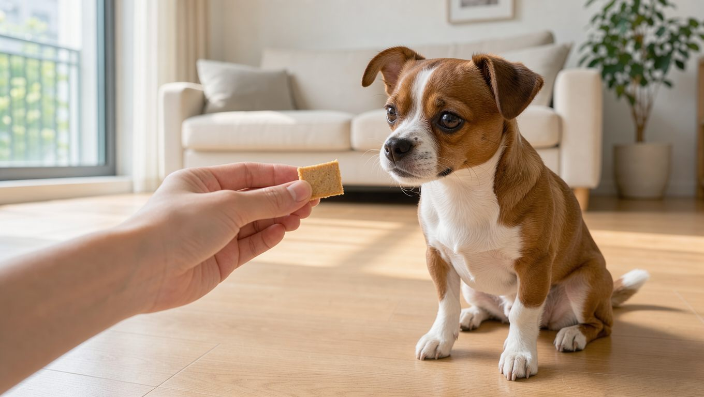

**2026년 11월 24일 기준**

## 빠른 답

**강아지 간식은 하루에 얼마나 줘야 하나요?**

하루 필요 열량의 10% 이내가 기준입니다. 나머지 90%는 완전하고 균형 잡힌 사료로 채워야 하므로, 간식은 개수가 아니라 열량으로 셉니다. 5kg 중성화 성견이라면 하루 약 375kcal가 필요하고, 간식 상한은 약 37kcal입니다.

## 간식 상한은 '하루 열량의 10%'

하루 필요 열량의 90%는 완전하고 균형 잡힌 사료로 채우고, 나머지 10% 이내에서 간식을 급여하도록 안내하고 있습니다 (미국 수의사 네트워크 VCA 동물병원). PetMD도 간식이 하루 권장 열량의 10%를 넘지 않아야 한다고 설명합니다 (PetMD).

기준이 개수가 아니라 열량인 이유는 간식마다 열량 차이가 크기 때문입니다. 큰 비스킷 한 장이 약 85kcal에 이르는 예시도 있습니다. 소형견이라면 이 한 장이 하루 간식 상한을 거의 채우는 양입니다. 육포, 덴탈껌, 수제 간식, 훈련 보상, 사람 음식까지 하루에 준 것은 모두 같은 상한에 더해야 합니다 (VCA).

## 체중별 하루 간식 권장 상한은 이 정도입니다

중성화한 성견의 활동량이 보통 수준인 경우를 가정한 계산 예시입니다. 하루 필요 열량은 안정 시 에너지 요구량 공식(RER = 70 × 체중^0.75)에 중성화 성견의 계수인 1.6을 곱해 계산했으며, 이 중 10%를 간식 상한으로 설정했습니다.

- **2kg** — 하루 약 190kcal, 간식 약 19kcal
- **5kg** — 하루 약 375kcal, 간식 약 37kcal
- **10kg** — 하루 약 630kcal, 간식 약 63kcal
- **20kg** — 하루 약 1,060kcal, 간식 약 106kcal
- **30kg** — 하루 약 1,440kcal, 간식 약 144kcal

같은 체중이라도 나이와 활동량, 중성화 여부, 질환에 따라 필요 열량은 달라집니다. 우리 강아지의 하루 목표 열량은 수의사에게 확인하고, 간식으로 급여할 수 있는 열량은 그 10% 이내로 설정하는 것이 좋습니다 (VCA). 체중과 상태를 넣어 직접 계산하려면 [강아지 간식 열량 비율 계산기](/tools/dog-treat-calories/)를 이용하시면 됩니다.

**딱지허브 평가**: 간식 10% 기준은 하루 전체 급여량의 합계에 적용되므로, 매번 간식의 무게를 잴 필요는 없습니다. 처음 1~2주 동안은 포장지에 표시된 열량을 기준으로 하루 간식 섭취량을 대략 계산해 감을 잡고, 이후에는 체중과 체형 변화를 살펴보며 관리하는 것이 꾸준히 실천하기 좋은 방법입니다.

## 간식 열량은 포장지에서 확인합니다

시중에 판매되는 간식은 먼저 포장지에 표시된 열량을 확인합니다. 100g당 열량이 표시되어 있다면 간식 한 개의 무게를 측정해 열량을 계산하고, 1개당 열량이 표시되어 있다면 해당 수치를 그대로 합산합니다. 사람 음식으로 간식을 만들었다면 식품 영양 데이터베이스에서 재료별 열량을 찾아 합산하면 됩니다 (VCA). 한 번에 여러 개를 주더라도 모두 더해서 하루 합계로 봅니다. 훈련 중에 손에 쥐고 주는 보상도 같은 상한에 포함됩니다 (PetMD).

## 훈련 간식이 많다면 사료를 보상으로 나눠 쓰세요

훈련 보상은 한 번에 조금씩 자주 급여하기 때문에 전체 간식 섭취량이 쉽게 늘어날 수 있습니다. 보상용 간식은 잘게 쪼개고, 정규 사료 일부를 떼어 보상으로 쓰는 방법이 좋습니다. 열량이 높은 간식은 주는 횟수 자체를 줄이는 것이 좋습니다 (VCA). 훈련 순서와 보상 타이밍은 [강아지 기본 훈련 가이드](/guides/dog-basic-training/)에서 다룹니다.

## 간식을 줬다면 사료에서 같은 열량을 덜어냅니다

간식은 사료를 대신하지 않습니다. 간식으로 200kcal를 급여했다면 사료에서 같은 열량만큼 줄이고, 사료 ¼컵을 간식으로 활용했다면 정규 식사량에서 ¼컵을 제외하도록 안내합니다 (PetMD). 사료를 줄이지 않고 간식만 더하면 하루 열량이 그만큼 늘어납니다.

체중이 늘었다면 간식부터 점검하는 것이 좋습니다. 체중과 체형을 관리할 때는 운동량뿐 아니라 하루 섭취 열량을 조절하는 것도 중요합니다 (VCA).

## 이런 간식은 조심하거나 피합니다

- **'라이트'나 '저칼로리' 표기** — 제품명이나 표시와 달리 실제 열량이 크게 낮지 않을 수 있으므로, 라벨만 믿지 말고 실제 열량을 확인해야 합니다 (VCA).
- **동결건조 간식이나 건조 생식 간식** — 세균 오염 위험이 있어 침과 배설물을 통해 다른 반려동물과 사람에게 옮을 수 있습니다 (VCA).
- **질환별 간식** — 췌장염으로 저지방 식이 중인 강아지에게 고지방 간식을 주면 안 되고, 비뇨기 처방식 같은 처방식은 간식이 더해지면 제 기능을 하지 못할 수 있습니다 (VCA).
- **위험한 사람 음식** — 마늘, 양파, 초콜릿, 포도, 건포도는 간식으로 주면 안 됩니다 (PetMD).
- **덴탈껌** — 치아 관리용 껌은 주 3회 정도, 치아 질환이 있는 강아지는 하루 1개 정도를 기준으로 안내하고 있습니다 (PetMD). 덴탈껌의 열량 역시 하루 간식 섭취량에 포함해야 합니다.

## 자주 묻는 질문

### 하루 간식 개수로 정해 주는 기준은 없나요?

개수 기준은 따로 없습니다. 간식마다 열량이 달라서, 같은 40kcal라도 비스킷이면 몇 장이고 잘게 쪼갠 훈련 보상이면 수십 개가 됩니다. 포장지 열량을 기준으로 하루 합계만 맞추면 됩니다.

### 간식을 전혀 주지 않는 편이 좋은가요?

그렇게까지 할 필요는 없습니다. 간식은 훈련과 유대를 돕는 도구라서, 하루 열량의 10% 안에서 활용하면 충분합니다. 다만 간식으로 끼니를 대신하거나 사료보다 간식을 더 많이 주는 습관은 피해야 합니다.

### 간식 열량 표기가 없는 제품은 어떻게 계산하나요?

같은 재료로 만들어지고 무게가 비슷한 다른 제품의 열량 표시를 참고해 대략적으로 계산할 수 있습니다. 정확한 값이 아니므로 이럴 때는 상한보다 여유 있게 잡고, 체중 변화로 다시 확인하는 것이 안전합니다.

### 사료를 줄이면 간식 상한도 다시 계산해야 하나요?

네. 기준은 하루 전체 열량의 10%이므로, 목표 열량이 바뀌면 간식 상한도 다시 계산합니다.

### 노령견이나 다이어트 중인 강아지는 어떻게 조정하나요?

하루 필요 열량이 줄어들면 간식으로 급여할 수 있는 열량도 함께 줄어듭니다. 목표 열량을 수의료진과 먼저 확인하고, 그 값으로 간식 상한을 잡는 것이 좋습니다 (VCA).

## 출처

- [Dog Treats — VCA Animal Hospitals](https://vcahospitals.com/know-your-pet/dog-treats) (10% 규칙, 포장 열량 확인, 훈련 보상, 주의할 간식)
- [Are Treats Good for Dogs? How to Find Healthy Dog Treats — PetMD](https://www.petmd.com/dog/nutrition/are-treats-good-for-dogs) (10% 상한, 사료 열량 조정, 덴탈껌 주기, 위험 음식)
- 표지 이미지는 AI로 생성했습니다.
