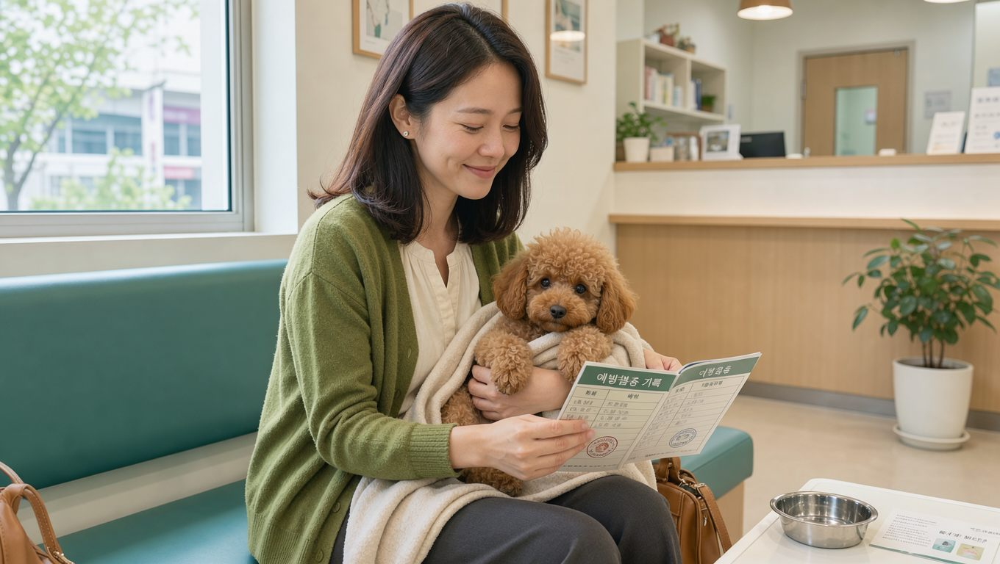

**2026년 10월 28일 기준**

## 빠른 답

**강아지 예방접종은 언제 시작하고, 얼마나 들까요?**

생후 6~8주 무렵 시작해 2~4주 간격으로 여러 차례 맞히고, 마지막 핵심 접종은 생후 16주 이후에 마칩니다. 첫해 접종 비용은 10만~20만 원 선으로 추정되며, 진찰료와 항체가 검사가 더해지면 실제 지출은 달라질 수 있습니다.

## 접종 일정은 시작과 마지막 접종이 기준입니다

힐스펫 코리아는 강아지 핵심 백신의 시작 시점과 마지막 접종 시점을 중심으로 일정을 잡도록 안내합니다.

<ul>
<li><strong>생후 6~8주</strong> — 첫 접종을 시작하는 시점입니다.</li>
<li><strong>2~4주 간격</strong> — 같은 핵심 백신을 일정 간격을 두고 반복합니다. 어미에게 받은 항체가 남아 있으면 백신 효과가 떨어질 수 있어, 항체가 충분히 형성될 때까지 여러 차례 맞히는 방식입니다.</li>
<li><strong>생후 16주 이후</strong> — 마지막 핵심 백신을 접종합니다. 이 시점을 기준으로 기초 접종 일정이 마무리됩니다.</li>
<li><strong>성견 이후</strong> — 마지막 접종 시점과 백신 종류에 맞춰 다음 일정을 정합니다. 핵심 항원은 더 긴 간격으로 관리할 수 있고, 켄넬코프와 인플루엔자는 생활 환경에 따라 매년 접종을 검토합니다.</li>
</ul>

접종 횟수를 미리 외우기보다 마지막 접종 시점과 간격을 기준으로 병원과 일정을 맞추는 편이 좋습니다. 강아지마다 첫 접종 시기와 건강 상태가 다르므로 접종 횟수도 달라질 수 있습니다.

## 비용: 항목별 범위와 첫해 총액

펫이어가 농림축산식품부의 동물병원 진료비용 공시 자료와 한국소비자원의 동물병원 진료비 실태조사, 보호자들의 영수증 제보를 종합해 추정한 금액입니다. 특정 병원의 고시 가격이 아니므로 범위로 보아야 합니다.

<ul>
<li><strong>진찰료</strong> — 1만~2만 원입니다. 접종 전 건강 확인을 위해 받는 경우가 많고, 접종비와 따로 청구될 수 있습니다.</li>
<li><strong>종합백신(DHPPL)</strong> — 2만~4만 원입니다.</li>
<li><strong>켄넬코프</strong> — 2만~4만 원입니다.</li>
<li><strong>광견병</strong> — 2만~3만 원입니다.</li>
</ul>

펫이어가 제시한 전체 예방접종 비용은 최저 3만 원, 평균 8만 원, 최고 15만 원입니다. 첫해에는 접종을 여러 차례 반복하므로 총 10만~20만 원을 잡고, 항체가 검사에는 3만~5만 원이 더 든다고 봅니다.

**딱지허브 평가**: 펫이어의 범위는 공시 자료와 보호자 제보를 섞은 추정치라 병원과 지역에 따른 차이가 크게 반영되어 있습니다. 처음 접종을 시작한다면 항목별 금액만 비교하기보다 첫해 예방접종에 드는 총비용을 문의하는 편이 실제 지출을 가늠하기 좋습니다.

같은 접종 항목이라도 병원과 지역에 따라 비용이 달라집니다. 진찰료가 따로 붙는지, 항체가 검사가 포함되는지까지 확인한 뒤 비교하는 편이 안전합니다. 병원을 고르는 기준과 진료비 공개 제도는 [동물병원 잘 고르는 법](/guides/choosing-animal-hospital/)에서 자세히 다뤘습니다.

## 백신마다 대비하는 질병이 다릅니다

<dl>
<dt>종합백신(DHPPL)이란?</dt>
<dd>디스템퍼(홍역), 전염성 간염, 파보바이러스, 파라인플루엔자, 렙토스피라 등 여러 질병을 한 번에 대비하는 핵심 백신입니다. 백신 명칭에 사용된 다섯 글자는 각 질병을 나타내는 영문 표기에서 따온 것입니다.</dd>
<dt>켄넬코프</dt>
<dd>호텔, 유치원, 미용실, 훈련소처럼 여러 강아지가 모이는 환경을 자주 이용할 때 고려하는 백신입니다. 기초 접종 뒤에는 생활 환경에 따라 매년 접종을 검토합니다.</dd>
<dt>인플루엔자</dt>
<dd>기초 접종 뒤 생활 환경에 따라 매년 접종을 검토하는 백신입니다.</dd>
<dt>광견병</dt>
<dd>접종 시기는 백신 제품과 지역 규정을 함께 확인해야 합니다.</dd>
</dl>

## 접종 당일과 그 뒤에 살필 것

<ul>
<li><strong>접종 당일</strong> — 격한 운동, 장시간 외출, 목욕은 피합니다.</li>
<li><strong>가벼운 반응</strong> — 일시적인 무기력과 식욕 저하, 미열, 접종 부위의 통증이나 작은 부종이 나타날 수 있습니다.</li>
<li><strong>바로 연락할 신호</strong> — 얼굴이나 눈 주변의 부기, 호흡이 가빠지는 모습, 반복되는 구토와 설사, 심한 침 흘림, 축 늘어짐, 경련 가운데 하나라도 보이면 즉시 동물병원에 연락합니다.</li>
</ul>

접종 후 평소와 다른 증상이 나타나면 [강아지 이상 증상 확인](/guides/dog-symptom-check/)의 체크리스트를 참고해 응급 상황인지 확인할 수 있습니다.

## 예방접종 확인서가 필요한 순간

반려견 호텔이나 유치원, 훈련소를 이용하거나 항공편 이용 및 해외 출국·검역을 준비할 때 예방접종 확인서를 요구받을 수 있습니다. 확인서에는 반려견 이름, 접종일, 백신명, 제조 번호, 동물병원 정보가 적힙니다.

확인서를 분실했다면 접종한 병원에 재발급이 가능한지 문의하고, 다른 병원으로 옮길 때는 기존 접종 기록을 새 병원에 전달하는 것이 좋습니다. 앱에 기록한 내용은 공식 확인서를 대신하지 못합니다.

## 자주 묻는 질문

### 종합백신은 몇 차례 맞히나요?
힐스펫 코리아는 접종 횟수를 구체적인 숫자로 제시하기보다 여러 차례에 걸쳐 접종하도록 안내합니다. 생후 16주 이후의 마지막 접종과 2~4주 간격을 기준으로 삼고, 강아지의 건강 상태와 첫 접종 시기에 맞춰 병원과 일정을 정하는 편이 좋습니다.

### 접종 당일 목욕은 피해야 하나요?
접종 당일에는 격한 운동과 장시간 외출뿐 아니라 목욕도 피하도록 안내합니다. 접종 뒤 몸 상태가 평소와 다를 수 있으므로 하루는 무리하지 않는 편이 좋습니다.

### 켄넬코프는 모든 강아지가 맞나요?
정해진 의무라기보다 생활 환경에 따라 고려하는 백신입니다. 여러 강아지가 모이는 환경을 자주 이용한다면 접종을 상담하고, 기초 접종 뒤에는 매년 접종 여부를 검토합니다.

### 광견병 접종 시기는 언제인가요?
백신 제품과 지역 규정에 따라 달라집니다. 접종 전에 동물병원에서 제품별 시기를 확인하는 편이 좋습니다.

### 성견이 되면 매년 맞혀야 하나요?
마지막 접종 시점과 백신 종류에 맞춰 다음 일정을 정합니다. 핵심 항원은 더 긴 간격으로 관리할 수 있고, 켄넬코프와 인플루엔자는 생활 환경에 따라 매년 접종을 검토합니다.

## 출처

- [강아지 예방접종 종류와 주기, 확인서까지 | 힐스펫 코리아](https://www.hillspet.co.kr/dog-care/healthcare/dog-vaccination-schedule) (접종 시작 시기와 간격, 마지막 접종 시점, 접종 후 반응, 확인서 기재 항목)
- [예방접종 평균 진료비 | 펫이어](https://www.petear.kr/vet-fees/vaccine) (항목별 진료비 범위, 첫해 총액과 항체가 검사 비용, 데이터 성격)

표지와 본문 이미지는 AI로 생성했습니다.
