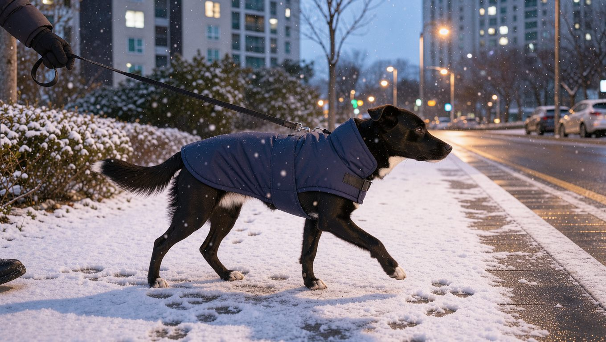
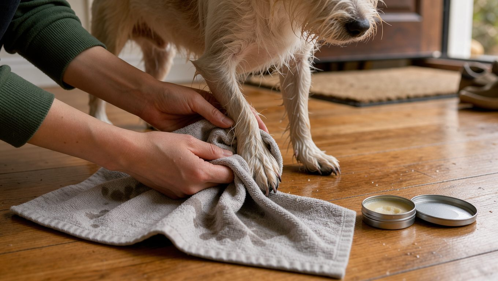

겨울 산책은 추위와 싸우는 일이 아니라 조건을 맞추는 일입니다. 기온과 바닥 상태를 확인하고, 시간과 동선을 줄이고, 돌아와서 발을 씻기면 대부분의 겨울 산책은 무리 없이 이어갈 수 있습니다. 평소 산책 기준은 [강아지 산책 가이드](/guides/dog-walking/)에서 먼저 확인해 주세요.

## 빠른 답

**영하 날씨에도 산책을 해야 하나요?** 짧게라도 산책하는 것이 좋습니다. 다만 기온이 영하로 내려가면 산책 시간을 줄이고, 귀가 후 발을 씻길 준비를 해 두어야 합니다. 영하 12℃ 이하가 이틀 이상 이어지는 한파에는 배변만 해결하고 실내 놀이로 채우는 편이 더 안전합니다.

## 한파주의보가 뜨면 기준부터 봅니다

기상청 한파특보는 아침 최저기온을 기준으로 발표됩니다. 한파주의보는 아침 최저기온이 영하 12℃ 이하로 이틀 이상 이어질 것으로 예상될 때, 한파경보는 영하 15℃ 이하로 이틀 이상 이어질 것으로 예상될 때 내려갑니다. 전날보다 기온이 급격히 떨어지는 경우에도 함께 발표됩니다 (경기도뉴스포털).

이 기준은 사람을 대상으로 한 특보이지만, 반려견의 산책 여부를 판단할 때도 참고할 수 있습니다. 한파특보가 내려진 날에는 산책을 배변 해결 정도로 줄이고, 실내에서 운동량을 채우는 편이 좋습니다. 정전이 길어질 경우를 대비해 담요와 실내 온도를 유지할 방법을 미리 준비해 두면 좋습니다 (AKC).

## 영하에서 먼저 얼는 곳은 귀와 꼬리, 코, 발입니다

개는 사람보다 추위에 강한 편이지만, 기온이 영하로 내려가면 동상에 걸릴 위험이 있습니다. 미국켄넬클럽(AKC)은 기온이 0℃ 아래로 내려가면 동상 위험이 생기며, 노출 30분 안에도 동상이 시작될 수 있다고 설명합니다. 꼬리와 귀, 코, 발처럼 몸 끝부분이 가장 취약합니다.

소형견과 단모견, 어린 강아지, 노령견은 위험이 더 큽니다. 피부가 창백하거나 파랗게 변하고, 만졌을 때 차갑거나 부어오르며, 통증을 보이거나 물집이 생기면 동상을 의심해야 합니다. 동상과 함께 저체온증이 나타날 수도 있으므로 강아지를 따뜻한 곳으로 옮긴 뒤 수의사와 상담해야 합니다.

**딱지허브 평가**: 30분이라는 숫자만 보고 영하의 산책을 전부 멈추는 보호자는 드뭅니다. 한국의 아파트 생활 환경에서는 평일에는 10~15분 정도 배변 산책을 두 번 하고, 주말 낮에는 공원에서 한 번 산책하는 방식이 현실적입니다. 한파특보가 내려진 날에는 배변 위주로 짧게 외출하고, 귀와 발 상태를 수시로 살펴 주세요.

## 옷은 날씨보다 견종에 맞춥니다

같은 기온에서도 털의 구조와 특성에 따라 추위를 느끼는 정도가 다릅니다. 소형견과 단모견, 섬세한 체형의 개는 겨울 코트나 몸에 맞는 스웨터가 도움이 됩니다. 그레이하운드처럼 몸집이 커도 털이 얇은 견종이 여기에 포함됩니다 (AKC).

반면 두꺼운 이중모를 가진 북방 견종은 짧은 산책이라면 옷을 입지 않아도 추위를 견딜 수 있습니다 (AKC). 다만 어린 강아지와 노령견은 체온 조절이 느리므로, 옷을 입히더라도 산책 시간을 줄이는 편이 안전합니다.

## 제설염과 얼음덩이는 발에서 문제를 만듭니다

한국 아파트 단지와 인도에는 눈이 오면 염화나트륨이나 염화칼슘 같은 제설 물질이 뿌려집니다. 이러한 제설 물질이 발바닥에 닿으면 피부 자극이나 손상을 일으킬 수 있습니다 (AKC).

귀가 후에는 미지근한 물로 발가락 사이와 발바닥 패드까지 씻어 냅니다. 순서는 다음과 같습니다.

1. 미지근한 물로 발가락 사이와 패드까지 헹굽니다.
2. 수건으로 발과 발가락 사이를 확실히 말립니다.
3. 발바닥 갈라짐과 붉은 자국이 없는지 확인합니다.

장모견은 발가락 사이의 털에 얼음덩이가 생기기 쉬우므로 발바닥 높이에 맞춰 털을 정리해 두는 것이 좋습니다. 산책이 많은 날에는 부츠나 발 보호대, 발바닥 보습제를 활용할 수 있습니다 (AKC).

## 길에서 주워 먹으면 안 되는 것

겨울에는 부동액이 특히 위험합니다. AKC는 티스푼 한 숟가락 정도의 부동액만으로도 신장 기능이 손상될 수 있다고 경고합니다. 침 흘림, 구토, 발작, 과도한 갈증, 헐떡임, 무기력, 술 취한 듯한 걸음이 섭취 신호입니다. 의심되면 지체 없이 동물병원으로 가야 합니다.

길가에 남아 있는 부동액 자국이나 정체를 알 수 없는 용기를 조심하고, 얼어붙은 웅덩이나 강가의 얇은 얼음 위에는 접근하지 않도록 해야 합니다 (AKC).

## 한파에는 실내에서 운동량을 채웁니다

한파특보가 장기간 이어지면 평소 산책으로 충족하던 운동량을 채우기 어려워집니다. 이때는 집 안에서 후각을 쓰는 놀이가 효율적입니다. 노즈워크는 좁은 공간에서도 정신적 자극을 줄 수 있으며, 산책을 대신해 하루에 여러 번 나누어 진행할 수 있습니다. 집에서 하는 노즈워크 방법은 [노즈워크 가이드](/guides/home-nosework/)에 정리되어 있습니다.

실내 놀이만으로 운동량이 충분하지 않을 수 있으므로 짧은 외출도 병행하되, 빙판길에서는 보폭을 줄여 미끄러지지 않도록 주의해야 합니다 (경기도뉴스포털).

## 자주 묻는 질문

### 강아지도 동상에 걸리나요?

걸릴 수 있습니다. 기온이 0℃ 아래로 내려가면 동상 위험이 커지며, 귀와 꼬리, 코, 발이 먼저 영향을 받을 수 있습니다. 피부색이 변하거나 부어오르면 따뜻한 곳으로 옮기고 수의사와 상담해 주세요.

### 한파주의보가 뜨면 산책을 쉬어야 하나요?

완전히 쉬기보다 배변만 해결하는 짧은 외출로 줄이는 편이 좋습니다. 운동량은 실내 놀이로 보완해 주세요.

### 겨울 산책 후 발은 어떻게 씻나요?

미지근한 물로 발가락 사이와 패드까지 헹구고 수건으로 잘 말립니다. 제설염이 남지 않도록 씻은 뒤에는 발바닥 상태를 확인해 주세요.

### 단모견은 겨울에 옷을 입혀야 하나요?

단모견과 소형견, 섬세한 체형의 개는 코트나 스웨터가 도움이 됩니다. 반대로 두꺼운 이중모를 가진 북방 견종은 짧은 산책이라면 옷 없이도 견딜 수 있습니다.

### 부동액을 핥으면 어떻게 되나요?

티스푼 한 숟가락 정도의 양만으로도 신장에 심각한 손상을 줄 수 있습니다. 침 흘림이나 구토 같은 신호가 보이면 즉시 동물병원을 찾아야 합니다.

## 출처

- [How to Keep Your Dog Warm and Safe This Winter](https://www.akc.org/expert-advice/health/keep-dog-warm-winter-safety-tips/) (제설염 발 세척, 부동액 중독, 겨울 코트, 정전 대비 지침)
- [Can Dogs Get Frostbite?](https://www.akc.org/expert-advice/health/can-dogs-get-frostbite/) (동상 위험 온도와 시간, 취약 부위, 동상 신호)
- [겨울철 안전을 위협하는 한파와 폭설, 대처법은?](https://gnews.gg.go.kr/news/news_detail.do?number=202201171424487593C048) (한파주의보·한파경보 발표 기준과 한파 행동요령)

이 글의 표지와 본문 이미지는 AI로 생성했습니다.
