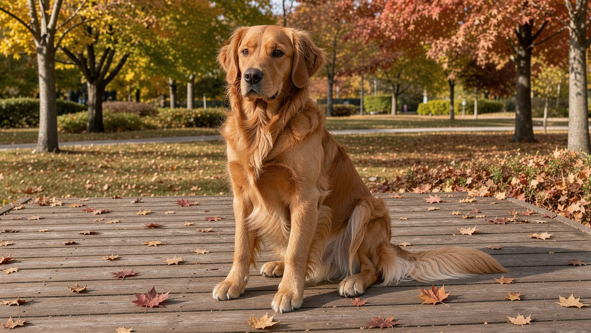
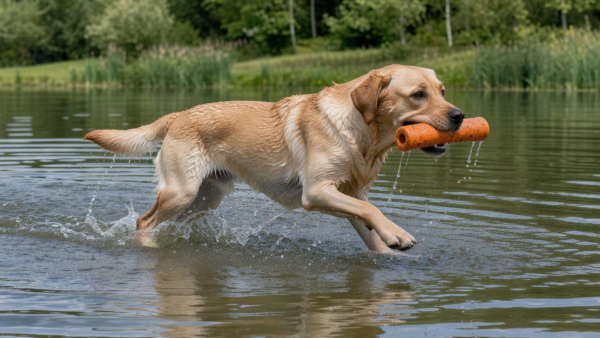
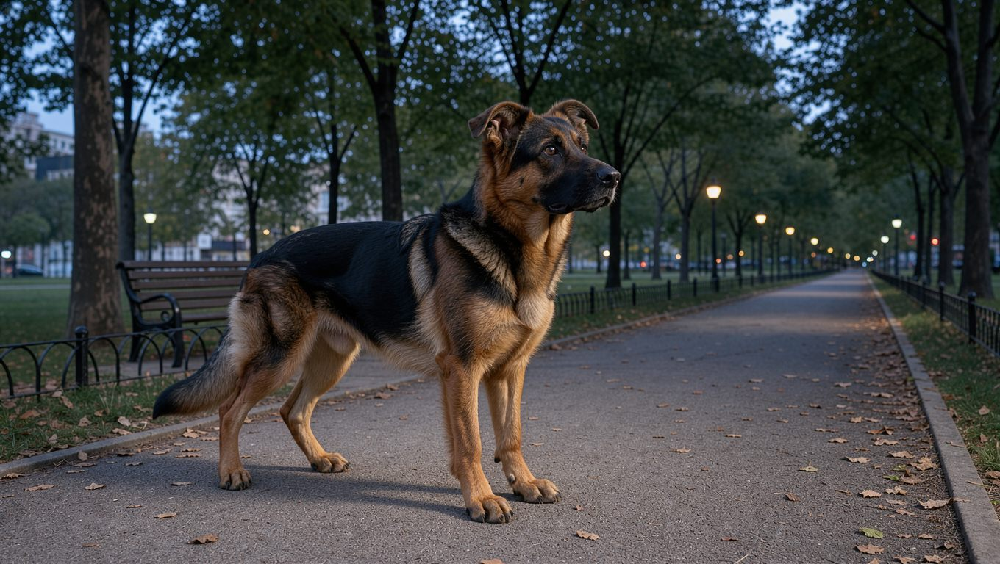
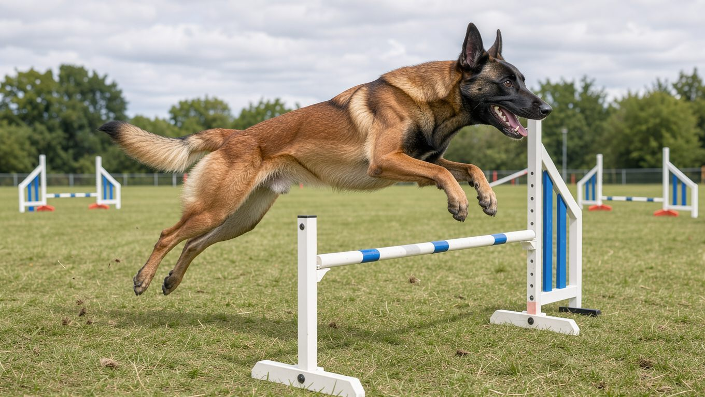
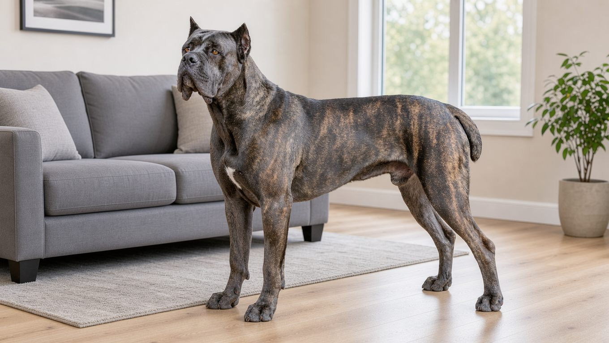
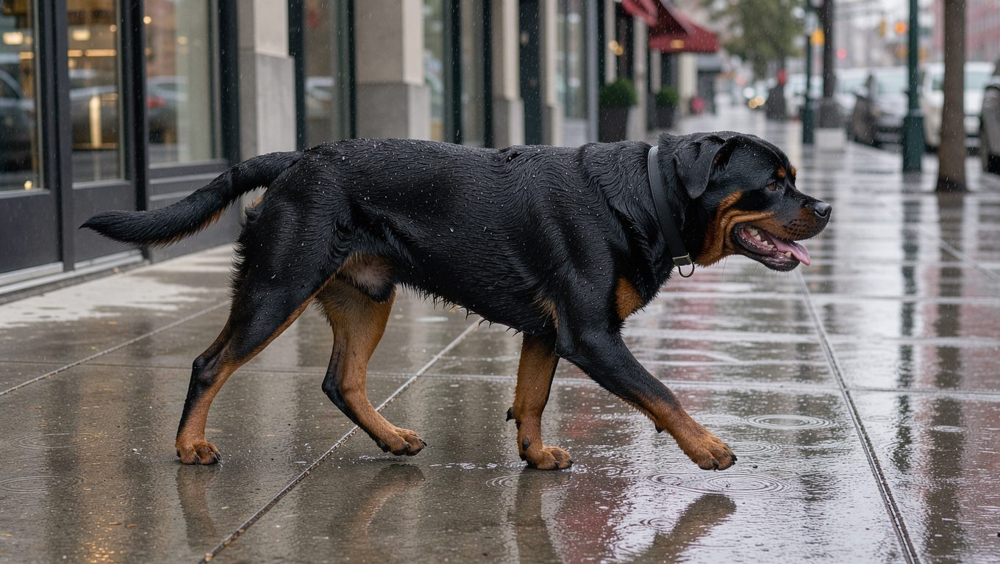
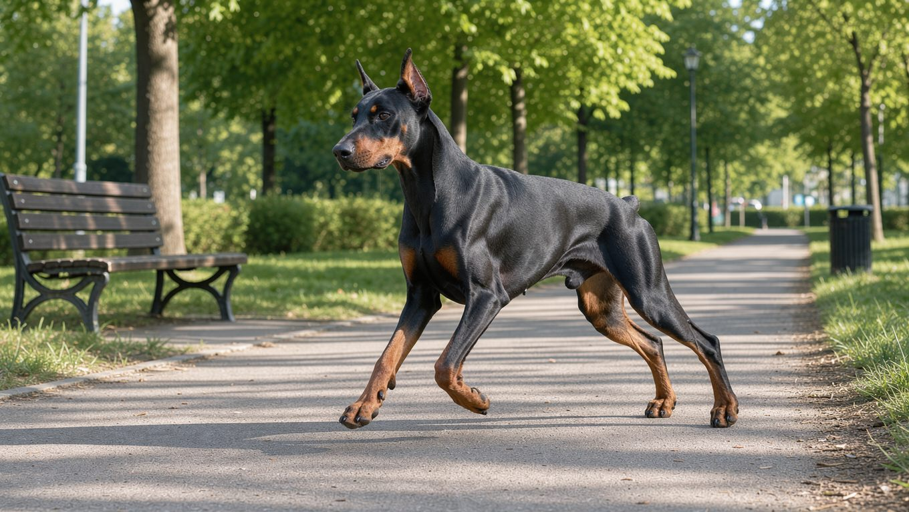
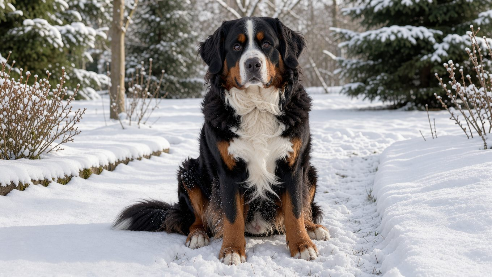
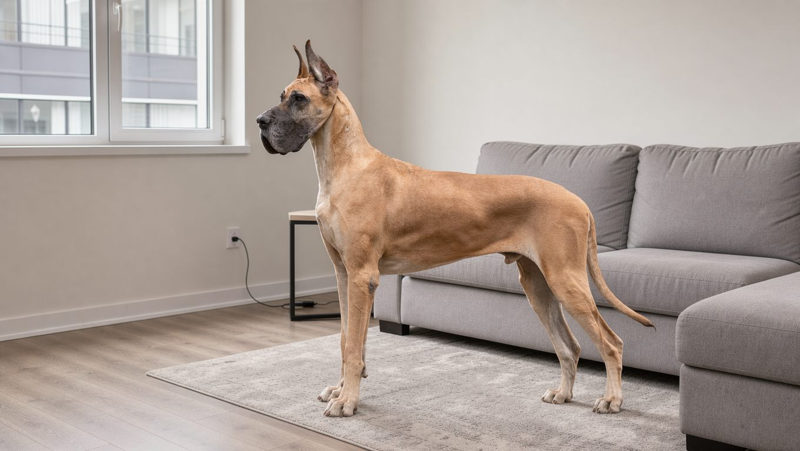
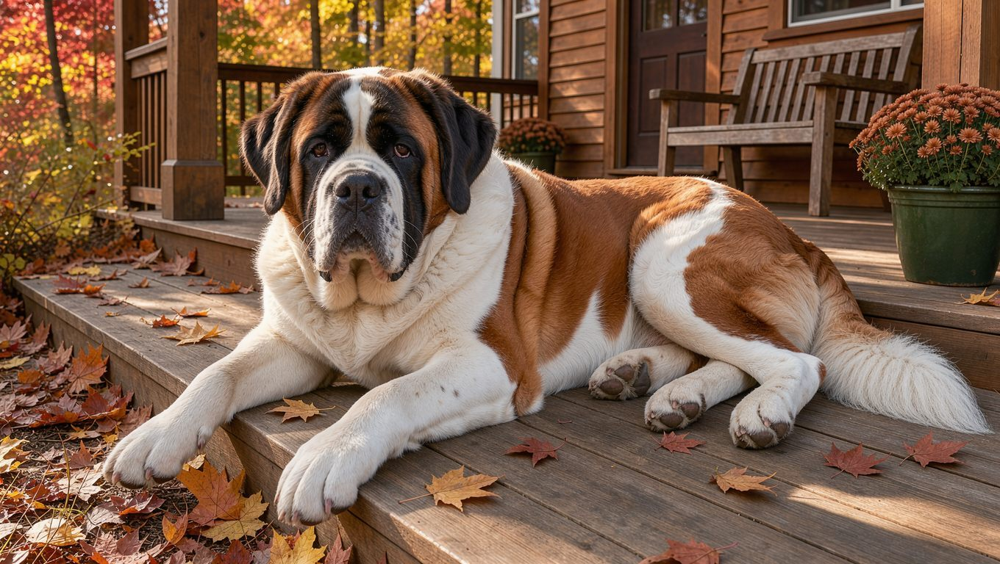

**2026년 10월 21일 기준**

## 빠른 답

**대형견 열 종 가운데 처음 키우는 보호자에게 비교적 무난한 견종은 무엇인가요?**

**골든 리트리버와 래브라도 리트리버입니다.** 둘 다 사람을 따르고 공격성이 낮은 편이라 입문 견종으로 자주 언급됩니다. 나머지 여덟 종은 운동량, 경계심, 법적 관리 의무 가운데 하나 이상에서 각오가 필요합니다.

## 대형견의 기준은 성견 체중 25kg 이상 — 공식 품종 분류는 아닙니다

국립축산과학원의 반려동물 정보는 소형견을 성견 몸무게 10kg 미만, 중형견을 10~25kg 미만, 대형견을 25kg 이상으로 안내합니다. 여기서 성견은 생후 2년 이상을 뜻합니다. 같은 안내는 이 구분이 건강관리를 위한 참고 정보일 뿐, 품종을 나누는 공식 분류 체계는 아니라고 밝힙니다.

이 기관은 대형견의 장단점도 함께 설명합니다. 성격이 차분하고 흥분도가 낮은 편이지만, 사료량과 배설량이 많고 성량이 커서 한 번 짖으면 울림이 크다고 설명합니다. 몸집에 맞춰 산책 줄을 당기는 힘도 커지므로, 어린 시기부터 끌지 않고 걷는 연습이 중요합니다.

## 10종 한눈 비교 — 체중과 수명

- **골든 리트리버** — 체중 25~34kg, 수명 10~12년. 사람을 반기고 온순한 편입니다. 긴 이중모와 처진 귀 때문에 털과 귀 관리가 꾸준히 필요합니다.
- **래브라도 리트리버** — 체중 25~36kg, 수명 10~12년. 먹는 것에 대한 관심이 강해 비만 관리가 평생 과제입니다. 짧은 이중모라 털 관리 부담은 골든 리트리버보다 적은 편입니다.
- **저먼 셰퍼드** — 체중 22~40kg, 수명 9~13년. 경계심과 영역성이 뚜렷하고 한 사람에게 깊게 붙는 편입니다. 암컷은 25kg 아래로 내려가 중형견 범주에 들어가기도 합니다.
- **벨지안 말리노이즈** — 체중 20~30kg, 수명 10~14년. 작업견 기질이 강해 몸과 머리를 함께 쓰는 활동이 필요합니다. 체중만 보면 대형견과 중형견의 경계에 있는 견종입니다.
- **카네코르소** — 체중 40~50kg, 수명 9~12년. 가족에게는 다정하지만 낯선 사람과 동물에 대한 경계심이 강합니다. 현행 법정 맹견에는 포함되지 않습니다.
- **로트와일러** — 체중 35~60kg, 수명 9~10년. 차분하지만 힘이 세고 보호 본능이 강합니다. 법정 맹견 5종에 포함되므로 별도의 관리 의무가 따릅니다.
- **도베르만** — 체중 27~45kg, 수명 10~12년. 민첩하고 경계심이 강합니다. 법정 맹견은 아니지만 심장 질환 위험을 살펴야 합니다.
- **버니즈 마운틴 독** — 체중 36~52kg, 수명 7~10년. 삼색 장모에 온화한 성격입니다. 대형견 가운데서도 수명이 짧은 편이고 더위에 약합니다.
- **그레이트 데인** — 체중 50~79kg, 수명 7~10년. 몸집이 가장 큰 축에 드는 견종입니다. 깊은 흉곽 때문에 위염전 위험이 특히 높습니다.
- **세인트 버나드** — 체중 54~82kg, 수명 8~10년. 구조견으로 알려진 온순한 초대형견입니다. 침과 털, 더위, 관절 관리가 부담으로 따라옵니다.

## 리트리버 계열 — 골든 리트리버와 래브라도 리트리버

### 골든 리트리버

골든 리트리버는 스포팅 그룹에 속하는 회수견입니다. 사람을 향한 관심이 많고 낯선 사람에게도 비교적 우호적이라, 대형견 입문 목록에 늘 이름을 올립니다. 다만 온순함과 훈련 반응이 좋은 것은 별개입니다. 몸집이 큰 만큼 어린 시기부터 사람과 다른 개 사이의 거리 조절을 가르쳐야 산책이 편해집니다.

털은 이중모이고 사계절 꾸준히 빠집니다. 귀가 처져 있어 습기가 고이기 쉬우므로 목욕 뒤 귀 안쪽을 말려 주는 것이 좋습니다. 유전병으로는 고관절 형성부전과 암 발생 위험이 자주 언급됩니다. 견종별 자세한 내용은 [골든 리트리버 허브](/breeds/golden-retriever/)에서 다룹니다.

### 래브라도 리트리버

래브라도 리트리버는 골든과 함께 대표적인 가정견입니다. 짧고 촘촘한 이중모라 털 관리 부담은 골든보다 적지만, 빠진 털이 사람 옷과 바닥에 붙는 점은 같습니다. 회수 본능이 강해 공이나 장난감을 물고 오는 놀이를 좋아합니다.

가장 큰 주의점은 식탐입니다. 비만 관련 유전자 연구가 이 견종에서 보고될 만큼 체중이 늘기 쉬워, 간식까지 하루 열량 안에서 계산하는 습관이 필요합니다. 관절에 부담이 커지면 산책도 즐거움이 아니라 통증이 됩니다. [래브라도 리트리버 허브](/breeds/labrador-retriever/)에 모색과 건강 이야기를 정리해 두었습니다.

## 작업견 계열 — 저먼 셰퍼드와 벨지안 말리노이즈

### 저먼 셰퍼드

저먼 셰퍼드는 경찰견과 구조견으로 널리 쓰인 작업견입니다. 영역 의식과 경계심이 뚜렷하고, 가족 가운데서도 한 사람에게 특히 깊게 붙는 경향이 있습니다. 훈련 반응이 좋은 편이지만 사회화가 부족하면 낯선 사람과 다른 개에게 과하게 반응할 수 있습니다.

건강에서는 고관절 형성부전과 퇴행성 척수병증, 위염전이 자주 거론됩니다. 쇼라인과 워킹라인처럼 혈통에 따라 체형과 활동량 차이가 크므로, 분양 전에 부모견의 검진 이력을 확인하는 것이 좋습니다. 품종 개요는 [저먼 셰퍼드 허브](/breeds/german-shepherd/)에서 확인할 수 있습니다.

### 벨지안 말리노이즈

벨지안 말리노이즈는 시프도그 계열 가운데 단모종입니다. 저먼 셰퍼드보다 몸이 가볍고 날렵하며, 작업에 대한 몰입도가 매우 높습니다. 활동량이 부족하면 가구를 뜯거나 짖는 등 문제 행동으로 에너지를 발산하기 쉽습니다.

체중이 20~30kg으로, 대형견 기준인 25kg을 경계로 중형견과 대형견에 걸쳐 있습니다. 분류보다 중요한 것은 하루에 얼마나 몸과 머리를 쓸 수 있는지입니다. 운동과 놀이를 충분히 소화할 자신이 없다면 첫 견종으로 권하기 어렵습니다. 실전 루틴은 [말리노이즈 운동량 글](/breeds/belgian-malinois-exercise/)에 정리되어 있습니다.

## 경계심이 강한 보호견 계열 — 카네코르소, 로트와일러, 도베르만

### 카네코르소

카네코르소는 이탈리아 원산의 대형 보호견입니다. 가족에게는 애정이 깊지만 낯선 사람과 동물을 경계하는 본능이 강합니다. 조용한 편이라 위험 신호를 소리로 알리지 않는 경우도 많아, 보호자가 개의 몸짓을 읽는 연습이 필요합니다.

현행 동물보호법상 법정 맹견 5종에는 해당하지 않습니다. 다만 40kg이 넘는 몸으로 경계심을 드러내면 주변에 위협이 될 수 있으므로, 어린 시기 사회화와 기본 훈련은 선택이 아니라 필수에 가깝습니다. [카네코르소 허브](/breeds/cane-corso/)에 모색과 건강 정보가 있습니다.

### 로트와일러

로트와일러는 법정 맹견 5종 가운데 하나입니다. 도사견, 핏불테리어, 아메리칸 스태퍼드셔 테리어, 스태퍼드셔 불 테리어, 로트와일러와 그 잡종이 여기에 해당합니다. 맹견으로 지정되면 목줄과 입마개 착용 등 관리 의무가 따르고, 2024년부터는 사육 허가제도 시행 중입니다. 자세한 기준은 [입마개 가이드](/guides/dog-muzzle/)에서 다룹니다.

성격은 차분하고 인내심이 있는 편이지만, 힘이 세고 보호 본능이 강해 훈련 없이 키우기 어렵습니다. 보호자가 통제 가능한 범위 안에서 규칙을 일관되게 지켜야 합니다.

### 도베르만

도베르만은 날렵한 몸과 높은 경계심을 가진 작업견입니다. 법정 맹견 5종에는 들어가지 않지만, 몸집이 크고 위압감이 있어 지자체 조례나 시설 규정에 따라 별도의 관리 기준이 적용될 수 있습니다.

품종 건강에서 가장 자주 언급되는 것은 확장성 심근병증입니다. 겉으로는 멀쩡해 보여도 심장 기능이 떨어져 갑작스러운 위험이 생길 수 있어, 정기 검진이 중요합니다. 활동량이 많아 장시간 산책과 달리기를 소화할 환경이 필요합니다.

## 초대형견 — 버니즈 마운틴 독, 그레이트 데인, 세인트 버나드

### 버니즈 마운틴 독

버니즈 마운틴 독은 스위스 원산의 삼색 장모견입니다. 온순하고 가족에게 다정해 대형견 가운데 인기가 높지만, 수명이 7~10년으로 짧은 편이고 암 발생 위험이 큰 축에 듭니다. 장모 때문에 털갈이와 빗질 부담도 상당합니다.

추위에는 강하지만 더위에는 약합니다. 여름에는 산책 시간을 이른 아침이나 해가 진 뒤로 옮기고, 실내 온도를 낮춰 주는 것이 좋습니다. 관절이 약한 편이라 미끄러운 바닥에는 러그를 까는 편이 안전합니다.

### 그레이트 데인

그레이트 데인은 몸집이 가장 큰 축에 드는 견종입니다. PetMD는 체고를 71~81cm, 체중을 약 50~79kg, 수명을 7~10년으로 안내합니다. 성격은 온순한 편이지만 몸집 자체가 생활 환경을 바꿉니다. 승용차 뒷좌석, 엘리베이터, 좁은 복도가 모두 변수가 됩니다.

가장 조심할 것은 위염전입니다. PetMD는 그레이트 데인의 깊은 흉곽 구조가 위염전 위험을 높이는 요인이라고 설명합니다. 위가 가스로 부풀며 꼬이면 위와 비장으로 가는 혈류가 막히고, 24시간 안에 생명을 위협할 수 있습니다. 헛구역질을 하면서 토하지 못하고 배가 부풀며 안절부절못하는 모습이 대표적인 신호입니다.

### 세인트 버나드

세인트 버나드는 알프스에서 조난자를 구조하던 초대형견입니다. 성격은 온화하고 참을성이 많아 가족견으로도 알려져 있습니다. 체중은 54~82kg에 이르며, 몸집에 걸맞게 사료량과 배설량이 상당합니다.

침을 많이 흘리고 털이 두꺼워 집 안 관리 부담이 큽니다. 더위에 약하고 위염전과 고관절 문제도 따라붙습니다. 초대형견을 고민한다면 넓은 공간과 병원 이동 수단을 먼저 확인하는 것이 좋습니다.

## 대형견 키우기 전 점검 — 운동, 아파트, 비용, 법정 맹견

필요한 운동량은 견종과 개체에 따라 크게 다릅니다. 해외 기관들은 성견의 하루 활동량으로 1~2시간을 제시합니다. 견종별 세부 기준은 [강아지 하루 운동량 가이드](/guides/dog-exercise-amount/)에서 확인할 수 있습니다. 대형견은 짧은 산책보다 냄새 맡기와 자유로운 걷기를 충분히 섞는 편이 정신적 자극에 도움이 됩니다.

**딱지허브 평가**: 하루 1~2시간은 참고할 만한 기준입니다. 한국의 아파트 생활에서는 평일 산책과 주말 공원 활동을 나누어 실천하는 보호자도 있습니다. 다만 산책 시간만으로 충분한 운동량을 확보할 수 있는지는 견종과 개체의 활동량에 따라 달라집니다. 다만 근육량이 많은 대형견은 산책만으로 부족하기 쉬우니, 실내에서도 노즈워크나 터그 놀이로 보완해 주세요.

아파트 사육을 금지하는 법적 규정은 없습니다. 대신 엘리베이터 안에서 다른 주민과 마주치는 일, 층간소음, 계단과 미끄러운 바닥, 집 안에서의 활동 공간을 따져야 합니다. 실내 배변 훈련과 승강기 예절은 [아파트에서 강아지 키우기](/guides/dog-apartment-guide/)에서 확인할 수 있습니다.

비용은 사료, 병원, 미용, 이동 수단에서 소형견과 차이가 납니다. 사료 소비량이 많고, 검진·마취·수술 비용도 체중에 따라 증가할 수 있습니다. 구체적인 금액은 병원과 지역마다 달라, 분양 전에 예방접종과 검진 항목을 포함해 한 번에 계산해 보는 것이 좋습니다.

법정 맹견에 해당하는 견종은 목줄과 입마개 등 관리 의무가 별도로 붙습니다. 열 종 가운데 로트와일러가 여기에 해당하며, 카네코르소와 도베르만은 법정 맹견이 아닙니다. 다만 지자체 조례와 시설 규정은 다를 수 있어, 사는 지역의 기준을 확인하는 것이 안전합니다.

## 큰 몸에 공통으로 오는 건강 리스크

### 고관절과 관절

대형견은 성장 속도가 빨라 관절에 부담이 누적되기 쉽습니다. 고관절 형성부전은 초기에는 눈에 띄지 않다가 산책을 꺼리거나 일어설 때 망설이는 모습으로 드러날 수 있습니다. 성장기에는 급격한 성장을 부추기는 과잉 급여를 피하고, 계단과 미끄러운 바닥을 줄이는 것이 좋습니다.

### 위염전

위염전은 깊은 흉곽을 가진 대형견에서 특히 위험합니다. 한 번에 많은 양을 먹이기보다 하루 두 번 이상 나누어 주고, 식후에는 격한 운동을 피하는 것이 좋습니다. PetMD는 높은 식기가 오히려 위염전 발생을 늘릴 수 있다고 보고, 이를 피하도록 권합니다. 위 고정술을 통해 위염전을 예방하는 방법도 있어, 중성화 수술을 계획할 때 함께 상담하기도 합니다.

### 성장기 운동과 검진

성장판이 닫히기 전까지는 장거리 달리기나 높은 곳에서 뛰어내리는 활동을 줄이는 편이 안전합니다. 견종과 개체에 따라 차이가 크므로 정확한 시기는 수의사와 상담하는 것이 좋습니다. 대형견은 마취 용량과 장비도 달라지므로, 정기 검진 때 몸무게와 활동량을 함께 기록해 두면 도움이 됩니다.

## FAQ

### 대형견은 아파트에서 키울 수 없나요?

법으로 금지하는 규정은 없습니다. 다만 엘리베이터 동선, 층간소음, 실내 활동 공간을 현실적으로 따져야 합니다. 법정 맹견은 목줄과 입마개 등 별도 관리 의무가 붙습니다.

### 대형견 입문으로 가장 무난한 견종은 무엇인가요?

대형견을 처음 키운다면 골든 리트리버와 래브라도 리트리버를 우선 고려할 수 있습니다. 사람을 따르고 공격성이 낮은 편이기 때문입니다. 다만 같은 견종이라도 개체차가 크므로, 부모견의 성격과 사회화 이력을 확인하는 것이 좋습니다.

### 벨지안 말리노이즈는 대형견인가요, 중형견인가요?

체중 20~30kg으로 대형견 기준 25kg의 경계에 걸칩니다. 분류보다 중요한 것은 운동량과 기질입니다. 하루에 충분한 활동을 소화할 수 없다면 체급과 관계없이 키우기 어려운 견종입니다.

### 대형견 성장기에는 운동을 얼마나 해야 하나요?

성장판이 닫히기 전에는 짧게 자주 걷는 방식이 안전합니다. 장거리 달리기와 높은 곳에서의 점프는 줄이는 편이 좋습니다. 시기는 견종과 개체에 따라 다르므로 수의사와 상담해 조정해 주세요.

### 대형견 사료는 소형견과 무엇이 다른가요?

대형견은 성장 속도와 관절 부담을 고려해야 하므로, 대형견용 성장기 사료처럼 성장 단계에 맞춰 칼슘과 열량 등이 설계된 제품을 선택하는 것이 좋습니다. 급여량은 체중과 활동량에 따라 달라지므로 봉투 표시를 기준으로 시작해 몸 상태를 보며 조정해 주세요. 기준은 [강아지 사료 고르기](/guides/choosing-dog-food/)에서 자세히 다룹니다.

## 출처

- [반려동물 알기 — 국립축산과학원](https://www.nias.go.kr/companion/new_petBoard.do?cmCode=M170718155128718) (소형·중형·대형견 체중 기준과 대형견의 특성)
- [Great Dane — PetMD](https://www.petmd.com/dog/breeds/great-dane) (그레이트 데인의 체고·체중·수명, 위염전 위험과 증상)

표지는 AI로 생성한 이미지입니다.
