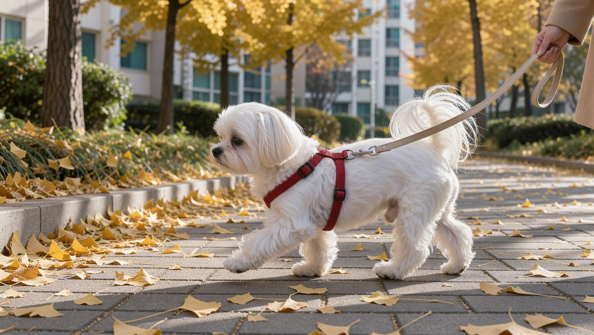
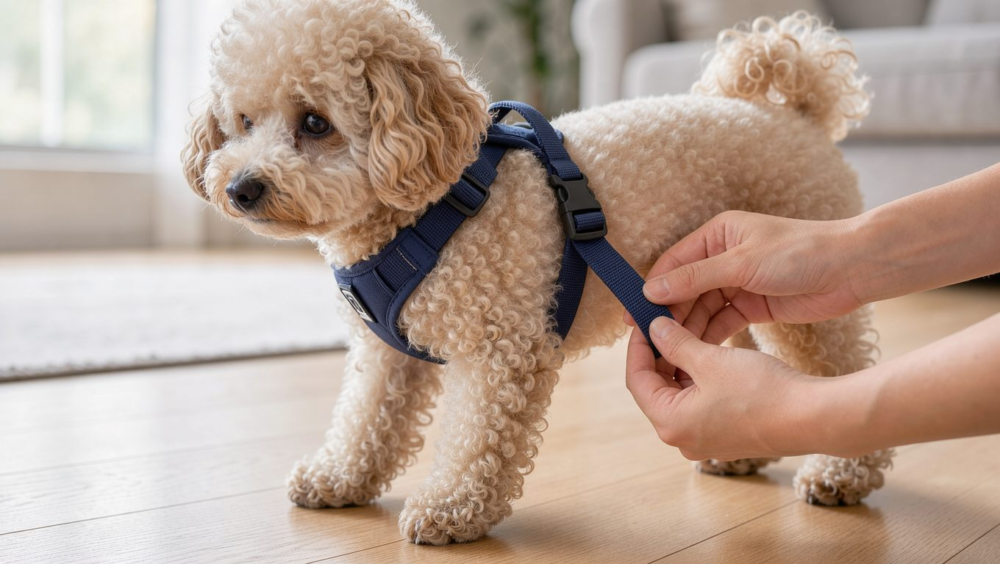

**2026년 11월 20일 기준**

## 빠른 답

**목줄과 하네스 중 무엇이 좋을까요?**

산책할 때 줄을 거는 용도라면 가슴에 힘을 나누는 하네스가 무난합니다. 다만 하네스도 몸에 맞지 않으면 목을 누를 수 있고, 당기는 습관은 장비를 바꾼다고 사라지지 않습니다.

## 목줄과 하네스, 압력이 가해지는 부위가 다릅니다

이 글에서 목줄은 목에 두르는 목걸이형 장비를, 하네스는 가슴에 거는 장비를 뜻합니다. 두 장비는 구조에 따라 산책 줄의 힘이 전달되는 부위가 다릅니다.

<dl>
<dt>목줄</dt>
<dd>목줄은 목 둘레에 힘이 집중됩니다. 목에는 기관과 후두, 갑상선, 굵은 혈관 등이 지나갑니다. 따라서 줄을 자주 당기거나 몸집이 작은 개, 얼굴이 짧은 개, 기도나 목에 문제가 있는 개는 목줄의 압박이 부담으로 작용할 수 있습니다(동물복지단체 포포즈 FOUR PAWS).</dd>
<dt>하네스</dt>
<dd>하네스는 산책 줄의 힘을 갈비뼈와 가슴 쪽으로 분산합니다(포포즈). 목에 가해지는 압박을 줄일 수 있지만, 몸에 맞게 조절하지 않으면 스트랩이 목을 누를 수도 있습니다.</dd>
</dl>

미국 터프츠대 수의과대학의 동물행동 전문가가 작성한 글에서도 몸에 잘 맞는 하네스를 산책용으로 권장하고 있습니다. 목줄은 인식표를 부착하는 용도로 사용하는 것이 좋다고 설명합니다(터프츠대 수의대).

목줄이 목에 가하는 압력은 실제 연구에서도 측정된 바 있습니다. 2020년 노팅엄트렌트대 연구에서는 목줄을 당길 때 목에 전달되는 압력이 83~832kPa로 나타났습니다. 또한 2025년 발표된 리뷰에서는 기관허탈이 진행된 개의 경우 약 20mmHg의 가벼운 압박에도 기도가 크게 좁아질 수 있다고 보고했습니다(매일신문).

## 어떤 경우에 어떤 장비가 유리할까요?

- **소형견과 기관허탈** — 몸집이 작은 개는 기도가 상대적으로 가늘어 목 압박에 취약할 수 있습니다. 특히 기관허탈이 있는 소형견은 목줄의 압박으로 증상이 악화될 수 있다는 설명도 있습니다(터프츠대 수의대).
- **단두종(얼굴이 짧은 견종)** — 퍼그처럼 얼굴이 짧은 개는 목에 가해지는 압박이 호흡에 영향을 줄 수 있습니다. 따라서 산책 줄의 힘을 가슴 쪽으로 분산하는 하네스를 사용하는 것이 좋습니다(터프츠대 수의대).
- **줄을 당기는 개** — 하네스를 사용하면 목에 가해지는 부담은 줄일 수 있지만, 줄을 당기는 습관까지 저절로 사라지는 것은 아닙니다. 장비 교체와 함께 보상 기반 훈련을 병행하는 것이 좋습니다(포포즈).
- **돌진이 심한 개** — 가슴 하네스는 목 부담을 줄이는 데 유리하지만, 갑자기 앞으로 튀어나가는 개를 제어하는 상황에서는 목줄이 더 효과적일 수 있다는 설명도 있습니다(매일신문).
- **차분하게 걷는 개** — 산책 중 줄을 당기지 않고 차분하게 걷는 개라면 몸에 잘 맞는 목줄을 사용해도 괜찮습니다(포포즈).

**딱지허브 평가**: 목줄이 유리하다는 설명은 개를 붙잡거나 제어하는 힘만을 기준으로 한 것입니다. 일상적인 산책에서는 하네스로 목에 가해지는 부담을 줄이고, 줄을 짧게 잡는 연습과 보상 훈련을 함께하는 것이 더 현실적인 방법입니다.

## 하네스를 고를 때 확인할 세 가지

- **Y자형인지** — 앞가슴 스트랩이 Y자 형태로 갈라져 흉골을 받쳐 주는 제품은 가슴 쪽으로 압력을 분산하는 데 도움이 됩니다. 반면 T자형은 제품의 구조와 착용 상태에 따라 어깨 움직임을 제한할 수 있습니다.
- **앞 스트랩이 목에 닿지 않는지** — Y자형 제품이라도 앞 스트랩이 목 가까이 올라오면 목에 압박이 가해질 수 있습니다. 흉골을 받치는 부분이 강아지의 체형에 잘 맞는지도 확인해야 합니다(매일신문).
- **겨드랑이가 쓸리지 않는지** — 하네스 스트랩이 겨드랑이에 닿아 피부를 자극하거나 마찰을 일으키지 않는지 확인하는 것이 좋습니다(포포즈).

## 하네스 사이즈와 착용 상태는 이렇게 확인합니다

1. 가슴둘레 중 가장 넓은 부분을 줄자로 측정합니다. 제품마다 사이즈 기준이 다르므로 측정한 수치를 판매처의 사이즈표와 비교해야 합니다.
2. 직접 착용시킨 뒤 앞 스트랩이 목 쪽으로 올라오거나 겨드랑이를 압박하지 않는지 확인합니다(매일신문).
3. 처음부터 장시간 착용시키기보다는 며칠에 걸쳐 착용 시간을 조금씩 늘리면서 피부가 붉어지거나 털이 쓸리는 부위가 없는지 살펴봅니다.
4. 성장기 강아지라면 몸집이 커지는 만큼 하네스 사이즈도 주기적으로 확인하고 조절해야 합니다.

목줄을 함께 쓰는 경우에는 손가락 하나가 들어갈 정도의 여유가 적당합니다(포포즈).

## 산책 환경에 맞춰 장비 선택하기

한국은 소형견을 키우는 가정이 많은 편입니다. KB금융그룹의 2025년 보고서에 따르면 등록견 순위 1위인 말티즈, 2위 푸들, 4위 포메라니안은 모두 기관허탈이 발생하기 쉬운 품종으로 소개됐습니다(매일신문). 소형견을 키운다면 목에 압력이 집중되는 장비의 사용에 특히 주의하는 것이 좋습니다.

아파트 단지에서는 승강기나 좁은 보도를 지날 때 산책 줄을 짧게 잡아야 하는 상황이 자주 생깁니다. 하네스에 줄을 연결하고 강아지가 보호자 옆에서 차분하게 기다리도록 연습해 두면 이런 상황에서도 한결 수월하게 이동할 수 있습니다. 산책 예절과 관련 법령은 [강아지 산책 가이드](/guides/dog-walking/)에서 자세히 다루었습니다.

줄이 팽팽해지는 습관이 있다면 [산책할 때 하지 말아야 할 것](/guides/dog-walk-mistakes/)도 참고할 수 있습니다.

## 자주 묻는 질문

### 하네스로 바꾸면 줄을 당기는 습관도 줄어드나요?

하네스로 교체하면 목에 가해지는 부담을 줄일 수 있습니다. 하지만 줄을 당기는 습관까지 해결되는 것은 아닙니다. 줄이 팽팽해지면 걸음을 멈추고, 줄이 느슨해졌을 때 다시 걷는 연습과 간식 보상을 병행하는 것이 좋습니다(포포즈).

### 목줄만 사용해도 괜찮은 경우가 있나요?

산책 중 줄을 당기지 않고 차분하게 걷는 개라면 몸에 잘 맞는 목줄을 사용해도 괜찮습니다(포포즈). 다만 소형견이나 단두종, 기관허탈 병력이 있는 개라면 목에 가해지는 압박을 줄일 수 있는 하네스를 우선적으로 고려하는 것이 좋습니다.

### 기관허탈 진단을 받았는데 어떤 하네스를 선택해야 하나요?

흉골을 받쳐 주는 Y자형 하네스 중 앞 스트랩이 목을 압박하지 않는 제품을 선택하는 것이 좋습니다(매일신문). 체중 관리도 중요하므로, 강아지의 상태에 맞는 장비는 수의사와 상담해 결정하는 것이 좋습니다.

### 인식표는 목줄과 하네스 중 어디에 부착하나요?

인식표는 목줄에 부착하고, 산책 줄은 하네스에 연결하는 방식이 무난합니다(터프츠대 수의대). 목줄은 인식표를 부착하는 용도로, 하네스는 산책 줄을 연결하는 용도로 구분해 사용하는 것입니다.

### 하네스를 낯설어하는 강아지는 어떻게 익숙해지나요?

처음에는 집 안에서 몇 분씩 입혀 보고, 입고 있는 동안 간식이나 놀이를 주는 방식이 좋습니다. 착용과 좋은 기억을 함께 묶어 두면 줄을 걸고 나가는 시간이 편해집니다.

## 출처

- [Dog Collars and Harnesses](https://vet.tufts.edu/news-events/news/dog-collars-and-harnesses) (하네스 권장과 목 압박 위험 — 터프츠대 수의대 동물행동 전문가 글, 2022년 11월 22일)
- [강아지 기관지 협착증, 목줄 대신 Y자 하네스…](https://www.imaeil.com/page/view/2026101607311395805) (Y자 하네스 구조, 목줄 압력 연구, 국내 견종 통계 — 매일신문, 2026년 10월 16일)
- [The Ultimate Guide to Dog Collars and Harnesses](https://www.four-paws.org.au/our-stories/publications-guides/the-ultimate-guide-to-dog-collars-and-harnesses) (목줄 압박 부위, 하네스 힘 분산, 피해야 할 장비 — 포포즈 FOUR PAWS)
- 표지와 본문 이미지는 AI로 생성한 이미지입니다.
