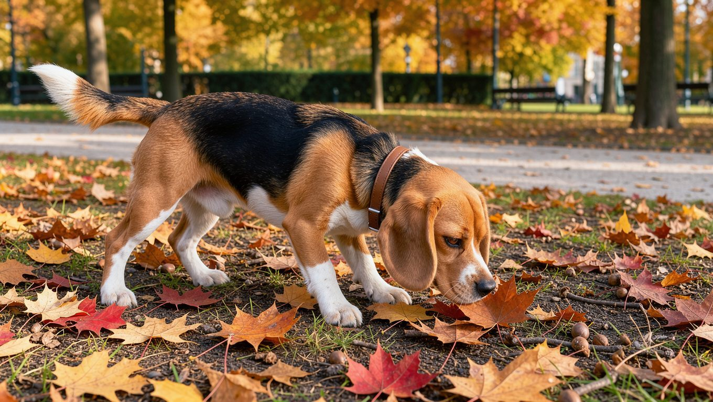
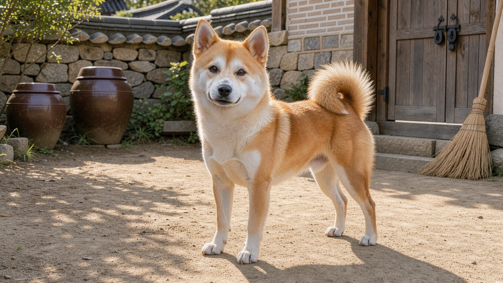
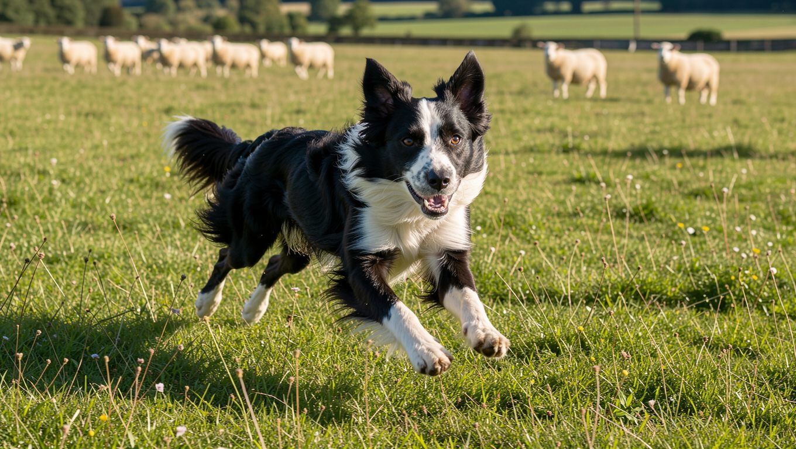
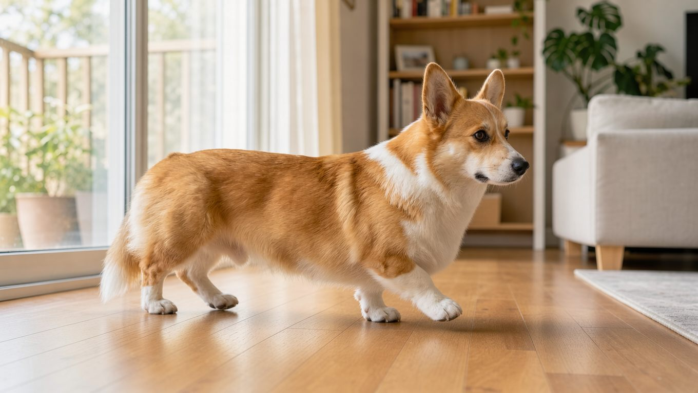
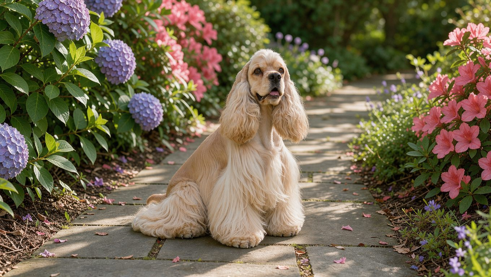
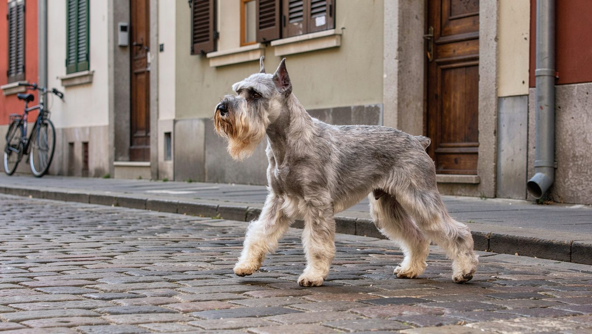
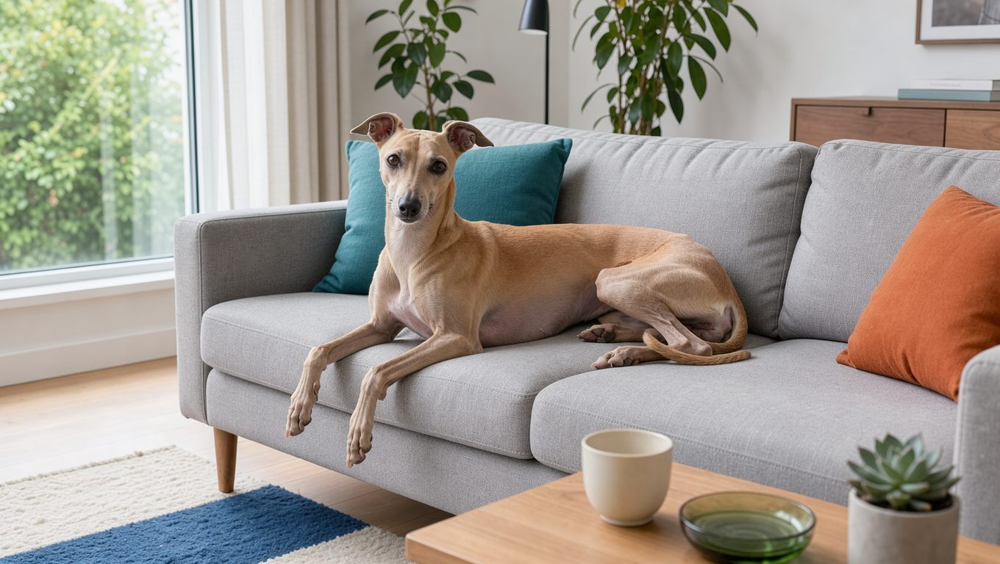
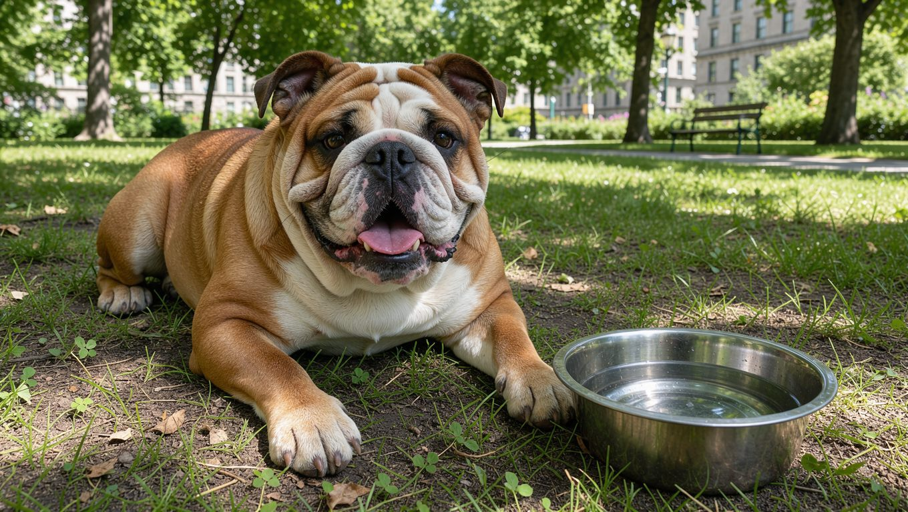
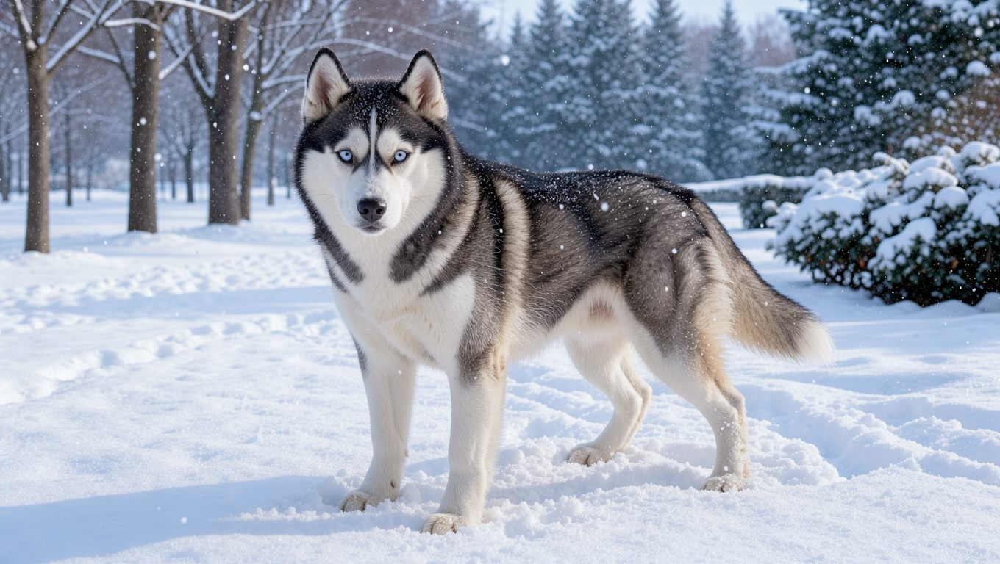
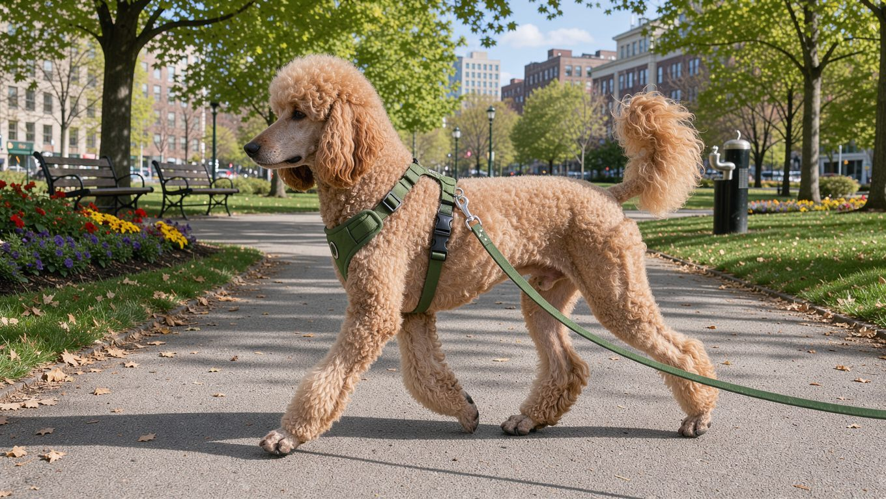

**2026년 11월 9일 기준**

## 빠른 답

**중형견은 어떤 견종을 말하나요?** 국립축산과학원은 성견 체중이 10kg 이상 25kg 미만인 개를 중형견으로 안내합니다. 중형견으로 자주 소개되는 대표 견종으로 비글, 진돗개, 보더콜리, 웰시코기, 코카 스패니얼, 스탠다드 슈나우저, 휘핏, 불독, 시베리안 허스키, 스탠다드 푸들을 꼽을 수 있습니다. 다만 견종별 체중 범위는 개체와 성별에 따라 달라지므로, 일부는 중형견 기준인 10~25kg을 벗어날 수 있습니다.

## 중형견 기준, 10kg과 25kg 사이

국립축산과학원은 반려견을 성견 체중으로 소형견 10kg 미만, 중형견 10kg 이상 25kg 미만, 대형견 25kg 이상으로 나눠 안내합니다. 이 구분은 사료 급여량과 백신 접종을 안내하기 위한 참고 정보이며, 품종을 나누는 공식 분류체계는 아니라고 밝힙니다(국립축산과학원).

American Kennel Club(AKC)은 견종을 크기별로 공식 분류하지 않고, 각 견종의 성견 체중 정보를 제공합니다(AKC). 같은 견종도 자료에 따라 소형견과 중형견, 중형견과 대형견 사이를 오갑니다. 소형견 8종은 [소형견 8종 도감](/guides/small-dog-types/)에서, 25kg 이상 대형견은 [대형견 10종 비교](/guides/large-dog-types/)에서 이어서 보실 수 있습니다.

## 중형견 10종 한눈에

체중은 성견 기준이고, 수명과 성격은 견종별 자료에 따라 차이가 있습니다.

<ul>
<li><strong>비글</strong> — 9~14kg, 수명 12~15년, 후각이 뛰어난 사냥개</li>
<li><strong>진돗개</strong> — 14~23kg, 수명 12~15년, 충성심이 강한 한국 토종견</li>
<li><strong>보더콜리</strong> — 14~25kg, 수명 12~15년, 운동량이 많은 목양견</li>
<li><strong>웰시코기</strong> — 11~14kg, 수명 12~15년, 짧은 다리의 목양견</li>
<li><strong>코카 스패니얼</strong> — 9~15kg, 수명 10~14년, 사람을 좋아하는 반려견</li>
<li><strong>스탠다드 슈나우저</strong> — 14~23kg, 수명 13~16년, 경계심이 강한 작업견</li>
<li><strong>휘핏</strong> — 11~18kg, 수명 12~15년, 조용한 시각 하운드</li>
<li><strong>불독</strong> — 18~23kg, 수명 8~10년, 차분한 반려견</li>
<li><strong>시베리안 허스키</strong> — 16~27kg, 수명 12~14년, 활동적인 스피츠</li>
<li><strong>스탠다드 푸들</strong> — 18~32kg, 수명 12~15년, 훈련 반응이 좋은 반려견</li>
</ul>

처음 반려견을 키운다면 사람과 함께하는 활동을 좋아하고 훈련에 잘 반응하는 견종을 고려해 볼 수 있습니다. 다만 비글은 짖음과 냄새 쫓기, 코카 스패니얼은 귀 관리, 스탠다드 푸들은 운동량과 미용 비용까지 충분히 고려해야 합니다. 보더콜리와 시베리안 허스키는 충분한 운동 시간을 확보하고 훈련에 익숙한 보호자에게 더 적합합니다.

## 중형견 10종 자세히 보기

### 1. 비글 — 뛰어난 후각을 지닌 사냥개

비글의 체중은 9~14kg으로, 중형견 분류 기준의 경계에 해당하는 견종입니다. 사냥개 출신이라 냄새를 쫓는 본능이 강하고, 사람을 좋아해 가족과 함께 있는 시간을 즐깁니다.

<dl>
<dt>체중</dt><dd>9~14kg</dd>
<dt>성격</dt><dd>밝고 호기심이 많습니다. 냄새에 몰입하면 보호자의 부름을 놓치기 쉽습니다.</dd>
<dt>운동</dt><dd>하루 1시간 안팎의 산책과 냄새 맡기 놀이가 어울립니다. 목줄을 놓으면 냄새를 따라 멀리 이동할 수 있어 안전한 울타리와 목줄이 필요합니다.</dd>
<dt>키울 때</dt><dd>하울링과 짖음이 잦을 수 있어 아파트에서는 소음 대비가 필요합니다. 먹성 좋은 편이라 체중 관리가 중요합니다.</dd>
</dl>

### 2. 진돗개 — 한국을 대표하는 토종견

진돗개의 체중은 수컷 18~23kg, 암컷 14~18kg 정도입니다. [진돗개 허브](/breeds/jindo/)에서 모색과 관리법을 더 자세히 볼 수 있습니다.

<dl>
<dt>체중</dt><dd>14~23kg</dd>
<dt>성격</dt><dd>충성심이 강하고 경계심이 있습니다. 가족에게는 다정하지만 낯선 사람과 다른 동물에게는 거리를 두는 편입니다.</dd>
<dt>운동</dt><dd>하루 1시간 이상의 산책이 필요합니다. 넓은 공간에서 뛰는 시간을 주 2~3회 더해 주면 좋습니다.</dd>
<dt>키울 때</dt><dd>털갈이철에 털 빠짐이 많고 짖음이 잦을 수 있습니다. 어린 시기부터 사람과 다른 개에게 익숙해지도록 사회화를 해 주셔야 합니다.</dd>
</dl>

### 3. 보더콜리 — 운동량과 지능을 함께 고려해야 하는 견종

보더콜리의 체중은 14~25kg으로, 중형견 분류 기준의 상한에 가까운 편입니다. 목양견 출신이라 일할 거리를 찾고, 집중력이 높습니다.

<dl>
<dt>체중</dt><dd>14~25kg</dd>
<dt>성격</dt><dd>지능이 높고 집중력이 좋습니다. 목양 본능이 강해 움직이는 자전거나 사람을 쫓으려는 습성이 있습니다.</dd>
<dt>운동</dt><dd>하루 1~2시간의 산책과 공놀이, 노즈워크 같은 정신적 자극이 필요합니다. 운동이 부족하면 파괴 행동이나 짖음으로 나타날 수 있습니다.</dd>
<dt>키울 때</dt><dd>초보 보호자에게는 운동량 부담이 큰 견종입니다. 아파트에서는 산책 시간을 넉넉히 잡고 실내 놀이를 함께 해 주셔야 합니다.</dd>
</dl>

### 4. 웰시코기 — 짧은 다리, 부지런한 목양견

펨브로크 웰시코기는 체중 11~14kg입니다. 다리가 짧아 실내에서 키우기 수월해 보이지만, 목양견 특유의 활동적인 성향을 지니고 있어 운동량이 적지 않습니다.

<dl>
<dt>체중</dt><dd>11~14kg (펨브로크 기준)</dd>
<dt>성격</dt><dd>밝고 자신감이 있으며 경계심이 있습니다. 사람이나 다른 개를 몰려는 행동이 나올 수 있습니다.</dd>
<dt>운동</dt><dd>하루 40분~1시간 산책이 필요합니다. 공놀이와 노즈워크를 더하면 만족도가 높아집니다.</dd>
<dt>키울 때</dt><dd>허리와 다리에 부담이 가지 않도록 높은 곳에서 뛰어내리거나 계단을 오르내리는 일을 줄여 주세요. 털 빠짐이 많고 짖음이 잦을 수 있습니다.</dd>
</dl>

### 5. 코카 스패니얼 — 사람과 함께하는 것을 좋아하는 반려견

한국에서 코카 스패니얼이라고 하면 일반적으로 아메리칸 코커 스패니얼을 가리킵니다. 체중은 9~14kg이고, 잉글리시 코커 스패니얼은 12~15kg 정도입니다.

<dl>
<dt>체중</dt><dd>9~14kg (아메리칸 코커 스패니얼)</dd>
<dt>성격</dt><dd>사람 곁에 머무는 것을 좋아하며 온순한 성격을 지닌 편입니다. 혼자 있는 시간이 길면 불안해할 수 있습니다.</dd>
<dt>운동</dt><dd>하루 40분~1시간 산책으로 충분한 편입니다. 냄새 맡기와 공놀이를 좋아해 함께 움직이면 더 만족합니다.</dd>
<dt>키울 때</dt><dd>긴 귀와 장모 관리가 필요합니다. 귀 안쪽을 자주 확인하고 빗질을 꾸준히 해 주세요. 목욕 뒤에는 귀에 물이 들어가지 않도록 말려 주셔야 합니다.</dd>
</dl>

### 6. 스탠다드 슈나우저 — 경계심과 장난기를 함께 가진 작업견

[스탠다드 슈나우저](/breeds/standard-schnauzer/)는 체중 14~23kg입니다. 털 빠짐이 적어 털갈이로 인한 부담은 비교적 적지만, 수염과 다리 털을 정기적으로 다듬어야 합니다.

<dl>
<dt>체중</dt><dd>14~23kg</dd>
<dt>성격</dt><dd>영리하고 장난기가 있습니다. 경계심이 강해 낯선 사람이 오면 알리는 습성이 있습니다.</dd>
<dt>운동</dt><dd>하루 1시간 안팎의 산책과 훈련 놀이가 어울립니다. 사람과 함께 머리를 쓰는 활동을 좋아합니다.</dd>
<dt>키울 때</dt><dd>전문 미용을 정기적으로 받으셔야 합니다. 수염과 다리 털이 엉키지 않도록 매일 조금씩 빗질해 주세요.</dd>
</dl>

### 7. 휘핏 — 실내에서는 차분하고 실외에서는 빠른 견종

휘핏의 체중은 11~18kg입니다. 실내에서는 얌전하게 지내지만, 야외에서는 순간적으로 빠르게 달리는 시각 하운드입니다.

<dl>
<dt>체중</dt><dd>11~18kg</dd>
<dt>성격</dt><dd>조용하고 온순합니다. 낯선 사람에게 짖는 일이 적은 편입니다.</dd>
<dt>운동</dt><dd>하루 1시간 정도 산책하고, 주 2~3회 안전하게 울타리가 설치된 공간에서 짧게 달릴 기회를 주세요. 시야에 들어온 작은 동물을 쫓을 수 있으므로 개방된 장소에서는 반드시 목줄을 착용해야 합니다.</dd>
<dt>키울 때</dt><dd>단모라 겨울철 보온이 필요합니다. 추위에 민감하므로 실내 온도와 산책복을 챙겨 주세요.</dd>
</dl>

### 8. 불독 — 차분하지만 더위에 약한 체형

불독의 체중은 18~23kg입니다. 활동량이 비교적 적고 가족에게 다정해 실내 생활에 잘 적응하는 편입니다.

성격과 건강 관리, 여름철 대비는 [불독 허브](/breeds/bulldog/)에서 더 자세히 다룹니다.

<dl>
<dt>체중</dt><dd>18~23kg</dd>
<dt>성격</dt><dd>차분하고 가족에게 다정합니다. 낯선 사람에게 먼저 다가가기보다 지켜보는 편입니다.</dd>
<dt>운동</dt><dd>짧은 산책을 하루 2~3회 나누는 편이 좋습니다. 숨이 차면 바로 쉬게 해 주세요.</dd>
<dt>키울 때</dt><dd>얼굴이 짧은 체형이라 무더위에 호흡이 힘들어질 수 있습니다. 한낮 산책을 피하고 그늘과 물을 챙겨 주세요. 피부 주름 사이를 청결하게 유지하는 것도 중요합니다.</dd>
</dl>

### 9. 시베리안 허스키 — 중형견과 대형견의 경계에 있는 스피츠

시베리안 허스키의 체중은 16~27kg으로, 중형견 분류 기준인 25kg을 초과하는 개체도 있습니다. 사교적이고 활동량이 많아 운동 시간을 넉넉히 낼 수 있는 보호자에게 맞습니다. 성격과 털갈이 관리법은 [시베리안 허스키 허브](/breeds/siberian-husky/)에 자세히 정리해 두었습니다.

<dl>
<dt>체중</dt><dd>16~27kg</dd>
<dt>성격</dt><dd>사교적이고 활발합니다. 독립심이 강해 부르는 데 바로 응하지 않을 수 있습니다.</dd>
<dt>운동</dt><dd>하루 1~2시간의 산책과 달리기, 노즈워크가 필요합니다. 운동이 부족하면 탈출 시도나 파괴 행동이 늘 수 있습니다.</dd>
<dt>키울 때</dt><dd>이중모라 털갈이철에 털 빠짐이 많습니다. 더위에 약한 편이라 여름철 산책 시간을 조절하고 냉방을 챙겨 주세요. 울타리와 목줄을 자주 점검해 주셔야 합니다.</dd>
</dl>

### 10. 스탠다드 푸들 — 훈련에 잘 반응하지만 정기적인 미용이 필요한 견종

스탠다드 푸들의 체중은 18~32kg으로, 중형견 분류 기준인 25kg을 초과하는 개체가 많습니다. 지능이 높고 사람과 함께하는 활동을 좋아해 훈련에도 적극적으로 반응하는 견종입니다.

<dl>
<dt>체중</dt><dd>18~32kg</dd>
<dt>성격</dt><dd>지능이 높고 사람을 좋아합니다. 훈련 반응이 좋아 처음 반려견을 키우는 보호자도 도전할 수 있습니다.</dd>
<dt>운동</dt><dd>하루 1시간 안팎의 산책과 공놀이가 어울립니다. 사람과 함께하는 활동을 즐깁니다.</dd>
<dt>키울 때</dt><dd>털이 계속 자라 정기 미용이 필요합니다. 미용 비용과 시간을 미리 계산해 두셔야 합니다.</dd>
</dl>

## 중형견 선택, 체중보다 생활 환경과 양육 조건이 중요합니다

중형견 10종은 같은 체급으로 분류되더라도 견종마다 생활 습관과 양육에 필요한 조건이 다릅니다. 집에 맞는 견종을 고를 때는 아래 네 가지를 먼저 확인해 보세요.

<dl>
<dt>주거 환경</dt><dd>아파트라면 짖음과 층간소음, 엘리베이터 동선을 확인해야 합니다. 진돗개와 웰시코기는 짖음이 잦을 수 있고, 보더콜리와 시베리안 허스키는 운동 공간이 필요합니다.</dd>
<dt>운동 시간</dt><dd>보더콜리와 시베리안 허스키는 하루 1~2시간의 운동 시간을 꾸준히 확보할 수 있는 보호자에게 적합합니다. 반면 불독과 휘핏은 짧은 산책을 여러 차례 나누어 진행하는 것이 좋습니다.</dd>
<dt>털 관리</dt><dd>진돗개, 웰시코기, 시베리안 허스키는 이중모라 털갈이철 관리가 필요합니다. 스탠다드 슈나우저와 스탠다드 푸들은 털이 잘 빠지지 않지만 정기 미용이 필요합니다. 휘핏과 불독은 단모라 빗질 부담이 적은 편입니다.</dd>
<dt>경험</dt><dd>처음 반려견을 키운다면 자신의 생활 패턴과 관리 여건에 맞는 견종을 선택하는 것이 중요합니다. 비글은 짖음과 후각 활동, 코카 스패니얼은 귀 관리, 스탠다드 푸들은 운동량과 정기적인 미용을 고려해야 합니다. 보더콜리와 시베리안 허스키는 충분한 운동과 꾸준한 훈련이 가능한 보호자에게 적합합니다.</dd>
</dl>

## 한국에서 중형견 키우기 — 여름철 관리와 아파트 생활

중형견은 대체로 소형견보다 운동량이 많지만, 대형견보다는 공간 부담이 적어 한국의 아파트 환경에서도 고려할 수 있는 견종이 다양합니다. 다만 여름 더위와 층간소음은 견종에 따라 대비가 다릅니다.

<ul>
<li><strong>불독</strong>처럼 얼굴이 짧은 견종은 습하고 더운 날 호흡이 힘들어질 수 있습니다. 한낮 산책을 피하고 에어컨과 물을 챙겨 주세요.</li>
<li><strong>시베리안 허스키, 진돗개, 웰시코기</strong>는 이중모를 지녀 털갈이철에 털 빠짐이 많으므로 꾸준한 관리가 필요합니다. 여름철 빗질과 목욕 주기를 조절해 주세요.</li>
<li><strong>보더콜리, 시베리안 허스키</strong>는 운동량이 많아 아파트에서는 산책 시간과 실내 놀이를 함께 계획해야 합니다.</li>
<li><strong>휘핏, 불독</strong>은 단모지만 추위와 더위에 각각 약한 편이라 실내 온도 관리가 필요합니다.</li>
</ul>

## 자주 묻는 질문

### 중형견과 대형견의 경계는 몇 kg인가요?

국립축산과학원의 분류 기준으로는 25kg입니다. 성견 체중이 25kg 이상이면 대형견으로 분류합니다. 다만 견종과 개체에 따라 체중 차이가 커서, 25kg을 넘어도 중형견으로 부르는 경우가 있습니다.

### 중형견 중 초보자가 키우기 쉬운 견종은?

초보자에게 무조건 적합한 중형견을 꼽기는 어렵습니다. 비글은 짖음과 냄새 쫓기, 코카 스패니얼은 귀 관리, 스탠다드 푸들은 운동량과 미용 비용을 고려해야 합니다. 견종의 성격뿐 아니라 보호자의 생활 패턴과 양육 경험에 맞춰 선택하는 것이 중요합니다.

### 중형견은 아파트에서 키울 수 있나요?

가능합니다. 다만 견종에 따라 짖음의 정도와 필요한 운동량이 다르므로 주거 환경에 맞춰 선택해야 합니다. 진돗개와 웰시코기는 짖음 관리가, 보더콜리와 시베리안 허스키는 산책 시간이 관건입니다. 입주 건물의 반려동물 규정과 엘리베이터 이용 규칙도 함께 확인해 보세요.

### 중형견 운동량은 하루 얼마나 되나요?

대부분 하루 1시간 안팎의 산책이 기본입니다. 보더콜리와 시베리안 허스키는 1~2시간, 불독과 휘핏은 짧은 산책을 여러 번 나누는 편이 좋습니다. 견종의 나이와 건강 상태에 따라 조절해 주세요.

### 중형견 중 털이 적게 빠지는 견종은?

스탠다드 슈나우저와 스탠다드 푸들은 털 빠짐이 적은 대신 정기적인 미용이 필요합니다. 휘핏과 불독은 단모라 빗질 부담이 적습니다. 반대로 진돗개, 웰시코기, 시베리안 허스키는 이중모라 털갈이철 관리가 필요합니다.

## 출처

- [국립축산과학원 — 반려동물 알기](https://www.nias.go.kr/companion/new_petBoard.do?cmCode=M170718155128718) (소형, 중형, 대형 견종의 체중 기준과 참고 정보 고지)
- [American Kennel Club — Breed Weight Chart](https://www.akc.org/expert-advice/nutrition/breed-weight-chart/) (견종별 성견 체중 참고표)

표지는 AI로 생성한 이미지입니다.
