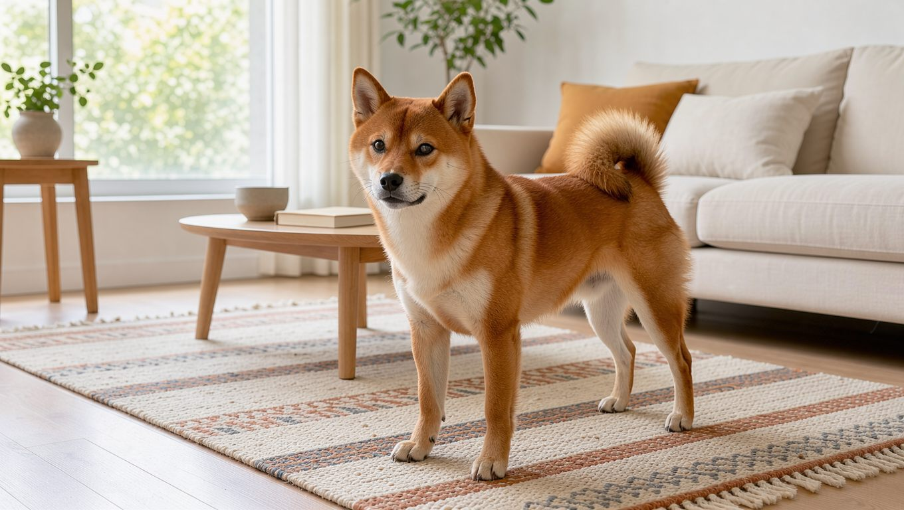
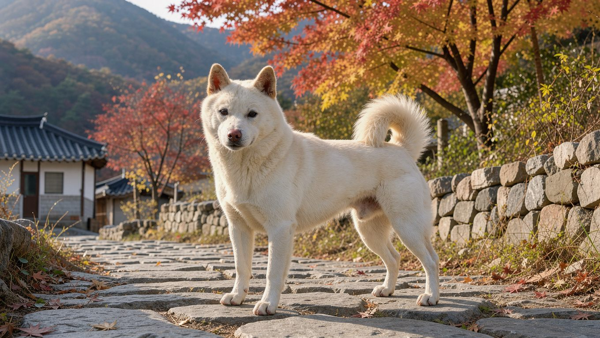

**2026년 11월 8일 기준**

시바견과 진돗개는 사진으로 보면 비슷합니다. 쐐기형 머리와 쫑긋한 귀, 등 위로 말린 꼬리, 두툼한 이중모까지 외형이 닮았습니다. 그러나 체격과 기질, 한국에서 차지하는 위치는 상당히 다릅니다. 두 견종을 같은 기준으로 놓고 비교해 보겠습니다.

## 빠른 답

**시바견과 진돗개 중 어느 쪽이 키우기 쉬운가요?**

시바견은 체구가 작고 상대적으로 관리 부담도 적습니다. 다만 둘 다 독립심이 강해 복종 훈련이 쉬운 편은 아니므로, 작은 체구를 원하면 시바견, 넉넉한 활동량을 충족해 주고 경계심과 수호 본능을 이해하며 함께 생활할 여유가 있다면 진돗개가 적합합니다.

## 한눈에 보는 차이

- **체급**: 시바견은 7.7~10.4kg의 소형견이며, 진돗개는 이보다 체구가 큰 중형견입니다.
- **기원**: 시바견은 일본에서 사냥견으로 길러졌으며, 진돗개는 한국 진도섬에서 유래한 토종견입니다.
- **기질**: 시바견은 독립적이고 자기주장이 강하며, 진돗개는 충성심과 경계심이 강합니다.
- **한국과 일본에서의 위치**: '진도의 진도개'는 천연기념물 제53호로 지정되어 있고, 시바견은 일본에서 가장 인기 있는 반려견으로 꼽힙니다.

## 시바견은 어떤 견종인가

시바견은 고대 일본의 사냥견에서 유래했으며, 작지만 근육질인 체형이 특징입니다. 지금은 일본에서 가장 인기 있는 반려견으로 꼽힙니다(AKC).

밝고 명랑한 성격이지만 독립심이 강하고 자기주장이 뚜렷합니다. 명령을 빠르게 익힐 만큼 영리하지만, 자신의 방식대로 행동하려는 성향도 강합니다. 사회화가 부족하면 낯선 사람에게 거리를 두는 경향이 있고, 스트레스나 좌절 상황에서는 '시바 스크림'이라 불리는 큰 소리를 내기도 합니다(PetMD).

운동량이 적은 편은 아닙니다. 신체 활동과 정신적 자극을 함께 제공해야 합니다. 냄새를 맡으며 걷는 산책과 공놀이, 노즈워크, 퍼즐 장난감 등을 활용하면 좋습니다. 운동이 부족하면 불안과 문제 행동으로 이어질 수 있습니다(PetMD).

털은 이중모라서 털갈이가 꾸준한 편이고, 1년에 한두 번 집중 환모기가 찾아옵니다. 환경 알레르기로 인해 피부와 귀에 염증이 반복될 수 있으며, 슬개골 탈구와 치주 질환, 불안 문제도 주의해야 합니다. 수명은 13~16년입니다(PetMD).

## 진돗개는 어떤 견종인가

진돗개는 한반도 남서쪽에 위치한 진도섬에서 유래한 중형견입니다. 충성심과 경계심이 강하고 영리한 견종으로, 독립적인 사냥견이자 수호견, 반려견으로서 역할을 해 왔습니다(AKC).

국가유산청은 '진도의 진도개'를 천연기념물 제53호로 지정해 보호하고 있습니다. 지정일은 1962년 12월 7일이고, 보호 대상은 진도군에서 사육 중인 표준품종 등록 개체 500마리입니다(국가유산청). 일상에서는 '진돗개'라는 표기가 흔하지만, 지정 명칭은 '진도개'입니다.

털은 시바견과 마찬가지로 이중모라서 환모기 털갈이를 관리해야 합니다. 사냥견의 기질이 남아 있어 냄새 맡기와 달리기에 흥미를 보이는 경우가 많습니다. 따라서 산책할 때 충분히 활동할 시간을 주는 것이 좋습니다. 수명과 모색, 관리법은 [진돗개 허브](/breeds/jindo/)에 정리해 두었습니다.

## 아파트에서 키운다면

시바견은 큰 소리를 내는 경우가 있어, 벽을 공유하는 공동주택에서는 양육에 주의가 필요하다는 지적이 있습니다(PetMD). 진돗개 역시 경계심이 강해 지나가는 사람이나 주변 소리에 민감하게 반응할 수 있습니다.

**딱지허브 평가**: 출처 기준은 소음 때문에 공동주택 양육을 조심하라는 쪽입니다(PetMD). 국내 아파트에서도 체구가 작고 평소에는 비교적 조용한 시바견과 함께 생활하는 가구가 적지 않습니다. 다만 시바 스크림과 털갈이에 대해서는 미리 대비해야 합니다. 이웃과 벽을 공유한다면 [시바 아파트 키우기](/breeds/shiba-inu-apartment/)의 준비 목록부터 확인해 보세요.

## 어떤 보호자에게 맞나

- **시바견**: 체구가 작아 생활 공간에 대한 부담이 적고, 관리해야 할 사항도 비교적 명확합니다. 다만 독립심과 큰 소리를 감당할 수 있어야 하고, 매일 정신적 자극을 줄 시간을 내야 합니다.
- **진돗개**: 중형견이 편안하게 생활할 수 있는 공간과 충분한 산책 시간이 필요합니다. 경계심을 단순한 문제 행동이 아닌 견종 고유의 기질로 이해하고, 사회화와 짖음 관리를 꾸준히 해 줄 수 있는 보호자에게 적합합니다.
- **둘 다**: 스피츠형 특유의 독립심을 존중해야 합니다. 복종 훈련에만 집중하기보다 사회화 교육과 일관된 생활 규칙을 먼저 정하는 것이 현실적입니다.

## 자주 묻는 질문

### 시바견과 진돗개는 같은 계열인가요?

두 견종 모두 직립한 귀와 말린 꼬리, 이중모를 가진 스피츠형 견종으로 외모가 비슷합니다. 그러나 시바견은 일본, 진돗개는 한국 진도섬에서 각각 발전한 별개 견종입니다. 두 견종 모두 사냥견의 기원을 지니고 있습니다(AKC).

### 체급은 어느 정도 차이가 나나요?

시바견은 7.7~10.4kg인 반면, 진돗개는 중형견에 해당해 체급 차이가 뚜렷합니다. 같은 스피츠형이라도 체구가 다르므로, 산책 공간과 이동 방법을 다르게 준비해야 합니다.

### 진돗개는 천연기념물인가요?

네. 국가유산청이 '진도의 진도개'를 천연기념물 제53호로 지정해 보호하고 있습니다. 지정일은 1962년 12월 7일이며, 진도군에서 사육 중인 표준품종 등록 개체가 대상입니다.

### 시바 스크림은 무엇인가요?

시바견이 스트레스를 받거나 뜻대로 되지 않을 때 내는 큰 소리입니다. 소리가 큰 편이므로 이웃과 벽을 공유하는 공동주택에서는 이에 대비하는 것이 좋습니다.

### 초보 보호자에게는 어느 쪽이 맞나요?

체구와 전반적인 관리 부담을 고려하면 시바견이 상대적으로 수월합니다. 그러나 두 견종 모두 독립심이 강해 복종 훈련이 쉽지 않으므로, 처음 키운다면 사회화와 운동 계획을 먼저 세우는 것이 좋습니다.

## 출처

- [Shiba Inu — PetMD](https://www.petmd.com/dog/breeds/shiba-inu) (체중·수명·성격·운동·털갈이·건강)
- [Korean Jindo Dog — American Kennel Club](https://www.akc.org/dog-breeds/korean-jindo-dog/) (기원·기질·체급 분류)
- [Shiba Inu — American Kennel Club](https://www.akc.org/dog-breeds/shiba-inu/) (기원과 일본 내 인기)
- [천연기념물 진도의 진도개 — 국가유산청 국가유산포털](https://www.heritage.go.kr/heri/cul/culSelectDetail.do?VdkVgwKey=16,0000530000000,36&pageNo=1_1_1_0) (지정 번호·지정일·등록 개체)

표지 이미지는 AI로 생성했습니다.
